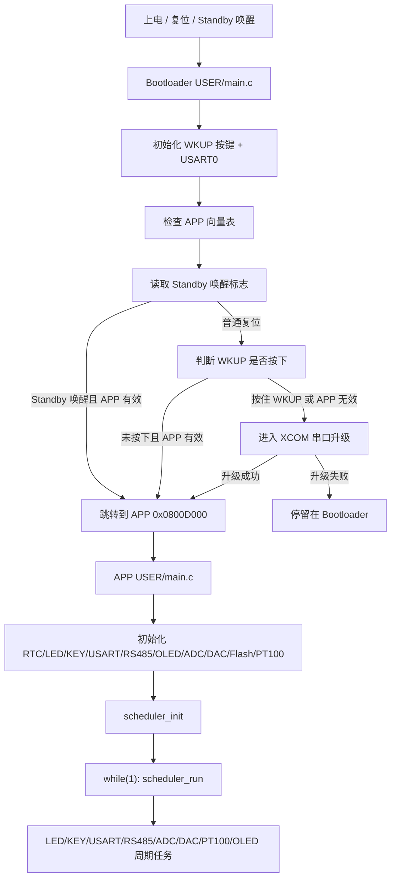
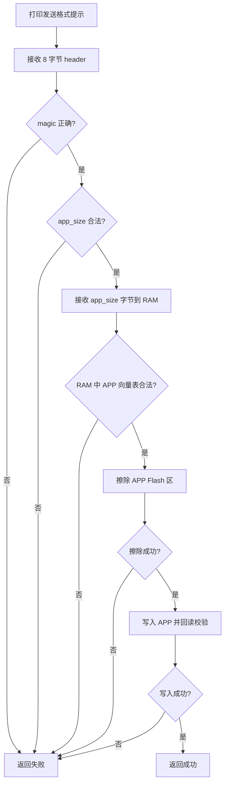
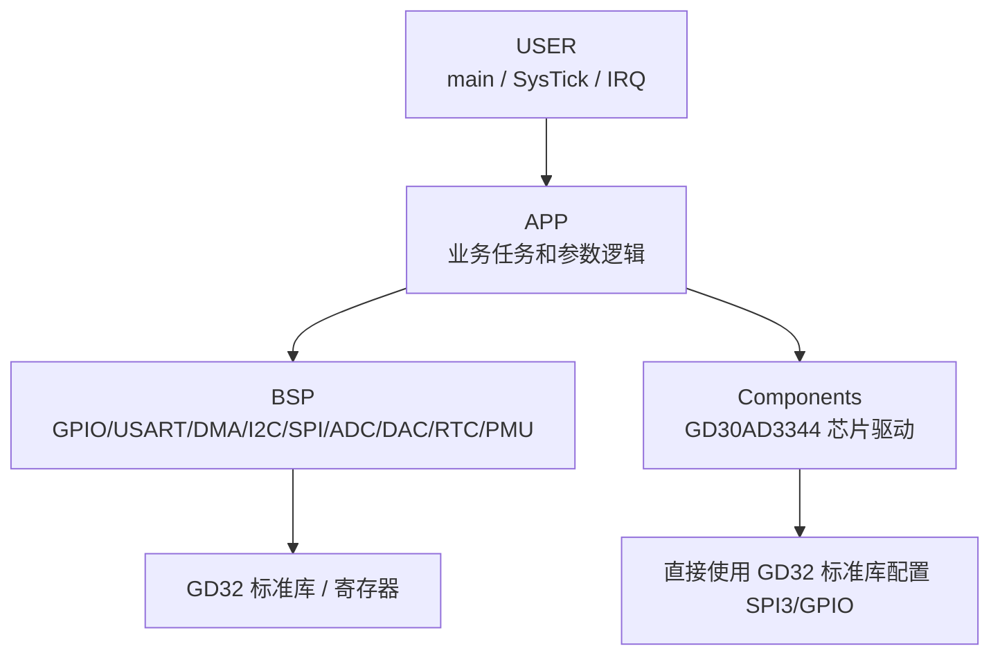
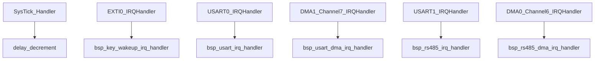
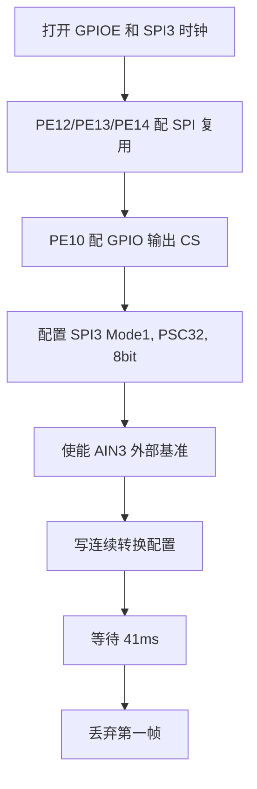
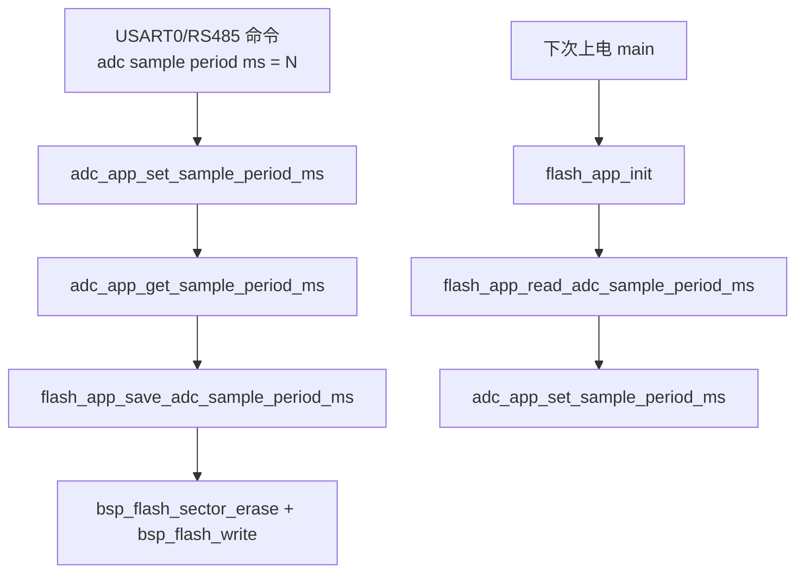
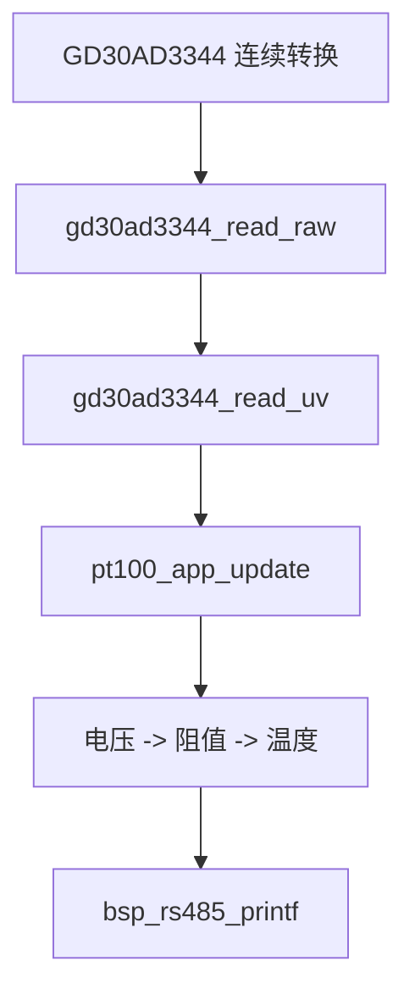
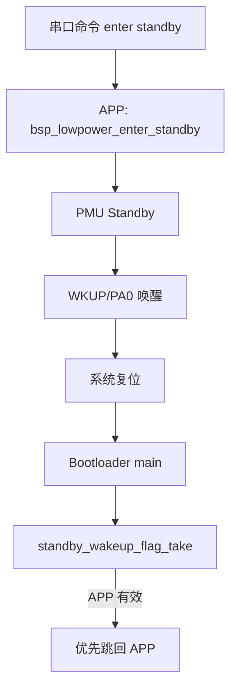

# GD32F470 APP 与 Bootloader 代码讲解

> 本文面向当前工程：`GD32F470_SIMENZ_CUP` 和 `GD32F470_Bootloader`。  
> 阅读范围只包含本项目自己维护的 `USER`、`APP`、`BSP`、`Components`、`BOOTLOADER` 代码。  
> 不讲标准库、CMSIS、Keil 输出目录、参考资料和别人的模板代码。

## 0. 阅读方法

这个工程不是一个“从 `main.c` 往下随便调函数”的小模板，而是两个固件配合工作：

- <span style="color:#dc2626"><b>Bootloader 工程</b></span>：负责上电后的第一判断、串口升级、跳转 APP。
- <span style="color:#16a34a"><b>APP 工程</b></span>：负责比赛功能，包含调度器、串口命令、ADC/DAC、OLED、RTC、外部 Flash、PT100/GD30AD3344、低功耗。

从一个软件工程师写代码的自然顺序看，通常会先定：

1. Flash 地址怎么分。
2. 上电先跑谁。
3. Bootloader 怎么判断 APP 是否能跑。
4. APP 跑起来后如何初始化硬件。
5. 主循环如何避免一堆阻塞延时。
6. 各业务模块如何通过 BSP 操作外设。
7. 传感器、参数保存、低功耗、升级这些功能如何互相衔接。

本文就按这个顺序讲。

颜色约定：

- <span style="color:#dc2626"><b>红色</b></span>：Bootloader、复位、升级、跳转。
- <span style="color:#2563eb"><b>蓝色</b></span>：BSP，和寄存器/外设直接打交道。
- <span style="color:#16a34a"><b>绿色</b></span>：APP 业务层。
- <span style="color:#9333ea"><b>紫色</b></span>：设计原因，也就是“为什么这样写”。
- <span style="color:#d97706"><b>橙色</b></span>：调试风险点。

---

## 1. 总体运行流程

整套固件的启动关系可以先看这张图：



这张图里最重要的是两点：

1. <span style="color:#dc2626"><b>Bootloader 永远先跑</b></span>，APP 并不是复位后直接从 `main.c` 开始。
2. <span style="color:#16a34a"><b>APP 不使用 RTOS</b></span>，而是靠 `SysTick + scheduler` 做轻量周期调度。

---

## 2. Flash 与 RAM 分区

文件：`GD32F470_Bootloader/BOOTLOADER/bl_partition.h`

```c
#define BL_BOOT_START_ADDR      ((uint32_t)0x08000000U)
#define BL_BOOT_SIZE            ((uint32_t)0x0000C000U)

#define BL_PARAM_START_ADDR     ((uint32_t)0x0800C000U)
#define BL_PARAM_SIZE           ((uint32_t)0x00001000U)

#define BL_APP1_START_ADDR      ((uint32_t)0x0800D000U)
#define BL_APP1_SIZE            ((uint32_t)0x00038000U)
#define BL_APP1_END_ADDR        (BL_APP1_START_ADDR + BL_APP1_SIZE)

#define BL_FLASH_END_ADDR       ((uint32_t)0x08080000U)
#define BL_SRAM_START_ADDR      ((uint32_t)0x20000000U)
#define BL_SRAM_END_ADDR        ((uint32_t)0x20030000U)
```

逐句理解：

| 代码 | 含义 | 为什么这样写 |
| --- | --- | --- |
| `BL_BOOT_START_ADDR = 0x08000000` | 片内 Flash 起点，也是 MCU 复位后取向量表的位置 | Bootloader 必须放在最前面，否则复位后不会先进 Bootloader |
| `BL_BOOT_SIZE = 0x0000C000` | Bootloader 区大小为 48KB | 给升级、串口、Flash 写入逻辑留空间 |
| `BL_PARAM_START_ADDR = 0x0800C000` | 预留参数区 | 当前 Bootloader 升级流程暂不重点使用，但地址规划上留出 |
| `BL_APP1_START_ADDR = 0x0800D000` | APP 起始地址 | APP 的 Keil IROM 起始地址必须和这里一致 |
| `BL_APP1_SIZE = 0x00038000` | APP 区大小 | Bootloader 写 APP 时不能越过这个范围 |
| `BL_FLASH_END_ADDR = 0x08080000` | 512KB 片内 Flash 结束地址 | 用于边界认知 |
| `BL_SRAM_START_ADDR / END` | SRAM 有效范围 | Bootloader 判断 APP 向量表里的初始栈指针是否可信 |

对应关系：


<span style="color:#9333ea"><b>为什么要检查 SRAM 范围？</b></span>  
Cortex-M 的向量表第 1 个字是初始 MSP，也就是程序一启动时的栈顶地址。如果发错文件，文件头前 4 字节大概率不是 `0x200xxxxx` 这种 SRAM 地址。Bootloader 用这个判断挡住一部分错误文件。

---

## 3. Bootloader 工程

Bootloader 工程只做三件事：

1. 判断是否能跳 APP。
2. 判断是否进入升级。
3. 用 USART0 接收升级文件并写入 APP 区。

### 3.1 Bootloader 的 BSP 层

Bootloader 里的 BSP 很克制，只有 `bsp_key` 和 `bsp_usart`。

#### 3.1.1 `BSP/bsp_key.c`

Bootloader 不需要 KEY1~KEY6，也不需要按键消抖。它只关心 WKUP/PA0 当前是不是被按住。

```c
void bsp_key_init(void)
{
    rcu_periph_clock_enable(KEYW_GPIO_CLK);
    gpio_mode_set(KEYW_GPIO_PORT, GPIO_MODE_INPUT, GPIO_PUPD_PULLUP, KEYW_GPIO_PIN);
}
```

逐句理解：

| 代码 | 做了什么 | 和后续代码的关系 |
| --- | --- | --- |
| `rcu_periph_clock_enable(KEYW_GPIO_CLK)` | 打开 GPIOA 时钟 | 不开 GPIO 时钟就读不到 PA0 电平 |
| `gpio_mode_set(... GPIO_MODE_INPUT, GPIO_PUPD_PULLUP, ...)` | 把 PA0 配成上拉输入 | WKUP 空闲为高电平，按下为低电平 |

```c
uint8_t bsp_key_is_pressed(bsp_key_id_t key_id)
{
    if (key_id != BSP_KEY_WKUP)
    {
        return 0U;
    }

    return (gpio_input_bit_get(KEYW_GPIO_PORT, KEYW_GPIO_PIN) == RESET) ? 1U : 0U;
}
```

逐句理解：

| 代码 | 做了什么 | 为什么 |
| --- | --- | --- |
| `if (key_id != BSP_KEY_WKUP)` | 非 WKUP 一律返回未按下 | Bootloader 不暴露无用按键 |
| `gpio_input_bit_get(...) == RESET` | 读取 PA0 是否为低电平 | 上拉输入下，按下就是低 |
| `? 1U : 0U` | 转成清晰的布尔语义 | 上层 `main.c` 只需要判断按没按 |

#### 3.1.2 `BSP/bsp_usart.c`

Bootloader 使用 USART0，PA9/PA10，115200-8-N-1。这里不用 DMA，不用中断，全部轮询。

<span style="color:#9333ea"><b>为什么 Bootloader 不用 DMA？</b></span>  
Bootloader 阶段任务非常单一，只在升级模式里等 XCOM 发文件。轮询更简单、状态更少、跳 APP 前更容易清理现场。

`bsp_usart_init()`：

```c
void bsp_usart_init(void)
{
    bsp_usart0_init();
}
```

这是一个很薄的封装。它让外部只知道“初始化 Bootloader 串口”，不需要知道底层具体是 USART0。

`bsp_usart_read_byte()`：

```c
uint8_t bsp_usart_read_byte(uint8_t *data)
{
    if (data == 0)
    {
        return 0U;
    }

    if (usart_flag_get(DEBUG_USART, USART_FLAG_RBNE) == RESET)
    {
        return 0U;
    }

    *data = (uint8_t)usart_data_receive(DEBUG_USART);
    return 1U;
}
```

逐句理解：

| 代码 | 含义 | 为什么 |
| --- | --- | --- |
| `if (data == 0)` | 保护空指针 | 防止调用者传错地址 |
| `USART_FLAG_RBNE` | Receive Buffer Not Empty，接收缓冲非空 | 没收到数据就立即返回 0，不在 BSP 内死等 |
| `usart_data_receive` | 读出一个字节 | 读 DATA 同时也会推进硬件接收状态 |
| `return 1U` | 表示确实读到了数据 | `bl_update.c` 再决定要不要阻塞等 |

`bsp_usart_printf()` 用 `vsnprintf()` 先格式化到局部数组，再一个字符一个字符通过 `usart_send_char()` 发出去。Bootloader 的日志量很少，这样够用。

`bsp_usart_wait_tx_done()`：

```c
while (usart_flag_get(DEBUG_USART, USART_FLAG_TC) == RESET)
{
}
```

`TC` 表示最后一个停止位也真正发完。跳 APP 前等它，是为了避免最后一行 `[BL] jump to APP` 还没发完就切换向量表和栈。

---

### 3.2 Bootloader 入口：`USER/main.c`

这是 Bootloader 的核心决策文件。

#### 3.2.1 函数指针类型

```c
typedef void (*app_entry_t)(void);
```

它的意思是：`app_entry_t` 是一个“无参数、无返回值的函数指针类型”。  
APP 的 Reset_Handler 本质上就是一个函数入口地址，所以 Bootloader 读出向量表第 2 个字后，要把它转成这种函数指针再调用。

#### 3.2.2 检查 APP 初始栈指针

```c
static uint8_t stack_addr_is_valid(uint32_t stack_addr)
{
    return (stack_addr > BL_SRAM_START_ADDR) &&
           (stack_addr <= BL_SRAM_END_ADDR) &&
           ((stack_addr & 0x7U) == 0U);
}
```

逐句理解：

| 判断 | 含义 | 原因 |
| --- | --- | --- |
| `stack_addr > BL_SRAM_START_ADDR` | 栈顶要落在 SRAM 内部 | 栈不可能在 Flash 或乱地址 |
| `stack_addr <= BL_SRAM_END_ADDR` | 不超过 SRAM 结束地址 | 防止越界 |
| `(stack_addr & 0x7U) == 0U` | 8 字节对齐 | Cortex-M ABI 通常要求栈 8 字节对齐 |

这个函数不是证明 APP 绝对正确，只是做基本可信度判断。

#### 3.2.3 检查 APP Reset_Handler

```c
static uint8_t reset_addr_is_valid(uint32_t reset_addr)
{
    uint32_t code_addr;

    code_addr = reset_addr & (~(uint32_t)0x1U);

    return (code_addr >= BL_APP1_START_ADDR) &&
           (code_addr < BL_APP1_END_ADDR) &&
           ((reset_addr & 0x1U) != 0U);
}
```

逐句理解：

| 代码 | 做了什么 | 为什么 |
| --- | --- | --- |
| `code_addr = reset_addr & ~0x1U` | 去掉函数地址最低位 | Cortex-M 函数指针最低位表示 Thumb 状态，不是实际地址位 |
| `code_addr >= BL_APP1_START_ADDR` | Reset_Handler 必须在 APP 区内 | 防止跳到 Bootloader 或其它区域 |
| `code_addr < BL_APP1_END_ADDR` | 不能超出 APP 分区 | 防止跳飞 |
| `(reset_addr & 0x1U) != 0U` | 函数入口最低位必须为 1 | Cortex-M 只运行 Thumb 指令 |

<span style="color:#9333ea"><b>这就是为什么普通 bin 文件必须从 APP 起始地址编出来。</b></span>  
如果 APP 的链接地址不是 `0x0800D000`，Reset_Handler 可能不在这个范围内，Bootloader 就会判无效。

#### 3.2.4 判断 APP 镜像是否有效

```c
static uint8_t app_image_is_valid(uint32_t app_addr)
{
    uint32_t stack_addr;
    uint32_t reset_addr;

    stack_addr = *(volatile uint32_t *)app_addr;
    reset_addr = *(volatile uint32_t *)(app_addr + 4U);

    return stack_addr_is_valid(stack_addr) &&
           reset_addr_is_valid(reset_addr);
}
```

逐句理解：

| 代码 | 含义 | 和前后文关系 |
| --- | --- | --- |
| `stack_addr = *(volatile uint32_t *)app_addr` | 读取 APP 向量表第 1 个字 | 这是 APP 初始 MSP |
| `reset_addr = *(volatile uint32_t *)(app_addr + 4U)` | 读取 APP 向量表第 2 个字 | 这是 APP Reset_Handler |
| `volatile` | 告诉编译器这是直接读固定内存 | 防止被过度优化 |
| 两个检查函数相与 | 栈和入口都可信才算 APP 有效 | 避免只看一个字段误判 |

#### 3.2.5 读取并清除 Standby 标志

```c
static uint8_t standby_wakeup_flag_take(void)
{
    rcu_periph_clock_enable(RCU_PMU);

    if ((PMU_CS & PMU_CS_STBF) == 0U)
    {
        return 0U;
    }

    PMU_CTL |= PMU_CTL_STBRST;
    PMU_CTL |= PMU_CTL_WURST;
    return 1U;
}
```

逐句理解：

| 代码 | 含义 | 为什么 |
| --- | --- | --- |
| `rcu_periph_clock_enable(RCU_PMU)` | 打开 PMU 时钟 | 不打开就不能可靠访问 PMU 状态 |
| `PMU_CS & PMU_CS_STBF` | 检查是否从 Standby 唤醒 | Standby 唤醒不是从函数后继续跑，而是复位重启 |
| `return 0U` | 没有 Standby 标志 | 按普通上电/复位处理 |
| `PMU_CTL |= PMU_CTL_STBRST` | 清 Standby 标志 | 避免下次误判 |
| `PMU_CTL |= PMU_CTL_WURST` | 清 Wakeup 标志 | 避免残留唤醒状态 |
| `return 1U` | 告诉 main 本次来自 Standby | main 会优先跳回 APP |

<span style="color:#9333ea"><b>这里是低功耗和 Bootloader 的连接点。</b></span>  
APP 调用 `bsp_lowpower_enter_standby()` 后，唤醒会重新进入 Bootloader。如果此时用户手还按着 WKUP，Bootloader 很容易误以为“按住 WKUP 要升级”。所以代码先判断 Standby 标志，只要 APP 有效就优先回 APP。

#### 3.2.6 跳转到 APP

```c
static void boot_jump_to_app(uint32_t app_addr)
{
    uint32_t app_stack;
    uint32_t app_reset;
    app_entry_t app_entry;
    uint32_t i;

    app_stack = *(volatile uint32_t *)app_addr;
    app_reset = *(volatile uint32_t *)(app_addr + 4U);
    app_entry = (app_entry_t)app_reset;

    __disable_irq();

    SysTick->CTRL = 0U;
    SysTick->LOAD = 0U;
    SysTick->VAL = 0U;

    for (i = 0U; i < 8U; i++)
    {
        NVIC->ICER[i] = 0xFFFFFFFFU;
        NVIC->ICPR[i] = 0xFFFFFFFFU;
    }

    SCB->VTOR = app_addr;
    __set_MSP(app_stack);
    __DSB();
    __ISB();

    __enable_irq();

    app_entry();
}
```

逐句理解：

| 代码 | 做了什么 | 为什么必须做 |
| --- | --- | --- |
| `app_stack = *(...)app_addr` | 取 APP 初始栈顶 | APP 运行前必须使用自己的栈 |
| `app_reset = *(...)(app_addr + 4U)` | 取 APP 入口 | 程序真正要跳到这里 |
| `app_entry = (app_entry_t)app_reset` | 把地址转成函数指针 | C 语言里调用入口需要函数指针 |
| `__disable_irq()` | 暂停中断 | 防止切换现场时被 Bootloader 中断打断 |
| 清 `SysTick` | 停止 Bootloader 可能留下的节拍 | APP 会自己重新配置 SysTick |
| 清 `NVIC->ICER/ICPR` | 关闭并清除所有外设中断挂起 | 防止跳入 APP 后先响应 Bootloader 的旧中断 |
| `SCB->VTOR = app_addr` | 向量表切到 APP 起始地址 | APP 的中断入口不在 `0x08000000`，而在 `0x0800D000` |
| `__set_MSP(app_stack)` | 设置主栈指针 | 让 APP 的局部变量、中断入栈都用 APP 栈 |
| `__DSB(); __ISB();` | 数据/指令同步屏障 | 确保寄存器切换对 CPU 生效 |
| `__enable_irq()` | 恢复中断 | APP 接管后可以正常响应中断 |
| `app_entry()` | 调用 APP Reset_Handler | 从这里进入 APP 启动流程 |

#### 3.2.7 Bootloader `main()`

```c
int main(void)
{
    uint8_t app_valid;

    bsp_key_init();
    bsp_usart_init();

    app_valid = app_image_is_valid(BL_APP1_START_ADDR);

    if ((standby_wakeup_flag_take() != 0U) && (app_valid != 0U))
    {
        boot_jump_to_app(BL_APP1_START_ADDR);
    }

    if ((bsp_key_is_pressed(BSP_KEY_WKUP) == 0U) && (app_valid != 0U))
    {
        boot_jump_to_app(BL_APP1_START_ADDR);
    }

    bsp_usart_printf("[BL] update mode\r\n");

    if (bl_update_run() != 0U)
    {
        bsp_usart_printf("[BL] jump to APP\r\n");
        bsp_usart_wait_tx_done();
        boot_jump_to_app(BL_APP1_START_ADDR);
    }

    bsp_usart_printf("[BL] update wrong, stay in Bootloader\r\n");

    while (1)
    {
    }
}
```

逐句理解：

| 代码 | 做了什么 | 工程意图 |
| --- | --- | --- |
| `uint8_t app_valid` | 保存 APP 是否有效 | 避免重复读向量表 |
| `bsp_key_init()` | 初始化 WKUP | 后面判断是否按住升级 |
| `bsp_usart_init()` | 初始化 USART0 | 升级和日志都靠它 |
| `app_image_is_valid(...)` | 检查 APP 向量表 | 只有 APP 有效才跳 |
| 第一段 `if Standby` | Standby 唤醒优先回 APP | 避免 WKUP 长按误进升级 |
| 第二段 `if WKUP 未按下` | 正常启动路径 | 没按升级键就跑 APP |
| `"[BL] update mode"` | 打印进入升级模式 | 提醒 XCOM 可以发文件 |
| `bl_update_run()` | 执行升级流程 | 收文件、校验、擦写 |
| 升级成功后 `wait_tx_done()` | 等日志发完 | 跳 APP 前保住最后提示 |
| 升级失败后 `while(1)` | 停在 Bootloader | 防止跳到不可信 APP |

---

### 3.3 Bootloader 升级：`BOOTLOADER/bl_update.c`

升级文件格式是：

```text
magic    4 bytes big-endian, 固定 0x5AA5C33C
app_size 4 bytes big-endian, 原始 APP bin 字节数
app.bin  原始 APP 二进制内容
```

APP 工程的 `MDK/make_update_bin.py` 负责生成这个文件。

#### 3.3.1 升级文件头

```c
#define BL_UPDATE_MAGIC              ((uint32_t)0x5AA5C33C)
#define BL_UPDATE_HEADER_SIZE        8U
#define BL_UPDATE_VECTOR_SIZE        8U
#define BL_UPDATE_APP_BUFFER_SIZE    (96U * 1024U)
```

逐句理解：

| 宏 | 含义 | 设计原因 |
| --- | --- | --- |
| `BL_UPDATE_MAGIC` | 魔术字 | 防止用户把普通 bin 或其它文件误发给 Bootloader |
| `HEADER_SIZE = 8` | 头部 8 字节 | 4 字节 magic + 4 字节 app_size |
| `VECTOR_SIZE = 8` | APP 向量表最少 8 字节 | 至少要有 MSP 和 Reset_Handler |
| `APP_BUFFER_SIZE = 96KB` | RAM 接收上限 | XCOM 普通发送没有握手暂停，所以先完整接收到 RAM |

<span style="color:#d97706"><b>注意：</b></span>当前方案没有 CRC32。它保持简单，但串口传输损坏只能靠 magic、长度、向量表检查挡住一部分。

#### 3.3.2 大端和小端读取

```c
static uint32_t read_be32(const uint8_t *data)
{
    return ((uint32_t)data[0] << 24) |
           ((uint32_t)data[1] << 16) |
           ((uint32_t)data[2] << 8) |
           ((uint32_t)data[3]);
}
```

文件头规定用大端，所以第 0 个字节是最高位。  
例如 magic `0x5AA5C33C` 在文件里依次是 `5A A5 C3 3C`。

```c
static uint32_t read_le32(const uint8_t *data)
{
    return ((uint32_t)data[0]) |
           ((uint32_t)data[1] << 8) |
           ((uint32_t)data[2] << 16) |
           ((uint32_t)data[3] << 24);
}
```

Cortex-M 的向量表存在 Flash 中是小端，所以 APP 的 MSP 和 Reset_Handler 要按小端解析。

#### 3.3.3 接收字节

```c
static void usart_wait_byte(uint8_t *data)
{
    while (bsp_usart_read_byte(data) == 0U)
    {
    }
}
```

这段代码故意阻塞。进入升级模式后，Bootloader 没有其它任务要调度，它就是等 XCOM 发文件。

```c
static void receive_bytes(uint8_t *buf, uint32_t len)
{
    uint32_t i;

    for (i = 0U; i < len; i++)
    {
        usart_wait_byte(&buf[i]);
    }
}
```

逐字节接收固定长度数据。  
这里没有超时，意味着如果开始升级但文件没发完，Bootloader 会一直等。

#### 3.3.4 接收并解析头部

```c
static void receive_header(bl_update_header_t *header)
{
    uint8_t raw[BL_UPDATE_HEADER_SIZE];

    receive_bytes(raw, BL_UPDATE_HEADER_SIZE);

    header->magic = read_be32(&raw[0]);
    header->app_size = read_be32(&raw[4]);
}
```

逐句理解：

| 代码 | 做了什么 |
| --- | --- |
| `uint8_t raw[8]` | 临时保存 8 字节头 |
| `receive_bytes(raw, 8)` | 从 USART0 收满头部 |
| `read_be32(&raw[0])` | 前 4 字节转 magic |
| `read_be32(&raw[4])` | 后 4 字节转 app_size |

#### 3.3.5 检查 APP 大小

```c
static uint8_t app_size_is_valid(uint32_t app_size)
{
    return (app_size >= BL_UPDATE_VECTOR_SIZE) &&
           (app_size <= BL_UPDATE_APP_BUFFER_SIZE) &&
           (app_size <= BL_APP1_SIZE);
}
```

三个条件分别对应：

1. 太小肯定不是 APP，因为连向量表前 8 字节都没有。
2. 不能超过 96KB RAM 缓冲。
3. 不能超过 APP Flash 分区。

#### 3.3.6 校验接收到的 APP 向量表

`received_app_is_valid()` 做的事情和 Bootloader `main.c` 里的 `app_image_is_valid()` 类似，只不过它检查的是 RAM 中刚收到的新 APP。

```c
stack_addr = read_le32(&app_buf[0]);
reset_addr = read_le32(&app_buf[4]);
```

这里必须用小端，因为 APP bin 内的向量表就是 Cortex-M 小端格式。

<span style="color:#9333ea"><b>为什么在擦 Flash 之前检查？</b></span>  
这是当前升级设计里最关键的保护：如果用户发错文件，Bootloader 会在 RAM 里发现向量表不可信，然后直接返回失败，不会先把旧 APP 擦掉。

#### 3.3.7 擦除 APP 区

```c
static uint8_t app_flash_erase(void)
{
    uint32_t addr;

    fmc_unlock();
    flash_flags_clear();

    for (addr = BL_APP1_START_ADDR; addr < BL_APP1_END_ADDR; addr += BL_UPDATE_FLASH_PAGE_SIZE)
    {
        if (fmc_page_erase(addr) != FMC_READY)
        {
            fmc_lock();
            return 0U;
        }

        flash_flags_clear();
    }

    fmc_lock();
    return 1U;
}
```

逐句理解：

| 代码 | 做了什么 | 为什么 |
| --- | --- | --- |
| `fmc_unlock()` | 解锁片内 Flash 控制器 | 不解锁不能擦写 |
| `flash_flags_clear()` | 清旧状态标志 | 防止历史错误标志影响本次操作 |
| `for addr ... += 0x1000` | 按 4KB 页擦 APP 区 | GD32F470 对应页擦粒度 |
| `fmc_page_erase(addr)` | 擦当前页 | Flash 写前必须擦 |
| 失败时 `fmc_lock(); return 0` | 立刻锁回并报错 | 防止继续写坏 |
| 成功后 `fmc_lock()` | 锁回 Flash 控制器 | 避免误写 |

#### 3.3.8 写入 APP 区

```c
static uint8_t app_flash_write(uint32_t app_size)
{
    uint32_t i;
    uint32_t addr;

    fmc_unlock();
    flash_flags_clear();

    for (i = 0U; i < app_size; i++)
    {
        addr = BL_APP1_START_ADDR + i;

        if (fmc_byte_program(addr, app_buf[i]) != FMC_READY)
        {
            fmc_lock();
            return 0U;
        }

        if (*(volatile uint8_t *)addr != app_buf[i])
        {
            fmc_lock();
            return 0U;
        }
    }

    fmc_lock();
    return 1U;
}
```

逐句理解：

| 代码 | 含义 |
| --- | --- |
| `for (i = 0; i < app_size; i++)` | 按字节写入整个 APP |
| `addr = BL_APP1_START_ADDR + i` | 目标地址从 APP 起始地址开始 |
| `fmc_byte_program(addr, app_buf[i])` | 写 1 字节 |
| `*(volatile uint8_t *)addr != app_buf[i]` | 写完立刻回读验证 |
| 失败立即返回 0 | 不继续写不可信内容 |

按字节写比较慢，但代码简单，比赛阶段 APP 约 22KB，可以接受。

#### 3.3.9 `bl_update_run()`



这就是当前 XCOM 裸文件升级的完整流程。

---

## 4. APP 工程总体结构

APP 工程的天然分层是：



各层职责：

| 层 | 文件夹 | 职责 |
| --- | --- | --- |
| <span style="color:#dc2626"><b>USER</b></span> | `USER` | 程序入口、中断入口、系统节拍 |
| <span style="color:#16a34a"><b>APP</b></span> | `APP` | 业务状态、任务、命令解析、参数恢复、PT100 计算 |
| <span style="color:#2563eb"><b>BSP</b></span> | `BSP` | 具体外设配置和读写 |
| <span style="color:#9333ea"><b>Components</b></span> | `Components/gd30ad3344` | 外部芯片驱动，隐藏寄存器细节 |

<span style="color:#9333ea"><b>为什么分层？</b></span>  
例如 PT100 计算不应该知道 SPI3 的 CPOL/CPHA，也不应该知道 PE10 是 CS；它只应该拿到 `AIN0` 电压。相反，GD30AD3344 驱动不应该知道温度公式，它只负责把原始码变成微伏。这样调试时问题能切开：

- SPI 没数据：看 `Components/gd30ad3344` 和硬件接线。
- AIN0 电压对但温度错：看 `APP/pt100_app.c` 的公式参数。
- 参数掉电丢失：看 `APP/flash_app.c` 和 `BSP/bsp_flash.c`。
- 串口命令不响应：看 `APP/usart_app.c` 或 `BSP/bsp_usart.c`。

---

## 5. APP 启动入口：`USER/main.c`

```c
int main(void)
{
    SystemCoreClockUpdate();
    systick_config();
    
    bsp_rtc_init();
    bsp_led_init();
    bsp_key_init();
    bsp_usart_init();
    bsp_rs485_init();
    bsp_oled_init();
    bsp_adc_init();
    bsp_dac_init();
    bsp_flash_init();    
    pt100_app_init();
    bsp_rs485_printf("FLASH ID:%06X\r\n", (unsigned int)bsp_flash_read_id());
    flash_app_init();
    
    bsp_rs485_printf("GD32F470 init finished\r\n");
    
    scheduler_init();
    
    while (1)
    {
        scheduler_run();
    }
}
```

逐句理解：

| 代码 | 做了什么 | 为什么放在这里 |
| --- | --- | --- |
| `SystemCoreClockUpdate()` | 根据时钟寄存器刷新 `SystemCoreClock` | 后面 SysTick 需要知道当前系统主频 |
| `systick_config()` | 配置 1ms SysTick | 调度器、延时、串口超时都依赖毫秒时基 |
| `bsp_rtc_init()` | 初始化 RTC | OLED 和串口命令会读取时间 |
| `bsp_led_init()` | 初始化 LED GPIO | LED 任务和按键任务会用 |
| `bsp_key_init()` | 初始化 KEY1~KEY6 和 WKUP/EXTI0 | 普通按键轮询、Deep Sleep 唤醒都依赖 |
| `bsp_usart_init()` | 初始化 USART0 调试串口 | 调试命令入口之一 |
| `bsp_rs485_init()` | 初始化 USART1 + PE8 方向控制 | 比赛通信和调试打印主通道 |
| `bsp_oled_init()` | 初始化 SSD1306 OLED | OLED 任务周期刷新 |
| `bsp_adc_init()` | 初始化片上 ADC0 PC0 | `adc_task` 读取滑动变阻器 |
| `bsp_dac_init()` | 初始化 PA4/PA5 DAC | `dac_task` 输出测试电压 |
| `bsp_flash_init()` | 初始化板载 SPI Flash | `flash_app_init()` 要从中读参数 |
| `pt100_app_init()` | 初始化 GD30AD3344/PT100 链路 | `pt100_task` 后续直接读温度 |
| `bsp_flash_read_id()` | 读取外部 Flash ID 并通过 RS485 打印 | 上电确认 SPI Flash 通信正常 |
| `flash_app_init()` | 从外部 Flash 恢复 ADC 采样周期 | 必须在 `bsp_flash_init()` 和 `adc_app` 可用之后 |
| `scheduler_init()` | 初始化任务调度器 | 设置每个任务第一次运行时机 |
| `while(1) scheduler_run()` | 永久轮询到期任务 | 没有 RTOS，主循环就是调度器 |

<span style="color:#9333ea"><b>为什么 `flash_app_init()` 在 `bsp_flash_init()` 后面？</b></span>  
`flash_app` 是业务参数层，它自己不配置 SPI Flash 硬件；它调用 `bsp_flash_read()`。所以硬件必须先初始化。

<span style="color:#9333ea"><b>为什么 `pt100_app_init()` 不是放在 `bsp_` 区？</b></span>  
因为 PT100 是业务概念，GD30AD3344 是芯片驱动概念。`pt100_app_init()` 目前只是调用 `gd30ad3344_init()`，但语义上是“启动 PT100 采样链路”。

---

## 6. 系统时基：`USER/systick.c`

这个文件由标准模板演化而来，核心新增是 `system_ms`。

```c
volatile static uint32_t delay;
volatile static uint32_t system_ms;
```

| 变量 | 作用 |
| --- | --- |
| `delay` | 给 `delay_1ms()` 阻塞延时使用 |
| `system_ms` | 系统运行毫秒数，给调度器和超时判断使用 |
| `volatile` | 告诉编译器这些变量会在中断里改变 |

### 6.1 `systick_config()`

```c
if (SysTick_Config(SystemCoreClock / 1000)){
    while (1){
    }
}
NVIC_SetPriority(SysTick_IRQn, 0x00);
```

逐句理解：

| 代码 | 含义 |
| --- | --- |
| `SystemCoreClock / 1000` | 让 SysTick 每 1ms 中断一次 |
| `SysTick_Config(...)` | 配置重装值并启用 SysTick 中断 |
| 失败进入 `while(1)` | 如果配置值非法，系统无法继续可靠运行 |
| `NVIC_SetPriority(..., 0x00)` | SysTick 优先级设为高 | 让系统节拍稳定 |

### 6.2 `delay_1ms()`

```c
void delay_1ms(uint32_t count)
{
    delay = count;

    while(0 != delay){
    }
}
```

`delay` 每 1ms 在 `delay_decrement()` 里减 1，所以这里就是阻塞等待 `count` 个毫秒。

<span style="color:#d97706"><b>注意：</b></span>APP 的周期任务里不适合大量使用这个函数，因为它会卡住主循环。当前它主要用于硬件初始化时的稳定等待。

### 6.3 `get_system_ms()`

```c
uint32_t get_system_ms(void)
{
    return system_ms;
}
```

这是当前工程自己的毫秒时间 API。调度器、USART 接收超时、ADC 采样周期都靠它。

### 6.4 `delay_decrement()`

```c
void delay_decrement(void)
{
    system_ms++;

    if (0 != delay){
        delay--;
    }
}
```

逐句理解：

| 代码 | 含义 |
| --- | --- |
| `system_ms++` | 系统毫秒计数增加 |
| `if (0 != delay)` | 如果当前有人在用阻塞延时 |
| `delay--` | 倒计时减 1ms |

这就是你之前问过的代码：`if (0 != delay) { delay--; }` 的意思是“只有延时计数还没归零时才继续递减，避免无符号数从 0 减成很大的数”。

---

## 7. 中断入口：`USER/gd32f4xx_it.c`

这个文件不是业务逻辑，它像一个中断分发器。



关键入口：

| 中断函数 | 转给谁 | 作用 |
| --- | --- | --- |
| `SysTick_Handler()` | `delay_decrement()` | 维护毫秒时基 |
| `EXTI0_IRQHandler()` | `bsp_key_wakeup_irq_handler()` | WKUP/PA0 唤醒 Deep Sleep |
| `USART0_IRQHandler()` | `bsp_usart_irq_handler()` | 调试串口接收 |
| `DMA1_Channel7_IRQHandler()` | `bsp_usart_dma_irq_handler()` | USART0 TX DMA 完成 |
| `USART1_IRQHandler()` | `bsp_rs485_irq_handler()` | RS485 收发状态 |
| `DMA0_Channel6_IRQHandler()` | `bsp_rs485_dma_irq_handler()` | RS485 TX DMA 完成 |

<span style="color:#9333ea"><b>为什么中断里只转发？</b></span>  
这样中断向量文件不绑定具体业务。真正的状态机放在 BSP 内部，便于维护，也避免中断文件越写越乱。

---

## 8. 调度器：`APP/scheduler.c`

当前 APP 没有 RTOS，调度器就是一个“到点就调用函数”的轮询器。

### 8.1 任务结构体

```c
typedef struct
{
    void (*task_func)(void);
    uint32_t rate_ms;
    uint32_t last_run;
} scheduler_task_t;
```

| 字段 | 含义 |
| --- | --- |
| `task_func` | 任务函数指针 |
| `rate_ms` | 任务周期 |
| `last_run` | 上次运行时间 |

### 8.2 任务表

```c
static scheduler_task_t scheduler_task[] =
{
    {led_task, 1000,   0},
    {key_task, 5,      0},
    {usart_task, 5,    0},
    {rs485_task, 5,    0},
    {adc_task, 100,    0},
    {dac_task, 1000,   0},
    {pt100_task, 1000, 0},
    {oled_task, 100,   0},
};
```

逐行理解：

| 任务 | 周期 | 作用 |
| --- | --- | --- |
| `led_task` | 1000ms | LED2 心跳 |
| `key_task` | 5ms | KEY1~KEY6 消抖扫描 |
| `usart_task` | 5ms | USART0 命令解析 |
| `rs485_task` | 5ms | RS485 命令解析 |
| `adc_task` | 100ms | 读取片上 ADC PC0，内部再按用户设置周期节流 |
| `dac_task` | 1000ms | DAC 输出跟随/测试 |
| `pt100_task` | 1000ms | 读取 GD30AD3344 并打印 PT100 |
| `oled_task` | 100ms | 刷新 OLED |

<span style="color:#9333ea"><b>为什么 OLED 放最后？</b></span>  
OLED 刷新通过 I2C 写大量字节，耗时相对更长。放后面可以让按键、串口、采样这些更敏感的任务先有机会执行。

### 8.3 `scheduler_init()`

```c
task_num = sizeof(scheduler_task) / sizeof(scheduler_task[0]);

for (i = 0; i < task_num; i++)
{
    scheduler_task[i].last_run = now_time - scheduler_task[i].rate_ms;
}
```

第一句自动计算任务数量，避免手动维护。  
第二句让每个任务第一次进入 `scheduler_run()` 时都满足“已经到期”，所以系统启动后不会等一个完整周期才第一次执行。

### 8.4 `scheduler_run()`

```c
now_time = get_system_ms();

for (i = 0; i < task_num; i++)
{
    if ((uint32_t)(now_time - scheduler_task[i].last_run) >= scheduler_task[i].rate_ms)
    {
        scheduler_task[i].last_run = now_time;
        scheduler_task[i].task_func();
    }
}
```

逐句理解：

| 代码 | 含义 |
| --- | --- |
| `now_time = get_system_ms()` | 取当前毫秒时间 |
| 遍历任务表 | 每轮检查所有任务 |
| `(uint32_t)(now - last_run) >= rate` | 判断任务是否到期 |
| `last_run = now_time` | 记录本次运行时间 |
| `task_func()` | 调用任务函数 |

这里用无符号减法，是为了 `system_ms` 溢出后仍能工作。只要周期远小于 `uint32_t` 最大范围，溢出不会破坏判断。

---

## 9. APP 层任务

APP 层文件只做业务，不直接堆寄存器配置。

### 9.1 LED：`APP/led_app.c`

```c
void led_task(void)
{
    bsp_led2_toggle();
}
```

这个任务非常简单：每 1000ms 翻转 LED2，作为系统心跳。

它的价值不是 LED 本身，而是快速判断：

- `SysTick` 有没有跑。
- `scheduler_run()` 有没有跑。
- GPIO 初始化是否正确。

### 9.2 KEY：`APP/key_app.c`

`key_task()` 每 5ms 被调度一次，做软件消抖。

核心状态：

```c
static uint8_t last_raw_state[BSP_KEY_NUM] = {0};
static uint8_t stable_state[BSP_KEY_NUM] = {0};
static uint8_t debounce_count[BSP_KEY_NUM] = {0};
```

| 变量 | 含义 |
| --- | --- |
| `last_raw_state` | 上一次读到的原始电平状态 |
| `stable_state` | 已确认稳定的按键状态 |
| `debounce_count` | 连续读到相同状态的次数 |

核心逻辑：

```c
raw_state = bsp_key_is_pressed((bsp_key_id_t)i);
```

APP 层不直接读 GPIO，而是调用 BSP。

```c
if (raw_state == last_raw_state[i])
{
    if (debounce_count[i] < KEY_DEBOUNCE_TICKS)
    {
        debounce_count[i]++;
    }
}
else
{
    debounce_count[i] = 0;
    last_raw_state[i] = raw_state;
}
```

如果连续读到同一个状态，就增加计数；如果状态变了，就重置计数。  
`KEY_DEBOUNCE_TICKS = 4`，调度周期 5ms，所以大约 20ms 稳定才确认。

```c
if ((debounce_count[i] >= KEY_DEBOUNCE_TICKS) && (stable_state[i] != raw_state))
{
    stable_state[i] = raw_state;
    
    if (stable_state[i] != 0)
    {
        key_pressed_event((bsp_key_id_t)i);
    }
}
```

只有“稳定状态变化”才触发事件。当前只处理按下事件，不处理松开事件。

`key_pressed_event()`：

```c
case BSP_KEY_1:
    bsp_led1_toggle();
    break;
```

当前 KEY1 按下翻转 LED1，是最小验证逻辑。其它按键先预留。

### 9.3 USART 命令：`APP/usart_app.c`

`usart_task()`：

```c
cmd = bsp_usart_get_string();
if (cmd == NULL)
{
    return;
}
usart_parse_command(cmd);
bsp_usart_clear_frame();
```

逐句理解：

| 代码 | 含义 |
| --- | --- |
| `bsp_usart_get_string()` | 从 BSP 取完整命令 |
| `cmd == NULL` | 没有完整命令就退出 |
| `usart_parse_command(cmd)` | 解析命令并执行 |
| `bsp_usart_clear_frame()` | 清掉当前帧，准备下一条 |

命令解析支持：

| 命令 | 动作 |
| --- | --- |
| `led1 on` | LED1 亮 |
| `led1 off` | LED1 灭 |
| `adc sample period ms ?` | 查询 ADC PC0 采样周期 |
| `adc sample period ms = %u` | 设置 ADC PC0 采样周期并保存到外部 Flash |
| `rtc get` | 读取 RTC |
| `rtc set yy-mm-dd hh:mm:ss` | 设置 RTC |
| `enter light sleep` | 进入浅睡眠 |
| `enter deep sleep` | 进入深睡眠 |
| `enter standby` | 进入 Standby |

设置 ADC 周期的关键代码：

```c
adc_app_set_sample_period_ms((uint32_t)adc_sample_period_ms);
adc_sample_period_ms = adc_app_get_sample_period_ms();
flash_app_save_adc_sample_period_ms(adc_sample_period_ms);
```

这里先设置，再读回，再保存。  
原因是 `adc_app_set_sample_period_ms()` 内部会拒绝非法值，比如 0。读回可以保证保存的是实际生效的值。

### 9.4 RS485 命令：`APP/rs485_app.c`

RS485 APP 层和 USART APP 层几乎同构，只是把打印和取帧接口换成：

- `bsp_rs485_get_string()`
- `bsp_rs485_printf()`
- `bsp_rs485_clear_frame()`

<span style="color:#9333ea"><b>为什么 USART0 和 RS485 的命令解析有重复？</b></span>  
当前命令少，重复逻辑还在可控范围内。强行抽通用命令框架会让 API 变复杂，不符合当前项目“接口简洁”的原则。

### 9.5 ADC：`APP/adc_app.c`

这个模块维护“片上 ADC PC0 最近一次采样值”和“采样周期”。

关键变量：

```c
static uint32_t adc_sample_period_ms = ADC_APP_DEFAULT_PERIOD_MS;
static uint32_t adc_last_sample_time;
static uint8_t adc_sample_ready;
static uint16_t adc_pc0_raw;
static uint16_t adc_pc0_mv;
```

| 变量 | 含义 |
| --- | --- |
| `adc_sample_period_ms` | 用户可设置的采样周期 |
| `adc_last_sample_time` | 上次实际采样时间 |
| `adc_sample_ready` | 是否已经采过一次 |
| `adc_pc0_raw` | 最近一次 0~4095 原始值 |
| `adc_pc0_mv` | 最近一次换算毫伏 |

`adc_task()` 里有两层周期：

1. 调度器每 100ms 调一次 `adc_task()`。
2. `adc_task()` 内部再按 `adc_sample_period_ms` 判断是否真的采样。

```c
if ((adc_sample_ready == 1) &&
    ((uint32_t)(now_time - adc_last_sample_time) < adc_sample_period_ms))
{
    return;
}
```

这句意思是：如果已经采过一次，并且距离上次采样还没到用户设置周期，就直接返回。

```c
adc_sample_ready = 1;
adc_last_sample_time = now_time;
adc_pc0_raw = bsp_adc_read_pot();
adc_pc0_mv = bsp_adc_to_mv(adc_pc0_raw);
```

到期后，更新状态、读取 BSP、换算毫伏。

对外 API：

| 函数 | 作用 |
| --- | --- |
| `adc_app_set_sample_period_ms()` | 设置采样周期，0 会被拒绝 |
| `adc_app_get_sample_period_ms()` | 查询当前周期 |
| `adc_app_get_raw()` | 获取最近一次原始值 |
| `adc_app_get_mv()` | 获取最近一次毫伏值 |

### 9.6 DAC：`APP/dac_app.c`

```c
void dac_task(void)
{
    adc_pc0_raw_old = adc_pc0_raw;
    adc_pc0_raw = adc_app_get_raw();
    
    bsp_dac1_set_value(2048);
    
    if(adc_pc0_raw != adc_pc0_raw_old)
    {
        bsp_dac0_set_value(adc_pc0_raw);
    }
}
```

逐句理解：

| 代码 | 含义 |
| --- | --- |
| `adc_pc0_raw_old = adc_pc0_raw` | 先保存旧值 |
| `adc_pc0_raw = adc_app_get_raw()` | 取 ADC 最新值 |
| `bsp_dac1_set_value(2048)` | PA5 输出半量程 |
| `if(adc_pc0_raw != adc_pc0_raw_old)` | 只有 ADC 变化时才更新 PA4 |
| `bsp_dac0_set_value(adc_pc0_raw)` | PA4 跟随 PC0 原始码 |

这个模块主要用于开发板模拟量验证。

### 9.7 OLED：`APP/oled_app.c`

`oled_task()` 读取 RTC 和 ADC，然后显示两行。

```c
bsp_rtc_get_time(&now_time);
uint16_t adc0_raw = adc_app_get_raw();
uint16_t adc0_mv = adc_app_get_mv();
```

APP 层只拿现成数据，不直接访问 RTC/ADC 寄存器。

```c
bsp_oled_printf(0, 15, "ADC:%4u-%u.%02uV", ...);
bsp_oled_printf(0, 31, "%02u-%02u %02u:%02u:%02u", ...);
```

0.91 寸 OLED 是 128x32，8x16 字体刚好两行。  
`y=15` 表示第一行字符左下角，`y=31` 表示第二行左下角。

### 9.8 Flash 参数：`APP/flash_app.c`

这个模块只保存一个参数：ADC PC0 采样周期。

参数结构：

```c
typedef struct
{
    uint32_t magic;
    uint32_t adc_sample_period_ms;
    uint32_t checksum;
} flash_param_t;
```

| 字段 | 作用 |
| --- | --- |
| `magic` | 判断这块 Flash 是否是本工程写过的参数 |
| `adc_sample_period_ms` | 要保存的 ADC 采样周期 |
| `checksum` | 简单校验，当前为 `magic ^ adc_sample_period_ms` |

`flash_app_init()`：

```c
flash_app_ready = 0;

adc_sample_period_ms = flash_app_read_adc_sample_period_ms();
adc_app_set_sample_period_ms(adc_sample_period_ms);

flash_app_ready = 1;
```

逐句理解：

| 代码 | 含义 |
| --- | --- |
| `flash_app_ready = 0` | 标记当前处于上电恢复阶段 |
| `flash_app_read_adc_sample_period_ms()` | 从外部 Flash 读参数 |
| `adc_app_set_sample_period_ms()` | 把读到的参数恢复到 ADC APP |
| `flash_app_ready = 1` | 恢复完成，后续用户修改才允许写回 |

`flash_app_save_adc_sample_period_ms()` 里先判断 `flash_app_ready`，是为了防止上电恢复过程中重复写 Flash。

<span style="color:#9333ea"><b>职责划分：</b></span>

- `adc_app` 只管 RAM 里的当前采样周期。
- `flash_app` 只管这个周期如何掉电保存和上电恢复。
- `bsp_flash` 只管 SPI Flash 的读、擦、写。

### 9.9 PT100：`APP/pt100_app.c`

这是温度计算业务层。它依赖 `gd30ad3344_read_uv()` 得到 AIN0 电压，然后按硬件公式反算 PT100 电压、阻值、温度。

当前实测宏：

```c
#define PT100_EXCITATION_UA           1035L
#define PT100_AMPLIFIER_GAIN_X1000    15706L
#define PT100_OUTPUT_OFFSET_UV        835000L
#define PT100_R0_MOHM                 100000L
#define PT100_ALPHA_PPM               3850L
```

| 宏 | 含义 |
| --- | --- |
| `PT100_EXCITATION_UA` | 恒流源电流，单位 \(\mu A\) |
| `PT100_AMPLIFIER_GAIN_X1000` | 放大倍数乘 1000，当前 \(15.706\) |
| `PT100_OUTPUT_OFFSET_UV` | AIN0 反算时加回的偏置，单位 \(\mu V\) |
| `PT100_R0_MOHM` | \(0^\circ C\) 下 PT100 阻值，单位 \(m\Omega\) |
| `PT100_ALPHA_PPM` | PT100 线性系数，单位 ppm |

完整计算链：


#### 9.9.1 读取 AIN0

```c
static int32_t pt100_app_sample_adc_uv(void)
{
    return gd30ad3344_read_uv();
}
```

PT100 层不碰 SPI，不碰 GD30AD3344 寄存器，只拿电压。

#### 9.9.2 AIN0 反算 PT100 电压

硬件关系是：

\[
V_{AIN0}=15.706V_{PT100}-0.835V
\]

所以反算为：

\[
V_{PT100}=\frac{V_{AIN0}+835000}{15.706}
\]

代码：

```c
pt100_uv = ((int64_t)(adc_uv + PT100_OUTPUT_OFFSET_UV) * 1000) / PT100_AMPLIFIER_GAIN_X1000;
```

这里用 `int64_t` 是为了中间乘法不溢出。  
`GAIN_X1000` 让代码不用浮点，也能表达小数倍数。

#### 9.9.3 PT100 电压转阻值

\[
R_{m\Omega}=\frac{V_{PT100,\mu V}\times1000}{I_{\mu A}}
\]

代码：

```c
return (int32_t)(((int64_t)pt100_uv * 1000) / PT100_EXCITATION_UA);
```

如果电流是 \(1035\mu A\)，那么电压单位 \(\mu V\) 转阻值单位 \(m\Omega\) 就按这个式子走。

#### 9.9.4 阻值转温度

线性近似：

\[
T=\frac{R-100}{0.385}
\]

代码以 \(m\Omega\) 和 \(0.01^\circ C\) 为单位：

\[
T_{0.01^\circ C}=\frac{(R_{m\Omega}-100000)\times100000000}{100000\times3850}
\]

代码：

```c
temperature_x100 = (((int64_t)resistance_mohm - PT100_R0_MOHM) * 100000000) /
                   (PT100_R0_MOHM * PT100_ALPHA_PPM);
```

#### 9.9.5 `pt100_app_update()`

```c
pt100_app_adc_uv = pt100_app_sample_adc_uv();
pt100_app_pt100_uv = pt100_app_adc_uv_to_pt100_uv(pt100_app_adc_uv);
pt100_app_resistance_mohm = pt100_app_pt100_uv_to_resistance_mohm(pt100_app_pt100_uv);
pt100_app_temperature_x100 = pt100_app_resistance_to_temperature_x100(pt100_app_resistance_mohm);
```

这是把四个计算步骤串起来，并保存最新结果，供 `pt100_task()` 打印，也供 `pt100_app_get_res_x1000()` 和 `pt100_app_get_temperature_x100()` 查询。

#### 9.9.6 `pt100_task()`

`pt100_task()` 每 1000ms 调用一次：

1. 先 `pt100_app_update()` 更新数据。
2. 处理负温度的显示符号。
3. 通过 `bsp_rs485_printf()` 打印 AIN0、PT100 电压、阻值、温度。

打印内部单位和显示单位关系：

| 内部变量 | 内部单位 | 打印形式 |
| --- | --- | --- |
| `pt100_app_adc_uv` | \(\mu V\) | `x.xxxV` |
| `pt100_app_pt100_uv` | \(\mu V\) | `x.xxxmV` |
| `pt100_app_resistance_mohm` | \(m\Omega\) | `x.xxxohm` |
| `pt100_app_temperature_x100` | \(0.01^\circ C\) | `x.xxC` |

---

## 10. BSP 层外设

BSP 层是“和硬件说话”的地方。

### 10.1 LED BSP：`BSP/bsp_led.c`

硬件占位：

- LED1：PD10
- LED2：PD11

`bsp_led_init()`：

```c
rcu_periph_clock_enable(LED1_GPIO_CLK);
rcu_periph_clock_enable(LED2_GPIO_CLK);
```

打开 GPIOD 时钟。虽然两个 LED 都在 GPIOD，代码仍分别写，读起来能对应 LED1/LED2 的定义。

```c
gpio_mode_set(... GPIO_MODE_OUTPUT ...);
gpio_output_options_set(... GPIO_OTYPE_PP, GPIO_OSPEED_50MHZ ...);
```

把引脚配成普通推挽输出。

`bsp_led1_on/off/toggle()` 和 `bsp_led2_on/off/toggle()` 都是薄封装，业务层不用知道具体 GPIO 端口和引脚。

### 10.2 KEY BSP：`BSP/bsp_key.c`

KEY1~KEY6 是轮询输入，WKUP/PA0 是低功耗唤醒输入。

`bsp_key_init()` 做两件事：

1. KEY1~KEY6 配成上拉输入。
2. 调 `key_wakeup_exti_init()` 配置 WKUP/PA0 的 EXTI0。

`bsp_key_is_pressed()` 使用 `switch` 根据 key_id 读对应 GPIO。因为硬件按上拉输入处理，所以：

```c
gpio_input_bit_get(...) == RESET
```

表示按下。

`bsp_key_wakeup_clear_pending()`：

```c
if (RESET != exti_interrupt_flag_get(KEYW_EXTI_LINE))
{
    exti_interrupt_flag_clear(KEYW_EXTI_LINE);
}
```

Deep Sleep 前调用它，防止睡前已经挂起的 EXTI0 让 MCU 刚睡下就醒。

`key_wakeup_exti_init()` 配置：

- PA0 输入上拉。
- SYSCFG 把 EXTI0 连接到 GPIOA PIN0。
- EXTI0 下降沿触发。
- NVIC 使能 EXTI0_IRQn。

### 10.3 USART0 BSP：`BSP/bsp_usart.c`

APP 中 USART0 是调试串口，使用：

- PA9 TX
- PA10 RX
- 115200-8-N-1
- RX 中断
- TX DMA 环形缓冲

#### 10.3.1 初始化

`bsp_usart_init()` 调两个函数：

```c
bsp_usart0_init();
bsp_usart0_dma_init();
```

USART 初始化负责 GPIO、波特率、接收中断。  
DMA 初始化负责 USART0_TX 的 DMA1 CH7 SUB4。

#### 10.3.2 接收机制

RX 中断每收到 1 字节就进 `bsp_usart_irq_handler()`：

```c
if (usart_rx_len < (DEBUG_USART_RX_BUF_SIZE - 1))
{
    usart_rx_buf[usart_rx_len] = (char)data;
    usart_rx_len++;
    usart_rx_buf[usart_rx_len] = '\0';
}

usart_last_rx_time = get_system_ms();
usart_rx_ready = 1;
```

逐句理解：

| 代码 | 含义 |
| --- | --- |
| 检查 `rx_len` | 防止接收数组溢出 |
| 存入 `usart_rx_buf` | 保存命令字符 |
| 补 `'\0'` | 保证上层可以按 C 字符串解析 |
| 更新 `last_rx_time` | 用于判断一帧是否结束 |
| `rx_ready = 1` | 表示至少收到过数据 |

`bsp_usart_get_string()` 不靠换行判断结束，而是靠 10ms 没有新字节：

```c
if ((uint32_t)(now_time - usart_last_rx_time) < DEBUG_USART_CMD_TIMEOUT_MS)
{
    return 0;
}

return usart_rx_buf;
```

这是“按时间空闲成帧”。适合 XCOM/串口助手手动发短命令。

#### 10.3.3 发送机制

发送不是直接阻塞写 USART，而是：

1. `bsp_usart_printf()` 格式化字符串。
2. `usart_dma_send()` 写入环形缓冲。
3. 如果 DMA 空闲，`usart_dma_start_next()` 启动下一段连续数据。
4. DMA 完成中断推进 tail，再启动下一段。

关键变量：

| 变量 | 作用 |
| --- | --- |
| `usart_tx_buf[256]` | TX 环形缓冲 |
| `usart_tx_head` | 写入位置 |
| `usart_tx_tail` | 已发送位置 |
| `usart_tx_dma_len` | 当前 DMA 发送长度 |
| `usart_tx_busy` | DMA 是否忙 |

<span style="color:#9333ea"><b>为什么用 DMA？</b></span>  
APP 主循环里还有调度任务，串口打印如果逐字节阻塞，OLED、按键、采样都会被拖慢。DMA 可以把发送搬运交给硬件。

### 10.4 RS485 BSP：`BSP/bsp_rs485.c`

RS485 使用：

- USART1 TX：PD5
- USART1 RX：PD6
- 方向控制：PE8
- PE8=1 发送，PE8=0 接收
- TX DMA0 CH6 SUB4
- RX 中断 + IDLE 成帧

#### 10.4.1 为什么 RS485 比 USART0 多一个方向控制

RS485 半双工总线同一时间只能收或发。  
所以发送前必须：

```c
rs485_set_send_mode();   // PE8 = 1
```

发送完成后再：

```c
rs485_set_receive_mode(); // PE8 = 0
```

#### 10.4.2 接收：RBNE + IDLE

`RBNE` 中断负责收字节，`IDLE` 中断负责判断一帧结束。

```c
if (RESET != usart_interrupt_flag_get(RS485_USART, USART_INT_FLAG_IDLE))
{
    data = (uint8_t)usart_data_receive(RS485_USART);
    (void)data;

    if (rs485_rx_len != 0)
    {
        ...
        rs485_rx_buf[rs485_rx_len] = '\0';
        rs485_rx_ready = 1;
    }
}
```

读一次 DATA 是为了清 IDLE 标志。  
补 `'\0'` 是为了 APP 层按字符串解析命令。

#### 10.4.3 发送：DMA 完成不等于真正发完

`bsp_rs485_dma_irq_handler()` 里：

```c
dma_channel_disable(...);
usart_interrupt_enable(RS485_USART, USART_INT_TC);
```

DMA 完成只表示“内存数据搬到了 USART 数据寄存器/移位流程”，不表示最后一个停止位已经从 TX 引脚发完。  
所以 RS485 必须再等 `TC` 中断，才能把 PE8 切回接收。

<span style="color:#d97706"><b>这个点非常关键：</b></span>如果 DMA 一完成就切回接收，最后几个 bit 可能还没真正发出去，总线上会出现尾字节损坏。

### 10.5 ADC BSP：`BSP/bsp_adc.c`

片上 ADC 读 PC0，开发板滑动变阻器输入。

`bsp_adc_init()` 配置：

- PC0 模拟输入。
- ADC0 时钟。
- ADC 独立模式。
- 单通道，不扫描。
- 连续转换。
- 12 位右对齐。
- 规则序列长度 1。
- 通道 10，采样时间 56。
- 软件触发一次后后台连续转换。

`bsp_adc_read_pot()`：

```c
adc_pot_last_value = (uint16_t)adc_routine_data_read(BSP_ADC_PERIPH);
return adc_pot_last_value;
```

它不启动转换、不等待转换，只拿 ADC 后台连续转换的最新值。

`bsp_adc_to_mv()`：

\[
V_{mV}=\frac{ADC_{raw}\times3300}{4095}
\]

代码：

```c
mv = ((uint32_t)adc_value * BSP_ADC_REFERENCE_MV) / BSP_ADC_FULL_SCALE;
```

### 10.6 DAC BSP：`BSP/bsp_dac.c`

DAC 输出：

- PA4 = DAC0_OUT
- PA5 = DAC1_OUT

`bsp_dac_init()`：

1. 打开 GPIOA 和 DAC 时钟。
2. PA4/PA5 配成模拟模式。
3. 复位 DAC。
4. DAC0/DAC1 都使用软件触发。
5. 关闭波形发生器。
6. 开输出缓冲。
7. 默认输出 0。

`bsp_dac0_set_value()` / `bsp_dac1_set_value()`：

```c
dac_data_set(... DAC_ALIGN_12B_R, value);
dac_software_trigger_enable(...);
```

先写 12 位右对齐数据，再软件触发更新输出。

`dac_limit_value()` 限制最大值为 4095，防止超出 12 位 DAC 范围。

### 10.7 RTC BSP：`BSP/bsp_rtc.c`

RTC 使用 LXTAL 32.768kHz。

`bsp_rtc_init()`：

1. 打开 PMU 时钟。
2. 允许写备份域。
3. 初始化 RTC 时钟源。
4. 如果备份寄存器没有初始化标记，设置默认时间。
5. 如果已经初始化过，只等待寄存器同步。

关键标记：

```c
#define RTC_INIT_MARK 0xA5A55A5A
```

它写在 `RTC_BKP0` 中，用于判断 RTC 是否已经配置过。

`bsp_rtc_set_time()`：

- 先检查时间范围。
- 把十进制年月日时分秒转 BCD。
- 调标准库 `rtc_init()` 写入 RTC。
- 写入初始化标记。

`bsp_rtc_get_time()`：

- 从 RTC 读出 BCD。
- 转成普通十进制。
- 返回给 APP 层。

<span style="color:#9333ea"><b>为什么 BSP 内部处理 BCD？</b></span>  
业务层只应该使用正常十进制时间，不能让 `APP/usart_app.c` 和 `APP/oled_app.c` 到处处理 BCD。

### 10.8 外部 SPI Flash BSP：`BSP/bsp_flash.c`

板载 SPI Flash 使用：

- SPI0
- CS：PA15
- SCK/MISO/MOSI：PB3/PB4/PB5
- SPI Mode 0

主要命令：

| 命令 | 值 | 作用 |
| --- | --- | --- |
| `0x9F` | Read ID | 读取 JEDEC ID |
| `0x03` | Read | 读数据 |
| `0x06` | Write Enable | 写使能 |
| `0x20` | Sector Erase | 擦 4KB 扇区 |
| `0x02` | Page Program | 页写 |
| `0x05` | Read Status | 读忙标志 |

`flash_send_byte()`：

```c
while (RESET == spi_i2s_flag_get(BSP_FLASH_SPI, SPI_FLAG_TBE)) {}
spi_i2s_data_transmit(BSP_FLASH_SPI, data);
while (RESET == spi_i2s_flag_get(BSP_FLASH_SPI, SPI_FLAG_RBNE)) {}
return (uint8_t)spi_i2s_data_receive(BSP_FLASH_SPI);
```

SPI 是全双工，所以发送一个字节的同时会收到一个字节。  
读 Flash 时发送 dummy 字节，收到的才是 Flash 返回的数据。

`bsp_flash_sector_erase()`：

1. 地址对齐到 4KB 扇区起点。
2. 写使能。
3. 发送擦除命令和 24 位地址。
4. 等待忙标志清除。

`bsp_flash_write()`：

外部 Flash 页大小 256 字节，页写不能跨页，所以函数会按页自动拆分，再调用 `flash_page_write()`。

### 10.9 OLED BSP：`BSP/bsp_oled.c`

OLED 是 SSD1306，128x32，I2C0：

- PB8 = SCL
- PB9 = SDA
- 写地址 `0x78`

核心设计：

```c
static uint8_t oled_buf[OLED_PAGE_NUM][OLED_WIDTH];
```

屏幕被分成 4 页，每页 8 像素高，每页 128 列。  
先把字符画到 `oled_buf`，再 `oled_refresh()` 刷到屏幕。

`bsp_oled_init()` 做：

1. 配 GPIOB 为 I2C 复用开漏上拉。
2. I2C0 配 400kHz。
3. 延时等 OLED 上电稳定。
4. 按 SSD1306 初始化表发命令。
5. 清屏。

`bsp_oled_printf()`：

```c
char buffer[32];
vsnprintf(buffer, sizeof(buffer), format, args);
oled_show_string(x, y, buffer);
```

先格式化字符串，再画到显存并刷新。

`oled_draw_char_8x16()`：

它把字模数组里的 16 字节拆成 8 列、16 行像素，再映射到 `oled_buf[page][x]` 的具体 bit 上。

<span style="color:#9333ea"><b>为什么使用显存缓存？</b></span>  
SSD1306 是分页写入，如果每画一个像素都直接 I2C 写屏，会非常慢。缓存能先在 RAM 里改图像，再按页刷新。

### 10.10 低功耗 BSP：`BSP/bsp_lowpower.c`

当前有三种低功耗：

| 函数 | 模式 | 唤醒后行为 |
| --- | --- | --- |
| `bsp_lowpower_enter_light_sleep()` | Sleep | 从函数后继续执行 |
| `bsp_lowpower_enter_deep_sleep()` | Deep Sleep | 从函数后继续执行，但要恢复时钟 |
| `bsp_lowpower_enter_standby()` | Standby | 复位重启，先进 Bootloader |

#### Light Sleep

```c
bsp_oled_screen_off();
systick_ctrl = SysTick->CTRL;
SysTick->CTRL &= ~SysTick_CTRL_TICKINT_Msk;
pmu_to_sleepmode(WFI_CMD);
SysTick->CTRL = systick_ctrl;
```

逐句理解：

| 代码 | 含义 |
| --- | --- |
| `bsp_oled_screen_off()` | 睡前关屏 |
| 保存 `SysTick->CTRL` | 醒来后恢复原状态 |
| 清 `TICKINT` | 关闭 SysTick 中断，避免 1ms 立刻唤醒 |
| `pmu_to_sleepmode(WFI_CMD)` | 执行 WFI 进入 Sleep |
| 恢复 `SysTick->CTRL` | 醒来后继续系统节拍 |

#### Deep Sleep

```c
bsp_key_wakeup_clear_pending();
bsp_oled_screen_off();
SysTick->CTRL &= ~SysTick_CTRL_TICKINT_Msk;
pmu_to_deepsleepmode(PMU_LDO_LOWPOWER, PMU_LOWDRIVER_DISABLE, WFI_CMD);
lowpower_reconfig_system_clock();
SystemCoreClockUpdate();
systick_config();
SysTick->CTRL = systick_ctrl;
```

逐句理解：

| 代码 | 含义 |
| --- | --- |
| `bsp_key_wakeup_clear_pending()` | 清 WKUP/PA0 残留中断 |
| 关 OLED | 降低显示功耗，避免冻结画面 |
| 暂停 SysTick 中断 | 防止系统节拍立即唤醒 |
| `pmu_to_deepsleepmode(...)` | 进入 PMU Deep Sleep |
| `lowpower_reconfig_system_clock()` | 唤醒后恢复 HXTAL/PLL/总线分频/Flash 等待周期 |
| `SystemCoreClockUpdate()` | 更新全局主频变量 |
| `systick_config()` | 重建 1ms 节拍 |
| 恢复 SysTick CTRL | 回到睡前 SysTick 状态 |

`PMU_LDO_LOWPOWER` 让 LDO 进入低功耗模式，功耗更低；`PMU_LOWDRIVER_DISABLE` 没有启用更激进的 low-driver。当前选择偏稳，不追最低功耗。

#### Standby

```c
bsp_key_wakeup_clear_pending();
bsp_oled_screen_off();
rcu_periph_clock_enable(RCU_PMU);
pmu_flag_clear(PMU_FLAG_RESET_WAKEUP);
pmu_flag_clear(PMU_FLAG_RESET_STANDBY);
pmu_wakeup_pin_enable();
pmu_to_standbymode();
```

Standby 唤醒后不会从本函数后面继续执行，而是复位重启。  
所以 Bootloader 的 `standby_wakeup_flag_take()` 必须配合它。

---

## 11. GD30AD3344 驱动：`Components/gd30ad3344`

这个驱动现在已经收敛成 PT100 专用模式，对外 API 很简洁：

```c
void gd30ad3344_init(void);
int16_t gd30ad3344_read_raw(void);
int32_t gd30ad3344_read_uv(void);
```

没有再暴露 AIN、PGA、SPS 枚举。  
当前固定：

- AIN0-GND
- AIN3 外部基准
- \(FSR=\pm2.048V\)
- 25SPS
- 连续转换

### 11.1 硬件连接

| 信号 | MCU |
| --- | --- |
| SCLK | PE12 / SPI3_SCK |
| DOUT/DRDY | PE13 / SPI3_MISO |
| DIN | PE14 / SPI3_MOSI |
| CS | PE10 GPIO |

<span style="color:#d97706"><b>已验证硬件注意点：</b></span>板子上 DOUT 和 DIN 丝印曾经确认是反的，最终以实际 SPI 数据为准。

### 11.2 初始化 SPI3

```c
spi_init_struct.clock_polarity_phase = SPI_CK_PL_LOW_PH_2EDGE;
spi_init_struct.prescale = SPI_PSC_32;
```

| 配置 | 含义 |
| --- | --- |
| `SPI_CK_PL_LOW_PH_2EDGE` | SPI Mode 1 |
| `SPI_PSC_32` | 分频更保守，满足 AD3344 SCLK 限制 |

`SPI_PSC_32` 保留下来，是因为 GD30AD3344 的 SCLK 上限较低，之前更快分频可能超规格。

### 11.3 外部基准 AIN3 使能

```c
gd30ad3344_enable_external_reference();
```

内部流程：

1. 写 `0x0012 = 0xACCA` 解锁隐藏寄存器。
2. 读 `0x0014`。
3. 置位 `0x0014 bit6`。
4. 写回 `0x0014`。

这个流程来自官方 ExtRef 例程。  
AIN3 在这里不是普通采样通道，而是外部参考源输入。

### 11.4 连续转换配置

```c
static uint16_t gd30ad3344_get_continuous_config(void)
{
    return (uint16_t)(GD30AD3344_CONFIG_MUX_AIN0_GND |
                      GD30AD3344_CONFIG_PGA_2V048 |
                      GD30AD3344_CONFIG_MODE_CONTINUOUS |
                      GD30AD3344_CONFIG_DR_25SPS |
                      GD30AD3344_CONFIG_PULL_UP_EN |
                      GD30AD3344_CONFIG_NOP_UPDATE |
                      GD30AD3344_CONFIG_RESERVED);
}
```

逐项理解：

| 配置项 | 含义 |
| --- | --- |
| `MUX_AIN0_GND` | 采 AIN0 对 GND |
| `PGA_2V048` | 满量程按 \(\pm2.048V\) |
| `MODE_CONTINUOUS` | 连续转换 |
| `DR_25SPS` | 每秒约 25 次转换 |
| `PULL_UP_EN` | 使能内部上拉相关配置 |
| `NOP_UPDATE` | 写入配置 |
| `RESERVED` | 按芯片要求保留位 |

### 11.5 `gd30ad3344_init()`

初始化顺序：



`delay_1ms(41)` 对应 25SPS 的约 40ms 转换周期：

\[
T=\frac{1}{25}=40ms
\]

第一帧丢弃，是为了避免刚切配置后读到旧数据或未稳定数据。

### 11.6 SPI 传输函数

`gd30ad3344_send_byte()` 和 Flash 的 SPI 逻辑类似：

1. 等 TBE。
2. 写一个字节。
3. 等 RBNE。
4. 读返回字节。

`gd30ad3344_transfer_word()`：

```c
GD30AD3344_CS_LOW();
high = gd30ad3344_send_byte((uint8_t)(data >> 8));
low = gd30ad3344_send_byte((uint8_t)data);
GD30AD3344_CS_HIGH();
```

一次 16 位传输，CS 在一个 word 前拉低，word 后拉高。

`gd30ad3344_transfer_word_keep_cs()` 不控制 CS，用于外部基准隐藏寄存器那种“一个 CS 周期内连续发多个 word”的流程。

### 11.7 连续模式读取

```c
int16_t gd30ad3344_read_raw(void)
{
    uint16_t raw_u16;

    raw_u16 = gd30ad3344_transfer_word(GD30AD3344_CONFIG_NOP_READ);

    return gd30ad3344_u16_to_s16(raw_u16);
}
```

连续模式下，ADC 已经在后台按 25SPS 自己转换。  
读的时候只发送 `0x0000`，相当于给 SPI 时钟，把当前转换寄存器的数据时钟出来。

<span style="color:#9333ea"><b>这就是连续模式“不每次等待 40ms”的原因：</b></span>  
40ms 转换发生在芯片内部后台。MCU 读 SPI 的瞬间只是取“最近已经转换好的值”。如果读得比 40ms 更频繁，可能读到重复值。

### 11.8 原始码转电压

```c
static int32_t gd30ad3344_raw_to_uv(int16_t raw)
{
    return (int32_t)(((int64_t)raw * GD30AD3344_FSR_UV) / 32768);
}
```

当前：

\[
V_{\mu V}=\frac{raw\times2048000}{32768}
\]

这里 `raw` 是有符号 16 位补码，范围约 \(-32768\sim32767\)。  
`GD30AD3344_FSR_UV = 2048000` 表示正满量程 \(+2.048V\)。

`gd30ad3344_u16_to_s16()`：

```c
if ((value & 0x8000U) != 0)
{
    signed_value = (int32_t)value - 65536;
}
else
{
    signed_value = value;
}
```

这就是把无符号 16 位补码转成 C 里的有符号数。

---

## 12. APP 升级文件生成：`MDK/make_update_bin.py`

Keil After Build 当前先生成原始 APP bin，再运行：

```text
python .\make_update_bin.py .\Objects\simenz.bin .\Objects\simenz_update.bin
```

Python 脚本核心：

```python
MAGIC = 0x5AA5C33C
MAX_APP_SIZE = 96 * 1024
```

这两个值必须和 Bootloader 里的 `BL_UPDATE_MAGIC`、`BL_UPDATE_APP_BUFFER_SIZE` 对上。

```python
app_data = input_path.read_bytes()
app_size = len(app_data)
```

读取原始 APP bin，并计算长度。

```python
if app_size < 8:
    ...
if app_size > MAX_APP_SIZE:
    ...
```

长度太小或超过 Bootloader RAM 接收上限，就不生成升级文件。

```python
output_path.write_bytes(MAGIC.to_bytes(4, "big") +
                        app_size.to_bytes(4, "big") +
                        app_data)
```

生成：

\[
update\_bin = magic_{BE32} + app\_size_{BE32} + app\_bin
\]

这不是上位机协议，只是给普通 bin 前面加 8 字节头。XCOM 发送时选择 `simenz_update.bin`。

---

## 13. 模块之间的关键联系

### 13.1 ADC 采样周期保存链路



职责清楚：

- 命令层负责解析。
- `adc_app` 负责运行值。
- `flash_app` 负责保存/恢复。
- `bsp_flash` 负责硬件读写。

### 13.2 PT100 采样链路



如果串口一直是 `AIN0=0V`，排查顺序应该是：

1. 硬件 DOUT/DIN 是否接对。
2. SPI3 引脚和 CS 是否正确。
3. SPI 模式和时钟是否符合 GD30AD3344。
4. 外部基准 AIN3 是否真的接入。
5. PT100 前端是否输出合理 AIN0。
6. 最后才看温度公式。

### 13.3 Standby 与 Bootloader 链路



这条链路说明 Standby 不是普通函数返回，而是 Bootloader 和 APP 配合完成。

---

## 14. 工程师视角下的设计取舍

### 14.1 为什么 APP 用调度器而不是到处 delay

因为当前系统同时有：

- 按键扫描。
- 串口命令。
- RS485 收发。
- OLED 刷新。
- ADC 周期采样。
- PT100 打印。

如果每个模块都自己 `delay_1ms(1000)`，主循环会被堵死。  
当前调度器虽然简单，但足够让每个任务“短平快地运行一次，然后返回”。

### 14.2 为什么 GD30AD3344 固定成连续模式 25SPS

PT100 是慢变量，只读 AIN0，不切通道。  
连续模式的好处是：

- 初始化后 ADC 自己后台转换。
- APP 读 SPI 不需要每次重新写配置并等完整转换周期。
- 25SPS 内部滤波更稳，约 40ms 一帧，对温度足够。

代价是：

- 外部 ADC 一直工作，极限低功耗还可以进一步优化。
- 读得太快会读到重复帧。

### 14.3 为什么 Bootloader 先收完整 APP 到 RAM

XCOM 普通文件发送没有握手，Bootloader 没法让 PC “暂停一下，我先擦 Flash”。  
所以当前策略是：

1. 先收完整文件到 RAM。
2. 在 RAM 里检查头和 APP 向量表。
3. 确认可信后才擦旧 APP。

这比边收边擦更安全。

### 14.4 为什么 API 保持简单

例如 GD30AD3344 只暴露：

```c
void gd30ad3344_init(void);
int16_t gd30ad3344_read_raw(void);
int32_t gd30ad3344_read_uv(void);
```

因为当前业务只需要固定 AIN0/PT100。  
如果暴露 AIN/PGA/SPS 枚举，APP 层会变复杂，而且会让“比赛固定硬件链路”变成“通用 ADC 驱动”问题。

---

## 15. 常见调试线索

| 现象 | 优先看哪里 | 原因 |
| --- | --- | --- |
| 上电不进 APP | Bootloader `app_image_is_valid()`、APP IROM 起始地址 | APP 向量表可能不在 `0x0800D000` |
| 按 WKUP 唤醒 Standby 后进升级 | Bootloader `standby_wakeup_flag_take()` | Standby 标志没有优先处理会误判按键 |
| XCOM 发文件后升级失败 | magic、app_size、是否选择 `simenz_update.bin` | 不能直接发送原始 `simenz.bin` |
| 串口命令没反应 | `bsp_usart_get_string()` 或 `bsp_rs485_get_string()` | 成帧方式不同，USART0 靠超时，RS485 靠 IDLE |
| RS485 回复缺尾巴 | `USART_FLAG_TC` 等待 | DMA 完成不等于物理发送完成 |
| OLED 卡顿 | `oled_refresh()` 写屏耗时 | I2C 刷整屏字节较多 |
| PT100 一直 0V | SPI 接线、DOUT/DIN、CS、SPI 模式 | 底层没读到 ADC 数据 |
| PT100 电压对但温度错 | `PT100_*` 宏和公式 | 公式参数与板层实测不一致 |
| ADC 周期掉电不保存 | `flash_app_ready`、外部 Flash ID、参数 magic | 保存/恢复链路可能没跑通 |
| Deep Sleep 醒来后异常 | `lowpower_reconfig_system_clock()` | Deep Sleep 后高速时钟要恢复 |

---

## 16. 最后用一句话串起整个工程

<span style="color:#dc2626"><b>Bootloader</b></span> 负责决定“跑旧 APP、升级新 APP、还是停在升级模式”；  
<span style="color:#16a34a"><b>APP</b></span> 负责按 `SysTick` 调度任务；  
<span style="color:#2563eb"><b>BSP</b></span> 负责把 GPIO、USART、DMA、I2C、SPI、ADC、DAC、RTC、PMU 这些硬件细节藏起来；  
<span style="color:#9333ea"><b>Components/gd30ad3344</b></span> 负责把外部 ADC 固定成 PT100 所需的连续采样模式；  
最后由 `pt100_app` 把 `AIN0` 电压一步步换算成 PT100 阻值和温度。

如果后续继续扩展，最稳的原则是：

- 新硬件能力先放 BSP 或 Components。
- 新业务状态放 APP。
- 中断入口只转发，不堆业务。
- Bootloader 只维护升级和跳转，不掺 APP 功能。

