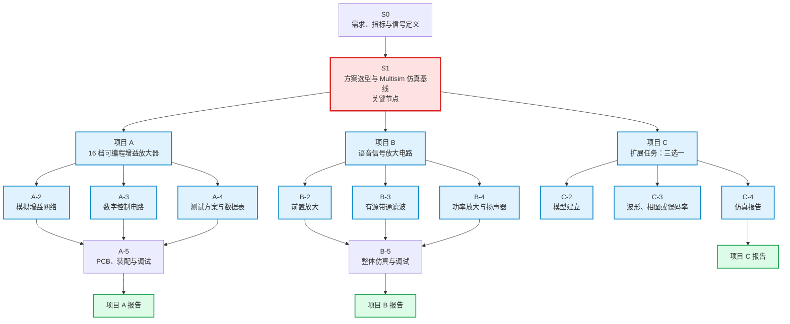
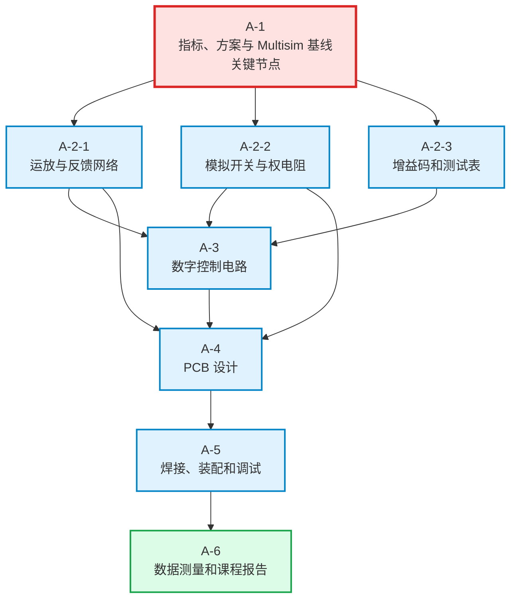
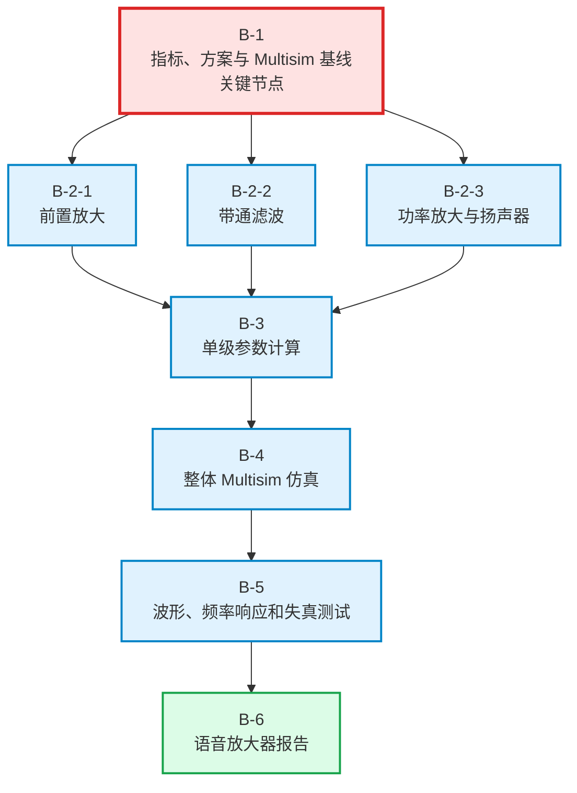
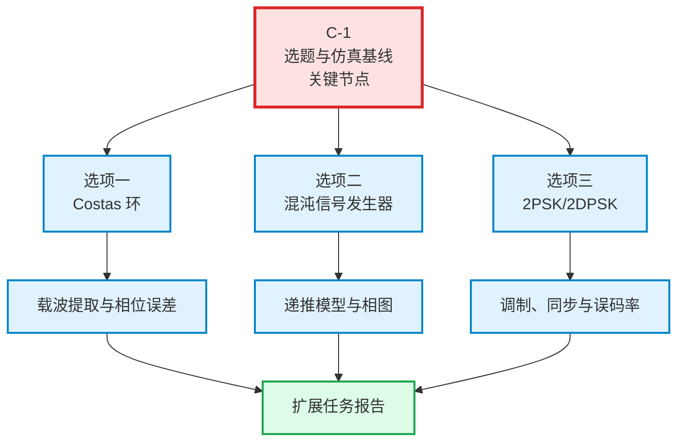
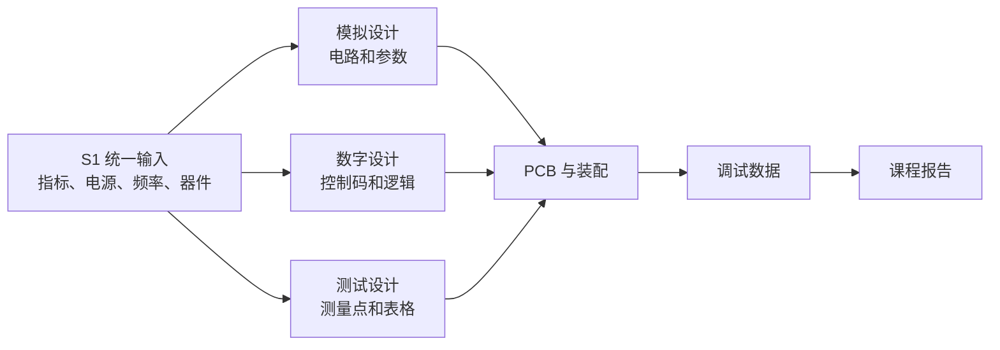

# 电子线路综合设计项目报告

> **文档状态：最初初选方案**
>
> 本报告用于组员了解项目范围、任务层级、协作接口和学习路径。方案、器件、指标和任务分工仍需根据老师要求、实验条件、器件库存和组员基础进行调整。

---

## 1. 报告目的

本课程包含三个相互独立的项目：

| 编号 | 项目名称 | 课程性质 | 当前初选安排 |
|---|---|---|---|
| 项目 A | 16 档可编程增益放大器 | 基础任务 | 软件仿真与 PCB 实物 |
| 项目 B | 语音信号放大电路 | 基础任务 | 软件仿真，实物方式待定 |
| 项目 C | 扩展任务 | 三选一 | 软件仿真 |

三个项目均需要形成设计资料、仿真结果、测试数据和总结报告。项目 A、B、C 共享课程报告的写作流程，但不共用同一个电路系统。

---

## 2. 总体任务层级

本方案将“方案选型与 Multisim 仿真基线”设为一级关键子任务。该子任务完成之前，后续器件计算、电路设计、PCB、调试和测试均缺少统一依据。

### 2.1 关键节点 S1 的作用

S1 的名称为“方案选型与 Multisim 仿真基线”。它需要确定：

1. 输入信号、频率范围和输出目标；
2. 电源电压、增益范围或通带范围；
3. 运放、功放、模拟开关、逻辑器件的初步型号；
4. 各单元电路的结构；
5. 关键电阻、电容参数的计算值；
6. Multisim 仿真原理图；
7. 输入输出波形和增益测量方法；
8. 后续子任务之间的接口数据。

S1 的输出是后续子任务的共同输入。若 S1 没有完成，后续工作可能使用不同的增益、频率、电源或器件，导致仿真、PCB 和测试结果无法统一。

---

# 项目 A：16 档可编程增益放大器

## A-1 项目简介

项目 A 的目标是设计一个放大倍数可以通过按键切换的放大器。放大器接收测试信号，并按照控制码输出不同幅度的信号。项目 A 主要体现模拟放大、数字控制、PCB 设计和硬件测试能力。

项目 A 的测试对象是放大倍数和增益控制，项目 B 的语音信号和扬声器不进入项目 A 的系统框图。

## A-2 原理介绍

### A-2-1 放大原理

非反相运算放大器的增益关系为：

$$
G=1+\frac{R_{\mathrm f}}{R_{\mathrm g}}
$$

其中，$R_{\mathrm f}$ 为反馈电阻，$R_{\mathrm g}$ 为反相输入端到地之间的等效电阻。改变 $R_{\mathrm g}$，即可改变电压增益。

### A-2-2 16 档增益方案

采用固定电阻和四个二进制权电阻，可以得到 16 种增益。设四个控制位为 $b_0,b_1,b_2,b_3$，则可以设计为：

$$
G=2+\sum_{k=0}^{3}2^k b_k
$$

对应的标称增益为：

$$
G=2,3,4,\ldots,17
$$

电阻网络由 CD4066 的四路模拟开关控制。74LS163 提供四位控制码，74LS279 用于按键消抖和状态保存。

## A-3 子任务与依赖关系

### A-1 方案选型与 Multisim 仿真基线

**任务内容**

- 确定输入幅度和测试频率；
- 确定 16 档增益；
- 确定电源电压；
- 选择 TL084、CD4066、74LS279、74LS163；
- 计算 $R_{\mathrm f}$ 和 $R_{\mathrm g}$；
- 建立 Multisim 仿真原理图；
- 记录每一档理论增益和仿真增益。

**需要学习的技能**

- 运算放大器基本模型；
- 非反相放大器增益计算；
- 电阻串并联；
- Multisim 元件放置和仿真；
- 示波器输入输出测量；
- Excel 或表格记录数据。

**学习建议**

先掌握以下关系：

$$
V_{\mathrm o}=G V_{\mathrm i}
$$

然后完成一个单档放大器仿真，再扩展为 16 档。此子任务完成后，模拟网络、控制电路和 PCB 才有统一参数。

**输出物**

- 方案比较表；
- 16 档增益表；
- Multisim 原理图；
- 输入输出波形；
- 理论增益和仿真增益表。

### A-2-1 运放与反馈网络

**任务内容**

- 设计输入缓冲；
- 设计增益可控放大级；
- 设计输出缓冲；
- 选择反馈电阻和权电阻；
- 分析最大输出幅度和失真。

**需要学习的技能**

- 虚短、虚断的工程理解；
- 反馈对增益和带宽的影响；
- 运放电源和输出摆幅；
- 增益误差分析。

**入门指引**

先只研究一个增益档，确认：

$$
G=1+\frac{R_{\mathrm f}}{R_{\mathrm g}}
$$

成立后，再将 $R_{\mathrm g}$ 替换成可切换的电阻网络。

### A-2-2 模拟开关与权电阻

**任务内容**

- 理解 CD4066 的导通和截止状态；
- 设计四位二进制控制码；
- 将控制码映射到权电阻；
- 分析模拟开关导通电阻对增益的影响。

**需要学习的技能**

- 模拟开关和数字开关的区别；
- 二进制权电阻网络；
- 导通电阻 $R_{\mathrm{on}}$；
- 电阻精度和增益误差。

**入门指引**

先写一张控制码表：

| $b_3b_2b_1b_0$ | 接入电阻 | 理论增益 |
|---|---|---:|
| 0000 | 固定支路 | 2 |
| 0001 | 加入 $R_{\mathrm g0}$ | 3 |
| 0010 | 加入 $R_{\mathrm g1}$ | 4 |
| 1111 | 全部接入 | 17 |

具体电阻值需要在 S1 中统一确定。

### A-2-3 增益码和测试表

**任务内容**

- 为 16 档建立控制码；
- 设定测试频率；
- 确定输入幅度；
- 设计增益、误差、带宽和失真测试表。

**需要学习的技能**

- 测量误差和相对误差；
- 峰峰值 $V_{\mathrm{pp}}$；
- 增益测量；
- 基础数据整理。

**测试关系**

$$
G_{\mathrm{meas}}=\frac{V_{\mathrm{o,pp}}}{V_{\mathrm{i,pp}}}
$$

$$
\delta=
\frac{G_{\mathrm{meas}}-G_{\mathrm{set}}}
{G_{\mathrm{set}}}
\times 100\%
$$

### A-3 数字控制电路

**任务内容**

- 按键输入；
- 74LS279 消抖；
- 74LS163 计数；
- 产生四位控制码；
- LED 显示档位；
- 给 CD4066 提供控制信号。

**需要学习的技能**

- 真值表；
- RS 触发器；
- 二进制计数器；
- 机械按键抖动；
- 数字逻辑电平。

**入门指引**

先只实现“按键一次，控制码加一”。确认计数和 LED 显示正确后，再接入模拟开关。

### A-4 PCB 设计

**任务内容**

- 绘制原理图；
- 选择直插封装；
- 设置电源、输入、输出和测试点；
- 完成双层 PCB 布局；
- 进行电源退耦和地线规划。

**需要学习的技能**

- 原理图符号和封装；
- PCB 布局布线；
- 电源退耦；
- 输入输出分区；
- 测试点设计。

**布局原则**

- 模拟部分和数字控制部分分区；
- CD4066 靠近运放；
- 反馈网络走线尽量短；
- 每个芯片附近放退耦电容；
- 使用连续地平面；
- 不在反馈节点下方走数字线。

### A-5 焊接、装配和调试

**任务内容**

- 焊接电源和器件；
- 检查电源；
- 逐级测试模拟放大器；
- 测试按键和控制码；
- 测试 16 档增益；
- 排查自激、噪声和失真。

**需要学习的技能**

- 焊接；
- 万用表；
- 示波器；
- 分级调试；
- 故障定位。

### A-6 数据测量和课程报告

**输出物**

- 16 档增益表；
- 增益误差曲线；
- 频率响应；
- 失真和最大输出；
- PCB 照片；
- 调试问题及处理方法；
- 最终结论。

---

# 项目 B：语音信号放大电路

## B-1 项目简介

项目 B 的目标是将弱语音信号放大到能够驱动扬声器的幅度和功率。输入条件为：

$$
V_{\mathrm{i,pp}}=5\,\mathrm{mV}
$$

频率范围为：

$$
100\,\mathrm{Hz}\leq f\leq 3.4\,\mathrm{kHz}
$$

项目 B 关注信号放大、音频频段选择和功率输出。项目 A 的增益码、按键和模拟开关不属于项目 B。

## B-2 原理介绍

语音放大器通常由三个主要环节组成：

### B-2-1 前置放大

前置放大器将毫伏级信号放大到适合滤波和功率放大的幅度。其增益关系仍可写为：

$$
G_{\mathrm{pre}}=1+\frac{R_{\mathrm f}}{R_{\mathrm g}}
$$

例如：

$$
G_{\mathrm{pre}}=50
$$

则：

$$
V_{\mathrm{o,pp}}
=
G_{\mathrm{pre}}V_{\mathrm{i,pp}}
=
250\,\mathrm{mV}
$$

### B-2-2 有源带通滤波

带通滤波器用于保留语音频段。低频截止频率可以由 RC 网络估计：

$$
f_{\mathrm L}=\frac{1}{2\pi R C}
$$

设计重点是让通带覆盖：

$$
100\,\mathrm{Hz}\sim 3.4\,\mathrm{kHz}
$$

### B-2-3 功率放大

LM386N-4 将滤波后的信号放大到能够驱动扬声器的功率。需要考虑输出耦合、音量控制、增益设置、电源退耦和自激抑制。

## B-3 子任务与依赖关系

### B-1 方案选型与 Multisim 仿真基线

**任务内容**

- 确认输入是正弦波还是实际语音；
- 确定前置放大倍数；
- 确定带通范围；
- 选择 LM324、LM386N-4；
- 确定扬声器等效负载；
- 完成 Multisim 整体框图和单级仿真。

**需要学习的技能**

- 电压放大和功率放大；
- 音频频率范围；
- RC 滤波；
- LM386 的增益和输出；
- Multisim 交流分析。

**输出物**

- 语音放大器方案表；
- 各级增益分配；
- 有源带通滤波器参数；
- Multisim 波形和幅频特性。

### B-2-1 前置放大

**任务内容**

- 设计 LM324 前置放大级；
- 计算增益电阻；
- 设置隔直和耦合电容；
- 保证输出不削顶。

**需要学习的技能**

- 运放放大电路；
- 增益分配；
- 交流耦合；
- 输出摆幅。

### B-2-2 有源带通滤波

**任务内容**

- 设计高通部分；
- 设计低通部分；
- 确定截止频率；
- 仿真通带增益和衰减。

**需要学习的技能**

- RC 高通和低通；
- 有源滤波器；
- 截止频率；
- 幅频特性。

### B-2-3 功率放大与扬声器

**任务内容**

- 设置 LM386N-4 增益；
- 选择输出耦合电容；
- 设置音量控制；
- 设计自激抑制网络；
- 估算扬声器输出功率。

**需要学习的技能**

- 功率、电压和负载关系；
- LM386 应用；
- 扬声器负载；
- 功放稳定性。

### B-3 单级参数计算

**任务内容**

- 前置级增益；
- 滤波器电阻和电容；
- 功放增益；
- 输出耦合；
- 电源退耦。

**输出物**

- 参数计算表；
- 理论增益；
- 理论截止频率；
- 器件清单。

### B-4 整体 Multisim 仿真

**任务内容**

- 连接前置放大、带通滤波和功率放大；
- 观察各级输出；
- 测试通带增益；
- 测试低频和高频衰减；
- 观察削顶和失真。

### B-5 波形、频率响应和失真测试

**测试内容**

- $100\,\mathrm{Hz}$、$1\,\mathrm{kHz}$、$3.4\,\mathrm{kHz}$ 处的增益；
- 通带幅频特性；
- 输出最大不失真幅度；
- LM386 输出波形；
- 扬声器负载影响。

### B-6 语音放大器报告

**输出物**

- 系统框图；
- 各级参数计算；
- Multisim 波形；
- 幅频特性曲线；
- 失真和削顶分析；
- 是否选择做实物的结论；
- 调试问题和解决措施。

---

# 项目 C：扩展任务

## C-1 项目简介

扩展任务从以下三个方向中选择一个完成软件仿真：

1. Costas 环的 FPGA 设计与仿真；
2. 混沌信号发生器；
3. 2PSK/2DPSK 调制解调。

扩展任务与项目 A、B 的电路实物没有信号连接。FPGA 开发板、DAC 和示波器可用于附加演示，软件仿真完成基本任务即可。

## C-2 三个候选方向

## C-3 选项一：Costas 环

### C-3-1 任务简介

Costas 环用于从抑制载波信号中恢复相干载波，并完成解调。系统包含 I/Q 两路乘法、低通滤波、鉴相、环路滤波和 NCO。

### C-3-2 子任务

1. 建立输入信号模型；
2. 建立 I/Q 乘法器；
3. 设计低通滤波器；
4. 实现鉴相器；
5. 设计环路滤波器；
6. 实现 NCO；
7. 观察频率误差、相位误差和解调波形。

### C-3-3 需要学习的技能

- 正弦信号和正交信号；
- 相位差；
- 低通滤波；
- 环路反馈；
- Simulink 或 HDL 建模。

## C-4 选项二：混沌信号发生器

### C-4-1 任务简介

混沌信号发生器根据确定性的递推公式产生类似随机的信号。其表现具有不可预测性，但仍由确定性系统产生。

### C-4-2 子任务

1. 选择递推公式和参数；
2. 建立 MATLAB 或 Simulink 浮点模型；
3. 设置初始值；
4. 观察时域波形；
5. 绘制 $x-y$ 相图；
6. 绘制频谱；
7. 研究参数变化；
8. 可选进行 FPGA 定点化和 RTL 仿真。

### C-4-3 需要学习的技能

- 差分递推；
- 状态变量；
- 初始值；
- MATLAB/Simulink；
- 相图；
- 定点数和溢出；
- 可选 Verilog/VHDL。

## C-5 选项三：2PSK/2DPSK

### C-5-1 任务简介

2PSK/2DPSK 系统完成数字基带信号的相位调制、载波调制、接收滤波、位同步和数据判决。

### C-5-2 子任务

1. 产生 0/1 数据；
2. 进行 2PSK 或 2DPSK 映射；
3. 产生载波；
4. 完成调制；
5. 进行匹配滤波；
6. 实现位同步；
7. 完成判决；
8. 统计误码率或绘制眼图。

### C-5-3 需要学习的技能

- 数字调制；
- 载波；
- 匹配滤波；
- 位同步；
- 判决门限；
- 误码率；
- Simulink 或 HDL。

---

## 4. 子任务协作接口

为了使不同基础的组员能够选择相对独立的工作，各子任务通过文档和仿真结果进行衔接。

### 4.1 接口文件

| 接口 | 负责子任务 | 输出内容 | 使用方 |
|---|---|---|---|
| 指标表 | S1 | 输入、频率、增益、电源、误差 | 全部子任务 |
| 器件表 | S1 | 型号、封装、参数、替代型号 | 电路和 PCB |
| 控制码表 | A-2-3、A-3 | 四位控制码和增益映射 | 模拟开关、LED、测试 |
| 参数表 | A-2-1、B-3 | 电阻、电容、增益、截止频率 | 仿真和 PCB |
| 测试表 | A-2-3、B-5 | 测量条件和记录格式 | 调试和报告 |
| 波形文件 | Multisim 或扩展仿真 | 波形、曲线、相图、眼图 | 报告和答辩 |

---

## 5. 学习方向和任务选择建议

| 学习方向 | 推荐子任务 | 需要掌握的核心技能 | 对整个项目的影响 |
|---|---|---|---|
| 模拟电路 | A-2-1、A-2-2、B-2-1、B-2-2 | 运放、反馈、滤波、频响 | 决定电路性能 |
| 数字电路 | A-3 | 触发器、计数器、按键消抖 | 决定增益切换 |
| 仿真建模 | S1、B-4、C-2 | Multisim、MATLAB、Simulink | 提供统一结果 |
| PCB 与焊接 | A-4、A-5 | 原理图、布局、焊接、测试 | 决定实物完成度 |
| 测试与数据 | A-2-3、A-6、B-5 | 示波器、误差、频响、数据表 | 决定报告质量 |
| 报告与展示 | 各项目末尾子任务 | 图表、技术表达、答辩组织 | 决定成果呈现 |
| FPGA 或 HDL | C-4-8、C-3 | Verilog/VHDL、RTL、定点数 | 扩展任务加分 |

### 5.1 初学者建议

初学者可以优先承担：

- 增益表和测试表整理；
- Multisim 基本操作；
- 元件封装和 BOM；
- 波形截图整理；
- 报告图表；
- 元件功能说明；
- 数据误差计算。

### 5.2 有模拟基础者建议

有模拟基础者可以承担：

- TL084 或 LM324 放大级；
- 反馈网络计算；
- 有源带通滤波器；
- LM386N-4 功放；
- 增益误差和失真分析。

### 5.3 有数字或 FPGA 基础者建议

有数字基础者可以承担：

- 74LS279 按键消抖；
- 74LS163 计数；
- 4 位控制码；
- CD4066 开关控制；
- 扩展任务的 RTL 或定点仿真。

---

## 6. 课程报告结构建议

1. 设计题目；
2. 设计任务和指标；
3. 总体方案与方案比较；
4. 子任务划分与依赖关系；
5. 单元电路和参数计算；
6. 元件选型和器件功能；
7. Multisim 或其他软件仿真；
8. PCB 设计与布局；
9. 焊接和调试；
10. 测试数据和误差分析；
11. 遇到的问题和解决措施；
12. 总结与改进方向；
13. 参考文献。

---

## 7. 当前初选方案

| 项目 | 初选方向 | 当前阶段 | 后续条件 |
|---|---|---|---|
| 项目 A | 16 档可编程增益放大器 | 方案、仿真和 PCB 准备 | 需要确认器件和 PCB 工具 |
| 项目 B | 语音信号放大电路 | 方案和 Multisim 仿真 | 是否做实物待定 |
| 项目 C | 混沌信号发生器 | 初选倾向 | 需要确认老师对 FPGA 仿真的要求 |

> **方案说明：本文档属于最初初选方案。**
>
> S1“方案选型与 Multisim 仿真基线”是项目 A、B、C 后续工作的共同前置条件。项目 A、B、C 的电路实现和测试应分别推进，避免将 16 档增益放大器、语音放大器和扩展任务混为一个系统。
