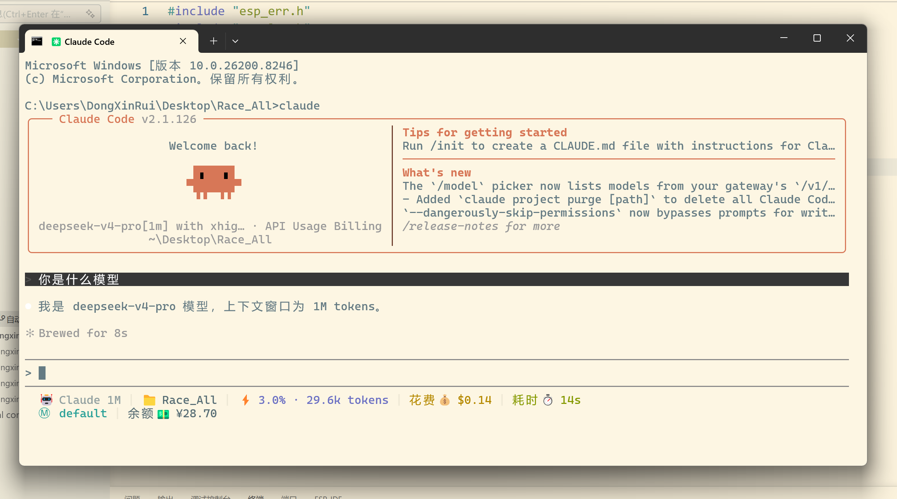

更新日期：2026-05-05
文档版本：v1.0
作者：RUI

前情提要：
这不是真正意义上的教程，我只是给大家提供思路，因为适合自己的才是最好的。
本面向Nuist-FFF群友，意在为大家提供AI时代下的整理笔记的新思路。

这样搭建知识库的优缺点有哪些？
优点：从0开始，可以几乎无限扩展，且借助AI整理效率极高，后续也可以借助github将知识库升级到云端；对文字，代码类笔记碾压传统手写和word，ppt等一切形式；形成完整的生态：你与AI对话产生的文本，你在网上获取的文本资料--转为markdown格式存在obsidian的知识库文件夹下--AI整理，补充，规范--又有了新的文本，新的笔记--AI整理，补充，规范，形成闭环。
缺点：对已有的手写笔记难以支持

你必须至少要有的前置知识：

注意：接下来你可能会有疑问，为什么我写个笔记建个知识库要这么多前置知识，太麻烦了，我不做了。但事实是：接下来的前置知识几乎都是一个程序员所必须有的，哪怕你不是程序员，但你学习过一门编程语言，你也一定都听说过，这些知识不是只对这个创建知识库的项目有用，你学了他们，相当于学了编程界的加减乘除。

markdown是什么？他相比于你经常见到的txt，docx有什么不同？
我们待会要配置的API和URL是什么，为什么我们可以在claude框架下使用deepseek作为他的大脑？
git是什么：当今计算机科学领域的基本设施，当今程序员的必备工具，类比于steam的游戏本地存档。如果你是一个程序员，却不知道git是什么，那就像
拓展：github：steam的游戏云存档
node.js是什么：js和node.js分别是什么，前后端桌面端，同样是每个程序员必然触及的领域。
obsidian是什么？

搭建这个知识库，你现在需要什么：
1.一台Windows11的电脑
2.可以连外网的魔法
3.一双手

下载git：

注册github账号：

下载obsidian：
这个视频值得看，包括obsidian的基本用法和git，github与obsidian的关联。
git和github部分看这个视频，如果你正在用git和github就不需要看，因为我真的不想教git和github。
https://www.bilibili.com/video/BV1fZCyBYEuT/?spm_id_from=333.1391.0.0&vd_source=e72b23bd02efae338ff569492cafce55
视频里的AI部分是用的Gemini CLI，比较垃圾，也不具有通用性。我们用的claudecode+deepseek可以广泛用于任何领域，包括代码，闲聊，对话，笔记。

下载node.js

通过npm指令安装claudecode，再随便建个空文件夹，无论在哪，然后在里面cmd，调用claudecode CLI，这时候发现需要账号或者API，叉掉cmd窗口，我们不需要在这里登录或者输入API。

去deepseek官网，注册，购买API，目前deepseek有很大折扣，token消耗量比较低，持续到5月31号。

下载CCswitch，用于给claudecode配置deepseek的URL和token，模型映射为deepseekV4pro。

打开claudecode发现可以正常提问和回答了，你问他是什么模型，他说自己是deepseek。（下面的部分LOGO是我加的插件，首次下载是没有的）

到这一步，你已经可以正常使用claudecode了。

