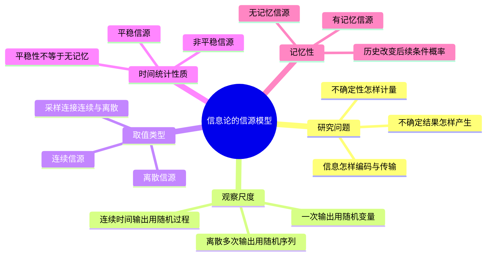

# 01 第1课 信息论的基本问题与信源模型

## 本课概要

> [!abstract] 本课主线
> 信息论研究的并不是某一台具体设备，而是“不确定结果怎样产生、怎样描述、怎样计量”。本课先把现实中的消息产生过程抽象为概率模型，确定随机变量、随机序列和随机过程分别描述什么，再区分离散与连续、平稳与有记忆。只有研究对象建模正确，后面的自信息、信息熵和信源编码才有明确含义。

## 一、为什么第一步不是计算信息量

面对“天气状态”“文本字符”“传感器电压”等不同对象，最容易出现的问题是直接套信息量公式，却没有说明一次试验究竟是什么。信息论中的“信源”不是专指某台发送设备，而是任何能够产生不确定结果的对象。例如，通信设备发送字符、传感器输出电压、天气系统产生天气状态，都可以看成信源。

同一个物理系统可以从不同时间尺度观察。只看下一次字符时，结果是一个随机变量；记录连续多个离散时刻时，结果是一个随机序列；如果信号在连续时间中变化，结果则是一个随机过程。若不先分清观察尺度，就无法判断应该计算单符号熵、联合熵还是条件熵。

因此，建模时要从三个彼此独立的维度观察信源：

1. **观察一次还是观察一段时间**：决定使用随机变量、随机序列还是随机过程；
2. **每次输出能取哪些值**：决定它是离散信源还是连续信源；
3. **各次输出之间怎样联系**：决定它是否平稳、是否有记忆。

课件中的信源分类图把这些维度画在同一张图中，看起来像一棵分类树。实际上，它们并不都是互斥的上下级分类。例如，一个信源可以同时是“离散的、平稳的、具有有限记忆的信源”。

![[assets/第1课-信源模型.svg]]

## 二、从一次输出到一段波形

只观察信源的一次输出时，用随机变量 $X$ 表示。例如，下一次发出的字符可能是 A、B 或 C。

观察连续多个离散时刻的输出时，用随机序列表示：

$$
\{X_n\}=\{X_1,X_2,\ldots\}.
$$

这里的下标 $n$ 表示第几次输出。例如，每秒记录一次温度，就会得到一个随机序列。

如果信号在连续时间内变化，则用随机过程表示：

$$
\{X(t)\}.
$$

例如，麦克风输出的连续电压波形就是随机过程。按照采样周期 $T_s$ 对它采样，可以得到

$$
X_n=X(nT_s),\qquad n=0,1,2,\ldots,
$$

从而把连续时间随机过程变成离散时间随机序列。

采样改变的是**时间形式**：原本由连续时间参数 $t$ 索引，采样后由离散时刻 $n$ 索引。采样本身不保证取值也离散。例如采样后的电压仍可能在一定范围内连续取值。

| 观察对象 | 数学表示 | 时间参数 | 典型例子 |
|---|---|---|---|
| 一次输出 | 随机变量 $X$ | 不强调时间 | 下一个天气状态 |
| 离散时刻输出序列 | 随机序列 $\{X_n\}$ | $n=0,1,2,\ldots$ | 每分钟记录一次温度 |
| 连续时间变化 | 随机过程 $\{X(t)\}$ | $t\in\mathbb R$ | 麦克风输出电压 |

## 三、离散取值与连续取值

如果随机变量 $X$ 只能取有限个或可数个值 $a_1,a_2,\ldots,a_q$，可以用概率空间表示为

$$
\begin{bmatrix}
X\\
P(X)
\end{bmatrix}
=
\begin{bmatrix}
a_1&a_2&\cdots&a_q\\
P(a_1)&P(a_2)&\cdots&P(a_q)
\end{bmatrix},
$$

并且

$$
\sum_{i=1}^{q}P(a_i)=1.
$$

这不是矩阵运算，而是一张“可能取值—对应概率”表。其中 $a_1,a_2,\ldots,a_q$ 是**一次输出的候选结果**，不是第 $1,2,\ldots,q$ 次输出。

如果 $X$ 可以在某个区间内连续取值，则用概率密度函数 $p(x)$ 描述。落入区间 $(c,d)$ 的概率为

$$
P(c<X<d)=\int_c^d p(x)\,\mathrm dx,
$$

全部取值范围内的总概率满足

$$
\int_{\mathbb R}p(x)\,\mathrm dx=1.
$$

连续随机变量在单个点上的概率通常为 $P(X=x)=0$，所以 $p(x)$ 是概率密度而不是点概率。例如，电压恰好等于 $1.000\ldots$ V 的概率可以为零，但电压落入一个小区间仍有正概率。

量化把连续取值划分为有限个区间，并用离散符号表示：

$$
Y=Q(X).
$$

因此，采样和量化解决的是不同问题：

| 变换 | 改变什么 | 不改变什么 | 结果 |
|---|---|---|---|
| 采样 | 连续时间 $\rightarrow$ 离散时刻 | 取值仍可能连续 | 离散时间随机序列 |
| 量化 | 连续取值 $\rightarrow$ 离散取值 | 采样时刻不变 | 离散取值序列 |

## 四、平稳性与记忆性不是一回事

建模后还要判断：概率规律是否随时间改变，以及过去输出是否能够帮助预测未来输出。这是两个独立问题。

若随机序列整体平移后，联合概率规律不变，则称为平稳信源。严格来说，对任意整数 $k$，有

$$
P(X_{n_1}=a_1,\ldots,X_{n_r}=a_r)
=P(X_{n_1+k}=a_1,\ldots,X_{n_r+k}=a_r).
$$

平稳表示“统计规则不随时间改变”，不表示输出值不变，也不表示各次输出独立。例如，一枚匀质硬币每天都按同一规则抛掷，输出会变化，但统计规律保持不变。

如果过去的输出不影响下一次输出，则称为无记忆信源：

$$
P(X_n=a\mid X_{n-1},X_{n-2},\ldots)=P(X_n=a).
$$

如果下一次输出只与最近 $m$ 次输出有关，则称为 $m$ 阶有限记忆信源：

$$
P(X_n\mid X_{n-1},X_{n-2},\ldots)
=P(X_n\mid X_{n-1},\ldots,X_{n-m}).
$$

一阶马尔可夫信源满足

$$
P(X_n\mid X_{n-1},X_{n-2},\ldots)=P(X_n\mid X_{n-1}).
$$

马尔可夫性描述前后输出的依赖关系，平稳性描述概率规律是否随时间变化。因此，马尔可夫信源既可能平稳，也可能非平稳。

| 概念 | 回答的问题 | 典型误读 |
|---|---|---|
| 平稳性 | 概率规则会不会随时间平移而改变？ | 把“平稳”误认为每次输出都相同 |
| 无记忆性 | 历史输出能否帮助预测当前输出？ | 把“无记忆”误认为概率分布随时间改变 |
| 马尔可夫性 | 预测当前输出需要记住多长的历史？ | 把马尔可夫误认为必定平稳 |

## 五、本课形成的建模流程

遇到新的信源题目时，可以按下面的顺序判断：

$$
\text{确定一次输出是什么}
\rightarrow
\text{确定时间参数}
\rightarrow
\text{确定取值形式}
\rightarrow
\text{判断平稳性}
\rightarrow
\text{判断记忆阶数}
\rightarrow
\text{写出概率模型}.
$$

例如，“每秒读取一次温度并量化成高、中、低三种状态，且下一时刻只与前一时刻有关”，对应的研究对象是离散时间、离散取值的一阶马尔可夫序列；至于它是否平稳，还要看状态转移概率是否随时间改变。

> [!warning] 常见误区
> 分类图中的“离散/连续”“平稳/非平稳”“有记忆/无记忆”不是三条只能选其一的路线。它们描述不同性质，一个信源可以同时具有多个性质。

## 六、复习路线

1. 先用一次输出定义随机变量 $X$；
2. 按时间参数区分随机序列 $\{X_n\}$ 与随机过程 $\{X(t)\}$；
3. 按取值形式区分概率分布与概率密度；
4. 用采样改变时间形式，用量化改变取值形式；
5. 用平稳性描述统计规则，用记忆性描述历史预测作用；
6. 建模完成以后，才进入下一课讨论具体结果的信息量和信源平均信息量。
