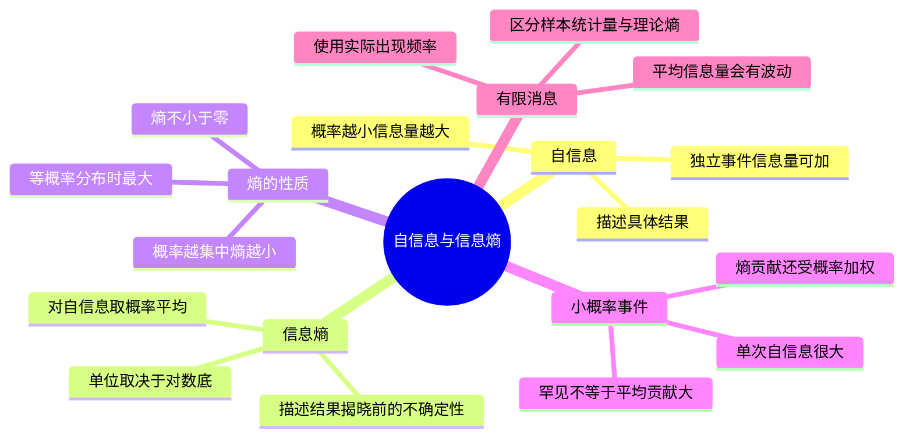

# 02 第2课 自信息、信息熵与平均信息量

## 本课概要



> [!abstract] 本课主线
> 上一课完成了信源的概率建模。接下来要回答两个不同层次的问题：某个具体结果出现时有多意外，以及结果揭晓以前整个信源平均有多难预测。前者引出自信息，后者引出信息熵。随后还要区分一条有限消息的平均信息量与信源理论熵，避免把“实际出现频率”和“理论概率”混为一谈。

## 一、为什么需要自信息

收到消息以后，我们不仅关心“得到了什么”，还想衡量这条消息消除了多少不确定性。直觉上，越不可能发生的结果一旦发生，就越出人意料，提供的信息也越多。例如，“太阳从东方升起”几乎不带来新信息，而“某台从未故障的设备突然损坏”则非常意外。

设具体结果 $x_i$ 的概率为 $P(x_i)$，它的自信息定义为

$$
I(x_i)=-\log_2P(x_i)=\log_2\frac{1}{P(x_i)}.
$$

公式中的 $P(x_i)$ 是这一具体结果发生的概率，$I(x_i)$ 则表示结果发生以后所消除的不确定性。负号把概率的“越大越好”翻转为信息量的“越小越容易发生、越大越意外”。

使用以 $2$ 为底的对数时，单位是比特（bit）。这个定义满足三条直觉：

- 概率越小，自信息越大；
- 概率为 $1$ 的必然事件不提供新信息；
- 独立事件同时发生时，概率相乘而自信息相加。

第三条尤其能说明为什么要用对数。若两个独立事件的概率分别为 $p_1,p_2$，则同时发生的概率是 $p_1p_2$，而

$$
-\log_2(p_1p_2)=-\log_2p_1-\log_2p_2.
$$

因此“概率相乘”被转换成“信息量相加”。

自信息描述的是**某个具体结果发生后的信息量**，而不是随机变量整体的平均水平。例如

$$
P(x_1)=0.99,\qquad P(x_2)=0.01,
$$

则

$$
I(x_1)=-\log_2 0.99\approx0.0145\ \mathrm{bit},
$$

$$
I(x_2)=-\log_2 0.01\approx6.644\ \mathrm{bit}.
$$

$x_2$ 很少发生，所以一旦发生就非常意外；$x_1$ 几乎可以预料，所以提供的信息很少。

![[assets/第2课-从自信息到熵.svg]]

## 二、为什么还要引入熵

在信源真正输出以前，我们不知道最终出现哪一个 $x_i$，所以无法预先指定本次获得的自信息。能做的是把所有可能结果的自信息按其概率加权平均，这就得到信息熵：

$$
\begin{aligned}
H(X)
&=\mathbb E[I(X)]\\
&=\sum_iP(x_i)I(x_i)\\
&=-\sum_iP(x_i)\log_2P(x_i).
\end{aligned}
$$

这里 $H(X)$ 是随机变量 $X$ 的熵，$P(x_i)$ 是结果 $x_i$ 的概率，$I(x_i)$ 是该结果的自信息。因为不同结果出现的频率不同，不能对所有自信息直接算术平均，而必须按概率加权。

同一个 $H(X)$ 可以从两个时间角度理解：

- 输出前，它是信源的平均不确定性；
- 输出后经过大量重复观察，它是每个符号提供的平均信息量。

某一次具体输出的信息量是 $I(x_i)$，并不一定等于 $H(X)$。只有长期统计许多次输出，其平均自信息才会趋近于熵。

| 量 | 描述对象 | 什么时候确定 | 单位 |
|---|---|---|---|
| $I(x_i)$ | 一个具体结果 | 结果发生以后 | bit |
| $H(X)$ | 整个随机变量 | 输出以前即可根据分布计算 | bit/符号 |

## 三、熵的上下界与概率不均匀

若两个二元信源的概率分别为 $(0.99,0.01)$ 与 $(0.5,0.5)$，前者几乎总能猜中结果，后者则最难预测。因此

$$
H(0.99,0.01)<H(0.5,0.5)=1\ \mathrm{bit}.
$$

对具有 $q$ 个可能结果的离散信源，熵满足

$$
0\leq H(X)\leq\log_2q.
$$

当某个结果必然发生时取下界 $0$；当 $q$ 个结果等概率时取上界 $\log_2q$。这个上界也是相同符号集合下的最大熵：概率越均匀，越没有倾向可以利用，结果越难预测。

### 小概率事件为什么自信息很大，熵贡献却可能很小

概率为 $p_i$ 的事件一旦发生，自信息是

$$
I(x_i)=-\log_2p_i.
$$

但它对熵的贡献不是单独的 $I(x_i)$，而是

$$
p_iI(x_i)=-p_i\log_2p_i.
$$

当 $p_i\to0^+$ 时，虽然 $I(x_i)\to+\infty$，但

$$
\lim_{p_i\to0^+}-p_i\log_2p_i=0.
$$

原因是事件出现频率的下降快于对数自信息的增长。例如，当 $p=10^{-6}$ 时，事件一旦发生可提供约 $19.93\ \mathrm{bit}$，但平均到每次试验的熵贡献只有

$$
10^{-6}\times19.93\approx1.993\times10^{-5}\ \mathrm{bit}.
$$

> [!warning] “可以忽略”的边界
> 单个极小概率事件的熵贡献趋近于零，但大量小概率事件的总贡献未必小；概率虽小但后果严重的安全事件，也不能因为熵贡献小就在决策中忽略。

## 四、有限消息的平均信息量与信源熵

信源熵由理论概率分布决定，而一条已经出现的有限长消息，其平均信息量还取决于这条消息中各符号实际出现了多少次。两者在有限样本中一般不完全相等。

### 例题：计算消息的平均信息量与信源熵

设离散无记忆信源满足

$$
P(0)=\frac38,\qquad
P(1)=\frac14,\qquad
P(2)=\frac14,\qquad
P(3)=\frac18.
$$

信源发出的消息为

```text
202120130213001203210110321010021032011223210
```

求这条消息中平均每个符号携带的信息量，以及该信源平均每个符号的信息量。

#### 第一步：统计实际出现次数

消息共有 $45$ 个符号，其中

| 符号 | 出现次数 | 理论概率 | 单次自信息 |
|---|---:|---:|---:|
| $0$ | $14$ | $3/8$ | $\log_2(8/3)$ |
| $1$ | $13$ | $1/4$ | $2$ |
| $2$ | $12$ | $1/4$ | $2$ |
| $3$ | $6$ | $1/8$ | $3$ |

计算这条消息的自信息时，自信息仍由信源给定的理论概率决定；实际次数决定每种自信息在这条消息中被累加多少次。

#### 第二步：计算消息总信息量和平均信息量

由于信源无记忆，整条消息的自信息等于各符号自信息之和：

$$
\begin{aligned}
I(\text{消息})
&=14\log_2\frac83+13\times2+12\times2+6\times3\\
&\approx87.8105\ \mathrm{bit}.
\end{aligned}
$$

平均到 $45$ 个符号：

$$
\overline I_{\text{消息}}
=\frac{87.8105}{45}
\approx1.9513\ \mathrm{bit/符号}.
$$

#### 第三步：根据信源理论概率计算熵

$$
\begin{aligned}
H(X)
={}&-\frac38\log_2\frac38
-\frac14\log_2\frac14\\
&-\frac14\log_2\frac14
-\frac18\log_2\frac18\\
\approx{}&1.9056\ \mathrm{bit/符号}.
\end{aligned}
$$

所以

$$
\boxed{\overline I_{\text{消息}}\approx1.9513\ \mathrm{bit/符号}},
$$

$$
\boxed{H(X)\approx1.9056\ \mathrm{bit/符号}}.
$$

两者不同，是因为这 $45$ 个符号的实际频率

$$
\frac{14}{45},\quad\frac{13}{45},\quad\frac{12}{45},\quad\frac{6}{45}
$$

并不恰好等于理论概率。消息足够长且确实由该无记忆信源产生时，实际频率通常会趋近理论概率，进而有

$$
\overline I_{\text{消息}}\longrightarrow H(X).
$$

| 比较项 | 所用概率 | 依赖消息长度吗 | 主要含义 |
|---|---|---|---|
| $\overline I_{\text{消息}}$ | 各符号理论自信息，按实际次数累计 | 是 | 这一条有限消息的样本平均 |
| $H(X)$ | 理论概率分布 | 否 | 信源长期的平均不确定性 |

## 五、本课复习路线

1. 用 $I(x_i)$ 衡量一个结果发生后的意外程度；
2. 输出以前不知道结果，所以对自信息按概率求期望，得到 $H(X)$；
3. 用等概率分布说明熵的上界；
4. 用 $-p_i\log_2p_i$ 区分“单次自信息”和“熵贡献”；
5. 用有限消息例子区分实际频率与理论概率；
6. 进入下一课后，把一个随机变量扩展到两个变量，讨论联合不确定性与条件不确定性。
