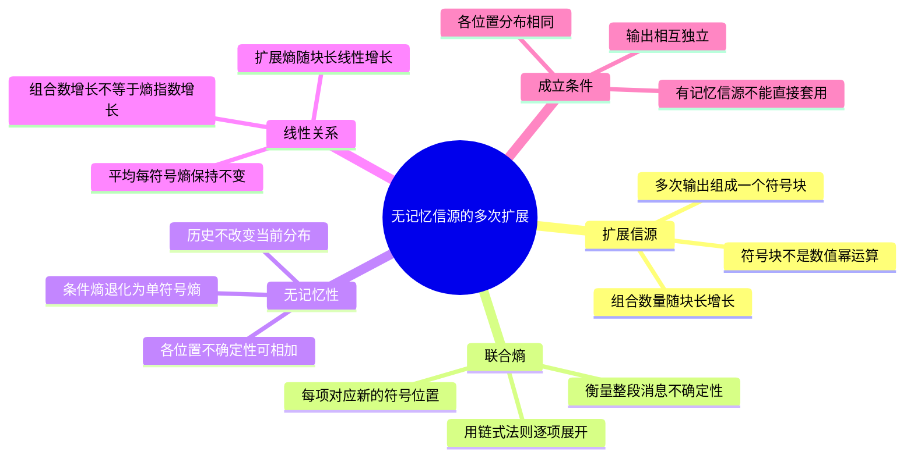

# 第4课 无记忆信源的 $N$ 次扩展

## 本课概要

> [!abstract] 本课主线
> 实际信源往往连续发送多个符号，因此需要把一段消息当作一个整体研究。无记忆信源的历史不能帮助预测当前符号，所以各次输出带来的不确定性可以相加。本课先明确“$N$ 次扩展信源”不是幂运算，再用联合熵链式法则解释 $H(X^N)=NH(X)$ 的成立条件。

## 一、扩展信源的定义与用途

第2课计算的是一个符号的熵 $H(X)$，第3课又研究了两个变量的联合熵和条件熵。实际编码往往面对长度为 $N$ 的一段消息，因此还需要回答：把连续 $N$ 次输出看成一个大符号以后，它的熵是多少？

这里的 $X^N$ 不是随机变量 $X$ 的 $N$ 次幂，而是把连续 $N$ 次输出组成一个大符号：

$$
X^N=(X_1,X_2,\ldots,X_N).
$$

它的熵就是这 $N$ 个变量的联合熵：

$$
H(X^N)=H(X_1,X_2,\ldots,X_N).
$$

![[assets/第4课-N次扩展.svg]]

如果原来的单符号有 $q$ 种取值，那么长度为 $N$ 的序列最多有

$$
q^N
$$

种组合。符号数量呈指数增加，但无记忆信源的熵只呈线性增加，因为每个位置带来的不确定性可以独立累加。

## 二、无记忆信源扩展熵的证明

证明离散无记忆信源的 $N$ 次扩展满足

$$
H(X^N)=NH(X).
$$

由联合熵的链式法则，

$$
\begin{aligned}
H(X^N)
={}&H(X_1)+H(X_2\mid X_1)\\
&+\cdots+H(X_N\mid X_1,\ldots,X_{N-1}).
\end{aligned}
$$

这个展开把确定整个序列的过程分成 $N$ 步：先确定第一个符号，再在已有历史的条件下依次确定后面的符号。

无记忆意味着各次输出相互独立，历史不能减少当前符号的不确定性，所以

$$
H(X_k\mid X_1,\ldots,X_{k-1})=H(X_k).
$$

同一信源的各次输出又服从相同分布，因此

$$
H(X_1)=H(X_2)=\cdots=H(X_N)=H(X).
$$

代回链式展开：

$$
\begin{aligned}
H(X^N)
&=H(X_1)+H(X_2)+\cdots+H(X_N)\\
&=NH(X).
\end{aligned}
$$

所以

$$
\boxed{H(X^N)=NH(X)}.
$$

公式中的 $H(X^N)$ 是长度为 $N$ 的序列作为整体的联合熵，$H(X)$ 是单符号熵。等式说明：在同分布、无记忆的条件下，总不确定性等于各符号不确定性之和。

## 三、从具体序列理解可加性

也可以从一个具体序列的自信息理解。无记忆信源中，序列 $(x_{i_1},\ldots,x_{i_N})$ 的概率为

$$
p(x_{i_1},\ldots,x_{i_N})=\prod_{k=1}^{N}p(x_{i_k}),
$$

所以其自信息为

$$
\begin{aligned}
I(x_{i_1},\ldots,x_{i_N})
&=-\log_2\prod_{k=1}^{N}p(x_{i_k})\\
&=\sum_{k=1}^{N}I(x_{i_k}).
\end{aligned}
$$

这里使用了对数性质：概率相乘对应自信息相加。对所有可能序列取平均，就得到 $H(X^N)=NH(X)$。

| 对象 | 概率关系 | 自信息关系 | 熵关系 |
|---|---|---|---|
| 无记忆序列 | $p(x_1,\ldots,x_N)=\prod_kp(x_k)$ | $I(x_1,\ldots,x_N)=\sum_kI(x_k)$ | $H(X^N)=NH(X)$ |
| 有记忆序列 | 一般不能拆成概率乘积 | 一般不能直接相加 | 通常 $H(X^N)\leq NH(X)$ |

## 四、等号成立的真正条件

若信源有记忆，前面的符号可以帮助预测后面的符号，一般只有

$$
H(X^N)\leq NH(X).
$$

等号成立的关键不是“扩展”本身，而是 $X_1,\ldots,X_N$ 相互独立。对于同分布的平稳信源，“同分布”保证每个 $H(X_k)$ 相同；“独立”才保证

$$
H(X_k\mid X_1,\ldots,X_{k-1})=H(X_k).
$$

这两个条件不能互相替代。

> [!warning] 常见误区
> 不要看到 $X^N$ 就写 $NH(X)$。必须先确认各次输出是否独立。若题目只说“同一信源连续输出 $N$ 次”，未必足以推出无记忆。

## 五、复习路线

1. 把 $X^N=(X_1,\ldots,X_N)$ 理解为一个大符号；
2. 用联合熵链式法则把大符号熵拆成逐步确定的条件熵；
3. 用无记忆性消去历史条件；
4. 用同分布性令所有单符号熵相等；
5. 得到 $H(X^N)=NH(X)$，并牢记其成立条件；
6. 下一课研究有记忆信源，观察历史信息如何改变这些条件熵。
