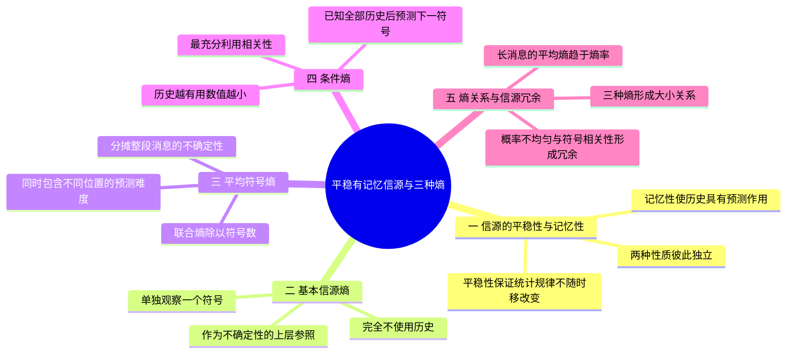

# 05 第5课 平稳有记忆信源与三种熵

## 本课概要

> [!abstract] 本课主线
> 第4课的可加性依赖“历史不能预测当前符号”。现实中的文本、语音和许多传感器数据往往具有记忆性，因此已知过去以后，下一符号通常更容易预测。本课把“不使用历史”“分摊整段消息”“充分使用历史”对应到三种熵，再用长消息的极限说明每符号实际新增的信息量与信源冗余。

## 一、平稳有记忆信源的三种熵

对平稳随机序列 $X_1,X_2,\ldots$，教材常比较基本信源熵、平均符号熵和条件熵。它们不是对同一个问题换一种写法，而是分别代表三种观察方式：

- 不看历史，只观察一个符号；
- 把长度为 $N$ 的整段消息的不确定性平均分摊到每个符号；
- 已经看到全部历史以后，预测下一个符号还剩多少不确定性。

![[assets/第5课-三种熵的关系.svg]]

### 1. 基本信源熵：完全不使用历史

单独观察一个符号时的不确定性为

$$
H(X_1).
$$

它把第一个符号当成一个孤立随机变量，不利用任何前后关系。概率分布越均匀，这个量越大。

### 2. 平均符号熵：整段消息平均分摊

长度为 $N$ 的符号组的平均符号熵是

$$
\overline H_N=\frac{1}{N}H(X_1,X_2,\ldots,X_N).
$$

其中 $H(X_1,\ldots,X_N)$ 是整段序列的联合熵。除以 $N$ 以后，表示“平均每个位置承担多少联合不确定性”。它把从第一个符号到最后一个符号的各种预测难度平均到了一起。

### 3. 条件熵：充分利用已有历史

已知前 $N-1$ 个符号后，第 $N$ 个符号的条件熵是

$$
H(X_N\mid X_1,\ldots,X_{N-1}).
$$

它只关心最后一个符号：在前面所有符号都已知的条件下，第 $N$ 个符号还剩多少不确定性。历史越有预测作用，这个值越小。

| 量 | 是否使用历史 | 描述对象 | 直观问题 |
|---|---|---|---|
| $H(X_1)$ | 不使用 | 单个符号 | 完全不知道前后文时有多难猜 |
| $\overline H_N$ | 混合了不同历史长度 | 整段消息的每个位置 | 一段消息平均每个符号有多难 |
| $H(X_N\mid X_1,\ldots,X_{N-1})$ | 使用完整历史 | 下一个符号 | 已经看到全部前文后还剩多难 |

> [!note] 教材术语说明
> 不同教材对“基本信源熵”的命名不完全统一。本节按课件语境，把单个信源符号的熵 $H(X_1)$ 称为基本信源熵；判断大小关系时应优先核对公式，而不要只看名称。

## 二、三种熵的大小关系

由联合熵链式法则，

$$
\begin{aligned}
H(X_1,\ldots,X_N)
={}&H(X_1)+H(X_2\mid X_1)\\
&+H(X_3\mid X_1,X_2)+\cdots\\
&+H(X_N\mid X_1,\ldots,X_{N-1}).
\end{aligned}
$$

因此 $\overline H_N$ 是这一串条件熵的算术平均。对平稳信源，随着已知历史增加，这些条件熵不会增大。这个结论可以严格写成

$$
\begin{aligned}
&H(X_{n+1}\mid X_1,X_2,\ldots,X_n)\\
\leq{}&H(X_{n+1}\mid X_2,\ldots,X_n)\\
={}&H(X_n\mid X_1,\ldots,X_{n-1}).
\end{aligned}
$$

第一步使用“增加已知条件不会增加条件熵”：把更多有用信息作为条件，通常只可能减少剩余不确定性。第二步使用平稳性，因为整体平移一个时刻后，联合概率规律不变。

因此

$$
H(X_1)\geq H(X_2\mid X_1)\geq\cdots
\geq H(X_N\mid X_1,\ldots,X_{N-1}).
$$

一组数的平均值介于最大值和最小值之间，所以

$$
\boxed{
H(X_N\mid X_1,\ldots,X_{N-1})
\leq\frac1N H(X_1,\ldots,X_N)
\leq H(X_1)
}.
$$

也就是

$$
\boxed{
\text{条件熵}\leq\text{平均符号熵}\leq\text{基本信源熵}
}.
$$

这个关系的本质是：使用越多历史信息，越容易预测下一个符号；而平均符号熵把从“完全没有历史”到“已有较多历史”的各种情况平均到了一起。

## 三、平稳性、无记忆性与大小关系的适用条件

该结论依赖平稳性。若信源无记忆，历史没有预测作用，所有条件熵都等于单符号熵，三个量相等：

$$
H(X_N\mid X_1,\ldots,X_{N-1})
=\overline H_N
=H(X_1).
$$

若信源有记忆，历史通常能提供预测信息，前面的大小关系一般至少有一个严格不等号。

| 信源性质 | 历史信息的作用 | 三种熵的关系 |
|---|---|---|
| 平稳无记忆 | 不能预测当前符号 | 三者相等 |
| 平稳有记忆 | 能降低当前符号的不确定性 | 条件熵 $\leq$ 平均符号熵 $\leq$ 基本信源熵 |
| 非平稳 | 概率规则本身随时间改变 | 不能直接套用上述平稳信源结论 |

平稳性与记忆性必须分别判断：

- 平稳性说的是概率规律是否随时间平移改变；
- 记忆性说的是历史输出是否帮助预测当前输出；
- 马尔可夫性说的是预测当前输出需要记住多长的历史。

## 四、从三种熵走向相关性与冗余度

当历史能够显著降低条件熵时，符号之间存在统计相关性。相关性意味着后面的符号并非完全“出乎意料”，因此一段消息中包含可预测成分。在信源编码中，这些可预测成分通常表现为可以用更少编码位表示的统计冗余。

因此，学习这一课时最重要的不是只背大小关系，而是抓住下面的因果链：

$$
\text{符号之间有相关性}
\rightarrow
\text{历史能够帮助预测}
\rightarrow
\text{条件熵下降}
\rightarrow
\text{实际每符号信息量低于独立情形}
\rightarrow
\text{存在信源压缩空间}.
$$

“冗余”在这里不是说消息中的符号没有用途，而是说符号之间的统计规律使某些组合更容易出现。信源编码会利用这些规律缩短平均码长，同时在无失真编码中完整恢复原始消息。

## 五、熵率与两类信源冗余

有限长度的平均符号熵 $\overline H_N$ 仍包含消息开头“几乎没有历史可用”的位置。如果关心很长的消息平均每个符号究竟带来多少新信息，就要让消息长度不断增大。对有限字母表的平稳信源，记

$$
h_N=H(X_N\mid X_1,\ldots,X_{N-1}).
$$

$h_N$ 是看到前 $N-1$ 个符号后，第 $N$ 个符号仍有的不确定性。上一节已证明这组数随 $N$ 不增，且熵不能小于零，因此它收敛。联合熵链式法则又表明 $\overline H_N=(h_1+\cdots+h_N)/N$，即这些条件熵的算术平均；收敛数列的算术平均与原数列有相同极限。由此得到熵率（也常称极限熵）：

$$
H_\infty
=\lim_{N\to\infty}\frac{H(X_1,\ldots,X_N)}{N}
=\lim_{N\to\infty}H(X_N\mid X_1,\ldots,X_{N-1}).
$$

它的单位是比特每符号，描述长消息中平均每个符号新增的不确定性，而不是某一次具体输出的信息量。平稳性与有限单符号熵保证上述极限存在；这并不意味着非平稳信源的平均熵一概没有极限。

有了 $H_\infty$，就能把“冗余”与最理想的等概率、独立输出作比较。若字母表有 $m$ 个符号，独立且等概率时每符号最多含 $\log_2m$ 比特。常用的相对冗余度定义为

$$
r=1-\frac{H_\infty}{\log_2m},\qquad m>1.
$$

这里 $m$ 是可用符号数；分母给出每符号不确定性的理论上限，分子是考虑长程统计规律后的实际平均值。两者的差还可以拆开：

$$
\log_2m-H_\infty
=\underbrace{\bigl(\log_2m-H(X_1)\bigr)}_{\text{单符号概率不均匀}}
+\underbrace{\bigl(H(X_1)-H_\infty\bigr)}_{\text{符号之间的统计相关性}}.
$$

这个分解适用于上述平稳有限字母表模型。第一项说明即使各次独立，只要有些符号更常见，就能利用频率差异；第二项说明即使单个符号等概率，历史仍可能帮助预测后续符号。

例如，独立二元信源满足 $P(X_n=0)=0.9$ 时，$H_\infty=H(X_1)\approx0.469$ 比特每符号，冗余来自概率不均匀。另设整段序列由一个等概率的初始比特 $B$ 决定，所有位置都输出 $B$。此时每个位置单独观察仍有 $H(X_n)=1$ 比特，但 $H(X_1,\ldots,X_N)=1$ 比特，故 $H_\infty=0$；冗余完全来自符号间的相关性。后一个模型是平稳的，却不是无记忆的。

这些冗余属于信源自身。接下来研究信道时，要另问一个问题：已经产生的信息经过传输后，接收端还获得了多少。

## 六、复习路线

1. 先区分三种观察方式，不把三个熵混成同一定义；
2. 用链式法则把联合熵写成逐符号条件熵之和；
3. 用“增加已知条件不会增加条件熵”和“平稳性”推导大小关系；
4. 用无记忆信源说明三者何时相等；
5. 用有记忆信源说明历史信息如何降低条件熵；
6. 最后用长消息的极限得到熵率，分清概率不均匀与符号相关性这两类冗余。
