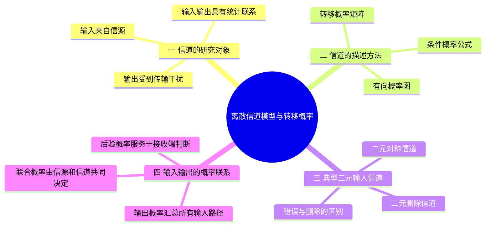
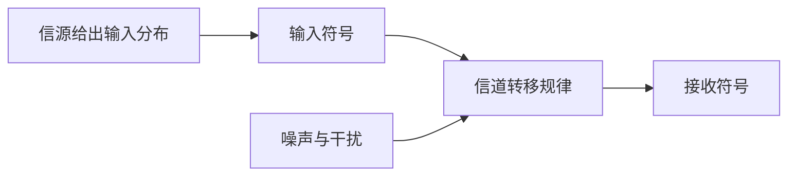

# 06 第6课 离散信道模型与转移概率

## 本课概要

> [!abstract] 本课主线
> 信源熵描述发送前的不确定性，信道则描述发送后可能出现的接收结果。先把信源的输入分布与信道的转移概率分开，再学习公式、图示和矩阵三种表示方法。二元对称信道与二元删除信道会展示两种不同的传输障碍：收到错误符号，以及明确知道某个符号没有收到。

## 一、信道连接信源与接收端

上一课的熵率衡量信源长期平均每个符号产生多少新信息。但通信还要经过传输。发送端产生的符号即使已经确定，接收端看到的结果也可能因噪声、干扰或检测过程而变化。若只研究信源分布，就无法判断消息在传输后还能保留多少。

用随机变量 $X$ 表示送入信道的一个符号，用 $Y$ 表示接收端得到的一个符号。信源给出输入分布 $p(x_i)=P(X=x_i)$；信道给出在已知输入 $x_i$ 时得到输出 $y_j$ 的条件概率：

$$
p(y_j\mid x_i)=P(Y=y_j\mid X=x_i).
$$

这个量称为**信道转移概率**或传递概率。输入、输出和转移概率构成单符号离散信道的基本模型。若连续多次使用信道，并且各次输出在给定各次输入后相互独立，才进一步称为离散无记忆信道；单符号转移矩阵本身尚未说明跨时刻是否无记忆。

信源与信道的作用不同：同一信道可以连接不同输入分布的信源；同一信源也可以经过不同信道。因此计算传输效果时，既要知道 $p(x_i)$，也要知道 $p(y_j\mid x_i)$。

## 二、转移概率的三种表示方法

假设输入符号集合为 $\mathcal X=\{x_1,\ldots,x_m\}$，输出符号集合为 $\mathcal Y=\{y_1,\ldots,y_n\}$。公式法直接逐项写出 $p(y_j\mid x_i)$。对于固定的输入 $x_i$，输出必定落入某个可能结果，因此

$$
\sum_{j=1}^{n}p(y_j\mid x_i)=1,
\qquad p(y_j\mid x_i)\geq0.
$$

图示法把输入和输出画成两侧节点，用从 $x_i$ 指向 $y_j$ 的有向边表示一条可能路径，边上标对应的 $p(y_j\mid x_i)$。它适合先弄清“哪些结果可能发生”，再列概率。

矩阵法把输入排成行、输出排成列：

$$
\mathbf W=
\begin{bmatrix}
p(y_1\mid x_1)&\cdots&p(y_n\mid x_1)\\
\vdots&\ddots&\vdots\\
p(y_1\mid x_m)&\cdots&p(y_n\mid x_m)
\end{bmatrix}.
$$

$\mathbf W$ 的每一行都是“给定某个输入后，输出落在各列的概率分布”，所以每行之和等于 $1$。矩阵把同一张概率图压缩成便于计算的形式；画图、写公式和列矩阵描述的是同一个信道。

## 三、二元对称信道与二元删除信道

先考虑输入、输出都取 $0$ 或 $1$ 的情形。若输入 $0$ 和输入 $1$ 被错误翻转的概率相同，记为 $\varepsilon$，就得到二元对称信道（BSC）：

$$
\mathbf W_{\mathrm{BSC}}=
\begin{array}{c|cc}
 &Y=0&Y=1\\\hline
X=0&1-\varepsilon&\varepsilon\\
X=1&\varepsilon&1-\varepsilon
\end{array}.
$$

$\varepsilon$ 称为**交叉概率**，是转移概率中的两条“翻转路径”：$p(1\mid0)=p(0\mid1)=\varepsilon$。相应的正确传输概率为 $1-\varepsilon$。$\varepsilon=0$ 时没有翻转；$\varepsilon=1/2$ 时两行相同，输出分布不再体现输入差异；$\varepsilon=1$ 时每次都翻转，但接收端反向解释输出，仍可无误恢复输入。因此“翻转频繁”不等于“没有信息”。

另一类障碍是：接收端没有读到该位置的符号，但知道这个位置发生了删除。二元删除信道（BEC）用 $?$ 表示这种**位置已知的删除标记**，设删除概率为 $\delta$：

$$
\mathbf W_{\mathrm{BEC}}=
\begin{array}{c|ccc}
 &Y=0&Y=1&Y=?\\\hline
X=0&1-\delta&0&\delta\\
X=1&0&1-\delta&\delta
\end{array}.
$$

收到 $0$ 或 $1$ 时，发送符号可以确定；收到 $?$ 时，只知道这个位置未被辨认。BSC 则可能把 $0$ 当成 $1$，接收端未必知道发生了错误。这里的“删除”指有标记的擦除，不是整段序列中某个符号消失、连原位置也不知道的无标记删除。

## 四、由正向模型得到接收端的判断

转移矩阵只说明“给定输入后可能收到什么”。接收端却要反过来问“已经收到 $y_j$，原输入是什么”。从正向模型走向反向判断，需要先把信源与信道结合：

$$
p(x_i,y_j)=p(x_i)p(y_j\mid x_i),
\qquad
p(y_j)=\sum_i p(x_i)p(y_j\mid x_i).
$$

第一式的 $p(x_i,y_j)$ 是发送 $x_i$ 且收到 $y_j$ 的联合概率；第二式把所有能通往同一输出 $y_j$ 的输入路径相加。若 $p(y_j)>0$，再得到后验概率

$$
p(x_i\mid y_j)
=\frac{p(x_i)p(y_j\mid x_i)}{p(y_j)}.
$$

它表达的是收到 $y_j$ 后，发送端原来选了 $x_i$ 的可能性。$p(y_j\mid x_i)$ 与 $p(x_i\mid y_j)$ 方向不同，通常不能交换；后者还依赖信源输入分布。

例如，BSC 的输入满足 $p(X=1)=q$ 时，收到 $1$ 的总概率为

$$
p(Y=1)=(1-q)\varepsilon+q(1-\varepsilon)
=\varepsilon+q(1-2\varepsilon).
$$

公式中的两项分别对应“发送 $0$ 后翻转”和“发送 $1$ 后正确接收”。这也说明：即使交叉概率 $\varepsilon$ 固定，改变信源的 $q$ 仍会改变接收端的输出分布。

## 五、复习路线

先分清信源分布 $p(x)$ 与信道规律 $p(y\mid x)$，再把一张概率图写成转移矩阵。面对接收结果时，沿“联合概率、输出概率、后验概率”的顺序反推输入。下一课将在此基础上计算接收以后还剩多少不确定性，以及实际获得了多少信息。
