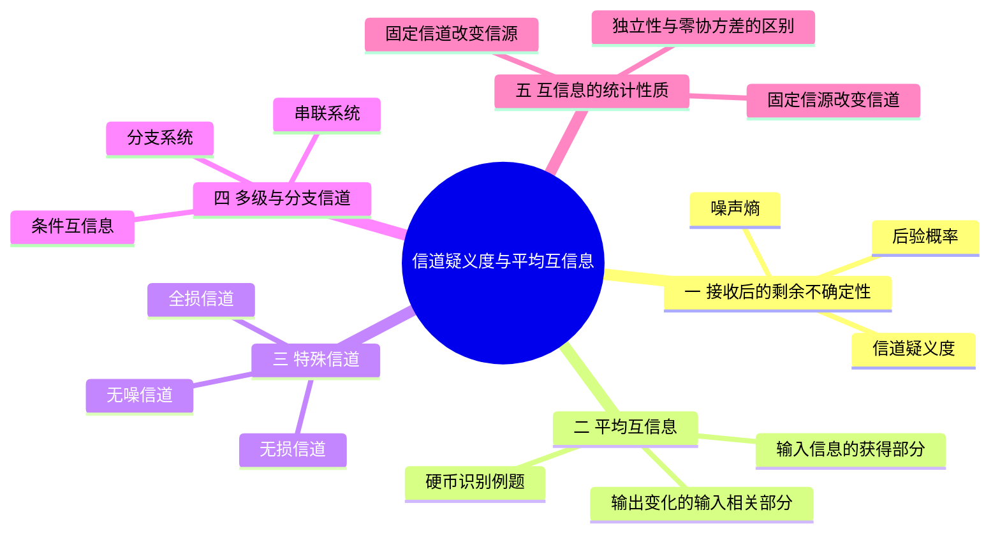
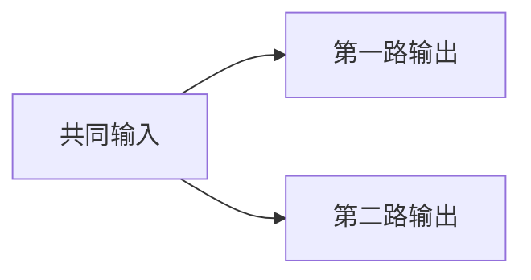

# 07 第7课 信道疑义度与平均互信息

## 本课概要

> [!abstract] 本课主线
> 上一课用转移概率描述输入如何变成输出；本课改从接收端出发，衡量收到输出后关于原输入还剩多少不确定性。信道疑义度给出尚未获得的部分，平均互信息给出实际获得的部分。用同一道硬币识别题完成计算，再利用条件互信息理解串联与分支传输，最后观察输入分布或信道变化时互信息怎样改变。

## 一、接收端的疑义与输出端的噪声

一个信道可能有多个输入通向同一个输出。收到 $Y=y_j$ 之后，如果仍有多个 $X=x_i$ 可能被发送，接收端就存在疑义。信道转移概率 $p(y_j\mid x_i)$ 描述发送方向；要分析接收后的不确定性，须先求后验概率 $p(x_i\mid y_j)$。

对某个已收到的 $y_j$，剩余不确定性是后验分布的熵：

$$
H(X\mid Y=y_j)
=-\sum_i p(x_i\mid y_j)\log_2p(x_i\mid y_j).
$$

这里的 $i$ 遍历所有可能的输入；概率为零的项按极限取零。不同输出留下的疑义可能不同，故还要按收到各输出的概率平均：

$$
\boxed{
H(X\mid Y)
=\sum_j p(y_j)H(X\mid Y=y_j)
=-\sum_j\sum_i p(x_i,y_j)\log_2p(x_i\mid y_j)
}.
$$

上式称为**信道疑义度**或**损失熵**。它衡量的是关于原输入 $X$ 的平均信息缺口；“损失”不表示信道改变了 $X$ 自身的概率分布。计算时通常依次求 $p(x_i,y_j)$、$p(y_j)$、$p(x_i\mid y_j)$，然后先算各个 $H(X\mid Y=y_j)$，最后按 $p(y_j)$ 加权。

从相反方向看，已知发送的是 $X=x_i$，接收结果仍可能随机变化。其平均不确定性为

$$
H(Y\mid X)
=-\sum_i p(x_i)\sum_jp(y_j\mid x_i)\log_2p(y_j\mid x_i).
$$

它常称为**噪声熵**。两个条件熵不能混用：$H(X\mid Y)$ 问收到后还认不认得原输入；$H(Y\mid X)$ 问发出后输出还有多少随机性。

## 二、平均互信息连接输入与输出

发送前，输入 $X$ 的不确定性是 $H(X)$；收到 $Y$ 后，平均还剩 $H(X\mid Y)$。两者之差表示接收结果平均消除了多少关于 $X$ 的不确定性，称为**平均互信息**：

$$
I(X;Y)=H(X)-H(X\mid Y).
$$

这个量对一对离散随机变量以比特计量。若 $X,Y$ 各对应一次信道使用，也可把数值理解为比特每次使用；若要换成比特每秒，还须知道每秒使用信道多少次。因此课件称它为信息传输率时，应注意所用的时间或信道使用单位。

同一量也可从接收端理解。输出 $Y$ 的全部随机变化有两种来源：一部分与发送的 $X$ 有关，另一部分在已知 $X$ 后仍存在。由联合熵链式法则的两种展开，

$$
H(X,Y)=H(X)+H(Y\mid X)=H(Y)+H(X\mid Y),
$$

移项便得到

$$
\boxed{I(X;Y)=H(X)-H(X\mid Y)=H(Y)-H(Y\mid X)}.
$$

后一种写法中的 $H(Y)$ 是**接收输出自身的总不确定性**，并非发送端提供的总信息；减去已知输入后仍由信道带来的 $H(Y\mid X)$，才得到输出中与输入有关的部分。如果信道自行产生随机输出，$H(Y)$ 可以很大，但这些变化未必传递了任何输入信息。

互信息还有直接的概率表达式：

$$
I(X;Y)
=\sum_i\sum_jp(x_i,y_j)
\log_2\frac{p(x_i,y_j)}{p(x_i)p(y_j)}.
$$

分式比较“联合出现的实际概率”和“假如两者独立时应有的概率”。对具体一对结果，$i(x_i;y_j)=\log_2[p(x_i\mid y_j)/p(x_i)]$ 是从结果 $y_j$ 得到的关于 $x_i$ 的互信息；它可以为负，表示这个 $y_j$ 使 $x_i$ 比先前更不可能。与之不同，单个结果的自信息为 $-\log_2p(x_i)$，只描述 $x_i$ 本身有多意外，不涉及另一个变量。对所有结果取平均后得到的 $I(X;Y)$ 始终非负。

## 三、硬币识别中的完整计算

随机等概率抽取一枚硬币：正常硬币的一面是国徽、一面是面值；另一枚两面都是面值。将抽中的硬币抛两次，只报告面值出现的次数。令 $X$ 表示硬币种类，$Y$ 表示面值出现次数。抽硬币给出输入分布，抛掷和计数过程给出信道规律：

| 输入 $X$ | $Y=0$ | $Y=1$ | $Y=2$ |
|---|---:|---:|---:|
| 正常硬币 | $1/4$ | $1/2$ | $1/4$ |
| 双面面值硬币 | $0$ | $0$ | $1$ |

正常硬币抛两次得到零、一次、两次面值的概率分别为 $1/4,1/2,1/4$；另一枚必定得到两次面值。两枚硬币各以 $1/2$ 的概率被抽中，因此联合概率表的每行等于上表对应行乘以 $1/2$：

| 输入 $X$ | $Y=0$ | $Y=1$ | $Y=2$ |
|---|---:|---:|---:|
| 正常硬币 | $1/8$ | $1/4$ | $1/8$ |
| 双面面值硬币 | $0$ | $0$ | $1/2$ |
| 输出概率 $p(y)$ | $1/8$ | $1/4$ | $5/8$ |

收到零次或一次面值时，输入必定是正常硬币，故两种输出对应的剩余熵都为零。收到两次面值时，正常硬币路径的联合概率为 $1/8$，两种路径合计为 $5/8$，故

$$
p(X=\text{正常硬币}\mid Y=2)=\frac{1/8}{5/8}=\frac15,
\qquad
p(X=\text{双面面值硬币}\mid Y=2)=\frac45.
$$

因此，已知出现两次面值时的剩余熵为

$$
H(X\mid Y=2)
=-\frac15\log_2\frac15-\frac45\log_2\frac45
\approx0.7219\ \text{比特}.
$$

但这不是平均疑义度，因为 $Y=2$ 只以 $5/8$ 的概率出现。平均后得到

$$
H(X\mid Y)
=\frac18\cdot0+\frac14\cdot0+\frac58H(X\mid Y=2)
\approx0.4512\ \text{比特}.
$$

抽硬币前两种输入等概率，所以 $H(X)=1$ 比特。接收结果平均提供的硬币识别信息为

$$
I(X;Y)=H(X)-H(X\mid Y)
\approx0.5488\ \text{比特}.
$$

用另一种写法可交叉理解这个结果。正常硬币对应的三种输出熵为 $1.5$ 比特；双面面值硬币的输出没有随机性，所以

$$
H(Y\mid X)=\frac12\cdot1.5+\frac12\cdot0=0.75\ \text{比特}.
$$

输出分布为 $(1/8,1/4,5/8)$，故 $H(Y)\approx1.2988$ 比特，两者相减同样得到 $I(X;Y)\approx0.5488$ 比特。这里 $H(Y)>H(X)$ 并不奇怪：计数结果自身还含有随机抛掷造成的变化，扣除 $H(Y\mid X)$ 后，才留下识别硬币所需的信息。

## 四、特殊信道由两个条件熵区分

平均互信息满足 $0\leq I(X;Y)\leq\min\{H(X),H(Y)\}$。下界来自“接收结果平均不会使输入更难判断”；两个上界分别由 $I=H(X)-H(X\mid Y)$ 与 $I=H(Y)-H(Y\mid X)$ 及条件熵非负得到。等号对应的信道要按两个方向分别判断。

| 情形 | 条件 | 确定的方向 | 一个例子 |
|---|---|---|---|
| 全损 | $I(X;Y)=0$ | 输出不提供关于输入的信息 | $Y$ 恒为固定值 |
| 无损 | $H(X\mid Y)=0$ | 每个有效输出都能确定原输入 | $Y=(X,N)$，额外附带随机量 $N$ |
| 无噪 | $H(Y\mid X)=0$ | 每个输入都确定唯一输出 | 不同输入合并映射到同一输出 |

无损信道中，只要 $p(y_j)>0$，$p(x_i\mid y_j)$ 对某个输入等于 $1$，对其余输入等于 $0$。一个输出不能来自两个仍可能的输入；但一个输入可以随机产生多个彼此可辨识的输出，所以无损不要求噪声熵为零。例如 $Y=(X,N)$ 中的 $N$ 可以随机，输出里仍完整保留 $X$。

无噪信道中，每个有效输入 $x_i$ 都确定唯一输出 $f(x_i)$，故 $p(y_j\mid x_i)$ 在该行只有一个 $1$。然而函数 $f$ 可以把不同输入合并成同一输出。例如等概率输入 $X\in\{0,1,2,3\}$，令 $Y=0$ 对应输入 $0,1$，$Y=1$ 对应输入 $2,3$，则 $H(Y\mid X)=0$，而 $H(X\mid Y)=1$ 比特。

全损意味着 $H(X\mid Y)=H(X)$，即接收结果未减少关于输入的平均不确定性；等价于 $X$ 与 $Y$ 统计独立。若所有可能输入对应的转移矩阵行都相同，这种独立性对任意输入分布都成立。固定输出的信道同时满足 $H(Y\mid X)=0$ 和 $I(X;Y)=0$：它没有输出随机性，却也没有传递输入信息。因此“噪声熵为零”不能直接推出“信息没有损失”。

## 五、条件互信息与多段传输

当接收端已经知道第三个变量 $Z$，还想衡量 $Y$ 能额外提供多少关于 $X$ 的信息，就需要条件互信息：

$$
I(X;Y\mid Z)
=H(X\mid Z)-H(X\mid Y,Z).
$$

第一项是已知 $Z$ 后关于 $X$ 的剩余不确定性，第二项是再知道 $Y$ 后的剩余量；相减得到 $Y$ 的**新增贡献**。它也可写为 $H(Y\mid Z)-H(Y\mid X,Z)$。与普通互信息一样，还要对 $Z$ 的所有可能取值按概率平均，不能只挑一个特定条件。

串联传输可画为

若第二段只依赖当前的 $Y$，而不再直接利用 $X$，便是马尔可夫链 $X\to Y\to Z$，满足 $p(z\mid x,y)=p(z\mid y)$。因此在已经知道中间结果 $Y$ 后，最终结果 $Z$ 不再提供额外的 $X$ 信息：$I(X;Z\mid Y)=0$。但只看到最终输出时，$Z$ 一般仍包含关于 $X$ 的信息，并有 $I(X;Z)\leq I(X;Y)$。

分支传输可画为

如果两路在给定 $X$ 后独立工作，即 $p(y,z\mid x)=p(y\mid x)p(z\mid x)$，那么 $I(Y;Z\mid X)=0$。这里为零的是**已知共同输入之后，两路输出之间的额外联系**；并不是说两路输出各自不含 $X$ 信息。已收到 $Z$ 后，再看 $Y$ 能为识别 $X$ 增加多少，表达式是 $I(X;Y\mid Z)$，一般不为零。单凭分叉图也不能推定两路条件独立，还须排除共同噪声等额外联系。

## 六、互信息随信源和信道变化

同一转移矩阵连接不同信源时，$H(X)$、$H(Y)$、$H(X\mid Y)$ 通常都会变化。固定信道并不意味着损失熵固定；在 BSC 中，若输入永远是同一个符号，$H(X\mid Y)=0$，而等概率输入时这一量可大于零。对 BSC 固定交叉概率 $\varepsilon$，令 $q=p(X=1)$，并记二元熵函数

$$
h_2(u)=-u\log_2u-(1-u)\log_2(1-u),
$$

其中 $u$ 是某一二元结果的概率，则

$$
I(X;Y)
=h_2\bigl(\varepsilon+q(1-2\varepsilon)\bigr)-h_2(\varepsilon).
$$

后一项是 BSC 的噪声熵 $H(Y\mid X)$，在 $\varepsilon$ 固定时不随 $q$ 改变；前一项是输出熵。当 $\varepsilon\ne1/2$ 时，$q=1/2$ 使输出等概率，互信息取得最大值 $1-h_2(\varepsilon)$；在 $q=0$ 或 $q=1$ 时输入恒定，互信息为零。若 $\varepsilon=1/2$，所有 $q$ 都得到零互信息。

反过来固定等概率输入 $q=1/2$，改变信道交叉概率，则

$$
I(X;Y)=1-h_2(\varepsilon).
$$

它在 $\varepsilon=1/2$ 时降至零；在 $\varepsilon=0$ 和 $\varepsilon=1$ 时都达到 $1$ 比特。后一个端点说明“总是翻转”仍是可逆的确定映射。图中的两条曲线分别展示固定信道改变信源、固定信源改变信道时的变化；它们只有在写清固定条件后才有确定含义。

![[assets/第7课-二元对称信道互信息曲线.svg]]

这也为下一章的信道容量作准备：固定一条信道，比较不同输入分布下的平均互信息，寻找它能达到的最大值。

## 七、互信息与协方差描述的联系层次

互信息为零表示统计独立，即对正概率事件有 $p(x,y)=p(x)p(y)$；如果 $X,Y$ 是具有有限二阶矩的数值变量，这会推出 $\operatorname{Cov}(X,Y)=0$。协方差仅计算 $E[(X-E[X])(Y-E[Y])]$，正负偏离可能平均抵消，因此零协方差一般不能反推独立，也不能反推零互信息。

例如 $X$ 等概率取 $-1,0,1$，令 $Y=X^2$。由对称性 $E[X]=E[X^3]=0$，所以 $\operatorname{Cov}(X,Y)=0$；但 $Y$ 由 $X$ 确定，$I(X;Y)=H(Y)>0$。通信原理里的相关函数把协方差式的比较延伸到不同时刻；信息论中的互信息则检验任意形式的统计依赖。只有在联合高斯等特殊条件下，零协方差才足以推出独立。

## 八、复习路线

先从转移矩阵和输入分布算出联合概率，再反推每种输出下的输入分布；先算单个输出的剩余熵，再按输出概率平均。掌握这一步后，用两种联合熵分解理解互信息的对称表达式，按确定方向区分无损、无噪与全损，最后在串联或分支模型中识别条件互信息究竟衡量哪一路的新增信息。
