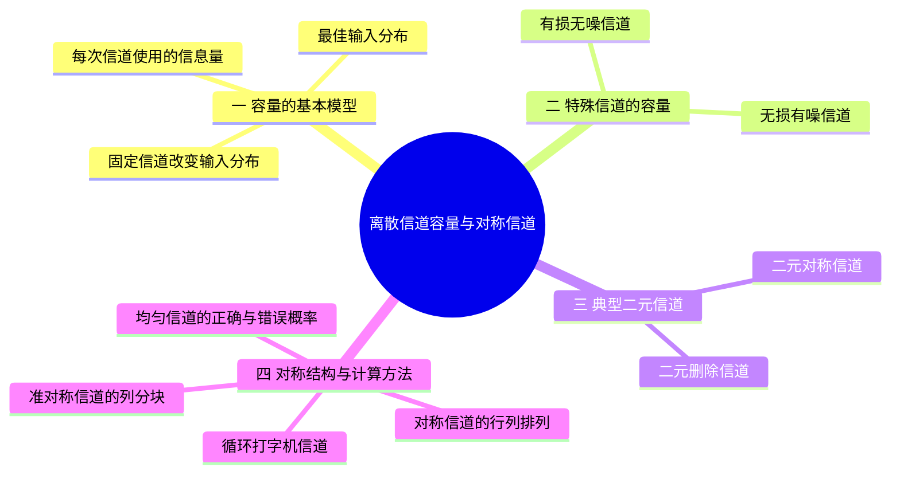
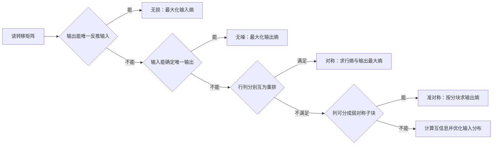

# 08 第8课 离散信道容量与对称信道

## 本课概要

> [!abstract] 本课主线
> 上一课的平均互信息描述给定输入分布时，一次接收平均获得多少信息。本课固定信道转移概率，允许发送端改变输入分布，寻找互信息的最大值。先用无损、无噪信道看清两个条件熵的作用，再计算 BEC 和 BSC，最后从转移矩阵的行与列识别对称、均匀与准对称信道。

## 一、固定信道后优化输入分布

同一条信道，发送端若一直发送同一个符号，接收端很快就能猜中它，并没有从当前输出获得多少新信息；发送端若合理使用不同符号，接收结果才可能持续提供信息。因此，信道的传输能力不能只凭某一次选定的输入分布判断。

设 $X$ 为一次信道使用的输入，$Y$ 为输出，转移概率 $p(y_j\mid x_i)$ 固定。输入分布 $p(x_i)$ 改变时，平均互信息 $I(X;Y)$ 通常也改变。回顾上一课的两种表达式：

$$
I(X;Y)=H(X)-H(X\mid Y)=H(Y)-H(Y\mid X).
$$

第一种写法比较发送前与接收后的输入不确定性；第二种写法从输出的总不确定性中扣除已知输入后仍由信道造成的随机性。对所有允许的输入概率分布取最大值，定义这条离散信道的**容量**：

$$
\boxed{C=\max_{p(x)}I(X;Y).}
$$

达到最大值的分布 $p^*(x)$ 称为最佳输入分布，此时 $I_{p^*}(X;Y)=C$。若 $X,Y$ 分别对应一次信道使用，容量的单位是比特每次使用；要换算成比特每秒，还须知道每秒能使用信道多少次。这里讨论的是单次使用的离散信道；对连续多次使用的信道，还需说明各次之间是否无记忆。

一个最简单的检验是无差错传送二元符号。此时 $Y=X$，所以 $I(X;Y)=H(X)$。若只发送 $0$，互信息为零；若 $0,1$ 等概率，互信息为 $1$ 比特，容量才达到 $1$ 比特每次使用。**互信息是当前输入方式的实际表现，容量是最佳输入方式下的上限。**

## 二、由两个条件熵认识特殊信道

计算容量时，不必一开始就对互信息作繁琐优化。先问两个具体问题：收到 $Y$ 后能否认出 $X$；已知 $X$ 后，$Y$ 是否还会随机变化。它们分别由 $H(X\mid Y)$ 和 $H(Y\mid X)$ 回答。

### 无损有噪：输出随机，但仍能认出输入

设输入为 $0,1$，输出为 $a,b,c,d$，转移矩阵为

$$
\mathbf W=\begin{array}{c|cccc}
 &a&b&c&d\\\hline
X=0&\tfrac12&\tfrac12&0&0\\
X=1&0&0&\tfrac12&\tfrac12
\end{array}.
$$

沿一行看：发送 $0$ 后可能收到 $a$ 或 $b$，所以即使知道输入，输出仍有随机性，$H(Y\mid X)=1$ 比特。沿一列反推：收到 $a,b$ 必定发送了 $0$，收到 $c,d$ 必定发送了 $1$，所以 $H(X\mid Y)=0$。这就是**无损有噪**：输出有随机变化，但没有丢失辨认原输入所需的信息。

因而 $I(X;Y)=H(X)$。二元输入等概率时 $H(X)$ 最大，为 $1$ 比特，故这个信道的容量为 $C=1$ 比特每次使用。一般地，若 $m$ 个有效输入各自可能产生的输出集合互不重叠，接收端总能反推输入；令这些输入等概率便有 $C=\log_2m$。

### 有损无噪：输出确定，但可能合并输入

再看一个方向相反的例子。设输入 $0,1$ 都变成 $a$，输入 $2,3$ 都变成 $b$：

$$
\mathbf W=\begin{array}{c|cc}
 &a&b\\\hline
X=0&1&0\\
X=1&1&0\\
X=2&0&1\\
X=3&0&1
\end{array}.
$$

每一行只有一个 $1$，即 $Y$ 由 $X$ 完全确定，$H(Y\mid X)=0$。但收到 $a$ 无法判断原来是 $0$ 还是 $1$；收到 $b$ 也无法区分 $2$ 与 $3$。信道把四个输入压成了两个可辨认的组。

此时 $I(X;Y)=H(Y)$。输出最多只有两种，故互信息不超过 $1$ 比特；只要让 $a,b$ 各以 $1/2$ 的概率出现，就达到 $C=1$ 比特每次使用。例如四个输入各以 $1/4$ 的概率发送便能达到。一般地，若确定映射 $Y=f(X)$ 有 $r$ 种可达到的输出，容量为 $\log_2r$：发送端可给每个输出选一个代表输入，并等概率使用这些代表。

“有损”描述信道存在合并不同输入的可能，并不表示**每一种**输入分布都有正的损失熵。若在上例中只使用 $0$ 和 $2$，接收端就能反推实际发送的输入，但信道仍无法区分未使用的同组符号。

## 三、BEC 与 BSC 的容量

### 二元删除信道：未删除时看得准，删除时完全看不见

二元删除信道（BEC）把辨认不出的一个位置标成 $?$。设发送 $0$、$1$ 时的删除概率都为 $q$，则

$$
\mathbf W_{\mathrm{BEC}}=\begin{array}{c|ccc}
 &Y=0&Y=1&Y=?\\\hline
X=0&1-q&0&q\\
X=1&0&1-q&q
\end{array}.
$$

收到 $0$ 或 $1$ 时，输入没有疑义；收到 $?$ 时，由于两种输入的删除概率相同，删除标记本身也没有透露输入是哪一个，后验分布仍等于原输入分布。删除发生的概率为 $q$，因此平均剩余不确定性为

$$
H(X\mid Y)=qH(X),
\qquad I(X;Y)=(1-q)H(X).
$$

两式中的 $H(X)$ 是发送前一个二元符号的不确定性。要让接收端平均获得的信息最多，应使 $0,1$ 等概率，从而 $H(X)=1$ 比特：

$$
\boxed{C_{\mathrm{BEC}}=1-q.}
$$

例如 $q=1/4$ 时，等概率输入可得到 $3/4$ 比特每次使用。直观地说，平均每四个位置中约有三个直接告诉接收端原符号，另一个位置只留下问号。这里的删除是**位置已知的擦除**；若符号消失后连原位置也未知，就不是这个模型。

### 二元对称信道：收到了符号，却不知道是否翻转

BSC 不会显示问号。它总输出 $0$ 或 $1$，但两种输入都以概率 $p$ 被翻转：

$$
\mathbf W_{\mathrm{BSC}}=\begin{array}{c|cc}
 &Y=0&Y=1\\\hline
X=0&1-p&p\\
X=1&p&1-p
\end{array}.
$$

两行只是把同一对概率调换位置，所以无论输入分布如何，已知输入后的输出熵都是一行的熵。记二元熵函数为

$$
h_2(u)=-u\log_2u-(1-u)\log_2(1-u),
$$

其中 $u$ 是二元结果之一的概率，零概率项按极限取零。于是 $H(Y\mid X)=h_2(p)$。设发送 $1$ 的概率为 $a$，收到 $1$ 有“发送 $0$ 后翻转”和“发送 $1$ 后未翻转”两条路径，故

$$
P(Y=1)=(1-a)p+a(1-p)=p+a(1-2p).
$$

输出为二元变量，$H(Y)$ 最大只能为 $1$ 比特。取 $a=1/2$ 时，输出恰好也等概率，达到这个上限。因此

$$
I(X;Y)=h_2\bigl(p+a(1-2p)\bigr)-h_2(p),
\qquad
\boxed{C_{\mathrm{BSC}}=1-h_2(p).}
$$

例如 $p=0.1$ 时，$h_2(0.1)\approx0.469$，故容量约为 $0.531$ 比特每次使用，而非正确接收概率 $0.9$。若 $p=1/2$，两行完全相同，输出与输入无关，容量为零；若 $p=1$，每次都翻转，但接收端可反向解释输出，容量仍为 $1$ 比特。

## 四、对称、均匀与准对称信道

BSC 的两行把相同的概率换了位置，两列也是如此。把这个结构推广到一般离散信道时，先区分行和列各自代表什么：第 $i$ 行是固定输入 $x_i$ 后各输出的概率分布；第 $j$ 列则收集不同输入产生同一个输出 $y_j$ 的概率。行互为重排说明每种输入面临同样大小的输出随机性，却不能单凭这一点断言等概率输入会产生等概率输出。

### 对称信道：行与列分别互为重排

本课把**各行互为重排，且各列也互为重排**的转移矩阵称为对称信道。有些教材称它为**强对称信道**，并把“各行互为重排、各列概率和相等”称为弱对称信道，甚至简称对称信道；遇到不同叫法，应以题目给出的矩阵条件为准。这里的行、列分别比较，不要求一行与一列含有相同数值，也不要求矩阵是方阵。

例如，下面的两行各含两个 $1/3$ 和两个 $1/6$，四列各含一个 $1/3$ 和一个 $1/6$，所以它是一个有两个输入、四个输出的对称信道：

$$
\mathbf W=\begin{array}{c|cccc}
 &y_1&y_2&y_3&y_4\\\hline
x_1&\tfrac13&\tfrac13&\tfrac16&\tfrac16\\
x_2&\tfrac16&\tfrac16&\tfrac13&\tfrac13
\end{array}.
$$

沿行看，各行熵相同，记为 $h=H(Y\mid X=x_i)$，故不论怎样选择输入分布，$H(Y\mid X)=h$。沿列看，各列互为重排，因而列和相等。若矩阵有 $m$ 行、$n$ 列，每行和为 $1$，则每列和必为 $m/n$。输入等概率时，

$$
P(Y=y_j)=\frac1m\sum_{i=1}^{m}p(y_j\mid x_i)
=\frac1m\cdot\frac mn=\frac1n.
$$

输出达到最大熵 $\log_2n$，同时噪声熵仍为 $h$，所以对称信道的容量为

$$
\boxed{C=\log_2n-h.}
$$

这里的 $n$ 是**输出符号数**；等概率输入一定达到容量，但最佳输入分布不一定只有一种。上面的矩阵中 $n=4$，所以 $C=2-H(1/3,1/3,1/6,1/6)$，约为 $0.082$ 比特每次使用。只检查行重排而没有核对列，不能直接套用这个公式。

### 均匀信道：错误概率平均分给其他输出

如果输入、输出各有 $r$ 个符号，且每个输入以同样的概率 $1-p$ 正确传输，以总概率 $p$ 出错，并把错误等概率分给其余 $r-1$ 个输出，就得到本课所说的**均匀信道**，也常称 $r$ 元对称信道。它的转移矩阵是方阵，主对角线均为 $1-p$，其余元素均为 $p/(r-1)$；因此各行、各列都互为重排，是对称信道的一个特殊情形，而不是对称信道的另一种名称。$r=2$ 时，它就是前面的 BSC。

$$
\mathbf W=\begin{pmatrix}
1-p & \frac{p}{r-1} & \cdots & \frac{p}{r-1}\\
\frac{p}{r-1} & 1-p & \cdots & \frac{p}{r-1}\\
\vdots & \vdots & \ddots & \vdots\\
\frac{p}{r-1} & \frac{p}{r-1} & \cdots & 1-p
\end{pmatrix}.
$$

固定一个输入后，先判断“正确还是出错”，其熵是 $h_2(p)$；若出错，还要在 $r-1$ 个等可能输出之间选择，平均多出 $p\log_2(r-1)$。因此行熵与容量分别为

$$
h=h_2(p)+p\log_2(r-1),
\qquad
\boxed{C=\log_2r-h_2(p)-p\log_2(r-1).}
$$

其中 $r\ge2$，$0\le p\le1$。这个公式依赖“所有正确概率相同、所有单个错误概率也相同”；只有行列互为重排的普通对称信道未必具有这种统一的正误概率。

### 准对称信道：按输出列分成对称子块

即使整体各列不互为重排，信道仍可能有可利用的对称结构：若能把**列**分成若干组，使每组构成的子矩阵都满足“组内各行互为重排、组内各列概率和相等”，则称为**准对称信道**。这里对子块采用弱对称判据；若每块的列也互为重排，则是截图所说的“对称子块”情形。不能把“仅有整体行重排”当作准对称的充分条件。

例如，下面的矩阵常被误判为对称信道，因为两行确实互为重排：

$$
\mathbf W=\begin{array}{c|cccc}
 &y_1&y_2&y_3&y_4\\\hline
x_1&\tfrac13&\tfrac13&\tfrac16&\tfrac16\\
x_2&\tfrac16&\tfrac13&\tfrac16&\tfrac13
\end{array}.
$$

但四列之和依次为 $1/2,2/3,1/3,1/2$，并不相等。等概率输入得到的输出分布为 $(1/4,1/3,1/6,1/4)$，也不等概率。把列分成 $\{y_1,y_4\}$、$\{y_2\}$、$\{y_3\}$ 三块后，每块都满足上述子块条件，所以这个矩阵是准对称信道，而不是对称信道。

设第 $k$ 块有 $n_k$ 列，每行落入该块的概率为 $a_k$。各块的行互为重排，保证 $a_k$ 不随输入改变。接收结果先有“落入哪一块”的不确定性 $H(a_1,\ldots,a_s)$；在第 $k$ 块内，等概率输入又使各列等概率，贡献 $a_k\log_2n_k$。因此等概率输入可达到

$$
H(Y)=H(a_1,\ldots,a_s)+\sum_{k=1}^{s}a_k\log_2n_k.
$$

若任意一整行的熵为 $h$，则 $H(Y\mid X)=h$，容量为

$$
\boxed{C=H(a_1,\ldots,a_s)+\sum_{k=1}^{s}a_k\log_2n_k-h.}
$$

对称信道将整矩阵作为一个分块即可，此式退化为 $C=\log_2n-h$；准对称信道需要多个分块时，不能把输出总数直接代入这个简式。

对于上面的三块，$(a_1,a_2,a_3)=(1/2,1/3,1/6)$，$(n_1,n_2,n_3)=(2,1,1)$，而 $h=H(1/3,1/3,1/6,1/6)\approx1.9183$。代入分块公式得 $C\approx0.0409$ 比特每次使用，确实不同于把四个输出误当成等概率时算出的结果。

### 循环打字机信道

设一台打字机有 $A,B,C,D$ 四个键。按下一个键后，以 $1/2$ 的概率印出本字母，以 $1/2$ 的概率印出循环排列中的下一个字母，$D$ 的下一个回到 $A$：

$$
\mathbf W=\begin{array}{c|cccc}
 &Y=A&Y=B&Y=C&Y=D\\\hline
X=A&\tfrac12&\tfrac12&0&0\\
X=B&0&\tfrac12&\tfrac12&0\\
X=C&0&0&\tfrac12&\tfrac12\\
X=D&\tfrac12&0&0&\tfrac12
\end{array}.
$$

沿行看，每行都有两个 $1/2$，故 $h=1$ 比特；沿列看，每列也都有两个 $1/2$，所以这是对称信道。四个键等概率使用时，四种印出结果等概率，$H(Y)=\log_2 4=2$ 比特，容量为

$$
C=\log_2 4-1=1\quad\text{比特每次使用}.
$$

若同样的循环规则推广到 $n$ 个键，容量为 $\log_2n-1$；例如使用 $26$ 个字母时约为 $3.70$ 比特每次使用。这里先用四键矩阵展示行、列的排列规律，再推广到更多字母；实际题目若给出不同的转移概率，应按其矩阵重新计算行熵。

## 五、计算路线与易错点

拿到信道题，先从转移矩阵读出它究竟是“输出能反推输入”“输入决定输出”，还是具有行、列对称性，再选相应的互信息表达式。BEC 的问号要单独分析；BSC 和打字机可先算一行的熵，再检查等概率输入是否让输出达到最大熵。判断对称结构时，先核对各行，再核对各列；若整矩阵的列不符合条件，再看能否按列分成对称子块。

特别不要把几种说法混为一谈：$H(Y\mid X)=0$ 说的是输出没有随机性，不保证输入无损；$H(X\mid Y)=0$ 说的是输入可以恢复，不保证输出没有随机性；行排列只保证行熵相同；列和相等才保证等概率输入产生等概率输出，但还不足以满足本课“各列互为重排”的对称信道定义。均匀信道还要求统一的正误概率，准对称信道则按列分块检查。最后再把算出的 $I(X;Y)$ 与容量 $C$ 区分开：只有最佳输入分布下，两者才相等。

复习时可先用本课的两个特殊信道矩阵辨认条件熵的方向，再重算 BEC 与 BSC 的容量，最后逐行逐列检查打字机矩阵，并试着将上面的准对称信道按输出列分块。
