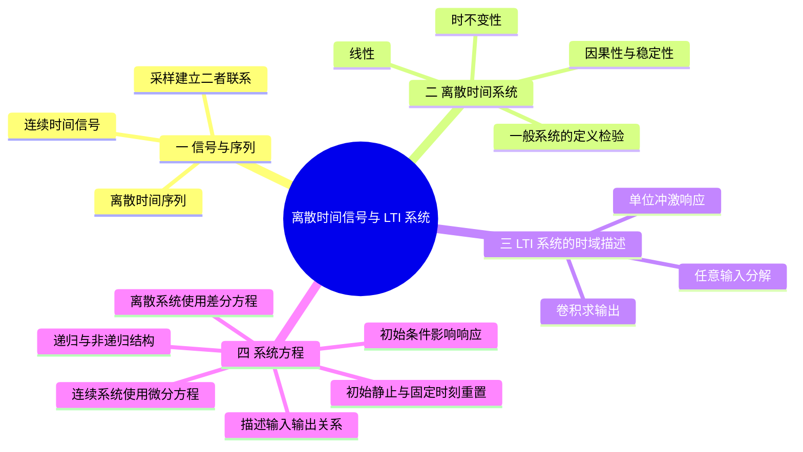
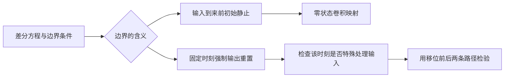

# 第 1 课：离散时间信号、LTI 系统与差分方程

## 本课概要

> [!abstract] 本课定位
> 本课先回答“信号和系统究竟是什么”，再说明为什么离散系统主要研究线性时不变（LTI）系统，以及为什么同一系统既可以由冲激响应与卷积描述，也可以由差分方程描述。学完本课，应能区分连续时间信号与离散序列，并理解差分方程中的记忆、递推和初始条件。

系统性质的判断沿“输入怎样变化、输出是否保持相应关系”展开；最后再把差分方程的边界条件纳入系统规则，区分初始静止与固定时刻重置。

## 1. 信号与系统的研究对象

数字信号处理最基本的问题是：给定输入信号和处理规则，输出会是什么？

例如，麦克风记录声音，滤波器削弱噪声，扬声器播放处理后的声音。这里的声音波形是信号，滤波器是系统。

连续时间信号写成

$$
x_c(t),\qquad t\in\mathbb R.
$$

时间 $t$ 可以取任意实数。离散时间序列写成

$$
x[n],\qquad n\in\mathbb Z.
$$

$n$ 不是连续时间，而是样点编号。若每隔 $T_s$ 秒测量一次连续信号，就得到

$$
x[n]=x_c(nT_s).
$$

因此，$x_c(t)$ 和 $x[n]$ 不是括号写法不同的同一个对象。前者描述任意时刻，后者只保留采样时刻的信息。

系统可以统一写成

$$
y=\mathcal T\{x\},
$$

表示系统 $\mathcal T$ 把输入 $x$ 变成输出 $y$。本课程最重要的是线性时不变系统，简称 LTI 系统。

- **线性**意味着输入可以拆开处理再相加。若输入扩大若干倍，输出也扩大相同倍数。
- **时不变**意味着同一种输入无论何时进入，系统都遵循同一规则。输入整体延迟，输出只会整体延迟。

这两个性质使我们能够把复杂信号拆成简单成分，分别研究系统对每个成分的作用。

## 2. 系统性质的四个独立判据

先固定同一个处理对象：输入是一整条序列，系统按规则取出、组合样点，得到输出。判断系统性质时，不能只看公式中有没有某个字母；应当分别改变输入的幅度、进入时间、未来样点和数值上界，观察输出怎样变化。四种性质考察的是同一个系统的不同方面。

### 2.1 线性与时不变性

例如 $\mathcal T\{x\}[n]=x[2n]$ 会在输出位置 $n$ 读取输入位置 $2n$。它没有改变样值之间的加法关系，因此先相加再取样，与分别取样再相加相同。一般的线性判据是

$$
\mathcal T\{a x_1+b x_2\}[n]
=a\mathcal T\{x_1\}[n]+b\mathcal T\{x_2\}[n],
$$

其中 $a,b$ 是任意常数，$x_1,x_2$ 是任意允许的输入。必须同时满足可加性和齐次性。零输入产生零输出是必要条件，但单凭这一点不能证明线性，例如平方系统也满足零输入零输出。

时不变性考察另一个变化：保持波形不变，只把输入整体延迟。对任意整数延迟 $d$，应比较

$$
\mathcal T\{x[n-d]\}[n]
\qquad\text{与}\qquad
\mathcal T\{x\}[n-d].
$$

两者对全部输入和允许的移位都相等，系统才时不变。前者先延迟输入再进系统，后者先过系统再延迟输出。仍取 $x[2n]$，前者是 $x[2n-d]$，后者是 $x[2n-2d]$，一般不同，所以它线性但时变。这也说明：公式没有显式的乘数 $n$，不代表系统一定时不变。

### 2.2 因果性与 BIBO 稳定性

对 $y[n]=x[2n]$，在 $n=1$ 时必须读取 $x[2]$，需要未来样点。若两个输入在 $n\leq1$ 完全相同，只在 $n=2$ 不同，输出 $y[1]$ 就会不同，所以系统非因果。

一般地，**在任意时刻 $n$，当前输出只能由不晚于 $n$ 的输入决定**，系统才因果。非线性、时变系统也可以这样判断。对 $y[n]=x[g(n)]$，只要存在一个时刻满足 $g(n)>n$，就能构造上述反例；若所有时刻均有 $g(n)\leq n$，则该取样系统因果。

稳定性不问读取的是过去还是未来，而问有界输入会不会产生无界输出。若对每个满足

$$
\lvert x[n]\rvert\leq M<\infty
$$

的输入，都存在一个不随 $n$ 增大的有限上界 $B$，使 $\lvert y[n]\rvert\leq B$，就称系统有界输入有界输出稳定，简称 BIBO 稳定。这里 $B$ 可以依赖输入的上界 $M$，但不能随时间无限增长。

例如 $x[2n]$ 虽然非因果，却满足 $\lvert x[2n]\rvert\leq M$，所以稳定。累加器

$$
y[n]=\sum_{k=0}^{n}x[k],\qquad n\geq0
$$

只读取现在和过去，所以因果；但有界输入 $x[k]=1$ 产生 $y[n]=n+1$，因此不稳定。每次相加的项有限，不等于整个输出序列有统一上界。

| 性质 | 改变或比较的对象 | 最小检验 |
| --- | --- | --- |
| 线性 | 输入的线性组合 | 比较整体处理与分别处理后叠加 |
| 时不变 | 输入和输出的整体移位 | 按两条路径分别代入，不凭外观判断 |
| 因果 | 同一时刻之后的输入 | 改动未来，检查当前输出是否改变 |
| 稳定 | 有界输入产生的整条输出 | 证明统一上界，或找一个无界输出反例 |

### 2.3 LTI 系统的冲激响应判据

前面的定义适用于一般系统。只有在线性、时不变的前提下，才能把系统完整地换成一个冲激响应 $h[n]$，并使用下面两个简化判据：

$$
\text{因果}\quad\Longleftrightarrow\quad h[n]=0\ (n<0),
$$

$$
\text{BIBO 稳定}\quad\Longleftrightarrow\quad
\sum_{n=-\infty}^{\infty}\lvert h[n]\rvert<\infty.
$$

例如 $h[n]=3^nu[n]$ 在负时间为零，但绝对值之和发散，因此因果而不稳定。$h[n]=2^nu[-n-1]$ 在负时间非零，但绝对值之和为 $\sum_{m=1}^{\infty}2^{-m}=1$，因此非因果而稳定。指数向哪一侧延伸，和指数底数一样重要。

第二个判据的充分性来自 $\lvert y[n]\rvert\leq M\sum_k\lvert h[k]\rvert$；必要性可以通过选择与冲激响应符号或相位匹配的有界输入证明。详细推导和 Z 域解释见 [[06 第6课 Z变换、收敛域与系统函数#5. 系统函数的因果性与稳定性]]。

## 3. 卷积与系统方程是同一系统的两种描述

### 3.1 冲激响应对 LTI 系统的完整表征

离散单位冲激为

$$
\delta[n]=
\begin{cases}
1,&n=0,\\
0,&n\ne0.
\end{cases}
$$

任意序列都能拆成许多位于不同位置、强度不同的冲激：

$$
x[n]=\sum_{k=-\infty}^{+\infty}x[k]\delta[n-k].
$$

设系统对 $\delta[n]$ 的响应为 $h[n]$。由于系统时不变，对 $\delta[n-k]$ 的响应就是 $h[n-k]$；由于系统线性，对 $x[k]\delta[n-k]$ 的响应就是 $x[k]h[n-k]$。

把所有响应相加：

$$
y[n]=\sum_{k=-\infty}^{+\infty}x[k]h[n-k].
$$

这就是卷积。它表达的不是一种孤立运算，而是：当前输出由所有输入样点留下的影响共同叠加而成。

### 3.2 连续系统与离散系统的方程描述

连续时间中的电压、电流、位移等物理量可以在任意时刻变化，因此常用导数描述瞬时变化率。连续系统可能满足

$$
\frac{\mathrm dy(t)}{\mathrm dt}+ay(t)=bx(t).
$$

它表示输出当前的变化速度、输出当前的大小和输入之间受到一个固定规律约束。

离散序列只在整数样点上有定义，两个样点之间没有可直接观察的瞬时变化率，因此使用相邻样点之差：

$$
y[n]-y[n-1].
$$

一般的线性常系数差分方程写成

$$
a_0y[n]+a_1y[n-1]+\cdots+a_Ny[n-N]
=b_0x[n]+b_1x[n-1]+\cdots+b_Mx[n-M].
$$

例如

$$
y[n]-0.8y[n-1]=x[n]
$$

可以改写为

$$
y[n]=x[n]+0.8y[n-1].
$$

当前输出依赖过去输出，说明系统具有记忆。差分方程适合逐点计算，冲激响应和卷积适合从整体上描述同一个 LTI 系统。

但这两种时域方法都有共同困难：卷积需要反复求和，递推也很难直接看出系统会保留哪些变化、削弱哪些变化。频域正是为了解决这个观察困难而引入的。

![[assets/离散时间信号与系统/时域描述关系.svg]]

## 4. 差分方程的边界条件与初始静止

只看到常系数方程，还没有完整确定输入输出映射。以

$$
y[n]=ay[n-1]+x[n]
$$

为例，当前输出还取决于递推起点之前储存的值。按本课程初值题的通常约定，输入从 $n=0$ 起施加，在 $n\geq0$ 上递推；若给定 $y[-1]=0$，则

$$
y[0]=x[0],\qquad y[1]=ax[0]+x[1],
$$

进而

$$
y[n]=\sum_{k=0}^{n}a^{n-k}x[k],\qquad n\geq0.
$$

对从 $n=0$ 开始的输入验证向右延迟，只检验了一部分移位，不能单凭它宣布系统时不变。若“初始静止”指输入到来前没有储存状态，就在所有具有有限起点的序列上使用同一映射

$$
\mathcal T\{x\}[n]=\sum_{k=-\infty}^{n}a^{n-k}x[k].
$$

原输入在 $n<0$ 为零时，这一映射自然满足 $y[-1]=0$；输入的起点移到别处时，初始静止区间也随之移动。任取整数 $d$，用 $m=k-d$ 换元后得到

$$
\begin{aligned}
\mathcal T\{x[\cdot-d]\}[n]
&=\sum_{k=-\infty}^{n}a^{n-k}x[k-d]\\
&=\sum_{m=-\infty}^{n-d}a^{(n-d)-m}x[m]
=\mathcal T\{x\}[n-d].
\end{aligned}
$$

这才是按定义判为时不变的依据。若反而规定在绝对时刻 $n=-1$ 强制重置，不论过去输入如何变化，取 $x[n]=\delta[n+1]$：原输出在 $n=-1$ 为零；把输入延迟一拍后，输出在 $n=0$ 为 $1$，却不等于原输出延迟后的 $0$。所以**固定重置映射时变**。边界条件若没有交代输入范围及重置含义，不能仅凭 $y[-1]=0$ 判断完整系统的时不变性。

若改为强制 $y[0]=0$，随后从 $n=1$ 递推，则

$$
y[n]=\sum_{k=1}^{n}a^{n-k}x[k],\qquad n\geq1.
$$

此时 $x[0]$ 没有进入输出。输入 $\delta[n]$ 得到全零输出；把输入延迟为 $\delta[n-1]$，却得到 $a^{n-1}u[n-1]$。原输出延迟仍为零，两条路径不同，因此这一固定起点规则线性但时变。

需要区分的不是“零在下标哪个位置就一定时变”，而是边界条件是否在特殊时刻改变了处理规则。

作业 1.5 的通常答案把 $y[-1]=0$ 作为原因果输入所满足的初始静止状态；若将其视为所有移位输入都必须满足的固定重置规则，时不变结论便不成立。

非零固定初态还会增加与输入无关的零输入响应。例如 $y[-1]=c$ 时，输出增加 $a^{n+1}c$。除退化情形外，零输入产生非零输出，完整输入输出映射就不再线性。其计算方法见第 6 课单边 Z 变换。

## 5. 本课小结

| 核心对象 | 它回答的问题 |
| --- | --- |
| $x[n]$ | 第 $n$ 个采样编号上的数值是多少？ |
| LTI 系统 | 复杂输入能否拆成简单输入分别处理？ |
| 冲激响应 $h[n]$ | 系统对“单位扰动”的长期反应是什么？ |
| 差分方程 | 当前输出如何由当前输入、过去输入和过去输出递推？ |

四种性质必须分别检验：线性比较输入组合，时不变比较移位顺序，因果比较未来输入是否影响当前输出，稳定比较是否存在统一的输出上界。只有确定 LTI 后，才使用冲激响应的因果与绝对可和判据；常系数方程还必须结合同一初始状态解释。

下一课将把“冲激响应代表系统”这句话变成可以实际计算的卷积和，并重点处理求和范围、移位和有限长序列长度。

---

## 相关笔记

[[02 第2课 序列的卷积和与卷积运算]]

对应作业：[[练习/01 第一章 第一次作业解析#1.5 边界条件与系统的线性、时不变性]]、[[练习/02 第一章 第二次作业解析#1.7 一般系统的四种性质]]。
