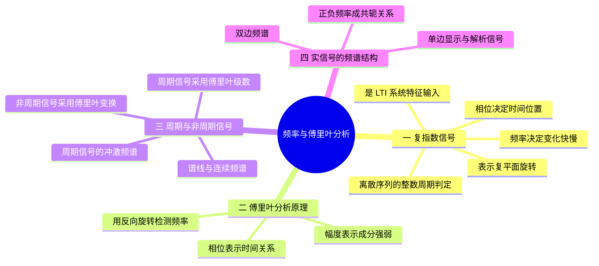

# 第 3 课：频率、复指数与傅里叶分析

## 本课概要

> [!abstract] 本课定位
> 本课解决一个根本疑问：系统明明可以直接在时域中计算，为什么还要引入频率和傅里叶分析？答案不是“公式更高级”，而是复指数通过 LTI 系统后保持频率不变，因此适合作为测试信号；傅里叶变换则把任意信号分解为这些测试信号的叠加。

进入傅里叶分析前，先把连续旋转与离散整数步返回区分开，掌握离散序列的周期判据；这也避免把“频率存在”误当成“序列必有整数周期”。

## 1. 复指数与 LTI 系统的特征函数

### 1.1 频率与相位

考虑余弦信号

$$
x(t)=A\cos(\Omega t+\varphi).
$$

$A$ 决定波形的高度，$\Omega$ 决定振荡速度，$\varphi$ 决定在 $t=0$ 时振荡已经进行到周期中的什么位置。

若 $\Omega\ne0$，周期为

$$
T=\frac{2\pi}{|\Omega|}.
$$

把信号延迟 $t_0$：

$$
\begin{aligned}
x(t-t_0)
&=A\cos\bigl(\Omega(t-t_0)+\varphi\bigr)\\
&=A\cos(\Omega t+\varphi-\Omega t_0).
\end{aligned}
$$

延迟没有改变 $t$ 前面的系数 $\Omega$，所以频率不变；它只增加相位 $-\Omega t_0$。相位变化可以表现为波峰和过零点出现得更早或更晚。

### 1.2 复指数的旋转表示

欧拉公式为

$$
e^{j\theta}=\cos\theta+j\sin\theta.
$$

在复平面上，$e^{j\theta}$ 是长度为 $1$、角度为 $\theta$ 的向量。令 $\theta=\Omega t$，这个向量便随时间旋转：

$$
e^{j\Omega t}=\cos(\Omega t)+j\sin(\Omega t).
$$

$\Omega$ 表示每秒增加多少弧度。复指数并不是说真实电压进入了复平面，而是把同频余弦、正弦及其相位关系装进一个便于计算的对象。

实余弦不能直接等于单个复指数。它由一对方向相反的复指数组成：

$$
\cos(\Omega t)
=\frac12e^{j\Omega t}+\frac12e^{-j\Omega t}.
$$

同理，正弦为

$$
\sin(\Omega t)
=\frac{e^{j\Omega t}-e^{-j\Omega t}}{2j}.
$$

正、负频率表示复平面中的两种旋转方向。对于实信号，它们互相配合，使最终结果的虚部抵消。

### 1.3 复指数通过 LTI 系统的频率不变性

设连续 LTI 系统的冲激响应为 $h(t)$，输入为

$$
x(t)=e^{j\Omega t}.
$$

输出由卷积得到：

$$
\begin{aligned}
y(t)
&=\int_{-\infty}^{+\infty}e^{j\Omega\tau}h(t-\tau)\,\mathrm d\tau\\
&=e^{j\Omega t}
\int_{-\infty}^{+\infty}h(\lambda)e^{-j\Omega\lambda}\,\mathrm d\lambda.
\end{aligned}
$$

后面的积分与 $t$ 无关，只是由系统和频率决定的复数。把它记作

$$
H(j\Omega)=|H(j\Omega)|e^{j\phi_H(\Omega)},
$$

于是

$$
y(t)=H(j\Omega)e^{j\Omega t}
=|H(j\Omega)|e^{j[\Omega t+\phi_H(\Omega)]}.
$$

输入和输出中的 $t$ 都乘以同一个 $\Omega$，因此频率没有改变。系统只做了两件事：

- 用 $|H(j\Omega)|$ 放大或缩小该频率；
- 用 $\phi_H(\Omega)$ 使该频率的周期位置提前或落后。

对冲激响应为实数的系统，输入 $\cos(\Omega t)$ 时，输出为

$$
y(t)=|H(j\Omega)|
\cos\bigl(\Omega t+\phi_H(\Omega)\bigr).
$$

复指数因此成为 LTI 系统最方便的试探输入：经过系统后形状和频率不变，系统作用可以由一个复数概括。

离散 LTI 系统也有完全对应的结论。将双边输入 $x[n]=e^{j\omega_0n}$ 代入卷积并提取与求和下标无关的因子：

$$
\begin{aligned}
y[n]&=\sum_{k=-\infty}^{\infty}h[k]e^{j\omega_0(n-k)}\\
&=e^{j\omega_0n}\sum_{k=-\infty}^{\infty}h[k]e^{-j\omega_0k}
=H(e^{j\omega_0})e^{j\omega_0n}.
\end{aligned}
$$

求和必须在该频率收敛；若 $h[n]$ 绝对可和，则全部频率都成立。这里输入从负无穷延续到正无穷，不能悄悄乘上 $u[n]$。$e^{j\omega_0n}u[n]$ 多了一个启动边界，输出通常还含启动过程，不能直接只保留上述同频项。

### 1.4 离散正弦与复指数序列的周期判定

连续复指数可以在连续时间轴上恰好转完一周；序列却只能观察整数位置。取 $x[n]=e^{j3\pi n/7}$，每走一个样点旋转 $3\pi/7$，要在某个正整数步数 $N$ 后回到原位置，必须存在整数 $k$ 使

$$
\frac{3\pi}{7}N=2\pi k,
\qquad 3N=14k.
$$

最小正整数解是 $N=14$。一般地，非恒定复指数 $e^{j(\omega_0n+\varphi)}$ 周期的判据是

$$
\omega_0N=2\pi k,\qquad N\in\mathbb Z_{>0},\quad k\in\mathbb Z.
$$

因此 $\omega_0/(2\pi)$ 必须是有理数；把它约成互素整数比 $p/q$ 后，基本周期为 $q$。相位 $\varphi$ 不改变这个返回条件。非退化实正弦、余弦也按此判定，但计算前应先检查序列是否恰好变成零或常数。例如 $\sin(3\pi n)=0$ 对所有整数 $n$ 成立，不能把这个零序列当成一条仍需求振荡周期的正弦波。

对序列通常把最小正整数周期称为基本周期，非零常值序列的基本周期为 $1$；零序列也满足任意正整数周期，有些教材会约定不讨论它的基本周期，使用时说明约定即可。若原式根本不含 $n$，例如 $e^{-j\pi}$，它就是常值序列。

教材习题 1.4（3）实际为 $e^{j(n/6-\pi)}$，每步相位增量是 $1/6$ 弧度，故周期条件为 $N=12\pi k$，不存在正整数解，因此非周期。注意辨认扫描公式中的 $n$ 与 $\pi$：$n/6$ 和 $\pi n/6$ 对应不同数字频率，周期性结论也不同。

多个周期序列相加时，最小公倍数给出一个公共周期，但相加后发生抵消时基本周期可能更小；不能先求周期再忽略实际样值。例如

$$
\sin(3\pi n)+\cos(15n)=\cos(15n)
$$

的第二项满足 $15/(2\pi)$ 为无理数，因此整体不周期。分子里出现 $\pi$ 才可能抵消分母的 $\pi$，不能把 $15$ 擅自读成 $15\pi$。

最后，周期判据必须检查整个序列。$\sin(\pi n/7)/(\pi n)$ 的分子周期为 $14$，但分母随位置增长；该序列在 $n=0$ 用极限补为 $1/7$ 后，趋于零且不恒为零，不可能周期。证明是：若存在周期 $N$ 且某点值非零，那么沿 $n_0+kN$ 会无限重复同一个非零值，与趋零矛盾。

这把“每步转多少角度”和“多少个整数步返回”区分开来，也为第 8 课选择与周期相容的旋转因子作准备。

## 2. 傅里叶分析的频率检测思想

假设信号中含有一个复指数分量

$$
x_0(t)=C_0e^{j\Omega_0t}.
$$

为了检测频率 $\Omega$，把它乘以反方向旋转的 $e^{-j\Omega t}$：

$$
x_0(t)e^{-j\Omega t}
=C_0e^{j(\Omega_0-\Omega)t}.
$$

当 $\Omega=\Omega_0$ 时，旋转完全抵消，结果变成固定复数 $C_0$。积分时，每一时刻的贡献朝同一方向累加。

当 $\Omega\ne\Omega_0$ 时，结果仍然旋转。经过合适的完整观察区间后，不同方向的贡献相互抵消。

因此傅里叶分析的核心不是背诵积分，而是：

> 用反方向旋转的待测频率抵消信号中的旋转；同频成分停止旋转并累积，异频成分继续旋转并抵消。

例如

$$
\int_0^\pi e^{-j4t}\,\mathrm dt
=\left[\frac{e^{-j4t}}{-j4}\right]_0^\pi
=\frac{e^{-j4\pi}-1}{-j4}=0.
$$

$e^{-j4t}$ 的长度始终为 $1$，但积分计算的是带方向的向量总和，而不是长度之和。在 $0\le t\le\pi$ 内它转过两整圈，各个方向正好抵消。若积分区间不能覆盖整数圈，一般会留下非零合成结果。

## 3. 周期信号的傅里叶级数与离散谱

设连续周期信号的周期为 $T_0$。组成它的复指数也必须在经过 $T_0$ 后回到原状态：

$$
e^{j\Omega(t+T_0)}=e^{j\Omega t}.
$$

这要求

$$
\Omega T_0=2\pi k,
\qquad k\in\mathbb Z.
$$

定义基波角频率

$$
\Omega_0=\frac{2\pi}{T_0},
$$

周期信号允许的频率就是离散的谐波 $k\Omega_0$。于是它可以写成

$$
x(t)=\sum_{k=-\infty}^{+\infty}C_ke^{jk\Omega_0t}.
$$

为了求第 $k$ 个谐波的复系数，在一个完整周期内用反向旋转检测并求平均：

$$
C_k=\frac{1}{T_0}
\int_{t_0}^{t_0+T_0}
x(t)e^{-jk\Omega_0t}\,\mathrm dt.
$$

除以 $T_0$ 是为了把同频分量在一个周期内累积出的 $T_0C_k$ 还原为 $C_k$。其他谐波在完整周期内转过整数圈，平均后为零。这种互不混淆的性质称为正交性。

### 3.1 傅里叶级数计算示例

考虑

$$
x(t)=3\cos\left(2t+\frac{\pi}{4}\right).
$$

其周期和基波角频率为

$$
T_0=\pi,
\qquad
\Omega_0=2.
$$

把余弦拆成复指数：

$$
x(t)=\frac32e^{j\pi/4}e^{j2t}
+\frac32e^{-j\pi/4}e^{-j2t}.
$$

因此只有两个非零系数：

$$
C_1=\frac32e^{j\pi/4},
\qquad
C_{-1}=\frac32e^{-j\pi/4}.
$$

也可以用系数公式验证。以 $C_1$ 为例：

$$
\begin{aligned}
C_1
&=\frac{1}{\pi}\int_0^\pi
x(t)e^{-j2t}\,\mathrm dt\\
&=\frac{3}{2\pi}
\left[
e^{j\pi/4}\int_0^\pi1\,\mathrm dt
+e^{-j\pi/4}\int_0^\pi e^{-j4t}\,\mathrm dt
\right]\\
&=\frac32e^{j\pi/4}.
\end{aligned}
$$

同频项停止旋转并留下，负频率项在积分区间内转整圈而抵消。

## 4. 非周期信号的傅里叶变换与连续频谱

非周期信号没有可重复使用的周期，也就没有固定基波。可以先截取很长一段，把它暂时看成周期为 $T_0$ 的信号。此时相邻谐波间隔为

$$
\Delta\Omega=\frac{2\pi}{T_0}.
$$

当 $T_0$ 越来越大时，$\Delta\Omega$ 越来越小。极限 $T_0\to\infty$ 下，离散谱线变成连续频率轴，傅里叶级数求和过渡为傅里叶积分。

连续时间傅里叶变换为

$$
X(j\Omega)=\int_{-\infty}^{+\infty}
x(t)e^{-j\Omega t}\,\mathrm dt,
$$

逆变换为

$$
x(t)=\frac{1}{2\pi}
\int_{-\infty}^{+\infty}
X(j\Omega)e^{j\Omega t}\,\mathrm d\Omega.
$$

正变换对时间积分，用来检测固定频率 $\Omega$；逆变换对频率积分，用来把所有频率的小贡献重新叠加。

$X(j\Omega)$ 在每个频率处是一个复数：

$$
X(j\Omega)=|X(j\Omega)|e^{j\phi(\Omega)}.
$$

$|X(j\Omega)|$ 描述该频率附近的幅度密度，$\phi(\Omega)$ 描述该频率分量的相位。连续频率轴上的单独一点没有宽度，真正参与重建的是

$$
\mathrm dx(t)=\frac{1}{2\pi}
X(j\Omega)e^{j\Omega t}\,\mathrm d\Omega.
$$

这就是为什么非周期信号的频谱更准确地称为复频谱密度，而周期信号的 $C_k$ 是离散谱线的完整复系数。

### 4.1 周期信号的傅里叶变换表示

周期信号通常不衰减，普通傅里叶积分不收敛，但可以用冲激表示其广义傅里叶变换。因为

$$
e^{jk\Omega_0t}
\quad\longleftrightarrow\quad
2\pi\delta(\Omega-k\Omega_0),
$$

所以

$$
x(t)=\sum_kC_ke^{jk\Omega_0t}
$$

对应

$$
X(j\Omega)=2\pi\sum_k
C_k\delta(\Omega-k\Omega_0).
$$

这里 $C_k$ 没有变成 $X(j\Omega)$。它成为频率 $k\Omega_0$ 处冲激的权重 $2\pi C_k$。把这个冲激频谱代入傅里叶逆变换，冲激的筛选作用会把积分自动化成傅里叶级数求和。

因此，用 $C_k$ 表示周期频谱时，重建使用求和；用冲激形式的 $X(j\Omega)$ 表示时，统一写成逆变换积分。两种表示包含相同信息。

## 5. 实信号的正负频率共轭结构

电压、声压和温度等物理量通常用实数表示，因此相应信号满足

$$
x(t)\in\mathbb R.
$$

以实余弦为例：

$$
x(t)=A\cos(\Omega_0t+\varphi).
$$

傅里叶分析不是直接使用余弦作为唯一的基本构件，而是使用复指数。根据欧拉公式，实余弦可以拆成

$$
\begin{aligned}
x(t)
&=\frac{A}{2}e^{j\varphi}e^{j\Omega_0t}
+\frac{A}{2}e^{-j\varphi}e^{-j\Omega_0t}.
\end{aligned}
$$

$e^{j\Omega_0t}$ 与 $e^{-j\Omega_0t}$ 表示复平面中方向相反的两种旋转。两个分量的虚部互相抵消，实部相加后成为实余弦。因此，负频率并不是另一种额外的物理振动，而是复指数表示法中的反向旋转。

这种成对关系并不限于余弦。连续时间傅里叶变换为

$$
X(j\Omega)=\int_{-\infty}^{+\infty}x(t)e^{-j\Omega t}\,\mathrm dt.
$$

如果 $x(t)$ 为实信号，那么 $x^*(t)=x(t)$，于是

$$
\begin{aligned}
X^*(j\Omega)
&=\int_{-\infty}^{+\infty}x^*(t)e^{j\Omega t}\,\mathrm dt\\
&=X(-j\Omega).
\end{aligned}
$$

所以实信号的频谱满足共轭对称性：

$$
\boxed{X(-j\Omega)=X^*(j\Omega)}.
$$

由此还能得到：

$$
|X(-j\Omega)|=|X(j\Omega)|,
$$

即幅度谱是偶对称的；相位谱在适当选取相位分支后是奇对称的。正、负频率虽然都存在，但其中一半可以由另一半恢复，因此它们不提供两份彼此独立的信息。

![[assets/单双边频谱对比.svg]]

## 6. 双边谱、单边显示与解析信号

完整傅里叶频谱的频率变量满足 $-\infty<\Omega<+\infty$，所以无论信号是实数还是复数，完整频谱都可以画在整条正、负频率轴上，这就是双边谱。

工程中经常只画实信号的正半轴。由于实信号的负半轴可由共轭关系恢复，这样做不会丢掉独立信息。为了使单边幅度代表正、负两侧的合计贡献，通常把非零正频率处的幅度乘以 $2$，但直流分量不乘 $2$。这种单边幅度谱只是**显示方法改变了**，原实信号的负频率并没有消失。

真正的单边频谱是指频谱在某一侧实际为零。例如

$$
x_c(t)=e^{j\Omega_0t}
$$

的频谱为

$$
X_c(j\Omega)=2\pi\delta(\Omega-\Omega_0),
$$

它只在正频率 $+\Omega_0$ 处有谱线。这个信号是复信号，因为

$$
x_c(t)=\cos(\Omega_0t)+j\sin(\Omega_0t).
$$

实信号的非零频率成分必须正、负共轭成对，所以含有非零频率成分的实信号不可能只保留其中一侧。仅在直流处有谱线的实常数是边界情况，不能把它误排除。反过来，复信号只是**有可能**具有单边谱，并不一定如此。例如

$$
x_c(t)=e^{j\Omega_1t}+2e^{-j\Omega_2t}
$$

仍然同时具有正、负频率。准确关系是

$$
\boxed{
\text{含非零频率成分的真正单边频谱}\Longrightarrow\text{非实信号}
}
$$

但

$$
\boxed{
\text{复信号}\not\Longrightarrow\text{单边频谱}
}.
$$

## 7. 本课小结与适用边界

傅里叶分析回答的是“信号由哪些旋转频率组成，以及系统怎样改变各频率的幅度与相位”。对于实信号，正、负频率成对出现；把双边谱只画成正半轴是显示约定，不等于原信号真的没有负频率。真正的单边谱通常要求复信号，但复信号也不一定只有单边频率。

下一课把观察对象固定为离散序列，研究 DTFT 中的数字角频率、周期性、时移与频移。

---

## 相关笔记

[[02 第2课 序列的卷积和与卷积运算]]、[[04 第4课 DTFT与数字频率]]、[[05 第5课 采样、混叠与理想恢复]]

对应作业：[[练习/01 第一章 第一次作业解析#1.4 序列的周期性]]、[[练习/02 第一章 第二次作业解析#1.14 差分方程的冲激响应与复指数输入]]。
