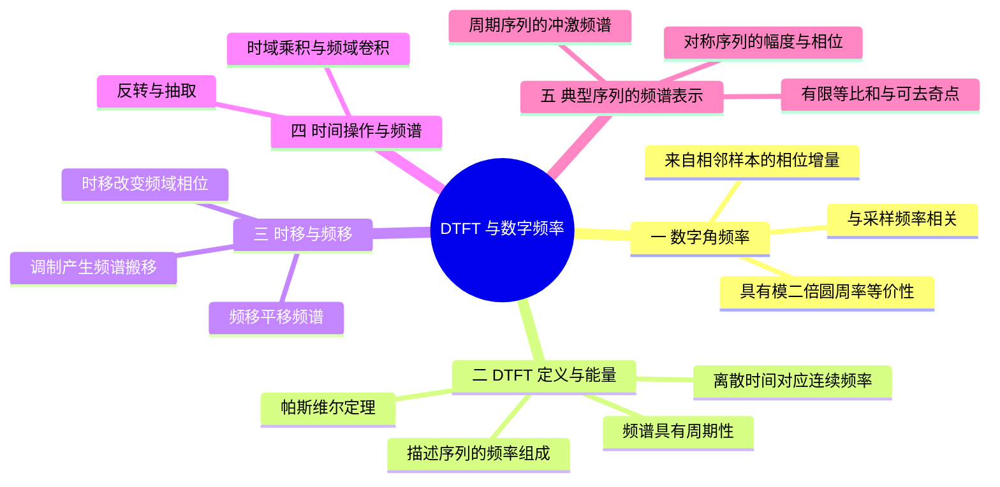
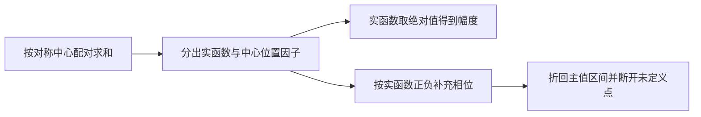

# 第 4 课：DTFT 与数字频率

## 本课概要

> [!abstract] 本课定位
> 连续傅里叶变换使用连续角频率 $\Omega$，采样后的序列则使用数字角频率 $\omega$。本课说明二者如何通过采样周期联系起来，为什么 DTFT 总是以 $2\pi$ 为周期，以及为什么 DTFT 是单位圆上的 Z 变换这一事实要到 Z 变换一课才能完全讲清。

在此基础上，本课继续沿着样点被移位、反转、抽取、相乘的过程，建立相应的频谱性质；最后分别计算有限序列的幅相曲线和周期序列的冲激频谱。实际练习见 [[练习/03 第二章 作业解析]]。

## 1. 离散时间傅里叶变换与数字角频率

### 1.1 数字角频率来自采样后的相位增量

连续复指数

$$
x_c(t)=e^{j\Omega t}
$$

以周期 $T_s$ 采样后变成

$$
x[n]=e^{j\Omega nT_s}.
$$

定义

$$
\omega=\Omega T_s,
$$

便得到

$$
x[n]=e^{j\omega n}.
$$

$\omega$ 表示样点编号每增加 $1$，复向量转过多少弧度，单位为 $\mathrm{rad/sample}$。若连续信号频率为 $f$，采样频率为 $f_s$，则

$$
\omega=2\pi\frac{f}{f_s}.
$$

因此数字角频率不是必须由序列周期产生的。它首先是离散复指数每个样点的相位增量。

离散时间傅里叶变换为

$$
X(e^{j\omega})
=\sum_{n=-\infty}^{+\infty}
x[n]e^{-j\omega n},
$$

逆变换为

$$
x[n]=\frac{1}{2\pi}
\int_{-\pi}^{\pi}
X(e^{j\omega})e^{j\omega n}\,\mathrm d\omega.
$$

即使 $x[n]$ 没有周期，也可以让检测变量 $\omega$ 连续变化。若序列以 $N_0$ 个样点为周期，它才具有数字基波角频率

$$
\omega_0=\frac{2\pi}{N_0}
$$

和离散谐波 $k\omega_0$。

### 1.2 DTFT 的 $2\pi$ 周期性

由于 $n$ 只能取整数：

$$
\begin{aligned}
e^{-j(\omega+2\pi)n}
&=e^{-j\omega n}e^{-j2\pi n}\\
&=e^{-j\omega n}.
\end{aligned}
$$

因此

$$
X(e^{j(\omega+2\pi)})=X(e^{j\omega}).
$$

相差 $2\pi$ 的数字频率在所有整数样点上的取值完全相同，所以无法区分。只需研究任意一个长度为 $2\pi$ 的区间，例如 $[-\pi,\pi)$。

连续复指数 $e^{j\Omega t}$ 虽然对时间 $t$ 周期，但连续频率不具有同样的等价关系。因为 $t$ 可以取任意实数，$e^{j2\pi t}$ 并不总等于 $1$。这是连续频谱不天然以 $2\pi$ 周期重复，而 DTFT 会重复的根本原因。

### 1.3 帕斯维尔定理：能量只是换了一种坐标

有限能量序列满足

$$
E_x=\sum_{n=-\infty}^{+\infty}|x[n]|^2<\infty.
$$

帕斯维尔定理给出

$$
\sum_{n=-\infty}^{+\infty}|x[n]|^2
=\frac{1}{2\pi}
\int_{-\pi}^{\pi}|X(e^{j\omega})|^2\,\mathrm d\omega.
$$

时域索引 $n$ 离散，所以使用求和；频率变量 $\omega$ 连续，所以使用积分。可以把

$$
\frac{1}{2\pi}|X(e^{j\omega})|^2
$$

理解为能量在数字频率轴上的密度。积分说明频率变量连续，但不能单凭积分符号断言频谱曲线处处连续。

非零周期序列会无限重复，总能量通常为无穷大，因此改用平均功率。若周期为 $N_0$，傅里叶级数系数为 $C_k$，则

$$
\frac{1}{N_0}\sum_{n=0}^{N_0-1}|x[n]|^2
=\sum_{k=0}^{N_0-1}|C_k|^2.
$$

## 2. 时移与频移的不同作用

设一个频率分量为

$$
x[n]=e^{j\omega_0n}.
$$

将它延迟 $n_0$ 个样点：

$$
\begin{aligned}
x[n-n_0]
&=e^{j\omega_0(n-n_0)}\\
&=e^{-j\omega_0n_0}e^{j\omega_0n}.
\end{aligned}
$$

$n$ 前面的系数仍为 $\omega_0$，所以频率不变；额外因子 $e^{-j\omega_0n_0}$ 的模为 $1$，只增加固定相位。因此

$$
x[n-n_0]
\quad\longleftrightarrow\quad
e^{-j\omega n_0}X(e^{j\omega}).
$$

时移不改变幅度谱，只给每个频率增加与 $\omega$ 成正比的相位。

频移采用另一种操作：在时域乘以复指数 $e^{j\omega_cn}$。原来的频率分量变成

$$
e^{j\omega_0n}e^{j\omega_cn}
=e^{j(\omega_0+\omega_c)n}.
$$

这次改变了 $n$ 前面的系数，因而频率位置真的发生变化：

$$
x[n]e^{j\omega_cn}
\quad\longleftrightarrow\quad
X\left(e^{j(\omega-\omega_c)}\right).
$$

若时域乘的是实余弦

$$
\cos(\omega_cn)=\frac12e^{j\omega_cn}+\frac12e^{-j\omega_cn},
$$

频谱会产生左右两份副本：

$$
Y(e^{j\omega})
=\frac12X\left(e^{j(\omega-\omega_c)}\right)
+\frac12X\left(e^{j(\omega+\omega_c)}\right).
$$

所以时移改变的是各频率“从周期中的哪里开始”，频移改变的是“每个样点转多少角度”。

![[assets/DTFT与数字频率/DTFT周期性与数字频率.svg]]

## 3. 时移、频移与调制对照

| 操作 | 时域结果 | 频域结果 | 物理含义 |
| --- | --- | --- | --- |
| 时移 | $x[n-n_0]$ | $e^{-j\omega n_0}X(e^{j\omega})$ | 各频率幅度不变，相位随频率线性改变 |
| 频移 | $e^{j\omega_0n}x[n]$ | $X(e^{j(\omega-\omega_0)})$ | 整个频谱沿数字频率轴搬移 |

## 4. DTFT 的反转、抽取与乘积性质

前面的时移和频移保留了所有样点，只改变它们的位置或相位。下面继续观察同一条 $x[n]$：把时间次序反过来、只保留偶数样点、逐点与另一个序列相乘。这三种操作改变对象的方式不同，频域公式也不能混用。

### 4.1 时间反转与反转后的移位

令 $v[n]=x[-n]$。在定义式中换元 $m=-n$，得到

$$
V(e^{j\omega})=\sum_m x[m]e^{j\omega m}=X(e^{-j\omega}).
$$

右侧表示把原频谱中的频率换为 $-\omega$。它不是自动取共轭；只有 $x[n]$ 是实序列时，才还能利用共轭对称关系。

例如 $x[n]=\delta[n-1]$ 的频谱为 $e^{-j\omega}$；反转成 $\delta[n+1]$ 后变为 $e^{j\omega}$，频率反转正好对应这次变化。对先反转再延迟 $d$ 点的 $x[d-n]=v[n-d]$，进一步得到

$$
x[d-n]\ \longleftrightarrow\ e^{-j\omega d}X(e^{-j\omega}).
$$

所以 $x[1-n]+x[-1-n]$ 的频谱为 $2\cos\omega\,X(e^{-j\omega})$。先写成 $v[n-1]+v[n+1]$，比直接猜移位的正负号更可靠。

### 4.2 隔点抽取与两份频谱的叠加

令 $y[n]=x[2n]$。输出的第 $n$ 点取原序列的第 $2n$ 点，奇数位置被删掉，输出编号也重新压紧。这不是时间移位。

先在原时间轴上把奇数样点置零，偶数样点保持不变。选择因子 $(1+(-1)^m)/2$ 在偶数 $m$ 为 $1$，在奇数 $m$ 为 $0$。于是

$$
\begin{aligned}
Y(e^{j\omega})
&=\sum_{\substack{m\in\mathbb Z\\m\text{ 为偶数}}}x[m]e^{-j(\omega/2)m}\\
&=\frac12\sum_m x[m]\bigl[1+(-1)^m\bigr]e^{-j(\omega/2)m}\\
&=\frac12\left[
X(e^{j\omega/2})+X(e^{j(\omega/2-\pi)})\right].
\end{aligned}
$$

利用频谱周期性，第二项也可写成 $X(e^{j(\omega/2+\pi)})$。两项缺一不可：第一项对应频率坐标改变，第二项记录删除奇数样点造成的另一份贡献。

最小检验取 $x[n]=\delta[n-1]$。抽取后全部为零；公式右侧正好是 $\tfrac12[e^{-j\omega/2}-e^{-j\omega/2}]=0$。若误写为 $X(e^{j\omega/2})$，就无法得到这个结果。只在特定带限条件下，才可以在某个频带忽略不重叠的副本；一般题目必须保留完整两项。

### 4.3 时域逐点相乘与频域周期卷积

现在取 $y[n]=x[n]v[n]$，它只在相同位置相乘，不对时间滑动。用 $v[n]$ 的逆变换代入：

$$
\begin{aligned}
Y(e^{j\omega})
&=\sum_n x[n]e^{-j\omega n}
\frac1{2\pi}\int_{-\pi}^{\pi}V(e^{j\theta})e^{j\theta n}\,d\theta\\
&=\frac1{2\pi}\int_{-\pi}^{\pi}
V(e^{j\theta})X(e^{j(\omega-\theta)})\,d\theta.
\end{aligned}
$$

积分在一段完整周期上进行，频率差按周期解释；它是连续频率变量上的周期卷积。它不同于第 8 课对有限个 DFS 系数做的离散周期卷积。

特别地，$x^2[n]$ 取 $v[n]=x[n]$，因此两个频谱都不取共轭。若题目给的是 $\lvert x[n]\rvert^2=x[n]x^*[n]$，第二个频谱则要用 $X^*(e^{-j\theta})$。对复序列，两道题不同。例如 $x[n]=j\delta[n]$ 时，平方为 $-\delta[n]$，模平方为 $\delta[n]$。

作为系数检查，取 $x[n]=\delta[n]$，则 $X=1$；积分为 $(2\pi)^{-1}\int_{-\pi}^{\pi}1\,d\theta=1$，与 $\delta^2[n]=\delta[n]$ 相符。

上述推导在绝对可和等保证求和、积分可交换的条件下直接成立；涉及冲激频谱时按广义函数解释，不能把分布任意相乘。

| 时域操作 | DTFT 结果 | 区别 |
| --- | --- | --- |
| $x[n-d]$ | $e^{-j\omega d}X(e^{j\omega})$ | 只移位 |
| $x[-n]$ | $X(e^{-j\omega})$ | 时间反转 |
| $x[2n]$ | $\tfrac12[X(e^{j\omega/2})+X(e^{j(\omega/2+\pi)})]$ | 删除奇数样点并重编号 |
| $x[n]v[n]$ | 频域周期卷积，含 $1/(2\pi)$ | 同位置相乘 |
| $x[n]*v[n]$ | $X(e^{j\omega})V(e^{j\omega})$ | 时域滑动求和 |
| $x[n]\cos(\omega_0n)$ | $\tfrac12[X(e^{j(\omega-\omega_0)})+X(e^{j(\omega+\omega_0)})]$ | 两份频谱搬移 |

## 5. 有限序列的频谱与幅相表示

### 5.1 有限等比和与可去奇点

对 $x[n]=a^nR_N[n]$，只有前 $N$ 项参与 DTFT。令 $q=ae^{-j\omega}$，则

$$
X(e^{j\omega})=\sum_{n=0}^{N-1}q^n=
\begin{cases}
\dfrac{1-q^N}{1-q},&q\ne1,\\[4pt]
N,&q=1.
\end{cases}
$$

有限项求和对任意有限 $a$ 都存在，不要求 $\lvert a\rvert<1$。$q=1$ 时是每一项都为 $1$，不是频谱发散。相应 Z 变换也是有限和；有理式中人为引入的分母零点若被分子抵消，就不是实际极点。

### 5.2 中心对称、实幅度函数与相位

直接对九个样值求频谱会产生九个复指数，但对称样值可以成对相加。设 $x[n]$ 只在 $0\leq n\leq8$ 非零，并满足 $x[4+m]=x[4-m]$。把每对样点相对于中心 $n=4$ 写出：

$$
\begin{aligned}
X(e^{j\omega})
&=e^{-j4\omega}\left[x[4]+\sum_{m=1}^{4}x[4+m]
(e^{-jm\omega}+e^{jm\omega})\right]\\
&=e^{-j4\omega}A(\omega),\\
A(\omega)&=x[4]+2\sum_{m=1}^{4}x[4+m]\cos(m\omega).
\end{aligned}
$$

指数因子记录序列中心的位置，实函数 $A(\omega)$ 记录成对相加的结果。**$A(\omega)$ 可以为负，不应直接称为幅度谱**。真正的幅度与相位满足

$$
\lvert X(e^{j\omega})\rvert=\lvert A(\omega)\rvert,
\qquad
\arg X(e^{j\omega})=
\begin{cases}
-4\omega,&A(\omega)>0,\\
-4\omega+\pi,&A(\omega)<0,
\end{cases}
\quad(\bmod\ 2\pi).
$$

$A=0$ 处相位未定义。若要求主值相位，将上述角度折回 $(-\pi,\pi]$，不能只画一条无限延伸的直线。最小例子是 $x[n]=\delta[n]+\delta[n-2]$：频谱为 $2\cos\omega\,e^{-j\omega}$，在 $\omega=\pi$ 时实际频谱为正实数 $2$，相位为零；若忽略 $2\cos\omega$ 的负号，就会错画成 $-\pi$。

作图可依次完成下面三步：

把一般式落到具体数据：取 $x[0],\ldots,x[8]=[5,4,3,2,1,2,3,4,5]$，其余位置为零。四对样值和中心值分别贡献 $10\cos4\omega$、$8\cos3\omega$、$6\cos2\omega$、$4\cos\omega$ 和 $1$，故

$$
X(e^{j\omega})=e^{-j4\omega}
\bigl(1+4\cos\omega+6\cos2\omega+8\cos3\omega+10\cos4\omega\bigr).
$$

![[assets/作业解析/2.20-4序列与幅相.png]]

先看上图关于第四号样点的对称性，再看中图：实函数的负值被翻到非负幅度。下图除了中心位置带来的斜率，还包含负号产生的半圈变化和主值折回；幅度为零的点相位未定义。教材习题 2.20（4）的完整计算见 [[练习/03 第二章 作业解析#2.20（4）对称有限序列的 DTFT 与幅相图]]。

## 6. 周期序列的广义 DTFT

有限序列和衰减序列可以直接求和，但 $e^{j\omega_0n}$ 的模恒为 $1$，在全部整数上求和不普通收敛。周期序列有频率成分，并不意味着这个普通级数就收敛；需要把频谱写成冲激，并用逆变换检验。

取

$$
X(e^{j\omega})=2\pi\sum_{k\in\mathbb Z}
\delta(\omega-\omega_0-2\pi k).
$$

在一段完整周期上，逆变换只取到一条谱线，得到 $(2\pi)^{-1}(2\pi)e^{j\omega_0n}=e^{j\omega_0n}$，所以谱线权重必须是 $2\pi$。相应地

$$
A\cos(\omega_0n+\varphi)
\longleftrightarrow
A\pi\sum_{k\in\mathbb Z}
\left[e^{j\varphi}\delta(\omega-\omega_0-2\pi k)
+e^{-j\varphi}\delta(\omega+\omega_0-2\pi k)\right].
$$

这里的 $\delta$ 是连续频率轴上的狄拉克冲激，不是离散时间单位冲激 $\delta[n]$。冲激的系数表示权重或面积，不能解释成普通曲线的有限高度。

例如采样 $3\cos(2\pi\cdot1000t)$，若 $f_s=5000\,\mathrm{Hz}$，则 $\omega_0=2\pi/5$，序列为 $3\cos(2\pi n/5)$；其一个频率周期内在 $\pm2\pi/5$ 各有权重 $3\pi$ 的谱线。这与第 5 课连续时间采样频谱的 $1/T_s$ 因子属于不同变量下的变换表达，不能在 DTFT 里额外乘以采样率。

## 7. 本课小结与常见误区

- $\omega$ 是相邻样点之间的相位增量，不是单位为 $\mathrm{rad/s}$ 的物理角频率。
- $\omega$ 与 $\omega+2\pi$ 在离散序列上无法区分，因此 DTFT 必然周期化。
- DTFT 的求和并不对任意序列都收敛，收敛条件会在 Z 变换的 ROC 中得到统一表达。
- 抽取必须保留完整的频谱副本叠加，时域相乘对应频域周期卷积；二者均不能凭连续时间的外观猜公式。
- 有限序列用有限和，幅度取绝对值；周期序列的普通求和通常不收敛，应使用广义冲激频谱。

下一课进入采样与重建：观察连续信号采样后频谱为何重复，什么条件下能够恢复，以及 $\mathrm{Sa}$ 插值公式为什么能穿过全部样点。

---

## 相关笔记

[[03 第3课 频率、复指数与傅里叶分析]]、[[05 第5课 采样、混叠与理想恢复]]、[[06 第6课 Z变换、收敛域与系统函数]]

