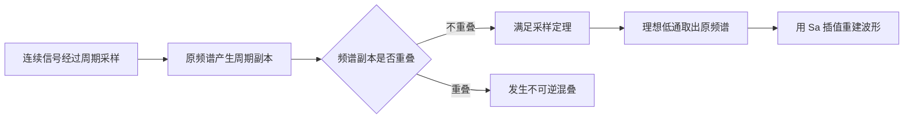

# 第 5 课：采样、混叠与理想恢复

## 本课概要

> [!abstract] 本课定位
> 采样看似只保留离散点，实际上对频谱做了周期延拓。本课沿着“采样频谱副本—是否重叠—能否理想恢复”的主线，把采样定理、混叠、理想低通滤波和 $\mathrm{Sa}$ 插值公式放在一起理解，而不是把它们记成互不相干的结论。

## 1. 采样为什么使频谱周期化

设两个连续角频率相差采样角频率

$$
\Omega_s=\frac{2\pi}{T_s}.
$$

在采样时刻 $t=nT_s$，它们满足

$$
\begin{aligned}
e^{j(\Omega+\Omega_s)nT_s}
&=e^{j\Omega nT_s}e^{j2\pi n}\\
&=e^{j\Omega nT_s}.
\end{aligned}
$$

因此，相差整数倍 $\Omega_s$ 的连续频率会产生完全相同的样本。采样器没有观察样点之间的波形，也就失去了区分这些频率的信息。

理想采样信号为

$$
x_s(t)=\sum_{n=-\infty}^{+\infty}
x_c(nT_s)\delta(t-nT_s).
$$

它的频谱是

$$
X_s(j\Omega)=\frac{1}{T_s}
\sum_{k=-\infty}^{+\infty}
X_c\bigl(j(\Omega-k\Omega_s)\bigr).
$$

原频谱以 $\Omega_s$ 为间隔被复制。原来的 $X_c(j\Omega)$ 没有自行变成周期函数；周期化的是采样后信号的频谱。

公式中的 $\dfrac{1}{T_s}$ 是理想冲激采样模型产生的尺度因子，不是把频谱最大值归一化成 $1$。频谱幅度在变换定义和单位固定后具有确定意义；只有明确除以最大值时，才是单纯的相对归一化幅度。

同一次频谱重复在三种横轴上的数值间隔为：

| 横轴 | 单位 | 副本间隔 |
| --- | --- | --- |
| $f$ | $\mathrm{Hz}$ | $f_s=\dfrac{1}{T_s}$ |
| $\Omega$ | $\mathrm{rad/s}$ | $\Omega_s=\dfrac{2\pi}{T_s}$ |
| $\omega$ | $\mathrm{rad/sample}$ | $2\pi$ |

它们通过

$$
\Omega=2\pi f,
\qquad
\omega=\Omega T_s
$$

互相换算，因此描述的是同一件事。

## 2. 混叠与采样定理

连续信号的频谱定义在整个频率轴上，不代表它在每个频率都非零。若

$$
X_c(j\Omega)=0,
\qquad |\Omega|>\Omega_{max},
$$

就称信号带限于 $\Omega_{max}$。

采样后的每个频谱副本宽度为 $2\Omega_{max}$。为了让相邻副本不重叠，需要

$$
\boxed{\Omega_s>2\Omega_{max}}
$$

或

$$
\boxed{f_s>2f_{max}}.
$$

这就是低通带限信号的采样定理。副本分开时，可以用低通滤波器取出中心副本并恢复原信号；周期化本身没有损伤信息。

若副本发生重叠，原来不同的模拟频率会相加到同一个数字频率。采样值无法说明它们分别来自哪里，这种不可逆的信息混合称为混叠。

采样定理关心最高频率，而不关心信号是否周期：

- 非周期信号没有基波，但仍然可能具有连续且有限的频带，可以无混叠采样；
- 周期信号具有基波，但理想方波包含无穷多个谐波，并不严格带限。

现实信号往往也不是严格带限的。工程系统会先用抗混叠低通滤波器压低高频成分，再按照保留下来的有效最高频率选择采样率。

## 3. 为什么单边复频谱的采样率可以减半

采样定理的根本依据不是机械地记忆“最高频率的两倍”，而是采样后周期重复的频谱副本不能重叠。

设采样周期为 $T$，采样角频率为

$$
\Omega_s=\frac{2\pi}{T}.
$$

如果实低通信号带限于 $\Omega_0$，它的频谱占据

$$
[-\Omega_0,\Omega_0],
$$

总宽度为 $2\Omega_0$。为了使相邻频谱副本不重叠，需要

$$
\boxed{\Omega_s>2\Omega_0}.
$$

如果某个复信号的频谱真正只占据

$$
[0,\Omega_0],
$$

总宽度只有 $\Omega_0$，于是可以使用

$$
\boxed{\Omega_s>\Omega_0}.
$$

这里必须采集完整复样本

$$
x[n]=x_I[n]+jx_Q[n],
$$

其中一个复样本包含 $I$、$Q$ 两个实数。采样次数虽然可以减半，每个样本包含的实数却增加了一倍，因此总信息量并没有凭空减少。仅仅把普通实信号的频谱图只画正半轴，不能把采样条件改成 $\Omega_s>\Omega_0$。

## 4. 从频谱副本到理想低通恢复

采样保留了离散时刻的数值，却没有直接给出采样点之间的波形。要理解为什么仍能恢复连续信号，需要观察采样对频谱做了什么。

理想冲激采样序列为

$$
p_T(t)=\sum_{n=-\infty}^{+\infty}\delta(t-nT).
$$

原连续信号与它相乘，得到采样后信号

$$
\begin{aligned}
\hat{x}(t)
&=x(t)p_T(t)\\
&=\sum_{n=-\infty}^{+\infty}x(nT)\delta(t-nT).
\end{aligned}
$$

其频谱为

$$
\boxed{
\hat{X}(j\Omega)
=\frac{1}{T}\sum_{k=-\infty}^{+\infty}
X\bigl(j(\Omega-k\Omega_s)\bigr)
}.
$$

这说明采样后的频谱由原频谱的许多副本组成：相邻副本的中心间隔是 $\Omega_s$，每个副本的幅度变为原来的 $1/T$。

![[assets/采样频谱与理想低通恢复.svg]]

当原信号带限于 $\Omega_0$ 且 $\Omega_s>2\Omega_0$ 时，频谱副本互不重叠。此时可以用理想低通滤波器取出位于原点的中心副本。

## 5. 门函数与 $\mathrm{Sa}$ 函数的变换关系

为了描述理想低通滤波器，先采用国内教材中常见的门函数记号。定义宽度为 $\tau$、高度为 $1$ 的门函数

$$
G_\tau(t)=
\begin{cases}
1,&|t|<\dfrac{\tau}{2},\\[4pt]
\dfrac12,&|t|=\dfrac{\tau}{2},\\[4pt]
0,&|t|>\dfrac{\tau}{2}.
\end{cases}
$$

并定义

$$
\mathrm{Sa}(x)=\frac{\sin x}{x},
\qquad
\mathrm{Sa}(0)=1.
$$

在本章采用的傅里叶变换约定下，门函数与 $\mathrm{Sa}$ 函数构成变换对：

$$
\boxed{
G_\tau(t)
\xleftrightarrow{\mathcal F}
\tau\,\mathrm{Sa}\left(\frac{\Omega\tau}{2}\right)
}.
$$

如果门函数位于频域，设其总宽度为 $\Omega_g$，则

$$
\boxed{
G_{\Omega_g}(\Omega)
\xleftrightarrow{\mathcal F^{-1}}
\frac{\Omega_g}{2\pi}
\mathrm{Sa}\left(\frac{\Omega_gt}{2}\right)
}.
$$

若门函数高度为 $A$，则时域函数也整体乘以 $A$：

$$
A G_{\Omega_g}(\Omega)
\xleftrightarrow{\mathcal F^{-1}}
\frac{A\Omega_g}{2\pi}
\mathrm{Sa}\left(\frac{\Omega_gt}{2}\right).
$$

采样恢复滤波器可以写成

$$
G(j\Omega)=T G_{\Omega_s}(\Omega).
$$

$G_{\Omega_s}(\Omega)$ 的总宽度为 $\Omega_s$，因此通带范围是

$$
-\frac{\Omega_s}{2}<\Omega<\frac{\Omega_s}{2}.
$$

滤波器的高度取为 $T$，是为了抵消采样频谱中的 $1/T$：

$$
\frac{1}{T}X(j\Omega)\cdot T=X(j\Omega).
$$

把 $A=T$、$\Omega_g=\Omega_s$ 代入门函数变换对，并利用 $\Omega_s=2\pi/T$，可得恢复滤波器的单位冲激响应

$$
\begin{aligned}
g(t)
&=\frac{T\Omega_s}{2\pi}
\mathrm{Sa}\left(\frac{\Omega_st}{2}\right)\\
&=\mathrm{Sa}\left(\frac{\pi t}{T}\right).
\end{aligned}
$$

因此采样恢复中最常用的变换对是

$$
\boxed{
T G_{\Omega_s}(\Omega)
\xleftrightarrow{\mathcal F^{-1}}
\mathrm{Sa}\left(\frac{\pi t}{T}\right)
}.
$$

门函数越宽，对应的 $\mathrm{Sa}$ 主瓣越窄；门函数越窄，对应的 $\mathrm{Sa}$ 主瓣越宽。这是时域与频域宽窄相反的又一个例子。

## 6. 为什么许多个 $\mathrm{Sa}$ 函数能重建连续信号

频域相乘对应时域卷积，因此恢复信号为

$$
x_r(t)=\hat{x}(t)*g(t).
$$

代入冲激采样信号：

$$
\begin{aligned}
x_r(t)
&=\left[
\sum_{n=-\infty}^{+\infty}
x(nT)\delta(t-nT)
\right]*g(t)\\
&=\sum_{n=-\infty}^{+\infty}
x(nT)g(t-nT).
\end{aligned}
$$

再代入 $g(t)$，得到理想采样内插公式：

$$
\boxed{
x(t)=
\sum_{n=-\infty}^{+\infty}
x(nT)
\mathrm{Sa}\left(\frac{\pi(t-nT)}{T}\right)
}.
$$

这个公式的几何意义是：在每个采样时刻 $nT$ 放置一个以该点为中心的 $\mathrm{Sa}$ 函数，用采样值 $x(nT)$ 调整它的高度，再把所有平移并加权后的 $\mathrm{Sa}$ 函数相加。

![[assets/Sa插值重建.svg]]

在另一个采样时刻 $t=mT$，有

$$
\mathrm{Sa}\left(\frac{\pi(mT-nT)}{T}\right)
=
\begin{cases}
1,&m=n,\\
0,&m\ne n.
\end{cases}
$$

所以在 $t=mT$ 处，只有以 $mT$ 为中心的那一个 $\mathrm{Sa}$ 函数留下贡献：

$$
x_r(mT)=x(mT).
$$

其他 $\mathrm{Sa}$ 函数虽然延伸到整个时间轴，但恰好在该采样点处过零。它们在采样点之间相互叠加，从而补出连续波形。

完全恢复依赖理想条件：原信号严格带限、采样频率满足奈奎斯特条件、使用理想冲激采样，并采用无限长的理想低通滤波器。实际系统只能用有限长度滤波器近似这一过程。

## 7. 本课小结与适用条件

| 问题 | 核心判断 |
| --- | --- |
| 能否避免混叠 | 原信号是否带限，采样后频谱副本是否不重叠 |
| 实低通信号的采样条件 | $\Omega_s>2\Omega_0$，实际工程通常还要留出过渡带 |
| 真正单边复频谱 | 频谱宽度只有 $\Omega_0$，可用 $\Omega_s>\Omega_0$，但每个样本含 $I/Q$ 两个实数 |
| 如何恢复 | 对采样频谱进行理想低通筛选，在时域等价于 $\mathrm{Sa}$ 插值求和 |

理想恢复依赖带限和理想低通两个条件。实际滤波器具有有限过渡带，实际信号也未必严格带限，因此工程采样率必须高于理论临界值。

---

## 相关笔记

[[04 第4课 DTFT与数字频率]]、[[06 第6课 Z变换、收敛域与系统函数]]

