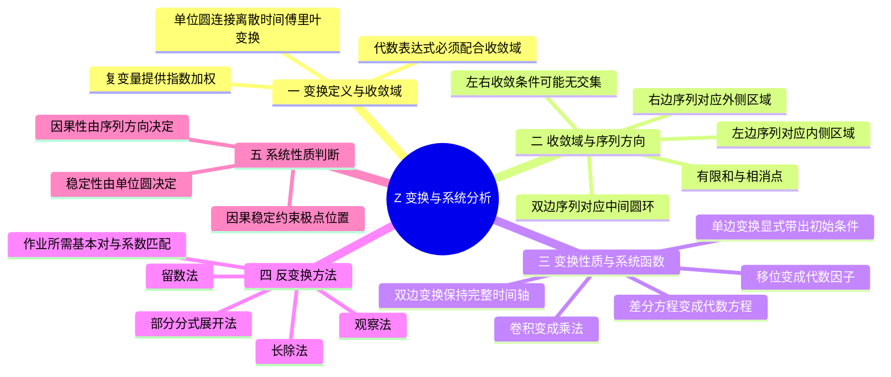
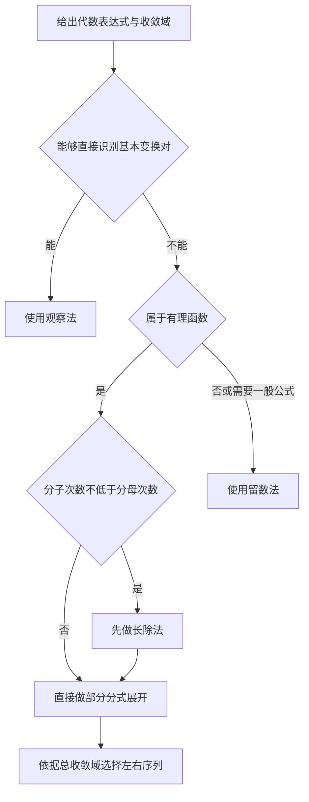
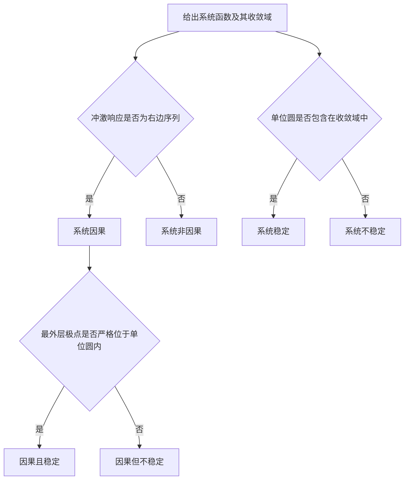

# 第 6 课：Z 变换、收敛域与系统函数

## 本课概要



> [!abstract] 本课定位
> DTFT 只考察单位圆上的纯振荡，遇到随时间增长的序列时可能不收敛。Z 变换在旋转因子之外增加径向的指数加权，把分析范围扩展到复平面。本课沿着“定义与收敛域—变换性质—反变换—系统函数—因果稳定性”的主线，说明代数表达式、ROC 与时域序列为何缺一不可。

## 1. Z 变换的定义与引入动机

离散时间傅里叶变换用复指数 $e^{-j\omega n}$ 检测序列中不同数字频率的成分：

$$
X(e^{j\omega})=
\sum_{n=-\infty}^{+\infty}x[n]e^{-j\omega n}.
$$

这个核函数只有旋转，没有幅度上的指数衰减。如果 $x[n]$ 本身增长得很快，求和中的各项可能无法趋于零，DTFT 便不存在。Z 变换把复变量写成

$$
z=re^{j\omega},
$$

于是

$$
z^{-n}=r^{-n}e^{-j\omega n}.
$$

其中，$e^{-j\omega n}$ 仍然负责检测振荡，$r^{-n}$ 则为序列施加指数权重。双边 Z 变换定义为

$$
\boxed{
X(z)=\sum_{n=-\infty}^{+\infty}x[n]z^{-n}
}.
$$

这里的 $n$ 是离散时间下标，$z$ 是复变量，$X(z)$ 是序列在复平面上的表示。指数权重只是计算时的观察方式，并没有在物理上改变原序列。

考虑增长的右边序列

$$
x[n]=2^n u[n].
$$

它的 Z 变换为

$$
\begin{aligned}
X(z)
&=\sum_{n=0}^{+\infty}2^nz^{-n}\\
&=1+\frac{2}{z}+\left(\frac{2}{z}\right)^2+\cdots.
\end{aligned}
$$

这是公比为 $2/z$ 的等比级数。只有满足

$$
\left\lvert\frac{2}{z}\right\rvert<1,
$$

也就是

$$
\lvert z\rvert>2
$$

时，原始无穷级数才收敛。因此完整的变换结果必须写成

$$
\boxed{
X(z)=\frac{1}{1-2z^{-1}}=\frac{z}{z-2},
\qquad
\mathrm{ROC}:\lvert z\rvert>2
}.
$$

所有能使定义式收敛的 $z$ 构成收敛域，简称 ROC。若把 $z=1$ 代入约分后的有理式，会得到 $-1$；但原级数此时是 $1+2+4+\cdots$，并不收敛。因此，有理式在 ROC 外的代数取值不能当作原始 Z 变换级数的和。

## 2. 收敛域包含的时域信息

### 2.1 同一代数表达式对应不同序列

同一个有理式

$$
X(z)=\frac{1}{1-az^{-1}}=\frac{z}{z-a}
$$

可以在不同区域展开。若在极点 $z=a$ 的外侧展开，则

$$
X(z)=1+az^{-1}+a^2z^{-2}+\cdots,
\qquad \lvert z\rvert>\lvert a\rvert,
$$

所以

$$
a^n u[n]
\quad\xleftrightarrow{\mathcal Z}\quad
\frac{1}{1-az^{-1}},
\qquad
\mathrm{ROC}:\lvert z\rvert>\lvert a\rvert.
$$

若在极点内侧展开，则先改写为

$$
X(z)
=-\frac{z/a}{1-z/a}
=-\frac{z}{a}-\frac{z^2}{a^2}-\cdots,
\qquad \lvert z\rvert<\lvert a\rvert.
$$

正幂 $z^k=z^{-(-k)}$ 对应负时间下标，因此

$$
-a^n u[-n-1]
\quad\xleftrightarrow{\mathcal Z}\quad
\frac{1}{1-az^{-1}},
\qquad
\mathrm{ROC}:\lvert z\rvert<\lvert a\rvert.
$$

$u[-n-1]$ 只在 $n\leq-1$ 时等于 $1$，所以左边序列不包含 $n=0$。这两个结果说明：$X(z)$ 的代数表达式只给出系数关系，ROC 才决定级数向 $z^{-1}$ 的正方向还是负方向展开，也就决定序列向右还是向左延伸。

### 2.2 单位圆与 DTFT

当 $r=1$ 时，复变量位于单位圆：

$$
z=e^{j\omega},
\qquad \lvert z\rvert=1.
$$

此时指数权重 $r^{-n}$ 消失，Z 变换退化为 DTFT：

$$
\boxed{
X(e^{j\omega})
=X(z)\big|_{z=e^{j\omega}}
}.
$$

这个等式成立的前提是单位圆包含在 ROC 中。若单位圆不在 ROC 内，即使形式上可以把 $z=e^{j\omega}$ 代入有理式，所得结果也不是原序列普通意义下的 DTFT。

例如，$\left(\frac12\right)^n u[n]$ 的 ROC 为 $\lvert z\rvert>\frac12$，包含单位圆，因此存在 DTFT；$2^n u[n]$ 的 ROC 为 $\lvert z\rvert>2$，不包含单位圆，因此不存在普通意义下的 DTFT。

### 2.3 极点划分候选收敛圆环

对于有理 Z 变换

$$
X(z)=\frac{B(z)}{A(z)},
$$

使 $B(z)=0$ 的点称为零点，使 $A(z)=0$ 的点称为极点。原始级数不可能在极点处收敛，所以极点构成 ROC 的候选边界；但极点本身不能告诉我们应取边界的哪一侧。

![[assets/Z变换收敛域方向.svg]]

有理 Z 变换的 ROC 具有以下基本规律：

- 右边序列的 ROC 位于最外层极点之外，并向 $z=\infty$ 延伸；
- 左边序列的 ROC 位于最内层极点之内，并向 $z=0$ 延伸；
- 双边序列的 ROC 位于两圈极点之间；
- ROC 是连续圆环，不能跨过极点，也不能由两个分离区域拼成。

例如，若极点模分别为 $\frac12$ 和 $2$，候选 ROC 与序列方向如下。

| 收敛域 | 序列方向 | 单位圆是否在 ROC 内 |
| --- | --- | --- |
| $\lvert z\rvert>2$ | 右边序列 | 否 |
| $\lvert z\rvert<\dfrac12$ | 左边序列 | 否 |
| $\dfrac12<\lvert z\rvert<2$ | 双边序列 | 是 |

表格中的结论只说明时域方向与 DTFT 是否存在；只有当 $X(z)$ 被解释为系统函数 $H(z)$ 时，才进一步对应系统的因果性与稳定性。

### 2.4 有限长序列的端点判断

若有限长序列只在 $n_1\leq n\leq n_2$ 内非零，则

$$
X(z)=\sum_{n=n_1}^{n_2}x[n]z^{-n}.
$$

有限项求和不会在有限且非零的 $z$ 处产生收敛问题，只需检查 $z=0$ 与 $z=\infty$：正时间项 $z^{-n}$ 会排除 $z=0$，负时间项 $z^{-n}=z^{\lvert n\rvert}$ 会排除 $z=\infty$。

| 非零样点范围 | ROC |
| --- | --- |
| $n_1<0$ 且 $n_2\leq0$ | $\lvert z\rvert<\infty$ |
| $n_1\geq0$ 且 $n_2>0$ | $0<\lvert z\rvert\leq\infty$ |
| $n_1<0$ 且 $n_2>0$ | $0<\lvert z\rvert<\infty$ |
| 仅有 $n=0$ | 整个 Z 平面 |

这组规则只针对有限长序列。无限长有理序列仍需结合有限极点和序列方向判断完整 ROC。

### 2.5 常用双边 Z 变换基本对

下面的表格采用双边 Z 变换约定。每一行都把时域序列、代数表达式和 ROC 一起列出；对于同一个代数式，改变 ROC 就可能改变反变换对应的序列。

| 时域序列 | Z 变换 | ROC | 说明 |
| --- | --- | --- | --- |
| $\delta[n]$ | $1$ | 整个 Z 平面 | 原点处的单位冲激 |
| $\delta[n-k]$ | $z^{-k}$ | $k>0$ 时排除 $z=0$；$k<0$ 时排除 $z=\infty$；$k=0$ 时为整个 Z 平面 | 移位冲激 |
| $u[n]$ | $\dfrac{1}{1-z^{-1}}=\dfrac{z}{z-1}$ | $\lvert z\rvert>1$ | 右边单位阶跃 |
| $-u[-n-1]$ | $\dfrac{1}{1-z^{-1}}=\dfrac{z}{z-1}$ | $\lvert z\rvert<1$ | 左边单位阶跃 |
| $a^n u[n]$ | $\dfrac{1}{1-az^{-1}}$ | $\lvert z\rvert>\lvert a\rvert$ | 右边指数序列 |
| $-a^n u[-n-1]$ | $\dfrac{1}{1-az^{-1}}$ | $\lvert z\rvert<\lvert a\rvert$ | 左边指数序列 |
| $(n+1)a^n u[n]$ | $\dfrac{1}{(1-az^{-1})^2}$ | $\lvert z\rvert>\lvert a\rvert$ | 二重极点的右边序列 |
| $-(n+1)a^n u[-n-2]$ | $\dfrac{1}{(1-az^{-1})^2}$ | $\lvert z\rvert<\lvert a\rvert$ | 二重极点的左边序列 |
| $n a^n u[n]$ | $\dfrac{az^{-1}}{(1-az^{-1})^2}$ | $\lvert z\rvert>\lvert a\rvert$ | 时间因子与指数序列的乘积 |

其中 $a$ 可以是实数或复数；涉及左右指数序列时默认 $a\neq0$，表中涉及稳定性时要比较的是 $\lvert a\rvert$。表中左、右两种指数序列的代数式相同，区别完全由 ROC 指定；这正是反变换时不能只抄代数式的原因。

### 2.6 双边序列的空收敛域与有限和的相消

“双边序列对应圆环”以变换确实存在为前提。对没有阶跃限制的 $x[n]=a^n$，其中 $a\ne0$，必须同时计算正、负下标：

$$
X(z)=\sum_{n=0}^{\infty}(a/z)^n+
\sum_{m=1}^{\infty}(z/a)^m.
$$

前半要求 $\lvert z\rvert>\lvert a\rvert$，后半要求 $\lvert z\rvert<\lvert a\rvert$，两者没有交集。因此普通双边 Z 变换不存在，ROC 为空，也就没有相应的普通 Z 变换零极点图。不能把两个在不同区域成立的等比和先写成有理式再相加成零；没有任何区域允许这样相加原级数。

再看 $a^{\lvert n\rvert}$。正时间要求 $\lvert z\rvert>\lvert a\rvert$，负时间要求 $\lvert z\rvert<1/\lvert a\rvert$，所以只有 $0<\lvert a\rvert<1$ 时才有非空圆环。每一侧的指数增长或衰减都必须独立检查，不能看到“双边”就直接画一个环。

有限长序列则没有无穷尾部。例如

$$
X(z)=\sum_{n=0}^{4}(1/2)^nz^{-n}
=\frac{1-(\tfrac12z^{-1})^5}{1-\tfrac12z^{-1}}.
$$

$z=1/2$ 时原有限和等于 $5$，分式只是出现了可去的 $0/0$，不能把它画成极点。约分后，该变换的四个有限零点为 $z=\tfrac12e^{j2\pi k/5}$，$k=1,2,3,4$；原点因 $z^{-4}$ 成为四重极点，ROC 是全部非零有限点并包含无穷远。有限 Z 平面内的零极点图通常不额外画无穷远处的零点。

## 3. Z 变换性质与差分方程

Z 变换真正适合分析系统，是因为它把时域中的移位、卷积和递推关系变成代数运算。设

$$
x[n]\xleftrightarrow{\mathcal Z}X(z),
$$

常用性质如下。

| 时域运算 | Z 域结果 | 主要用途 |
| --- | --- | --- |
| $a x_1[n]+b x_2[n]$ | $aX_1(z)+bX_2(z)$ | 分解并叠加简单序列 |
| $x[n-k]$ | $z^{-k}X(z)$ | 双边 Z 变换下的移位；单边变换需补边界项 |
| $a^n x[n]$ | $X(z/a)$ | 移动 ROC 与极点的径向位置 |
| $x_1[n]*x_2[n]$ | $X_1(z)X_2(z)$ | 把卷积化为乘法 |
| $n x[n]$ | $-z\dfrac{dX(z)}{dz}$ | 处理带时间因子的序列 |

表中的 ROC 通常至少是各部分收敛域的交集，但零极点相消可能使实际 ROC 扩大；时移还可能改变 $z=0$ 或 $z=\infty$ 是否被包含。因此，性质公式不能替代对 ROC 的单独检查。

### 3.1 双边与单边 Z 变换的求和范围

前面没有特别标注时，本课的 Z 变换性质默认采用双边定义：

$$
X_{\mathrm{bi}}(z)=\sum_{n=-\infty}^{+\infty}x[n]z^{-n}.
$$

双边变换把负时间样点和非负时间样点都纳入求和。由于求和覆盖整条时间轴，改变下标时不会丢掉任何项，所以延迟性质可以直接写成

$$
\mathcal Z_{\mathrm{bi}}\{x[n-k]\}=z^{-k}X_{\mathrm{bi}}(z).
$$

求解带初始条件的差分方程时，题目通常只要求 $n\geq0$ 的输出，并且会给出 $y[-1]$、$y[-2]$ 等初始样点。这时使用单边 Z 变换更直接：

$$
X_+(z)=\sum_{n=0}^{+\infty}x[n]z^{-n}.
$$

单边变换的求和从 $n=0$ 开始。时域序列发生移位后，原来位于负时间的样点会被移到求和边界附近，于是它们必须单独列出。这些被单独列出的项正是初始条件在 Z 域中的表现。

可以把这个过程概括为：

```mermaid
flowchart TD
    A[单边求和从 n=0 开始] --> B[对移位序列拆出边界样点]
    B --> C[剩余部分重新写成 z 的幂次乘 X_+(z)]
    C --> D[边界样点成为初始条件项]
    D --> E[差分方程可分解为零状态与零输入响应]
```

### 3.2 单边变换的延迟推导

先从一个样点的延迟开始。单边变换的定义要求从 $n=0$ 求和：

$$
\mathcal Z_+\{x[n-1]\}
=\sum_{n=0}^{+\infty}x[n-1]z^{-n}.
$$

把求和的第一项单独写出：

$$
\begin{aligned}
\sum_{n=0}^{+\infty}x[n-1]z^{-n}
&=x[-1]+\sum_{n=1}^{+\infty}x[n-1]z^{-n}.
\end{aligned}
$$

在第二项中令 $m=n-1$。当 $n=1$ 时 $m=0$，因此

$$
\begin{aligned}
\sum_{n=1}^{+\infty}x[n-1]z^{-n}
&=\sum_{m=0}^{+\infty}x[m]z^{-(m+1)}\\
&=z^{-1}\sum_{m=0}^{+\infty}x[m]z^{-m}\\
&=z^{-1}X_+(z).
\end{aligned}
$$

所以

$$
\boxed{
\mathcal Z_+\{x[n-1]\}=z^{-1}X_+(z)+x[-1]
}.
$$

$z^{-1}X_+(z)$ 描述从 $n\geq0$ 开始的主体序列延迟一个样点；$x[-1]$ 是延迟后落在单边求和起点 $n=0$ 处的旧样点。它不是凭空增加的项，而是求和范围改变后必须保留的边界信息。

延迟两个样点时，前两个样点会落在边界处：

$$
\begin{aligned}
\mathcal Z_+\{x[n-2]\}
&=\sum_{n=0}^{+\infty}x[n-2]z^{-n}\\
&=x[-2]+x[-1]z^{-1}+\sum_{n=2}^{+\infty}x[n-2]z^{-n}.
\end{aligned}
$$

对最后一项令 $m=n-2$，得到

$$
\begin{aligned}
\sum_{n=2}^{+\infty}x[n-2]z^{-n}
&=\sum_{m=0}^{+\infty}x[m]z^{-(m+2)}\\
&=z^{-2}X_+(z).
\end{aligned}
$$

因此

$$
\boxed{
\mathcal Z_+\{x[n-2]\}
=z^{-2}X_+(z)+x[-2]+x[-1]z^{-1}
}.
$$

延迟三个样点时，前三个负时间样点都要列出：

$$
\begin{aligned}
\mathcal Z_+\{x[n-3]\}
&=\sum_{n=0}^{+\infty}x[n-3]z^{-n}\\
&=x[-3]+x[-2]z^{-1}+x[-1]z^{-2}\\
&\quad+\sum_{n=3}^{+\infty}x[n-3]z^{-n}\\
&=x[-3]+x[-2]z^{-1}+x[-1]z^{-2}+z^{-3}X_+(z).
\end{aligned}
$$

于是，一般的 $k$ 个样点延迟为

$$
\boxed{
\mathcal Z_+\{x[n-k]\}
=z^{-k}X_+(z)
 +\sum_{r=0}^{k-1}x[r-k]z^{-r},
\qquad k\geq1
}.
$$

把边界项按初始样点的负下标排列，也可以写成

$$
\boxed{
\mathcal Z_+\{x[n-k]\}
=z^{-k}X_+(z)
 +x[-k]+x[-k+1]z^{-1}+\cdots+x[-1]z^{-(k-1)}
}.
$$

如果序列在 $n<0$ 时为零，也就是系统处于初始静止状态，那么所有边界项都为零，公式才退化为

$$
\mathcal Z_+\{x[n-k]\}=z^{-k}X_+(z).
$$

这解释了为什么初学时只记住了 $z^{-k}X(z)$：当时默认的是双边变换，或者默认所有初始样点为零。

### 3.3 单边变换的超前推导

单边变换也可以处理 $x[n+k]$。以超前一个样点为例：

$$
\begin{aligned}
\mathcal Z_+\{x[n+1]\}
&=\sum_{n=0}^{+\infty}x[n+1]z^{-n}\\
&=\sum_{m=1}^{+\infty}x[m]z^{-(m-1)}\\
&=z\sum_{m=1}^{+\infty}x[m]z^{-m}\\
&=z\left[X_+(z)-x[0]\right].
\end{aligned}
$$

所以

$$
\boxed{
\mathcal Z_+\{x[n+1]\}=zX_+(z)-zx[0]
}.
$$

超前两个样点时，$x[0]$ 和 $x[1]$ 被从完整变换中删去：

$$
\boxed{
\mathcal Z_+\{x[n+2]\}
=z^2X_+(z)-z^2x[0]-zx[1]
}.
$$

同理，超前三个样点为

$$
\boxed{
\mathcal Z_+\{x[n+3]\}
=z^3X_+(z)-z^3x[0]-z^2x[1]-zx[2]
}.
$$

一般地，$k$ 个样点超前满足

$$
\boxed{
\mathcal Z_+\{x[n+k]\}
=z^k\left[
X_+(z)-\sum_{r=0}^{k-1}x[r]z^{-r}
\right],
\qquad k\geq1
}.
$$

延迟公式带出负时间样点，超前公式扣除非负时间序列最开始的 $k$ 个样点。两种边界项的来源相同：单边变换只从 $n=0$ 开始，所以移位后必须重新检查求和范围。

### 3.4 单边移位公式在差分方程中的含义

考虑只在 $n\geq0$ 上求解的差分方程

$$
y[n]-ay[n-1]=x[n],
$$

并给定初始样点 $y[-1]$。对两边做单边 Z 变换时，延迟项不能直接写成 $z^{-1}Y_+(z)$，而应使用刚刚推导的公式：

$$
\mathcal Z_+\{y[n-1]\}=z^{-1}Y_+(z)+y[-1].
$$

因此

$$
Y_+(z)-a\left[z^{-1}Y_+(z)+y[-1]\right]=X_+(z).
$$

整理得

$$
Y_+(z)\left(1-az^{-1}\right)=X_+(z)+ay[-1],
$$

即

$$
\boxed{
Y_+(z)=
\underbrace{\frac{X_+(z)}{1-az^{-1}}}_{Y_{\mathrm{zs}}(z)}
+
\underbrace{\frac{ay[-1]}{1-az^{-1}}}_{Y_{\mathrm{zi}}(z)}
}.
$$

第一项只由输入决定，是零状态响应；第二项只由初始样点决定，是零输入响应。单边变换的边界项因此把“系统受输入产生的输出”和“系统原来储存的能量自行释放的输出”分开了。

对于二阶差分方程，例如

$$
y[n]+a_1y[n-1]+a_2y[n-2]=x[n],
$$

单边变换中的两个延迟项分别为

$$
\mathcal Z_+\{y[n-1]\}=z^{-1}Y_+(z)+y[-1],
$$

$$
\mathcal Z_+\{y[n-2]\}=z^{-2}Y_+(z)+y[-2]+y[-1]z^{-1}.
$$

所以 $y[-1]$ 和 $y[-2]$ 会以不同的幂次进入 Z 域方程。这正是高阶系统需要多个初始条件的原因，也是单边变换特别适合初值问题的地方。

双边变换与单边变换的使用范围可以归纳如下：

| 任务 | 更自然的变换 | 原因 |
| --- | --- | --- |
| 求序列的 ROC、零点和极点 | 双边 Z 变换 | 保留完整时间轴，并能区分左右序列 |
| 求系统函数 $H(z)$ | 双边 Z 变换或零初始条件下的单边变换 | 系统函数描述零状态输入输出关系 |
| 求频率响应 $H(e^{j\omega})$ | 系统函数的双边解释 | 需要结合 ROC 判断单位圆是否有效 |
| 给定 $y[-1]$、$y[-2]$ 求输出 | 单边 Z 变换 | 移位公式自动带出初始条件 |
| 分解零输入、零状态和全响应 | 单边 Z 变换 | 边界项对应零输入响应，输入项对应零状态响应 |

以移位性质为例，令 $m=n-k$，则

$$
\begin{aligned}
\mathcal Z\{x[n-k]\}
&=\sum_{n=-\infty}^{+\infty}x[n-k]z^{-n}\\
&=\sum_{m=-\infty}^{+\infty}x[m]z^{-(m+k)}\\
&=z^{-k}X(z).
\end{aligned}
$$

因此，延迟一个样点对应乘以 $z^{-1}$。考虑零状态差分方程

$$
y[n]-ay[n-1]=x[n].
$$

两边做双边 Z 变换：

$$
Y(z)-az^{-1}Y(z)=X(z).
$$

原来的递推关系变成普通代数方程，系统函数为

$$
\boxed{
H(z)=\frac{Y(z)}{X(z)}
=\frac{1}{1-az^{-1}}
}.
$$

更一般地，若零状态差分方程为

$$
\sum_{k=0}^{N}a_k y[n-k]
=\sum_{m=0}^{M}b_m x[n-m],
$$

则

$$
\boxed{
H(z)
=\frac{\displaystyle\sum_{m=0}^{M}b_mz^{-m}}
{\displaystyle\sum_{k=0}^{N}a_kz^{-k}}
}.
$$

“零状态”表示输出完全由输入引起，因此才能直接使用 $H(z)=Y(z)/X(z)$。若题目给出非零初始条件，输出还包含零输入响应，需要使用单边 Z 变换，或先把初始条件产生的响应单独处理。

| 系统表示 | 直接回答的问题 | 使用条件 |
| --- | --- | --- |
| 差分方程 | 输出样点如何递推 | 需要说明初始条件 |
| $h[n]$ | 单位冲激进入系统后的输出 | LTI 系统由它完全确定 |
| $H(z)$ 与 ROC | 系统的零极点、时域方向和收敛性质 | 代数式必须配合 ROC |
| $H(e^{j\omega})$ | 各数字频率的幅度和相位变化 | 单位圆必须位于 ROC 内 |

## 4. Z 反变换的计算方法

反变换要从 $X(z)$ 与 ROC 恢复 $x[n]$。方法并不是越复杂越好，而应先利用表达式结构。



### 4.1 观察法与展开方向

在习题 2.1 中，我们从 $a^nu[n]$ 出发求出 $1/(1-az^{-1})$；反变换做的是同一件事的反方向：已知分式和 ROC，找回原来的序列。难点是一个分式可以对应左右两种序列，所以必须把 ROC 作为已知条件一起读。

右边指数的公式来自无穷等比和：

$$
\sum_{n=0}^{\infty}a^nz^{-n}=\frac1{1-az^{-1}},\qquad \lvert a/z\rvert<1.
$$

左边公式中的负号也由求和决定。对 $-a^nu[-n-1]$，令 $m=-n$，则

$$
-\sum_{m=1}^{\infty}(z/a)^m
=-\frac{z/a}{1-z/a}=\frac{z}{z-a},\qquad\lvert z/a\rvert<1.
$$

这两条公式的有理式相同，但第一条从非负时间开始，第二条只在负时间非零。因而反过来使用时，外侧 ROC 配 $u[n]$，内侧 ROC 配 $-u[-n-1]$。

观察法利用已经掌握的基本变换对。最重要的一对是

$$
\boxed{
\frac{1}{1-az^{-1}}
\quad\xleftrightarrow{\mathcal Z^{-1}}\quad
\begin{cases}
a^n u[n], & \lvert z\rvert>\lvert a\rvert,\\
-a^n u[-n-1], & \lvert z\rvert<\lvert a\rvert.
\end{cases}
}
$$

这里的两行不是两个互相矛盾的答案，而是同一代数式在不同 ROC 中的两种 Laurent 级数展开。做题时必须先读 ROC，再决定采用哪一行。

### 4.2 部分分式展开法

基本对只能直接处理一个一阶分母。部分分式法先把多个一阶因子的分式拆成一阶项之和，再逐项使用第 4.1 节的变换对；它不是另一张需要死记的变换表。

例如作业 2.3（1）的分母可分解为 $(1-\frac12z^{-1})(1+\frac12z^{-1})$。设两个分项的系数分别是 $A,B$，通分后必须满足

$$
1-\frac12z^{-1}
=A\left(1+\frac12z^{-1}\right)+B\left(1-\frac12z^{-1}\right)
=(A+B)+\frac12(A-B)z^{-1}.
$$

这对所有允许的 $z$ 都成立，因此常数项、$z^{-1}$ 项的系数分别相等：$A+B=1$、$A-B=-1$，解得 $A=0,B=1$。剩下 $1/(1+\frac12z^{-1})$；与 $1/(1-az^{-1})$ 对照，参数是 $a=-1/2$，不是 $1/2$。ROC 为 $\lvert z\rvert>1/2$，故答案为 $(-1/2)^nu[n]$。

这个例子还可以先相消再识别基本对；保留系数比较过程，是为了接下来处理不能直接相消的 2.3（4）。

当分母含有多个不同的一阶因子时，先把复杂有理式拆成多个基本单极点项。考虑贯穿本节的例子

$$
X(z)=
\frac{1}
{\left(1-\frac12z^{-1}\right)
\left(1-2z^{-1}\right)}.
$$

设

$$
X(z)=
\frac{A}{1-\frac12z^{-1}}
+\frac{B}{1-2z^{-1}}.
$$

比较常数项与 $z^{-1}$ 项，得到

$$
A=-\frac13,
\qquad
B=\frac43.
$$

因此

$$
X(z)=
-\frac13\frac{1}{1-\frac12z^{-1}}
+\frac43\frac{1}{1-2z^{-1}}.
$$

接下来不是为每一项任意选择方向，而是把同一个总 ROC 分别与两个极点比较。

当 $\mathrm{ROC}:\lvert z\rvert>2$ 时，两项都取右边展开：

$$
x[n]=
-\frac13\left(\frac12\right)^n u[n]
+\frac43 2^n u[n].
$$

当 $\mathrm{ROC}:\lvert z\rvert<\frac12$ 时，两项都取左边展开：

$$
x[n]=
\frac13\left(\frac12\right)^n u[-n-1]
-\frac43 2^n u[-n-1].
$$

当 $\mathrm{ROC}:\frac12<\lvert z\rvert<2$ 时，第一个极点对应右边展开，第二个极点对应左边展开：

$$
x[n]=
-\frac13\left(\frac12\right)^n u[n]
-\frac43 2^n u[-n-1].
$$

最后一种结果在时间轴两侧都非零，因此是双边序列。它的 ROC 是两个分项收敛条件

$$
\lvert z\rvert>\frac12
\qquad\text{与}\qquad
\lvert z\rvert<2
$$

的交集。

### 4.3 长除法与有限冲激项

若把 $X(z)$ 看成关于 $z^{-1}$ 的有理函数，并且分子次数不低于分母次数，就要先做多项式长除法。考虑

$$
X(z)=\frac{1+3z^{-1}+z^{-2}}{1-2z^{-1}}.
$$

令 $q=z^{-1}$，则

$$
\frac{q^2+3q+1}{1-2q}
=-\frac12q-\frac74
+\frac{\frac{11}{4}}{1-2q}.
$$

换回 $z^{-1}$：

$$
X(z)=
-\frac12z^{-1}-\frac74
+\frac{11/4}{1-2z^{-1}}.
$$

有限多项式直接对应有限个移位冲激：

$$
c_0+c_1z^{-1}+\cdots+c_Mz^{-M}
\quad\xleftrightarrow{\mathcal Z^{-1}}\quad
c_0\delta[n]+c_1\delta[n-1]+\cdots+c_M\delta[n-M].
$$

若本例取 $\mathrm{ROC}:\lvert z\rvert>2$，则

$$
\boxed{
x[n]=
-\frac12\delta[n-1]
-\frac74\delta[n]
+\frac{11}{4}2^n u[n]
}.
$$

若余式取左边展开，有限项中的 $z^{-1}$ 会排除 $z=0$，因此总 ROC 是 $0<\lvert z\rvert<2$，而不能简单写成 $\lvert z\rvert<2$。长除法不仅产生冲激项，也可能改变完整 ROC 对原点或无穷远点的包含关系。

### 4.4 留数法与反变换公式

部分分式法先拆成已知序列；留数法则直接计算指定下标 $n$ 对应的样值。先看最小的一阶项 $F(z)=g(z)/(z-p)$，其中 $g$ 在 $p$ 附近没有奇点：乘上 $(z-p)$ 就消去分母，随后令 $z=p$ 得到 $g(p)$，这个数就是一阶极点的留数。它不是把 $F(p)$ 直接代进去，因为 $F(p)$ 本来就发散。

例如 2.3（1）约分后 $X(z)=z/(z+1/2)$。反变换要处理的函数是 $F_n(z)=X(z)z^{n-1}=z^n/(z+1/2)$。在 $p=-1/2$ 处，消去分母再代值，就得到 $p^n=(-1/2)^n$。但这只有在把积分圈内其他极点也检查完后，才能作为完整的反变换结果；当 $n<0$ 时，$z^n$ 会在原点产生额外极点。

观察法和部分分式展开依赖熟悉的变换对，留数法则直接从 $X(z)$ 中提取指定样点。若 $C$ 是位于 ROC 内、逆时针绕原点一周的闭合曲线，则

$$
\boxed{
x[n]=\frac{1}{2\pi j}
\oint_C X(z)z^{n-1}\,dz
}.
$$

这个公式的核心是

$$
\oint_C z^m\,dz=
\begin{cases}
2\pi j, & m=-1,\\
0, & m\neq-1.
\end{cases}
$$

由定义

$$
X(z)=\sum_{k=-\infty}^{+\infty}x[k]z^{-k},
$$

乘以 $z^{n-1}$ 后得到

$$
X(z)z^{n-1}
=\sum_{k=-\infty}^{+\infty}x[k]z^{n-k-1}.
$$

只有 $k=n$ 时指数等于 $-1$，因此闭合积分消去其他各项，只留下 $x[n]$。这就是“闭合积分提取 $z^{-1}$ 项系数”的含义。

若被积函数记为

$$
F_n(z)=X(z)z^{n-1},
$$

留数定理给出

$$
x[n]
=\sum_{z_k\text{ 位于 }C\text{ 内}}
\operatorname{Res}[F_n(z),z_k].
$$

函数在 $z=z_0$ 附近的 Laurent 级数中，$(z-z_0)^{-1}$ 项的系数称为该点的留数。若 $z_0$ 是一阶极点，则

$$
\operatorname{Res}[F(z),z_0]
=\lim_{z\to z_0}(z-z_0)F(z).
$$

例如

$$
X(z)=\frac{1}{1-az^{-1}}=\frac{z}{z-a}
$$

对应的被积函数为

$$
F_n(z)=\frac{z^n}{z-a}.
$$

若 ROC 为 $\lvert z\rvert>\lvert a\rvert$，积分圆包围 $z=a$。当 $n\geq0$ 时，该点的留数为 $a^n$；当 $n<0$ 时，$z^{n}$ 还会在原点引入极点，其留数与 $z=a$ 处的留数抵消。最终得到

$$
x[n]=a^n u[n].
$$

若 ROC 为 $\lvert z\rvert<\lvert a\rvert$，积分圆不包围 $z=a$，最终得到

$$
x[n]=-a^n u[-n-1].
$$

因此，留数法严格解释了 ROC 为何决定左右序列。实际计算时必须寻找 $X(z)z^{n-1}$ 的全部极点，而不能只看 $X(z)$ 的极点。

还可以避免直接求负时间时原点的高阶留数。若有理被积函数 $F_n(z)$ 在无穷远按 $O(z^{-2})$ 或更快衰减，则大圆积分趋于零；把 ROC 内的积分圆扩大到大圆时，只跨过圈外极点，于是

$$
\frac1{2\pi j}\oint_C F_n(z)\,dz
=-\sum_{p\text{ 在 }C\text{ 外的有限极点}}\operatorname{Res}[F_n(z),p].
$$

这仍是留数法。对 $F_n(z)=z^n/(z-a)$，当 $n<0$ 时满足衰减条件：右侧 ROC 的圈外没有极点，所以负时间值为零；左侧 ROC 的圈外有 $a$，所以负时间值为 $-a^n$。不能忽略衰减条件而对所有 $n$ 都使用“圈外留数取负”。

对于 $m$ 重极点，留数公式为

$$
\operatorname{Res}[F(z),z_0]
=\frac{1}{(m-1)!}
\lim_{z\to z_0}
\frac{d^{m-1}}{dz^{m-1}}
\left[(z-z_0)^mF(z)\right].
$$

例如二重极点满足

$$
\frac{1}{(1-az^{-1})^2}
\quad\xleftrightarrow{\mathcal Z^{-1}}\quad
\begin{cases}
(n+1)a^n u[n], & \lvert z\rvert>\lvert a\rvert,\\
-(n+1)a^n u[-n-2], & \lvert z\rvert<\lvert a\rvert.
\end{cases}
$$

重极点会在指数序列前产生关于 $n$ 的多项式因子。理解这个规律即可；能够用观察法或部分分式法完成的题目，没有必要强行使用留数法。

### 4.5 作业反变换所用公式汇总

做 2.3 时先把分母因式分解，分别标明每个极点的模与给定 ROC 的关系；再选择部分分式或留数法。两种方法恢复的是同一个序列，ROC 也必须保持一致。

| 要识别的代数项 | 时域结果 | 条件 |
| --- | --- | --- |
| $1$ | $\delta[n]$ | 整个平面 |
| $z^{-d}$ | $\delta[n-d]$ | 有限点除可能的原点；$d$ 为整数 |
| $C/(1-az^{-1})=Cz/(z-a)$ | $Ca^nu[n]$ | $\lvert z\rvert>\lvert a\rvert$ |
| $C/(1-az^{-1})=Cz/(z-a)$ | $-Ca^nu[-n-1]$ | $\lvert z\rvert<\lvert a\rvert$ |
| $1/(1-az^{-1})^2$ | $(n+1)a^nu[n]$ | $\lvert z\rvert>\lvert a\rvert$ |

左右指数行默认 $a\ne0$；$C$ 是该项前面的常系数。冲激移位行的精确端点规则是：$d>0$ 时排除 $z=0$，$d<0$ 时包含 $z=0$ 但排除无穷远，$d=0$ 时为常数 $1$。二重分母的公式可由右边指数公式对参数 $a$ 求导后整理得到，不能把它误当成普通指数。

留数法使用的四条公式如下。$n$ 是要恢复的样点编号；$p$ 是被积函数 $F_n$ 的极点，未必只是 $X$ 的极点。

$$
F_n(z)=X(z)z^{n-1},\qquad
x[n]=\sum_{p\text{ 在 }C\text{ 内}}\operatorname{Res}[F_n,p].
$$

$$
\operatorname{Res}[F_n,p]
=\lim_{z\to p}(z-p)F_n(z)\qquad\text{（一阶极点）}.
$$

$$
\operatorname{Res}[F_n,p]
=\frac1{(m-1)!}\left.\frac{d^{m-1}}{dz^{m-1}}
\bigl[(z-p)^mF_n(z)\bigr]\right|_{z=p}\qquad\text{（}m\text{ 重极点）}.
$$

$$
x[n]=-\sum_{p\text{ 在 }C\text{ 外}}\operatorname{Res}[F_n,p],
\qquad F_n(z)=O(z^{-2})\text{ 或衰减更快时}.
$$

积分圈 $C$ 必须在 ROC 内逆时针绕原点一周。最后一条是把圈内积分扩大到无穷远后得到的捷径：大圆积分为零，原来圈内的留数和就等于圈外有限极点的留数和取负。它尤其适合 2.3 的负时间计算；不满足衰减条件时不能使用。

## 5. 系统函数的因果性与稳定性

### 5.1 因果性对应右边冲激响应

离散时间 LTI 系统的输出为

$$
y[n]=\sum_{k=-\infty}^{+\infty}x[k]h[n-k].
$$

若系统在时刻 $n$ 的输出不能依赖未来输入，就必须满足

$$
\boxed{
h[n]=0,
\qquad n<0
}.
$$

因此，因果 LTI 系统的冲激响应是右边序列。对于有理系统，因果 ROC 位于最外层极点之外，并向无穷远延伸。

### 5.2 BIBO 稳定性对应绝对可和

若输入有界，即存在有限常数 $M$ 使

$$
\lvert x[n]\rvert\leq M,
$$

则

$$
\begin{aligned}
\lvert y[n]\rvert
&\leq\sum_{k=-\infty}^{+\infty}
\lvert x[k]\rvert\,\lvert h[n-k]\rvert\\
&\leq M\sum_{m=-\infty}^{+\infty}\lvert h[m]\rvert.
\end{aligned}
$$

所以离散时间 LTI 系统满足 BIBO 稳定的充要条件是

$$
\boxed{
\sum_{n=-\infty}^{+\infty}\lvert h[n]\rvert<\infty
}.
$$

绝对可和又保证 $H(z)$ 在单位圆上收敛，因此

$$
\boxed{
\text{BIBO 稳定}
\quad\Longleftrightarrow\quad
\text{单位圆包含在 }H(z)\text{ 的 ROC 中}
}.
$$

### 5.3 因果性与稳定性的联合判断



因果性要求 ROC 向外延伸，稳定性要求 ROC 包含单位圆。两者同时成立时，最外层极点必须位于单位圆内部。因此，对于约分后的有理 LTI 系统：

$$
\boxed{
\text{因果且稳定}
\quad\Longleftrightarrow\quad
\text{所有极点都严格位于单位圆内}
}.
$$

“极点在单位圆内”不能脱离“因果”前提单独作为稳定判据。仍以前面的双极点系统为例：

$$
H(z)=
\frac{1}
{\left(1-\frac12z^{-1}\right)
\left(1-2z^{-1}\right)}.
$$

| ROC | 冲激响应方向 | 因果性 | 稳定性 |
| --- | --- | --- | --- |
| $\lvert z\rvert>2$ | 右边 | 因果 | 不稳定 |
| $\lvert z\rvert<\dfrac12$ | 左边 | 非因果 | 不稳定 |
| $\dfrac12<\lvert z\rvert<2$ | 双边 | 非因果 | 稳定 |

中间 ROC 包含单位圆，所以系统稳定；但冲激响应包含负时间部分，所以系统非因果。这个反例说明，稳定性的根本标准是单位圆是否属于 ROC，而不是孤立地观察某个极点是否位于单位圆外。

另一个简单例子是

$$
H(z)=\frac{1}{1-1.2z^{-1}}.
$$

若取因果 ROC $\lvert z\rvert>1.2$，单位圆不在 ROC 内，所以系统因果但不稳定；若取 $\lvert z\rvert<1.2$，单位圆在 ROC 内，系统稳定但非因果。

## 6. 适用条件、易错点与复习路线

1. **完整的 Z 变换必须包含 ROC。** 同一有理式可能对应右边、左边或双边序列。
2. **极点只划分候选边界。** 序列方向决定实际选择哪个圆环，单位圆是否落在其中决定 DTFT 或频率响应是否存在。
3. **稳定不等于所有极点都在单位圆内。** 只有再加上因果条件，才能得到这一极点判据。
4. **底数大小不能脱离时间方向判断衰减。** 例如 $\left(\frac12\right)^n$ 在 $n\to-\infty$ 时反而增长。
5. **长除法产生的有限项也会影响 ROC。** $z^{-k}$ 对应 $\delta[n-k]$，并会排除 $z=0$。
6. **留数法检查的是 $X(z)z^{n-1}$。** 当 $n<0$ 时，因子 $z^{n-1}$ 可能在原点引入新的极点。
7. **系统函数默认描述零状态响应。** 非零初始条件不能直接混入 $H(z)=Y(z)/X(z)$。

本课的复习顺序应保持为：先由时域方向确定 ROC，再用移位和卷积性质建立系统函数，随后根据表达式结构选择反变换方法，最后用“右边序列”和“单位圆”分别判断因果性与稳定性。

---

## 相关笔记

前置内容：[[01 第1课 离散时间信号、LTI 系统与差分方程]]、[[02 第2课 序列的卷积和与卷积运算]]、[[04 第4课 DTFT与数字频率]]

下一步：离散傅里叶变换（DFT）将把频域观察从连续的数字频率变量进一步变成有限个离散频率样点。

对应作业：[[练习/03 第二章 作业解析#2.1 Z 变换、零极点与收敛域]]、[[练习/03 第二章 作业解析#2.3 用两种指定方法求 Z 反变换]]。
