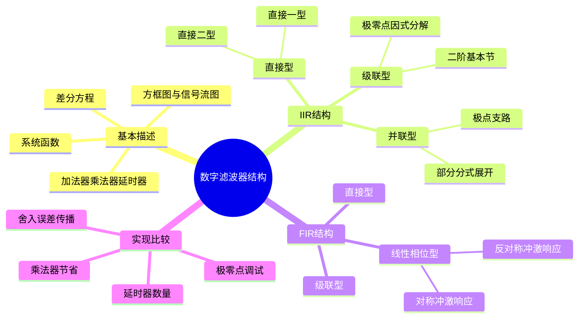
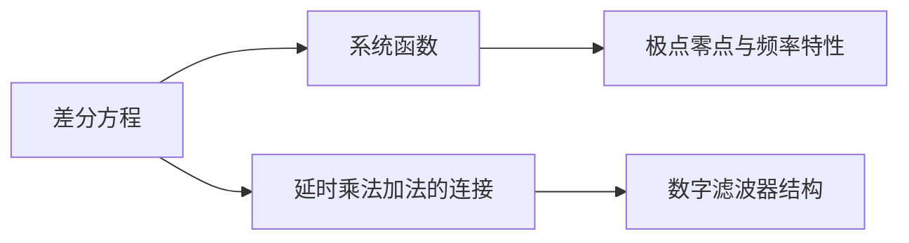
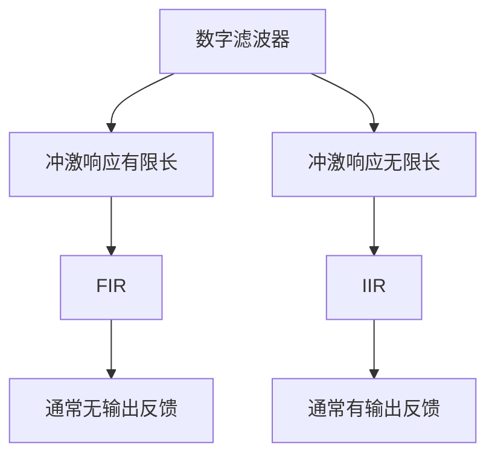
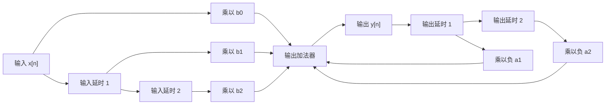
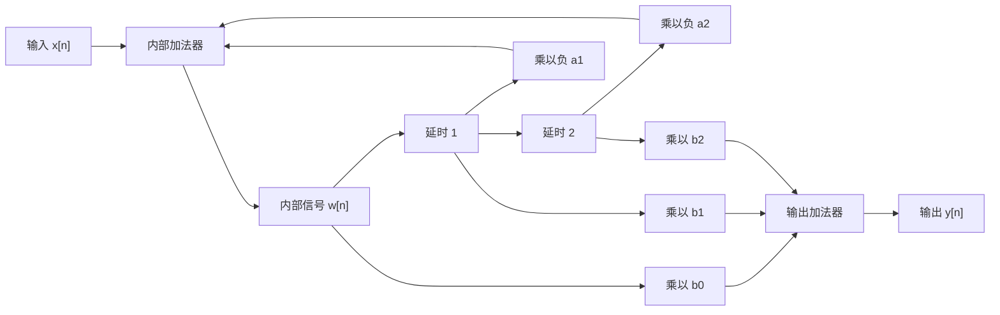
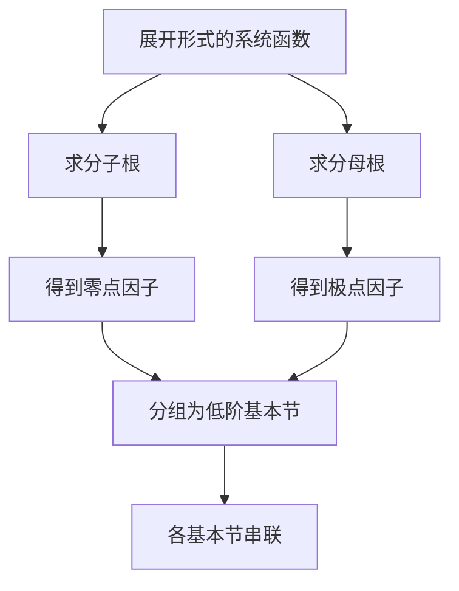
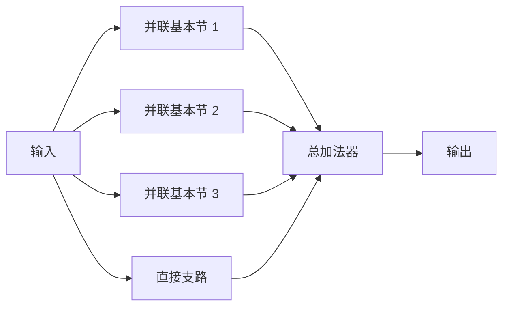
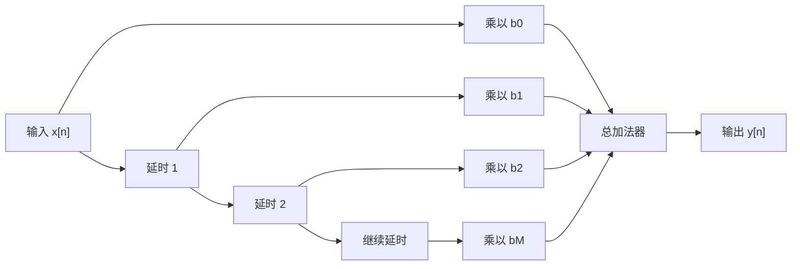
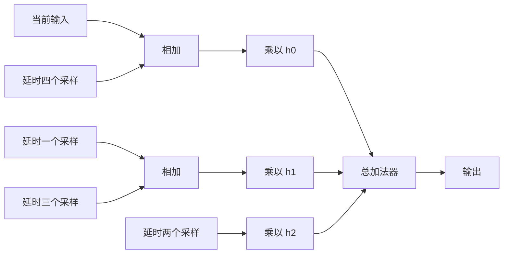

# 第 7 课：数字滤波器的基本结构

## 本课概要

> [!abstract] 本课定位
> 上一课用 Z 变换把差分方程变为系统函数，并利用极点、零点和收敛域分析系统性质。本课进一步回答实现问题：一个已经写出的数字滤波器，怎样用延时器、乘法器和加法器逐点计算出来。课程主线是“差分方程与系统函数—基本运算单元—IIR 结构—FIR 结构—实现代价与调试特点”。

## 1. 从系统分析进入系统实现

上一课主要研究系统的性质。例如，给出差分方程后，可以通过 Z 变换得到

$$
H(z)=\frac{Y(z)}{X(z)},
$$

再由系统函数判断冲激响应、极点位置、因果性和稳定性。这些结果说明了“系统是什么”。

实现时还要解决另一个问题：输入序列每到一个新的采样时刻，计算机怎样得到当前输出？它需要保存哪些过去的样值？每个样值乘以什么系数？哪些结果需要相加？

因此，本课把同一个系统换一种角度观察：差分方程提供计算规则，系统函数提供代数表示，结构图则把计算规则拆成可以执行的基本运算。

### 1.1 三种基本运算单元

数字滤波器的结构图主要由三种单元组成。

**单位延时器**保存一个采样间隔以前的信号。若输入为 $v[n]$，延时器输出为 $v[n-1]$。在 Z 域中，延时一个采样间隔对应乘以 $z^{-1}$。方框中通常标记 $z^{-1}$。

**乘法器**把信号乘以固定系数。例如，系数为 $b_2$ 的乘法器把 $v[n]$ 变为 $b_2v[n]$。滤波器系数就是通过这些乘法器作用到不同延迟支路上的。

**加法器**把多条支路的信号相加。若某条反馈支路标为 $-a_k$，它表示该支路贡献 $-a_kv[n-k]$。

分支点只是把同一个信号提供给多条支路，并不把数值平均分开。沿着一条支路读出延时和乘法，沿着所有进入加法器的支路相加，就能从结构图恢复差分方程。

### 1.2 方框图与信号流图

方框图把延时器、乘法器和加法器画成独立的功能模块；信号流图更强调信号节点和有向支路。两者描述的是同一个计算过程。

例如

$$
y[n]=x[n]+\frac{1}{2}x[n-1]
$$

需要一条直接支路提供 $x[n]$，另一条支路先经过单位延时得到 $x[n-1]$，再乘以 $1/2$，最后在加法器中合并。

## 2. FIR 与 IIR 的分类基础

### 2.1 一般数字滤波器方程

常用的因果线性时不变数字滤波器写成

$$
y[n]
=
\sum_{k=0}^{M}b_kx[n-k]
-
\sum_{k=1}^{N}a_ky[n-k].
$$

其中 $x[n]$ 是输入，$y[n]$ 是输出，$b_k$ 是前向系数，$a_k$ 是反馈系数，$M$ 和 $N$ 分别表示输入延迟项和输出延迟项的最高阶数。对应的零状态系统函数为

$$
H(z)=
\frac{\displaystyle\sum_{k=0}^{M}b_kz^{-k}}
{\displaystyle 1+\sum_{k=1}^{N}a_kz^{-k}}.
$$

分子描述输入历史经过加权后对输出的贡献，分母描述输出历史通过反馈对当前输出的影响。

### 2.2 FIR 系统

FIR 是有限长冲激响应系统。它的冲激响应只有有限个非零样值，输入冲激的影响经过有限个采样间隔后严格结束。

FIR 没有过去输出项，因此 $a_k=0$，方程变为

$$
y[n]=\sum_{k=0}^{M}b_kx[n-k],
$$

系统函数为

$$
H(z)=\sum_{k=0}^{M}b_kz^{-k}.
$$

它是关于 $z^{-1}$ 的有限次多项式。滑动平均系统是典型例子：

$$
y[n]=\frac{1}{L}\sum_{k=0}^{L-1}x[n-k].
$$

因为只使用当前输入和有限个过去输入，所以它也常被称为平均滑动系统。

### 2.3 IIR 系统

IIR 是无限长冲激响应系统。它的冲激响应在理论上有无限多个非零样值，常见原因是过去输出被反馈回来，继续影响未来输出。

例如

$$
y[n]=x[n]-a_1y[n-1]
$$

的系统函数为

$$
H(z)=\frac{1}{1+a_1z^{-1}}.
$$

分母方程

$$
1+a_1z^{-1}=0
$$

给出一个极点。对没有发生完全约分的常见因果 IIR 系统，分母至少含有一个非平凡极点。

需要区分两个分类标准：FIR 或 IIR 按冲激响应是否有限长；递归或非递归按实现结构中是否存在反馈回路。通常 IIR 使用递归结构，FIR 使用非递归结构，但这不是两个定义的同义替换。判断 FIR 或 IIR 时应看最简系统函数和实际冲激响应。

把关于 $z$ 的表达式改写成有理式时，FIR 可能在原点出现形式上的极点；这类原点因子不等同于 IIR 系统中的反馈极点。教材中“FIR 没有极点”通常是指其关于 $z^{-1}$ 的最简有限多项式没有非平凡分母。

## 3. IIR 的直接型结构

### 3.1 直接 I 型：输入链与输出链分开

一般方程可以拆成输入前向部分和输出反馈部分：

$$
y[n]
=
\underbrace{\sum_{k=0}^{M}b_kx[n-k]}_{\text{输入延迟项}}
-
\underbrace{\sum_{k=1}^{N}a_ky[n-k]}_{\text{输出反馈项}}.
$$

直接 I 型严格按照这两个求和式画图：

1. 输入经过一条延时链，产生 $x[n-1],x[n-2],\ldots$；
2. 每个输入延迟项乘以对应的 $b_k$；
3. 输出经过另一条延时链，产生 $y[n-1],y[n-2],\ldots$；
4. 每个输出延迟项乘以 $-a_k$；
5. 所有前向项和反馈项在加法器中相加。

若输入和输出的最高延迟阶数都为 $N$，直接 I 型约需 $2N$ 个单位延时器。它的优点是直观：差分方程中有什么延迟项，图中就有相应延时支路；缺点是延时器较多，而且 $a_k,b_k$ 不是极点和零点本身。

### 3.2 直接 II 型：共享内部延时链

直接 I 型的两条延时链保存输入历史和输出历史。重新安排结构，可以先形成一个内部信号 $w[n]$，再让前向部分和反馈部分共同使用 $w[n]$ 的延迟样值：

$$
w[n]=x[n]-\sum_{k=1}^{N}a_kw[n-k],
$$

$$
y[n]=\sum_{k=0}^{M}b_kw[n-k].
$$

同一组内部延时样值 $w[n-k]$ 同时送给反馈系数和前向系数。因此需要的延时器数量通常为 $\max(M,N)$，而不是输入链和输出链之和。

课堂上常说“把直接 I 型的 $a$、$b$ 两边交换，把 $z^{-1}$ 放在一起”。准确含义是重新安排乘法器、加法器和延时器的连接，使两条延时链共享同一组内部状态；不是把系数数值 $a_k$ 与 $b_k$ 互换。直接 II 型延时器少、结构紧凑，但内部信号可能出现较大幅度，有限字长实现时要注意溢出和量化误差。

### 3.3 直接型的总体特点

直接型从差分方程直接得到结构，最容易画出，也最容易按照系数实现。可是极点和零点需要分别求解

$$
A(z)=0,
\qquad B(z)=0,
$$

才能得到，因此 $a_k,b_k$ 本身不直接反映极零点位置，调试某个极点或零点不够方便。

## 4. IIR 的级联型结构

### 4.1 级联型的分解对象

级联型不是把差分方程中的项随意拆开，而是把系统函数进行因式分解。令 $q=z^{-1}$，把

$$
H(z)=\frac{B(z)}{A(z)}
$$

看成关于 $q$ 的有理式。若分子零点为 $z_i$，分母极点为 $p_i$，则可以写成

$$
H(z)=G_0
\frac{\prod_i(1-z_i z^{-1})}
{\prod_i(1-p_i z^{-1})}.
$$

把一阶因子分组后得到

$$
H(z)=G_0H_1(z)H_2(z)\cdots H_L(z).
$$

各个 $H_k(z)$ 首尾相连，系统函数相乘，所以形成级联型。

从展开式得到级联型的步骤是：先求分子和分母多项式的根，再把根写成因子，将共轭根配成二阶因子，最后把低阶因子组合成若干基本节。

### 4.2 二阶基本节的来源

二阶基本节不是说原系统一定是二阶，而是把高阶系统拆成低阶模块。若滤波器使用实系数，非实根必须成共轭对出现。

设 $p$ 是一个非实极点，且 $P(z)$ 是实系数多项式。如果 $P(p)=0$，对等式取共轭，由于多项式系数为实数，有

$$
P(p)^*=P(p^*)=0.
$$

所以 $p^*$ 也是极点。零点的结论完全相同。也就是说，实系数系统不能只出现一个非实极点或零点，非实根必须和共轭根成对出现。

设一对共轭极点为

$$
p=re^{j\theta},
\qquad p^*=re^{-j\theta},
$$

则对应因子相乘为

$$
\begin{aligned}
(1-pz^{-1})(1-p^*z^{-1})
&=1-(p+p^*)z^{-1}+pp^*z^{-2}\\
&=1-2r\cos\theta\,z^{-1}+r^2z^{-2}.
\end{aligned}
$$

系数 $-2r\cos\theta$ 和 $r^2$ 都是实数，因此一对共轭极点可以组成实系数二阶分母。共轭零点对同样形成实系数二阶分子。

因此，IIR 的二阶基本节通常写成

$$
H_k(z)=
\frac{b_{0,k}+b_{1,k}z^{-1}+b_{2,k}z^{-2}}
{1+a_{1,k}z^{-1}+a_{2,k}z^{-2}}.
$$

分子系数决定该节的零点，分母系数决定该节的极点。一对实根可以形成一阶基本节，一对共轭复根通常组成二阶基本节。

### 4.3 级联型的优缺点

级联型把极点和零点分配到不同基本节，修改某一节的分子或分母系数时，可以比较直接地观察相应零点或极点的变化，因此便于调试。

另一方面，信号要依次经过多个基本节。每级都会产生系数量化、乘法舍入和加法舍入误差，前一级的误差还会进入后一级，所以误差沿级联链传播并累积。实际设计还要考虑基本节排列顺序、增益分配和中间结果溢出。

## 5. IIR 的并联型结构

### 5.1 并联型的分解方法

并联型不使用乘法分解，而使用部分分式展开。一般写成

$$
H(z)=D(z)+\sum_{r=1}^{L}H_r(z),
$$

其中 $H_r(z)$ 是各个并联基本节，$D(z)$ 是可能存在的直接项。

设分母已经因式分解为两个因子

$$
A(z)=A_1(z)A_2(z),
$$

其中

$$
A_1(z)=1+\alpha_1z^{-1}+\alpha_2z^{-2},
$$

$$
A_2(z)=1+\beta_1z^{-1}+\beta_2z^{-2}.
$$

若

$$
H(z)=\frac{B(z)}{A_1(z)A_2(z)},
$$

可以设

$$
H(z)=
\frac{c_0+c_1z^{-1}}{A_1(z)}
+
\frac{d_0+d_1z^{-1}}{A_2(z)}.
$$

两边通分得到

$$
B(z)=
(c_0+c_1z^{-1})A_2(z)
+
(d_0+d_1z^{-1})A_1(z).
$$

展开右侧并比较各阶 $z^{-k}$ 的系数，就能求出 $c_0,c_1,d_0,d_1$。这就是并联分解的具体计算过程。

### 5.2 为什么并联支路也常用二阶基本节

若一对共轭极点为 $p$ 和 $p^*$，部分分式中的两个共轭一阶支路可以合并为

$$
\frac{C}{1-pz^{-1}}+
\frac{C^*}{1-p^*z^{-1}}.
$$

通分后分母为

$$
(1-pz^{-1})(1-p^*z^{-1})
=1-(p+p^*)z^{-1}+pp^*z^{-2},
$$

是实系数二阶式；分子可以整理为实系数一次式。因此并联中的实系数二阶基本节常写成

$$
H_k(z)=
\frac{\gamma_{0,k}+\gamma_{1,k}z^{-1}}
{1+\alpha_{1,k}z^{-1}+\alpha_{2,k}z^{-2}}.
$$

级联型和并联型都使用二阶基本节，但来源不同：级联型是共轭因子的乘法组合，并联型是共轭部分分式通分后的实系数支路。

### 5.3 $M<N$ 与 $M=N$ 的直接项

设分子最高阶数为 $M$，分母最高阶数为 $N$。

当 $M<N$ 时，系统函数是严格真分式，部分分式展开没有直接项：

$$
H(z)=\sum_{r=1}^{L}H_r(z).
$$

当 $M=N$ 时，分子分母阶数相同，长除法会产生常数直接项：

$$
H(z)=d_0+\sum_{r=1}^{L}H_r(z).
$$

结构上，$d_0$ 对应一条输入直接乘以 $d_0$ 的支路，其输出与各个并联基本节的输出一起送入总加法器。

### 5.4 并联型的优缺点

并联型各支路相对独立，某一支路的舍入误差不会像级联型那样连续经过后面的多个基本节，因此可以减少串行误差传播。每个支路的分母主要决定该支路的极点，所以并联型便于调节极点。

但系统总零点来自所有支路相加后的整体结果：

$$
H(z)=H_1(z)+H_2(z)+\cdots+H_L(z).
$$

因此某一支路的修改可能同时改变整体零点，零点调试不如级联型直接。并联型也不是完全没有误差，支路输出在总加法器处仍会产生舍入误差。

## 6. FIR 的直接型与级联型

### 6.1 FIR 直接型

FIR 的差分方程为

$$
y[n]=\sum_{k=0}^{M}b_kx[n-k].
$$

它只需要一条输入延时链、各抽头的乘法器和一个加法器。

以三点滑动平均为例：

$$
y[n]=\frac13x[n]+\frac13x[n-1]+\frac13x[n-2].
$$

结构中有两个单位延时器，三个系数为 $1/3$ 的乘法器和一个总加法器。FIR 无反馈，稳定性容易保证；代价是阶数较高时硬件乘法器、加法器和延时器较多。

### 6.2 FIR 级联型

FIR 系统函数是有限多项式：

$$
H(z)=b_0+b_1z^{-1}+\cdots+b_Mz^{-M}.
$$

求出零点后可以因式分解为

$$
H(z)=G_0\prod_{i=1}^{M}(1-z_i z^{-1}).
$$

将因子分成一阶或二阶基本节，得到

$$
H(z)=G_0H_1(z)H_2(z)\cdots H_L(z).
$$

各基本节串联就是 FIR 级联型。与 IIR 级联型相比，FIR 基本节的分母为 $1$，没有非平凡反馈分母；它主要通过零点位置塑造频率响应。

若零点为复数，由于系数为实数，零点必须和共轭零点成对出现。设一对共轭零点为 $z_0=re^{j\theta}$ 和 $z_0^*=re^{-j\theta}$，则

$$
(1-z_0z^{-1})(1-z_0^*z^{-1})
=1-2r\cos\theta\,z^{-1}+r^2z^{-2},
$$

这就是实系数二阶 FIR 基本节。

## 7. FIR 的线性相位型

### 7.1 对称与反对称冲激响应

FIR 的冲激响应记为

$$
h[0],h[1],\ldots,h[N-1].
$$

若满足

$$
h[n]=h[N-1-n],
$$

称为偶对称；若满足

$$
h[n]=-h[N-1-n],
$$

称为奇对称或反对称。

下标 $n$ 与 $N-1-n$ 的和为 $N-1$，所以这两个样值关于序列中点成对出现。

例如长度为 $5$ 的偶对称冲激响应满足

$$
h[0]=h[4],
\qquad h[1]=h[3].
$$

### 7.2 对称性节省乘法器

一般 FIR 输出为

$$
y[n]=\sum_{k=0}^{N-1}h[k]x[n-k].
$$

对长度为 $5$ 的偶对称情况，原式为

$$
\begin{aligned}
y[n]={}&h[0]x[n]+h[1]x[n-1]+h[2]x[n-2]\\
&+h[3]x[n-3]+h[4]x[n-4].
\end{aligned}
$$

利用 $h[4]=h[0]$ 和 $h[3]=h[1]$，可以重排为

$$
\begin{aligned}
y[n]={}&h[0]\bigl(x[n]+x[n-4]\bigr)\\
&+h[1]\bigl(x[n-1]+x[n-3]\bigr)\\
&+h[2]x[n-2].
\end{aligned}
$$

原来需要五次乘法，重排后只需要三次乘法。对应结构是先把关于中点对称的输入样值相加，再共用同一个系数乘法器。

若是反对称情况，则对应输入样值先相减：

$$
y[n]=h[0]\bigl(x[n]-x[n-4]\bigr)
+h[1]\bigl(x[n-1]-x[n-3]\bigr)+h[2]x[n-2].
$$

当长度为奇数且序列反对称时，中间样值满足 $h[2]=-h[2]$，因此 $h[2]=0$，中间支路不需要乘法器。

### 7.3 对称性与线性相位

对称或反对称的 FIR 冲激响应会使频率响应具有线性相位结构。其主要形式可写为

$$
H\left(e^{j\omega}\right)=A(\omega)e^{-j\omega(N-1)/2},
$$

其中 $A(\omega)$ 是与幅度有关的函数，指数项的相位随数字角频率 $\omega$ 线性变化。完整证明需要把频率响应中的成对项重新组合，本课先掌握结构前提和实现结果：

$$
h[n]=\pm h[N-1-n]
$$

会带来线性相位，并允许前后对应样值共用乘法器。

线性相位型不是 FIR 与 IIR 之外的第三种响应分类，而是利用 FIR 系数特殊对称性降低实现复杂度的一种结构。

## 8. 结构选择与易错点

### 8.1 三种 IIR 结构

| 结构 | 数学分解 | 主要优点 | 主要局限 |
| --- | --- | --- | --- |
| 直接型 | 直接使用差分方程系数 | 简单直观，容易画出 | 极零点不直观，直接 I 型延时器较多 |
| 级联型 | 系统函数因式分解为乘积 | 极点和零点便于分别调节 | 误差沿串联级传播 |
| 并联型 | 系统函数部分分式展开为和 | 支路独立，便于调节极点 | 整体零点不易单独调节 |

### 8.2 三种 FIR 结构

| 结构 | 实现思路 | 主要特点 |
| --- | --- | --- |
| 直接型 | 直接实现各个 $b_k$ 延迟项 | 结构最直观 |
| 级联型 | 将零点多项式因式分解后串联 | 零点位置较容易观察 |
| 线性相位型 | 利用冲激响应对称或反对称 | 可以减少乘法器 |

### 8.3 常见误区

1. **不要把 FIR 和非递归、IIR 和递归当成同一个定义。** FIR/IIR 看冲激响应长度，递归/非递归看结构中是否存在反馈。
2. **二阶基本节不是说系统原本就是二阶。** 它是把高阶系统中的共轭根成对组合后的低阶模块。
3. **级联型和并联型的拆分方法不同。** 级联型通过因式分解得到乘积；并联型通过部分分式展开得到和。
4. **并联型的二阶分母来自共轭极点。** 支路分母主要控制极点，整体零点要看所有支路相加后的结果。
5. **FIR 的“没有极点”要结合表示方式理解。** 关于 $z^{-1}$ 的最简表达式没有非平凡分母；改写成关于 $z$ 的有理式时原点因子不表示 IIR 反馈动态。
6. **线性相位型首先利用的是系数对称性。** 它的乘法器节省来自成对样值共用系数，不是来自极点分解。

## 9. 本课小结与下一步

本课从差分方程出发，把数字滤波器实现为延时器、乘法器和加法器的连接。IIR 的直接型直接对应差分方程，直接 II 型通过共享内部延时链节省延时器；级联型利用极零点因式分解，适合分别调节基本节中的极点和零点；并联型利用部分分式展开，支路独立且便于观察极点。FIR 没有输出反馈，直接型只需一条输入延时链，级联型可以对零点多项式因式分解，线性相位型则利用冲激响应对称性减少乘法器。

后续进入 DFT 时，重点会从“系统怎样实现”转向“有限长序列怎样在有限个离散频率点上表示”。滤波器结构仍会作为应用背景保留下来。

---

## 相关笔记

前置内容：[[01 第1课 离散时间信号、LTI 系统与差分方程]]、[[02 第2课 序列的卷积和与卷积运算]]、[[04 第4课 DTFT与数字频率]]、[[06 第6课 Z变换、收敛域与系统函数]]

后续内容：离散傅里叶变换（DFT）与快速傅里叶变换（FFT）。
