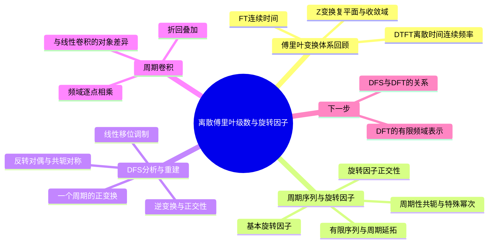

# 第 8 课：离散傅里叶级数与旋转因子

## 本课概要

> [!abstract] 本课定位
> 前面已经学过 FT、DTFT 和 Z 变换。本课把观察对象进一步限定为周期为 $N$ 的离散序列，先建立旋转因子及其正交性，再定义离散傅里叶级数（DFS），并用同一个 $N=4$ 的例子逐项核对 DFS 的主要性质。周期卷积放在本课最后，因为它是 DFS 中“时域卷积对应频域相乘”的直接来源。DFT 尚未在本课展开，下一课再处理有限长序列的离散频域表示。

## 1. 傅里叶变换体系的前置回顾

### 1.1 FT：连续时间与连续频率

连续时间信号 $x_c(t)$ 在每个实数时刻都有定义。检测角频率 $\Omega$ 时，对整个时间轴积分：

$$
X_c(j\Omega)=\int_{-\infty}^{+\infty}x_c(t)e^{-j\Omega t}\,\mathrm dt.
$$

这里 $\Omega$ 是连续时间角频率，单位为弧度每秒。逆变换把连续频率上的所有分量重新叠加：

$$
x_c(t)=\frac{1}{2\pi}\int_{-\infty}^{+\infty}X_c(j\Omega)e^{j\Omega t}\,\mathrm d\Omega.
$$

正变换的对象是连续时间信号，求和方式是积分，频率变量 $\Omega$ 可以连续变化。

### 1.2 DTFT：离散时间与连续数字频率

离散序列 $x[n]$ 只在整数编号处有样值，因此正变换改成对样点求和：

$$
X(e^{j\omega})
=\sum_{n=-\infty}^{+\infty}x[n]e^{-j\omega n}.
$$

逆变换在任意一个长度为 $2\pi$ 的频率区间上积分：

$$
x[n]=\frac{1}{2\pi}\int_{-\pi}^{\pi}
X(e^{j\omega})e^{j\omega n}\,\mathrm d\omega.
$$

例如，有限序列

$$
x[0]=1,\qquad x[1]=2,\qquad x[2]=3
$$

其余位置为零时，DTFT 为

$$
X(e^{j\omega})=1+2e^{-j\omega}+3e^{-j2\omega}.
$$

输入只有三个非零样值，但检测频率 $\omega$ 仍可连续变化，所以输出是一条连续频率函数，而不是三个频域数。

由于 $n$ 为整数：

$$
e^{-j(\omega+2\pi)n}=e^{-j\omega n},
$$

因此 DTFT 以 $2\pi$ 为周期。这个周期性是后面 DFS 只保留有限个频率的前置原因。

### 1.3 Z 变换：在 DTFT 外增加复平面半径

Z 变换把 DTFT 中的检测因子推广为 $z^{-n}$：

$$
X(z)=\sum_{n=-\infty}^{+\infty}x[n]z^{-n}.
$$

令

$$
z=re^{j\omega},
$$

则

$$
z^{-n}=r^{-n}e^{-j\omega n}.
$$

其中 $e^{-j\omega n}$ 仍体现频率检测，$r^{-n}$ 还会改变不同时间位置的权重。Z 变换因此需要说明收敛域（ROC）。当单位圆属于收敛域时，令 $z=e^{j\omega}$ 才能得到 DTFT：

$$
X(e^{j\omega})=X(z)\big\vert_{z=e^{j\omega}}.
$$

本课的 DFS 可以看作：对周期序列，只选取一组与周期相容的离散数字频率来检测。

## 2. 有限序列、周期延拓与主值

### 2.1 同一组数可以代表两个不同对象

取一组数据：

$$
[1,2,3,0].
$$

如果区间外补零，它表示有限长序列：

$$
x[n]=[\ldots,0,0,1,2,3,0,0,\ldots].
$$

如果规定每四个样点重复一次，则得到周期序列：

$$
\tilde{x}[n]=[\ldots,1,2,3,0,1,2,3,0,1,2,3,0,\ldots],
$$

满足

$$
\tilde{x}[n+4]=\tilde{x}[n].
$$

两者在 $n=0,1,2,3$ 这一组数相同，但在区间外的定义不同：有限序列为零，周期序列继续重复。

![[assets/离散傅里叶级数与旋转因子/有限序列与周期延拓.svg]]

### 2.2 周期延拓与取主值

把一段数据向左右无限重复，叫周期延拓。周期序列每一组都相同，所以只需保留连续的 $N$ 个样值作为一个周期的主值：

取主值是保留一组样值；用模运算查询周期序列的位置是另一件事。例如周期为 $4$ 时：

$$
\tilde{x}[6]=\tilde{x}[2]=3.
$$

因此三者要分开：

| 概念 | 作用 |
| --- | --- |
| 周期延拓 | 用一组样值生成无限重复序列 |
| 取主值 | 从周期序列保留一个周期 |
| 模运算 | 把任意编号换算为一个周期内的位置 |

## 3. 旋转因子及其性质

### 3.1 基本旋转因子

对于周期为 $N$ 的序列，定义基本旋转因子

$$
W_N=e^{-j\frac{2\pi}{N}}.
$$

根据欧拉公式，它位于复平面的单位圆上，表示顺时针旋转 $2\pi/N$。其整数次幂为

$$
W_N^k=e^{-j\frac{2\pi k}{N}}.
$$

以 $N=4$ 为例：

$$
W_4=-j,
\qquad
W_4^0=1,
\quad W_4^1=-j,
\quad W_4^2=-1,
\quad W_4^3=j.
$$

![[assets/离散傅里叶级数与旋转因子/N4旋转因子.svg]]

这些幂次对应四种在整数样点上互不重复的旋转序列。$W_4^4=1$，所以再继续旋转就会重复。

### 3.2 周期性、乘法、共轭与倒数

因为

$$
W_N^N=e^{-j2\pi}=1,
$$

所以

$$
W_N^{k+N}=W_N^k.
$$

旋转因子相乘时指数相加：

$$
W_N^aW_N^b=W_N^{a+b}.
$$

共轭会改变旋转方向：

$$
\left(W_N^k\right)^*=W_N^{-k}=\frac{1}{W_N^k}.
$$

常用的特殊幂次为

$$
W_N^{N/2}=-1,
\qquad
W_N^{N/4}=-j,
$$

其中相应的指数需要是整数。若 $M$ 是 $N$ 的因数，则

$$
W_N^M=W_{N/M}.
$$

### 3.3 旋转因子的正交性

两个不同的旋转在一个完整周期内会互相抵消。一般地：

$$
\sum_{n=0}^{N-1}W_N^{kn}\left(W_N^{rn}\right)^*
=\sum_{n=0}^{N-1}W_N^{(k-r)n}.
$$

令 $q=W_N^{k-r}$，这是等比数列：

$$
\sum_{n=0}^{N-1}q^n=\frac{1-q^N}{1-q}.
$$

当 $k=r$ 时，$q=1$，每一项都是 $1$，因此

$$
\sum_{n=0}^{N-1}q^n=N.
$$

当 $k\ne r$ 时，$q\ne1$，但

$$
q^N=e^{-j2\pi(k-r)}=1,
$$

所以

$$
\sum_{n=0}^{N-1}q^n=0.
$$

最终得到

$$
\boxed{
\sum_{n=0}^{N-1}W_N^{kn}\left(W_N^{rn}\right)^*
=
\begin{cases}
N, & k\equiv r\pmod N,\\
0, & k\not\equiv r\pmod N.
\end{cases}}
$$

这里“同一个指数 $kn$ 与其共轭相乘”给出 $N$；比较两个不同频率时，应使用 $k$ 和 $r$，结果为零。这种“同频留下、异频抵消”的性质就是正交性。

## 4. DFS 的定义与逆变换

### 4.1 正变换

设 $\tilde{x}[n]$ 是周期为 $N$ 的序列，只取一个周期 $n=0,1,\ldots,N-1$。离散傅里叶级数正变换定义为

$$
\tilde{X}[k]
=\sum_{n=0}^{N-1}\tilde{x}[n]W_N^{kn},
\qquad k=0,1,\ldots,N-1.
$$

展开旋转因子：

$$
\tilde{X}[k]
=\sum_{n=0}^{N-1}\tilde{x}[n]e^{-j2\pi kn/N}.
$$

$n$ 是一个周期内的时间位置，$k$ 是正在检测的离散旋转频率编号，$\tilde{X}[k]$ 是该旋转分量的复系数。

### 4.2 逆变换

$$
\tilde{x}[n]
=\frac{1}{N}\sum_{k=0}^{N-1}\tilde{X}[k]W_N^{-kn}.
$$

将正变换代入：

$$
\begin{aligned}
\frac{1}{N}\sum_{k=0}^{N-1}\tilde{X}[k]W_N^{-kn}
&=\frac{1}{N}\sum_{k=0}^{N-1}
\left[\sum_{m=0}^{N-1}\tilde{x}[m]W_N^{km}\right]W_N^{-kn}\\
&=\frac{1}{N}\sum_{m=0}^{N-1}\tilde{x}[m]
\sum_{k=0}^{N-1}W_N^{k(m-n)}.
\end{aligned}
$$

内层求和由正交性决定：$m=n$ 时为 $N$，其他情况为零，因此只留下 $\tilde{x}[n]$。逆变换成立的根本原因是旋转因子的正交性。

### 4.3 $N=4$ 基准例子

取

$$
\tilde{x}[n]=[1,2,3,0],
\qquad W_4=-j.
$$

则

$$
\begin{aligned}
\tilde{X}[0]&=1+2+3+0=6,\\
\tilde{X}[1]&=1+2(-j)+3(-1)=-2-2j,\\
\tilde{X}[2]&=1+2(-1)+3(1)=2,\\
\tilde{X}[3]&=1+2j+3(-1)=-2+2j.
\end{aligned}
$$

所以

$$
\boxed{\tilde{X}[k]=[6,-2-2j,2,-2+2j]}.
$$

例如用逆变换检查 $n=0$：

$$
\tilde{x}[0]
=\frac{6+(-2-2j)+2+(-2+2j)}{4}=1.
$$

## 5. DFS 的主要性质

以下仍使用

$$
x[n]=[1,2,3,0],
\qquad X[k]=[6,-2-2j,2,-2+2j].
$$

### 5.1 线性

取

$$
g[n]=[1,0,1,0],
\qquad G[k]=[2,0,2,0].
$$

令 $y[n]=2x[n]+g[n]=[3,4,7,0]$，则

$$
Y[k]=2X[k]+G[k]=[14,-4-4j,6,-4+4j].
$$

原因是求和本身满足线性：

$$
ax[n]+bg[n]\longleftrightarrow aX[k]+bG[k].
$$

### 5.2 周期移位

右移一个样点：

$$
x_s[n]=x[n-1]=[0,1,2,3].
$$

令 $m=n-n_0$，则

$$
\begin{aligned}
X_s[k]
&=\sum_{n=0}^{N-1}x[n-n_0]W_N^{kn}\\
&=W_N^{kn_0}X[k].
\end{aligned}
$$

本例 $n_0=1$：

$$
X_s[k]=W_4^kX[k]=[6,-2+2j,-2,-2-2j].
$$

因为 $\lvert W_N^{kn_0}\rvert=1$，移位只改变相位，不改变幅度。

### 5.3 调制

令

$$
x_m[n]=x[n]W_4^{-n}=[1,2j,-3,0].
$$

则

$$
\begin{aligned}
X_m[k]
&=\sum_{n=0}^{3}x[n]W_4^{-n}W_4^{kn}\\
&=X[k-1].
\end{aligned}
$$

因此

$$
X_m[k]=[-2+2j,6,-2-2j,2].
$$

时域乘以旋转因子，会使频域序列发生循环移位。

### 5.4 时域反转与频率反转

定义

$$
x_r[n]=x[(-n)\bmod4]=[1,0,3,2].
$$

换元可得

$$
x[(-n)\bmod N]\longleftrightarrow X[(-k)\bmod N].
$$

本例中

$$
X_r[k]=[6,-2+2j,2,-2-2j].
$$

### 5.5 实序列的共轭对称性

如果 $x[n]$ 为实序列，则

$$
\begin{aligned}
X^*[k]
&=\left[\sum_{n=0}^{N-1}x[n]W_N^{kn}\right]^*\\
&=\sum_{n=0}^{N-1}x[n]W_N^{-kn}\\
&=X[-k].
\end{aligned}
$$

本例中：

$$
X^*[k]=[6,-2+2j,2,-2-2j]=X[-k].
$$

所以 $X[0]$ 和偶数长度时的 $X[N/2]$ 为实数，正负频率位置互为共轭。

### 5.6 对偶性

若

$$
x[n]\longleftrightarrow X[k],
$$

则把 $X[k]$ 看作新的周期序列再做一次 DFS，有

$$
X[n]\longleftrightarrow Nx[(-k)\bmod N].
$$

本例中

$$
\mathcal{F}_4\{X[n]\}
=4x[(-k)\bmod4]=[4,0,12,8].
$$

多出的系数 $N$ 来自正变换没有除以 $N$，而周期反转来自指数中 $k$ 与 $n$ 的交换。

### 5.7 频域序列的周期性

旋转因子满足 $W_N^{k+N}=W_N^k$，所以

$$
X[k+N]=X[k].
$$

本例中 $X[4]=X[0]=6$。因此只需保留 $k=0,1,2,3$ 这四个不同编号。

## 6. 周期卷积与普通卷积的区别

### 6.1 普通卷积在整数轴上滑动

第 2 课中的卷积和是

$$
y[n]=\sum_{m=-\infty}^{+\infty}x[m]h[n-m].
$$

有限长序列区间外补零，输出长度通常为

$$
L_y=L_x+L_h-1.
$$

取

$$
x[n]=[1,2,3,0],
\qquad h[n]=[1,0,0,1],
$$

普通卷积为

$$
y_{\mathrm{lin}}[n]=[1,2,3,1,2,3,0].
$$

### 6.2 周期卷积在首尾相接的环上计算

若两个序列都按 $N=4$ 周期延拓，则周期卷积只需计算一个周期：

$$
y[n]=\sum_{m=0}^{N-1}x[m]h[(n-m)\bmod N].
$$

本例逐项计算：

$$
y[n]=[3,5,3,1].
$$

普通卷积中编号相差 $N$ 的结果会折回同一位置并相加：

$$
\begin{aligned}
y[0]&=y_{\mathrm{lin}}[0]+y_{\mathrm{lin}}[4]=3,\\
y[1]&=y_{\mathrm{lin}}[1]+y_{\mathrm{lin}}[5]=5,\\
y[2]&=y_{\mathrm{lin}}[2]+y_{\mathrm{lin}}[6]=3,\\
y[3]&=y_{\mathrm{lin}}[3]=1.
\end{aligned}
$$

因此

$$
\boxed{
y_{\mathrm{circ}}[n]=\sum_{r=-\infty}^{+\infty}
y_{\mathrm{lin}}[n+rN]
}
$$

这是一种时域折回叠加。它与采样课中的频谱混叠不是同一个概念。

![[assets/离散傅里叶级数与旋转因子/周期卷积折回.svg]]

### 6.3 周期卷积的 DFS 结果

对周期卷积做 DFS：

$$
Y[k]=\sum_{n=0}^{N-1}y[n]W_N^{kn}.
$$

代入周期卷积并令 $r=n-m$：

$$
\begin{aligned}
Y[k]
&=\sum_{n=0}^{N-1}
\left[\sum_{m=0}^{N-1}x[m]h[n-m]\right]W_N^{kn}\\
&=\left[\sum_{m=0}^{N-1}x[m]W_N^{km}\right]
\left[\sum_{r=0}^{N-1}h[r]W_N^{kr}\right]\\
&=X[k]H[k].
\end{aligned}
$$

本例中

$$
H[k]=[2,1+j,0,1-j],
$$

而

$$
Y[k]=[12,-4j,0,4j]=X[k]H[k].
$$

因此：

$$
\boxed{
x[n]\circledast_N h[n]
\longleftrightarrow
X[k]H[k]
}
$$

## 7. 变换与性质对照

| 时域操作 | DFS 结果 | 本例结果 |
| --- | --- | --- |
| 线性组合 $ax[n]+bg[n]$ | $aX[k]+bG[k]$ | $[14,-4-4j,6,-4+4j]$ |
| 周期右移 $x[n-n_0]$ | $W_N^{kn_0}X[k]$ | $[6,-2+2j,-2,-2-2j]$ |
| 乘旋转因子 $x[n]W_N^{-k_0n}$ | $X[k-k_0]$ | $[-2+2j,6,-2-2j,2]$ |
| 周期反转 $x[-n]$ | $X[-k]$ | $[6,-2+2j,2,-2-2j]$ |
| 实序列 | $X^*[k]=X[-k]$ | $X[1]$ 与 $X[3]$ 共轭 |
| 周期卷积 | $X[k]H[k]$ | $[12,-4j,0,4j]$ |

## 8. 小结、适用条件与下一步

本课的逻辑链是：

$$
\text{旋转因子}
\longrightarrow
\text{正交性}
\longrightarrow
\text{DFS正变换与逆变换}
\longrightarrow
\text{DFS性质}
\longrightarrow
\text{周期卷积定理}.
$$

需要记住的对象边界如下：

1. DFS 的输入是周期序列，计算时只取一个周期。
2. $W_N^k$ 表示基本旋转角 $2\pi/N$ 的整数倍，$k$ 按 $N$ 周期重复。
3. 逆变换前的 $1/N$ 来自旋转因子正交求和留下的 $N$。
4. 普通卷积在整数轴上滑动，周期卷积把超出一个周期的结果折回并相加。
5. 实序列的 DFS 具有周期共轭对称性，但“时域反转对应频率反转”是另一个变换性质。

下一课进入 DFT：把一段有限长序列与它的周期延拓联系起来，说明 DFT 为什么可以理解为对周期延拓序列做 DFS，并计算八点与十六点 DFT。

## 相关笔记

前置内容：[[03 第3课 频率、复指数与傅里叶分析]]、[[04 第4课 DTFT与数字频率]]、[[06 第6课 Z变换、收敛域与系统函数]]、[[02 第2课 序列的卷积和与卷积运算]]

下一步：[[09 第9课 离散傅里叶变换（上）]]。
