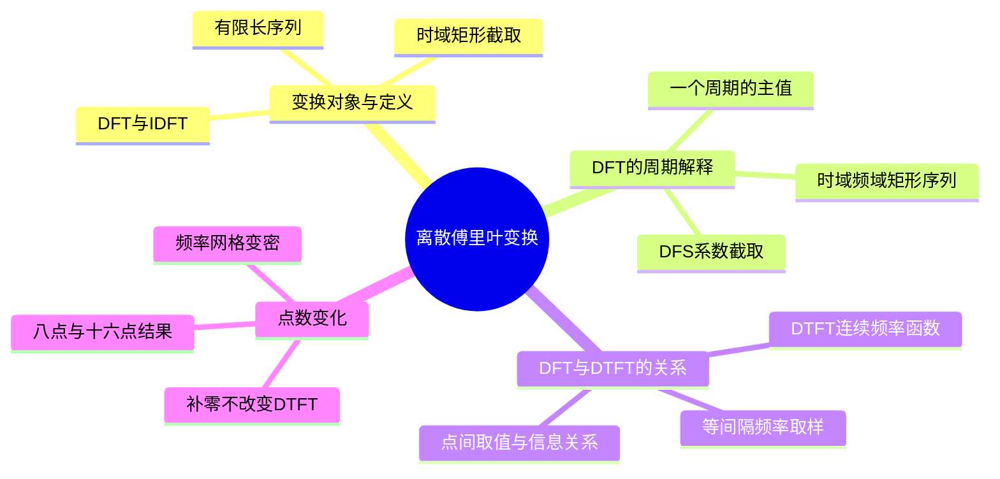
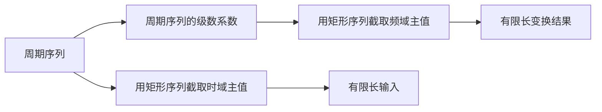

# 第 9 课：离散傅里叶变换（上）

## 本课概要

> [!abstract] 本课定位
> 第 8 课建立了旋转因子、DFS 和周期卷积。本课从有限长序列出发，说明 DFT 如何用有限个频域数表示一段数据，并用老师的矩形序列 $R_N$ 记号写出“取一个周期主值”的步骤。随后把 DFT 分别联系到周期延拓序列的 DFS、有限序列的 DTFT 以及 $R_4[n]$ 的八点和十六点 DFT。这里的 DFT 内容尚未讲完，后续性质与应用留待课程继续。

## 1. 从连续频率曲线到有限个频域数

在第 8 课中，有限序列 $x[n]=[1,2,3]$ 的 DTFT 是

$$
X(e^{j\omega})=1+2e^{-j\omega}+3e^{-j2\omega}.
$$

时间样值只有三个，但 $\omega$ 可以连续改变，因此 DTFT 是连续频率函数。计算机处理有限数据时，常希望用有限个数存下频域表示。做法是选定点数 $N$，只在 $N$ 个等间隔数字频率上计算：

$$
\omega_k=\frac{2\pi k}{N},
\qquad k=0,1,\ldots,N-1.
$$

每个频域数对应连续 DTFT 曲线上的一个取值。为了恢复整个长度为 $N$ 的时域数据，点数需与输入长度相容；若原序列长为 $M$，通常取 $N\ge M$，并在不足的位置补零。

## 2. 矩形序列与 DFT 的定义

### 2.1 矩形序列截取一个周期

定义长度为 $N$ 的矩形序列：

$$
R_N[n]=
\begin{cases}
1,&0\le n\le N-1,\\
0,&\text{其他整数 }n.
\end{cases}
$$

设 $\tilde{x}[n]$ 是周期为 $N$ 的序列。将它乘以时域矩形序列，只留下一个周期的主值：

$$
x[n]=\tilde{x}[n]R_N[n].
$$

例如 $\tilde{x}[n]=[\ldots,1,2,3,0,1,2,3,0,\ldots]$ 时，乘以 $R_4[n]$ 后只保留 $n=0,1,2,3$ 上的 $[1,2,3,0]$，其他位置归零。

对本课例题 $R_4[n]$，若选 $N=8$，下图绿色区域就是要保留的八个时域位置。先看上下两行在绿色区域内完全相同，再看区域外：有限序列为零，周期延拓序列继续重复。乘 $R_8[n]$ 正是把下排区间外的重复样值去掉。

![[assets/离散傅里叶变换/有限序列与八周期延拓.png]]

老师的 DFT 写法也把频域的截取显式写出。若 $\tilde{X}[k]$ 是周期序列 DFS 的系数序列，则

$$
X[k]=\tilde{X}[k]R_N[k].
$$

这里 $R_N[k]$ 只保留频域一个周期的 $N$ 个系数。时域与频域各自乘矩形序列，表达的是相同形式的“取一个周期”，但乘法作用在不同变量上。

### 2.2 DFT 与 IDFT

对长度为 $N$ 的有限长序列 $x[n]$，其 $N$ 点 DFT 定义为

$$
X[k]
=\sum_{n=0}^{N-1}x[n]e^{-j\frac{2\pi}{N}kn}
=\sum_{n=0}^{N-1}x[n]W_N^{kn},
\qquad k=0,1,\ldots,N-1,
$$

其中 $W_N=e^{-j2\pi/N}$ 是第 8 课的基本旋转因子。$n$ 标记输入样值，$k$ 标记检测频率编号。逆变换为

$$
x[n]
=\frac{1}{N}\sum_{k=0}^{N-1}X[k]e^{j\frac{2\pi}{N}kn}
=\frac{1}{N}\sum_{k=0}^{N-1}X[k]W_N^{-kn},
\qquad n=0,1,\ldots,N-1.
$$

DFT 和 IDFT 都只涉及 $N$ 个数。它们互为可逆变换，因此完整的 $N$ 点 DFT 足以恢复这 $N$ 个时域样值。

## 3. DFT 与 DFS、DTFT 的关系

这些名称先按研究对象放在一起。FT 在本课程此处指连续时间傅里叶变换；它与其余三个缩写的区别，首先在于输入是否为离散时间序列。

| 缩写 | 中文名称 | 研究对象与频域形式 |
| --- | --- | --- |
| FT | 连续时间傅里叶变换 | 连续时间信号、连续频率 |
| DTFT | 离散时间傅里叶变换 | 离散序列、连续数字频率 |
| DFS | 离散傅里叶级数 | 周期离散序列、离散谐波系数 |
| DFT | 离散傅里叶变换 | 有限长数据、有限个频域数 |

### 3.1 DFT 是一个周期的 DFS 系数

把有限长输入 $x[0],\ldots,x[N-1]$ 看作周期序列 $\tilde{x}[n]$ 的一个周期。对它做 DFS：

$$
\tilde{X}[k]=\sum_{n=0}^{N-1}\tilde{x}[n]W_N^{kn}.
$$

在主值区间内，$x[n]=\tilde{x}[n]$，于是求和完全相同：

$$
X[k]=\tilde{X}[k]R_N[k],
\qquad 0\le k<N.
$$

因此 DFT 与 DFS 的计算核相同，差别在于对象的解释：DFS 直接分析本来就周期的序列；DFT 把有限长数据看作某个周期序列的一个周期，再取该周期的 DFS 系数。

周期延拓是理解 DFT 与 DFS 关系的方式。实际计算 DFT 时只需有限长输入，不需要显式构造无限序列。

### 3.2 DFT 是 DTFT 的等间隔取样

有限长序列的 DTFT 为

$$
X(e^{j\omega})=\sum_{n=0}^{N-1}x[n]e^{-j\omega n}.
$$

在 $\omega_k=2\pi k/N$ 处代入：

$$
\begin{aligned}
X(e^{j\omega_k})
&=\sum_{n=0}^{N-1}x[n]e^{-j\frac{2\pi}{N}kn}\\
&=X[k].
\end{aligned}
$$

故

$$
\boxed{
X[k]=X(e^{j\omega})\bigg|_{\omega=2\pi k/N}
}.
$$

DFT 直接列出 DTFT 在 $N$ 个均匀频率位置上的取值。DTFT 曲线上两个网格点之间也有合法的变换值；DFT 本身没有把这些中间值逐点列出。对已知有限序列，可以直接代入 DTFT 公式求任意频率处的取值，或先用 IDFT 从完整 DFT 恢复时域样值后再计算。

要分清“变换函数的取值”和“序列的频率成分”：对有限长序列，DTFT 是连续频率函数；DFT 是该函数的有限个样值。对周期延拓序列，DFS 则描述周期信号的离散谐波系数。DFS 系数和 DFT 数值相同，并不意味着有限序列和周期序列是同一个对象。

## 4. $R_4[n]$ 的八点与十六点 DFT

### 4.1 题目与求和化简

已知

$$
x[n]=R_4[n]
=\begin{cases}
1,&n=0,1,2,3,\\
0,&\text{其他整数 }n,
\end{cases}
$$

分别求八点和十六点 DFT。

当 DFT 点数 $N\ge4$ 时，输入在 $0\le n\le3$ 上为 $1$，其余新增位置是零。因此

$$
X_N[k]=\sum_{n=0}^{3}e^{-j2\pi kn/N},
\qquad k=0,1,\ldots,N-1.
$$

这是等比数列。若 $k\ne0$，可写成

$$
X_N[k]
=\frac{1-e^{-j2\pi k(4)/N}}{1-e^{-j2\pi k/N}},
$$

若分子分母同时为零，则回到原始求和式计算；特别是 $X_N[0]=4$。这个表达式适合直接计算每个频率网格上的复数值。

### 4.2 八点 DFT

八点 DFT 的网格间隔是 $2\pi/8=\pi/4$。旋转因子 $W_8=e^{-j\pi/4}$。逐点计算得：

$$
\begin{aligned}
X_8[0]&=4,\\
X_8[1]&=1-j(1+\sqrt2),\\
X_8[2]&=0,\\
X_8[3]&=1-j(\sqrt2-1),\\
X_8[4]&=0,\\
X_8[5]&=1+j(\sqrt2-1),\\
X_8[6]&=0,\\
X_8[7]&=1+j(1+\sqrt2).
\end{aligned}
$$

因此

$$
X_8[k]=[4,\ 1-j(1+\sqrt2),\ 0,\ 1-j(\sqrt2-1),\ 0,\ 1+j(\sqrt2-1),\ 0,\ 1+j(1+\sqrt2)].
$$

例如 $k=2$ 时，检测因子为 $1,-j,-1,j$，求和为零。这些零点来自四项复旋转相互抵消。

### 4.3 十六点 DFT

十六点 DFT 的频率间隔变为 $2\pi/16=\pi/8$。偶数编号处的频率恰好与八点 DFT 网格相同：

$$
\omega^{(16)}_{2r}
=\frac{2\pi(2r)}{16}
=\frac{2\pi r}{8}
=\omega^{(8)}_r.
$$

因此

$$
\boxed{X_{16}[2r]=X_8[r],\qquad r=0,1,\ldots,7.}
$$

新增的是奇数编号频率点。利用有限几何和逐点求得正频率一侧如下；表中小数是四位近似值，其余由实序列的共轭对称性 $X_{16}[16-k]=X_{16}^*[k]$ 得到：

| 编号 $k$ | $X_{16}[k]$ |
| --- | --- |
| $0$ | $4$ |
| $1$ | $3.0137-2.0137j$ |
| $2$ | $1-2.4142j$（等于 $X_8[1]$） |
| $3$ | $-0.2483-1.2483j$ |
| $4$ | $0$（等于 $X_8[2]$） |
| $5$ | $0.8341+0.1659j$ |
| $6$ | $1-0.4142j$（等于 $X_8[3]$） |
| $7$ | $0.4005-0.5995j$ |
| $8$ | $0$ |

例如 $X_{16}[15]=X_{16}^*[1]=3.0137+2.0137j$，$X_{16}[14]=X_8[7]$。偶数点复用旧网格值，奇数点补进新网格位置。

### 4.4 两组 DFT 点落在同一条 DTFT 上

原序列 $R_4[n]$ 的 DTFT 幅度是一条连续曲线。蓝色表示八点网格；十六点网格中蓝色点与八点结果重合，橙色点是新增加的取样位置。沿曲线先看零点：它们在两种网格中都落在同一频率，只是编号随点数变化。

![[assets/离散傅里叶变换/R4序列八点与十六点DFT频谱采样.png]]

十六点 DFT 让频率取样间隔从 $\pi/4$ 减半为 $\pi/8$，所以图上显示得更密。但输入仍只有四个非零样值，DTFT 曲线没有改变。零填充增加的是频域取样密度，不是原始信号信息，也不自动提高区分两个相近正弦频率的能力。

## 5. 连续频谱点与 DFT 样值

取一个简单序列 $x[n]=R_4[n]=[1,1,1,1]$。它的 DTFT 为

$$
\begin{aligned}
X(e^{j\omega})
&=1+e^{-j\omega}+e^{-j2\omega}+e^{-j3\omega}\\
&=e^{-j3\omega/2}\frac{\sin(2\omega)}{\sin(\omega/2)}.
\end{aligned}
$$

四点 DFT 只取 $\omega=0,\pi/2,\pi,3\pi/2$，得到

$$
X_4[k]=[4,0,0,0].
$$

但网格中间的 $\omega=\pi/4$ 仍有非零 DTFT 值：

$$
X(e^{j\pi/4})=1-j(1+\sqrt2).
$$

上面的正弦比值式在分子分母同时为零的位置应按极限理解，不能直接把零除以零当成该频率的结果；例如 $\omega=0$ 时直接由求和得到 $X(e^{j0})=4$。

所以频率网格之间的 DTFT 值确实存在，DFT 没有直接列出它们。与此同时，四点 DFT 经过 IDFT 能准确恢复四个时域样值；有了样值就能计算 DTFT 的任何频率点。这里“不直接列出”不等于“恢复原序列所需的信息已经丢失”。

| 问题 | DTFT | DFT |
| --- | --- | --- |
| 描述对象 | 有限长序列 | 同一组有限长样值 |
| 频率变量 | 连续的 $\omega$ | $N$ 个等间隔的 $\omega_k$ |
| 结果形式 | 连续频率函数 | 有限个复数样值 |
| 主要用途 | 查看任意频率的变换值 | 有限地表示并可逆恢复 $N$ 个数据 |
| 增大点数 | 函数本身不因此改变 | 网格变密，可取更多曲线样值 |

“真实频谱”需要说明对象：有限长序列的 DTFT 连续函数完整给出任意频率处的变换值；DFT 给出一组能恢复有限数据的离散坐标；若把数据无限周期延拓，则 DFS 是周期序列的离散谐波表示。三者不应简单排成真假或完整与残缺的等级。

## 6. 本课小结与后续

本课目前建立的关系是：

$$
\text{有限长数据}
\xrightarrow{\text{补零并选取 }N\text{ 个频率点}}
\text{DFT样值},
$$

并且

$$
\text{DFT} = \text{周期延拓序列的一个周期 DFS 系数}
=\text{有限序列 DTFT 在 }\omega_k=2\pi k/N\text{ 处的取样}.
$$

适用边界与易错点：

1. $R_N[n]$ 和 $R_N[k]$ 分别截取时域与频域的一个主值区间。
2. 若原序列有 $M$ 个样值而希望从 DFT 无损恢复这段序列，应取 $N\ge M$。当 $N>M$ 时才在末尾补零；若 $N<M$，应先增大变换点数。
3. DFT 网格之间仍有 DTFT 值，只是 DFT 没有直接列出。
4. 增大 DFT 点数并补零会使 DTFT 取样更密，不会改变原数据的 DTFT。
5. DFS 分析周期序列；DFT 处理有限数据。周期延拓解释二者的公式联系，但对象约定不能混淆。

老师目前讲到 DFT 的定义、$R_N$ 主值记法、与 DFS/DTFT 的关系，以及 $R_4[n]$ 的八点和十六点 DFT。DFT 后续性质和应用仍待讲授，下一步从课堂新内容继续。

## 相关笔记

前置内容：[[08 第8课 离散傅里叶级数与旋转因子]]、[[04 第4课 DTFT与数字频率]]

后续：DFT 的进一步性质与应用（课堂继续后补充）。
