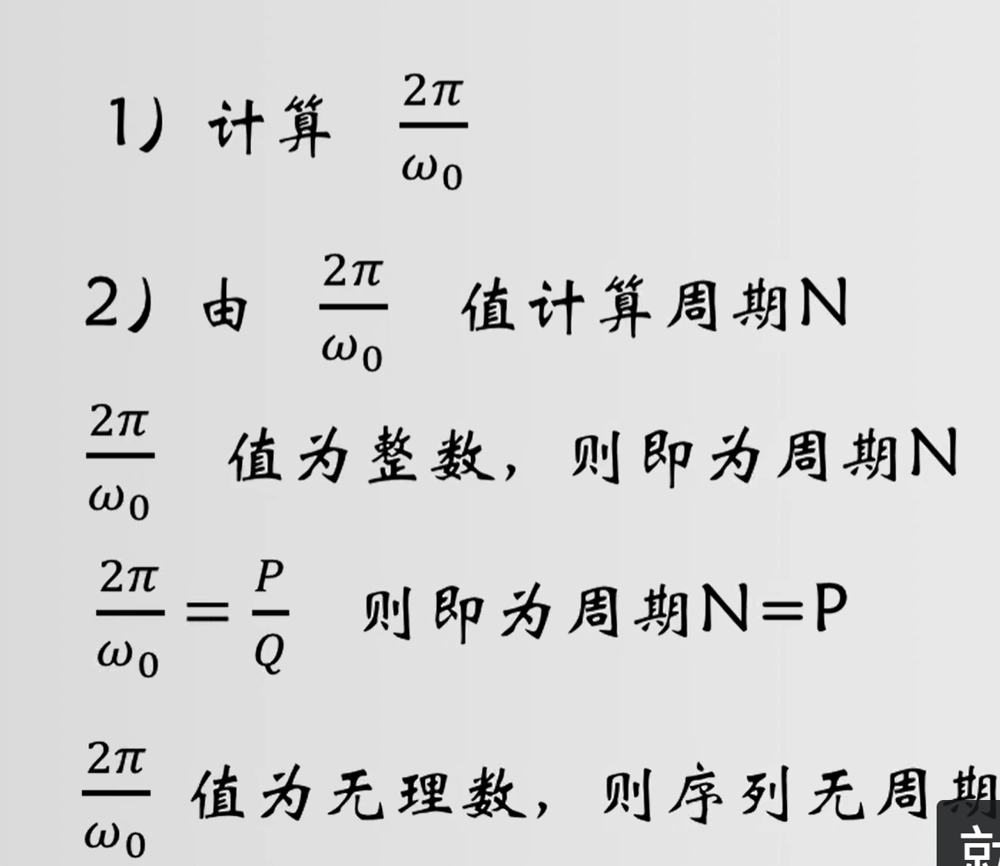

常见典型序列：
1.单位冲激序列，是最基础的序列，可以当作最小单位来表示其他序列
2.单位阶跃序列
3.矩形序列
4.实指数序列，分为单边和双边
5.复指数序列,可以拆分为实指数和虚指数序列，虚指数序列的波形非常复杂，但在虚屏幕投射后，虚平面为sin函数，实平面为cos函数，这一点也和欧拉公式相印证了。
6.正弦型（余弦）序列，注意不是每个正余弦序列都能体现出一个在序列图像上重复的周期，算出的周期是无理数，则图像不会重复，这是由于序列的采样点都是有理数
7.周期序列。

计算序列周期的方法：

要注意模拟周期（采样周期）和我们序列周期的不同含义，序列周期一定是整数，体现的是序列在图像上的重复性
还有由多个正余弦函数加减起来的表达式的周期的计算方法。

序列的基本计算：
1.加减乘除，要对准序列 n=0的位置，找下划线。
2.序列和单位冲激序列的乘法，抽样性质
3.移位分为超前和延迟，看下划线移动的规律
4.翻转
5.尺度变换，也就是抽取，m是正整数，x(mn)就是每m点抽取一次。
