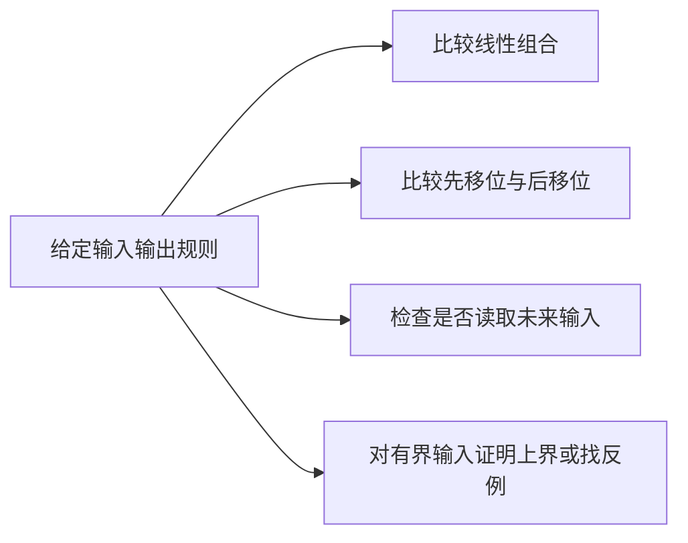

# 第一章第二次作业解析

作业范围：**1.7（2）（4）（6）（8）、1.8（1）（3）（6）、1.14 全部小问**。教材定位为 **PDF 第 69—70 页**，对应书内第 57—58 页。作业本与 [[01 第一章 第一次作业解析]] 之间空若干行。

## 1.7 一般系统的四种性质

**题目。** 对下列四个系统，分别判断（1）线性，（2）时不变，（3）因果，（4）BIBO 稳定。

这些是一般系统，还没有共同的 LTI 前提。因此应直接检验输入输出规则，不能先用冲激响应代替系统。

### （2）固定下限的累加器

$$
y[n]=\sum_{k=n_0}^{n}x[k],
$$

其中 $n_0$ 为固定整数；在通常的启动模型中，$n<n_0$ 时输出取零。

**线性。** 有限求和可分配到输入的线性组合，满足可加性与齐次性。

**时变。** 先延迟输入 $d$ 点再累加：

$$
\mathcal T\{x[\cdot-d]\}[n]
=\sum_{m=n_0-d}^{n-d}x[m].
$$

而先计算原输出再延迟：

$$
y[n-d]=\sum_{m=n_0}^{n-d}x[m].
$$

两者下限不同。具体取 $x[n]=\delta[n-(n_0-1)]$，原输入在累加起点之前，输出全零；把它延迟一点，冲激落在 $n_0$，输出从该时刻变成 $1$。因此非时不变。

**因果。** 在工作区间里只使用 $k\leq n$ 的样点，启动前输出也不读取未来。

**不稳定。** 有界输入 $x[n]=1$ 产生 $y[n]=n-n_0+1$，随着 $n$ 增长而无界。固定下限不能擅自改成负无穷；下限改变会改变时不变性判断。

### （4）逐点指数系统

$$
y[n]=e^{x[n]}.
$$

**非线性。** 零输入产生 $e^0=1$，已违反线性系统必须零输入零输出的必要条件。

**时不变。** 延迟输入得到 $e^{x[n-d]}$，恰好等于原输出延迟 $d$ 点。

**因果。** 当前输出只读取当前输入，是无记忆系统。

**稳定。** 若输入实数且 $\lvert x[n]\rvert\leq M$，则 $\lvert y[n]\rvert=e^{x[n]}\leq e^M$。即使允许复输入，也有 $\lvert e^{x[n]}\rvert=e^{\operatorname{Re}x[n]}\leq e^M$。指数函数随自变量增长很快，不意味着它会把一条有统一上界的输入变成无界序列。

### （6）非均匀取样系统

$$
y[n]=x[n^3].
$$

**线性。** 在指定位置读取样值不会破坏加法与数乘。

**时变。** 先延迟输入得到 $x[n^3-d]$；先过系统再延迟得到 $x[(n-d)^3]$，两者一般不同。例如 $d=1,n=2$ 时分别读取 $x[7]$ 与 $x[1]$，可取输入只在其中一点非零作为反例。

**非因果。** $n=2$ 时读取 $x[8]$，需要未来输入。即使在某些负下标位置只读取过去，也不能使整个系统成为因果。

**稳定。** 若 $\lvert x[k]\rvert\leq M$ 对所有整数 $k$ 成立，则 $\lvert x[n^3]\rvert\leq M$。改变读取位置不会突破输入的统一幅值上界。

### （8）二倍抽取系统

$$
y[n]=x[2n].
$$

**线性。** 取样与输入线性组合可交换。

**时变。** 先延迟输入得到 $x[2n-d]$；先延迟输出得到 $x[2n-2d]$。例如 $d=1,n=1$ 分别读取 $x[1]$ 与 $x[0]$，并不总相同。

**非因果。** $n=1$ 时读取未来样点 $x[2]$。这里比较的是题目中同一个时间编号 $n$；实际多速率装置若另有输入输出时钟与实现延迟，须由另外的模型描述。

**稳定。** $\lvert x[2n]\rvert\leq M$，所以保持有界。

| 小问 | 线性 | 时不变 | 因果 | 稳定 |
| --- | --- | --- | --- | --- |
| （2）固定下限累加 | 是 | 否 | 是 | 否 |
| （4）逐点指数 | 否 | 是 | 是 | 是 |
| （6）立方编号取样 | 是 | 否 | 否 | 是 |
| （8）二倍抽取 | 是 | 否 | 否 | 是 |

**本题笔记对应。** 全部小问见 [[01 第1课 离散时间信号、LTI 系统与差分方程#2. 系统性质的四个独立判据]]；固定起点还可对照该课第 4 节。原笔记对线性与时不变只有直观描述，缺少代入检验、一般系统的因果与稳定定义，原先不合格，现已补齐。

## 1.8 从冲激响应判断因果性与稳定性

**题目。** 以下序列分别为线性时不变系统的单位冲激响应 $h[n]$，判断各系统是否（1）因果，（2）稳定。

这次已经有 LTI 前提，所以使用 $h[n]=0$（$n<0$）判断因果，用 $\sum_n\lvert h[n]\rvert<\infty$ 判断稳定。两种判断互相独立。

### （1）$h[n]=u[n]/n^2$

**先处理题面原点。** PDF 确实写作 $u[n]/n^2$，在 $n=0$ 处没有定义，严格说原式未给出完整冲激响应。通常题目意图是对 $n\geq1$ 使用 $1/n^2$，并给 $h[0]$ 补上任意有限值 $c$。它不能用连续极限消除奇点，因为 $1/n^2$ 在原点发散。

按这一有限值补定义，负时间全零，所以 **因果**；且

$$
\sum_n\lvert h[n]\rvert
=\lvert c\rvert+\sum_{n=1}^{\infty}\frac1{n^2}
=\lvert c\rvert+\frac{\pi^2}{6}<\infty,
$$

因此 **稳定**。作业中宜写“在 $h[0]$ 补定义为有限值的通常解释下，因果且稳定”；若原点取无穷大，则它不是通常允许的有限样值冲激响应。

### （3）$h[n]=3^nu[n]$

负时间为零，所以 **因果**；但

$$
\sum_n\lvert h[n]\rvert=\sum_{n=0}^{\infty}3^n=\infty,
$$

故 **不稳定**。可以取有界输入 $\delta[n]$，输出就是无界的 $3^nu[n]$，直接构成不稳定反例。

### （6）$h[n]=(0.3)^nu[-n-1]$

序列在 $n\leq-1$ 非零，所以 **非因果**。令 $m=-n\geq1$，则

$$
\sum_n\lvert h[n]\rvert
=\sum_{m=1}^{\infty}(0.3)^{-m}
=\sum_{m=1}^{\infty}\left(\frac{10}{3}\right)^m=\infty.
$$

故 **不稳定**。底数小于 $1$ 只说明正下标方向衰减；这里沿负时间延伸，实际不断增长。

**本题笔记对应。** [[01 第1课 离散时间信号、LTI 系统与差分方程#2.3 LTI 系统的冲激响应判据]]及 [[06 第6课 Z变换、收敛域与系统函数#5. 系统函数的因果性与稳定性]]。第 6 课原先已包含严格判据；本次把早期时域入口补回第 1 课，便于按教材第一章完成作业。第（1）问的原点问题属于题面缺定义，已在此处明确，不能归咎于笔记或静默改题。

## 1.14 差分方程的冲激响应与复指数输入

**题目。** 因果系统由差分方程

$$
y[n]-\frac12y[n-1]=x[n]+\frac12x[n-1]
$$

确定。（1）求单位冲激响应；（2）由（1）结果，利用卷积求输入 $x[n]=e^{j\omega n}$ 的响应。按因果 LTI 零状态系统理解该方程。

### （1）单位冲激响应

令 $x[n]=\delta[n]$。因果性给出 $h[n]=0$（$n<0$）。于是

$$
\begin{aligned}
h[0]&=1,\\
h[1]-\frac12h[0]&=\frac12,\quad h[1]=1,\\
h[n]&=\frac12h[n-1],\qquad n\geq2.
\end{aligned}
$$

因此

$$
\boxed{h[n]=\delta[n]+\left(\frac12\right)^{n-1}u[n-1]
=2\left(\frac12\right)^nu[n]-\delta[n].}
$$

原点样值为 $1$，从下一点开始以 $1/2$ 衰减。检验 $\sum_n\lvert h[n]\rvert=1+\sum_{n=1}^{\infty}(1/2)^{n-1}=3$，所以后续全部实频率上的卷积都收敛。

### （2）利用卷积计算输出

题目输入是双边复指数，**没有乘 $u[n]$**。把输入代入卷积，并用 $k$ 表示冲激响应的位置：

$$
\begin{aligned}
y[n]&=\sum_{k=-\infty}^{\infty}h[k]e^{j\omega(n-k)}\\
&=e^{j\omega n}\left[
1+\sum_{k=1}^{\infty}\left(\frac12\right)^{k-1}e^{-j\omega k}\right]\\
&=e^{j\omega n}\left[1+\frac{e^{-j\omega}}{1-\frac12e^{-j\omega}}\right].
\end{aligned}
$$

等比公比的模为 $1/2<1$，故

$$
\boxed{y[n]=\frac{1+\frac12e^{-j\omega}}{1-\frac12e^{-j\omega}}\,e^{j\omega n}.}
$$

输入频率保持不变，前面的复数因子是该频率下的增益与相位。取 $\omega=0$，输出为常数 $3$，与全部冲激响应之和一致；这是检验符号与系数的便捷方法。

**笔记对应。** （1）[[01 第1课 离散时间信号、LTI 系统与差分方程#3. 卷积与系统方程是同一系统的两种描述]]、[[02 第2课 序列的卷积和与卷积运算#4. 求和范围与因果序列]]；（2）[[03 第3课 频率、复指数与傅里叶分析#1.3 复指数通过 LTI 系统的频率不变性]]。原第 3 课只推导了连续系统的复指数响应，离散情形与输入是否启动的区别不完整，原先不合格，现已补上离散卷积推导及适用条件。也可用第 6 课系统函数核对，但本题主解保留老师要求的卷积方法。

## 本次作业的共同判断

系统四性质用四种不同的输入变化检验；只有确定 LTI 后才能直接用冲激响应判据。差分方程求响应时，先区分冲激、双边复指数和从原点启动的单边输入，它们的边界不同，不能混用。

下一份：[[03 第二章 作业解析]]。全范围与补充记录见 [[00 作业索引与笔记对应]]。
