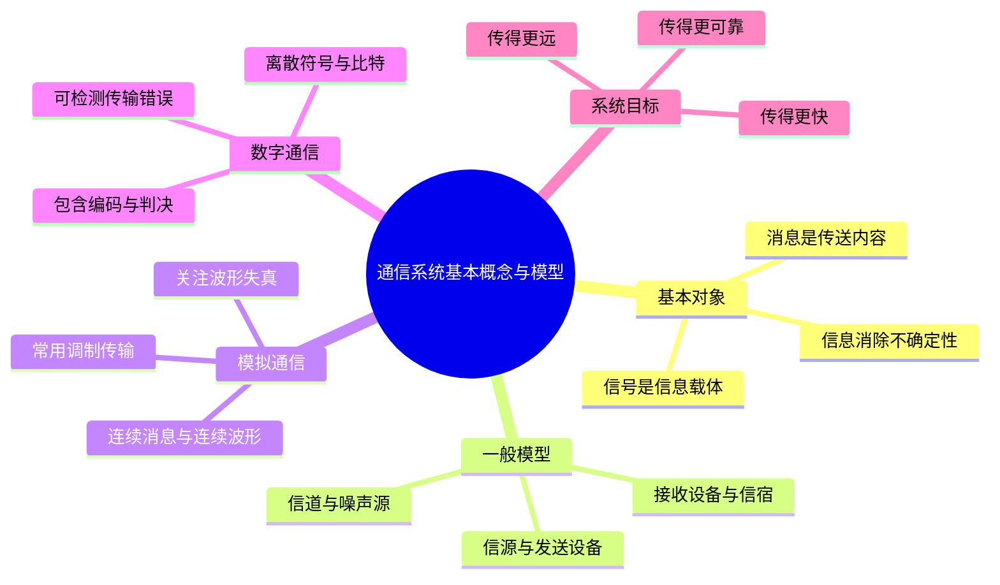

# 第 1 课 通信系统的基本概念与模型

## 本课概要

通信系统最表面的任务，是把一处的信息送到另一处。但真正建模时，我们会发现“要表达的内容”“内容所携带的意义”和“实际传播的物理波形”不是同一件事。先把这三个层次分开，才能理解发送设备中为什么需要编码、调制，接收设备中又为什么要做相反处理。

## 从一个具体通信任务开始

假设有这样一个任务：

> 传感器测得室温为 $25^\circ\mathrm{C}$，并通过无线链路把结果送到监控终端。

对人来说，“室温是 $25^\circ\mathrm{C}$”是一条完整的消息；接收者由不知道室温变为知道室温，获得的是信息；但无线电波本身并不携带汉字或摄氏度单位，它只是电压、电流或电磁场按某种规律变化。最后一种可实际传播的物理量，就是信号。

因此，通信不是简单地“把一个东西搬过去”，而是完成下面的表示转换：

$$
\text{消息} \longrightarrow \text{信息表示} \longrightarrow \text{信号} \longrightarrow \text{信道传输} \longrightarrow \text{恢复消息}
$$

## 消息、信息和信号的关系

消息（message）是待表达和待传递的具体内容，例如一句话、一段语音、一幅图像、一组传感器数据或一个控制指令。信息（information）是消息中能够消除接收者不确定性、带来新认识的部分。信号（signal）则是消息在物理系统中的表现形式，例如随时间变化的电压、光功率或电磁波。

| 概念 | 英文 | 回答的问题 | 例子 |
|---|---|---|---|
| 消息 | message | 发送的具体内容是什么 | “室温是 $25^\circ\mathrm{C}$” |
| 信息 | information | 接收者由此知道了什么 | 室温不确定状态被消除 |
| 信号 | signal | 内容用什么物理量传播 | 电压波形、光脉冲或电磁波 |

消息通常可以包含自然冗余。比如语言中的上下文、固定格式和可预测词语，都可能让接收者在没有收到全部字词时猜出原意。信息量关心的是消息带来了多少“意外”或不确定性消除，而不是简单数一数有多少字符。

需要把消息的自然冗余与通信系统人为增加的编码冗余区分开。校验位、CRC 和纠错码是为抗差错而加入的编码冗余；加密主要保护内容的机密性，并不等同于增加信息量。信源编码通常压缩自然冗余，信道编码则主动加入受控冗余，两者作用相反。

![[SVG图/通信系统总体模型.svg]]

## 通信系统的一般模型

一个完整通信系统至少包括信息源、发送设备、信道、接收设备和信息用户。信道是实际传播信号的媒介，可以是电缆、光纤、水声信道或自由空间。信道并不理想，它会引入衰减、失真和噪声，因此必须在模型中单独标出噪声。

发送设备把消息转换成适合信道传播的信号，接收设备从受污染的接收信号中尽量恢复消息。这里最重要的认识是：信道中传播的是信号，而不是人主观理解的信息本身。信息是接收端重新解释消息后获得的意义。

![[SVG图/数字通信系统模型.svg]]

## 模拟通信和数字通信的差别

模拟通信直接传输连续变化的消息波形。基带信号通常频率较低，不适合直接高效传播，因此需要调制：把基带信号加载到高频载波上，使其适合有线或无线信道。接收端通过解调恢复基带信号。

调制（modulation）可以把信息信号嵌入载波；解调（demodulation）是从已调载波中恢复原信息信号的逆过程。调制除了搬移频谱，还可能改善天线尺寸、抗干扰能力以及多用户频率分配。

数字通信先把消息变成离散符号或比特，再进行一系列处理：

1. 信源编码减少不必要的表示长度，提高传输效率。
2. 加密把可读内容变换为受保护的密文。
3. 信道编码加入用于检错和纠错的冗余，提高可靠性。
4. 调制把数字基带波形转换成适合信道传输的射频波形。
5. 接收端依次进行解调、信道译码、解密和信源译码。

用一条短信来串起整条链路。中文文本先按 UTF-8 变成二进制数据，再进行安全保护和差错控制编码，随后由调制器生成无线信号。接收端把射频信号恢复为比特流，译码、解密并重新显示为中文。

数字通信的优点包括便于加密、抗干扰能力强、差错可控、易于集成和便于现代信号处理。它的代价是通常需要更大传输带宽，并且系统需要位同步、帧同步等复杂机制。

## 概念之间的收束

这节课的知识可以压缩成一条主线：

$$
\boxed{\text{消息给出内容，信息衡量意义，信号负责传播}}
$$

一般模型说明通信由哪些部分组成；模拟模型突出调制和解调；数字模型则进一步说明为什么需要编码、加密以及相应的逆过程。后续学习信息度量时，重点是把“信息”从日常含义转化为可计算量；学习性能指标时，重点是判断这些处理模块是否同时兼顾了速度与质量。

## 复习自检

- 能否不看图默写一般通信系统、模拟通信系统和数字通信系统？
- 能否说明信源编码与信道编码都在处理冗余，但目的为何相反？
- 能否区分消息中的自然冗余、人为添加的校验冗余和加密带来的协议开销？
- 能否用调制与解调解释“信息搭载载波”和“从载波取出信息”？

## 课件来源

- [[PPT/第一讲 chapter 1 introduction更新版.pdf]]
- [[PPT/第一讲 chapter 1阅读材料.docx]]
