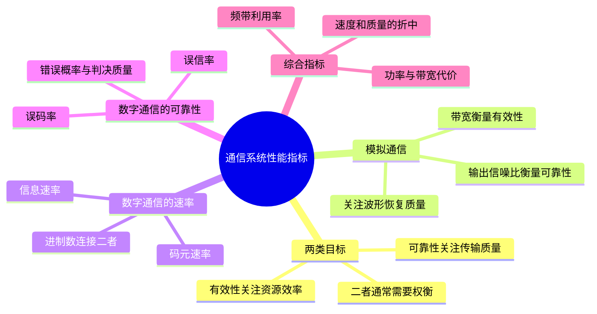

# 第 4 课 通信系统的性能指标

## 本课概要

通信工程总是面对一对基本矛盾：希望在有限的频谱和时间里传得更快，又希望接收结果足够准确。因此评价一个通信系统时，不能只看发射功率、速率或带宽中的某一个数字，而要把性能分成有效性与可靠性两组指标。

有效性（effectiveness）衡量传输一定信息时占用多少信道资源，反映“速度和资源效率”；可靠性（reliability）衡量接收信息的准确程度，反映“传输质量”。改善可靠性往往需要增加功率、冗余、时间或带宽，所以两者经常相互制约。

![[SVG图/通信系统性能指标.svg]]

## 模拟通信系统的有效性与可靠性指标

模拟通信恢复的是连续波形。不同模拟消息没有天然的“码元个数”，所以有效性通常用有效传输带宽描述：

$$
B=f_{\mathrm H}-f_{\mathrm L}
$$

其中，$f_{\mathrm H}$ 与 $f_{\mathrm L}$ 是系统占用频带的最高和最低频率，$B$ 的单位为 $\mathrm{Hz}$。在传输相同消息并达到相近质量的条件下，$B$ 越小，频谱资源利用越有效。

噪声会使整个连续波形发生失真，很难把结果简单判为“对”或“错”，所以模拟系统一般用解调器输出端的信噪比衡量可靠性：

$$
\mathrm{SNR}_{\mathrm o}
=\frac{P_{\mathrm{s,o}}}{P_{\mathrm{n,o}}}
$$

其中，$P_{\mathrm{s,o}}$ 是输出端有用信号功率，$P_{\mathrm{n,o}}$ 是输出端噪声功率，下标 $\mathrm o$ 表示输出端。信噪比越大，有用信号相对噪声越强，恢复波形通常越接近原波形。

## 数字通信系统的码元速率与信息速率

数字通信传输离散码元。设一个码元持续时间为 $T_B$，则码元速率为：

$$
R_B=\frac{1}{T_B}
$$

$R_B$ 表示每秒传输的码元数，单位为波特（$\mathrm{Bd}$）。对于 $M$ 进制信号，一个码元有 $M$ 种可能取值。若各符号独立、等概率，每个码元携带：

$$
\log_2 M\ \mathrm{bit}
$$

因此信息速率或比特率为：

$$
R_b=R_B\log_2 M
$$

$R_b$ 表示每秒传输的平均信息量，单位为 $\mathrm{bit/s}$。二进制系统满足 $M=2$，于是 $R_b=R_B$。

符号持续时间变短、码元速率提高，意味着单位时间内要完成更多波形变化，通常也需要更宽频带。因此码元速率不是与带宽无关，而是受到带宽约束。理想无码间串扰的奈奎斯特极限为：

$$
R_B\leq2B
$$

这里的 $B$ 是单边基带带宽，等号对应理想奈奎斯特脉冲。实际系统使用升余弦等可实现波形时，通常有：

$$
R_B<2B
$$

要同时比较“传了多少”和“占了多少带宽”，应使用频带利用率：

$$
\eta_B=\frac{R_B}{B}
$$

以及：

$$
\eta_b=\frac{R_b}{B}
$$

其中，$\eta_B$ 的单位为 $\mathrm{Bd/Hz}$，$\eta_b$ 的单位为 $\mathrm{bit/(s\cdot Hz)}$。对于等概率 $M$ 进制系统：

$$
\eta_b=\eta_B\log_2 M
$$

因此更完整的数字通信有效性比较，需要同时关注 $R_B$、$R_b$、$M$ 和 $B$。

## 数字通信系统的错误概率指标

数字接收端最终需要对码元或比特作出离散判决。发送 $1$ 而判为 $0$，就是一次错误。因此可靠性用错误概率描述。

误符号率或码元错误概率为：

$$
P_e=P_s
=\frac{\text{错误码元数}}{\text{传输码元总数}}
$$

误比特率为：

$$
P_b
=\frac{\text{错误比特数}}{\text{传输比特总数}}
$$

二进制系统的一个码元就是一个比特，因此通常有：

$$
P_b=P_e
$$

对于 $M$ 进制系统，一个错误码元可能对应一个或多个错误比特，所以 $P_b$ 与 $P_e$ 的关系取决于调制进制数、格雷映射和错误分布。使用格雷映射时，相邻码元通常只有一位不同，常可近似写成：

$$
P_b\approx\frac{P_e}{\log_2 M}
$$

这个关系是工程近似，不应在未说明映射方式时当作普遍恒等式。

## 性能指标总表

| 系统 | 有效性 | 可靠性 | 越好的方向 |
|---|---|---|---|
| 模拟系统 | 传输带宽 $B$ | 输出信噪比 $\mathrm{SNR}_{\mathrm o}$ | $B$ 越小，$\mathrm{SNR}_{\mathrm o}$ 越大 |
| 数字系统 | $R_B$、$R_b$ 或 $\eta_b$ | $P_e$ 或 $P_b$ | 速率和频带利用率越大，错误概率越小 |

比较数字系统时，只用 $R_B$ 描述有效性并不完整。比如一个系统以 $2000\ \mathrm{Bd}$ 传输却占用 $10\ \mathrm{kHz}$，另一个系统以 $1000\ \mathrm{Bd}$ 传输但只占用 $1\ \mathrm{kHz}$。后者的码元速率低，但频带利用率更高。因此“传输速度快”与“频谱利用有效”不能混为一谈。

## 用贯穿例题建立计算关系

### 例一：码元速率与信息速率

某数字系统中码元持续时间为：

$$
T_B=0.2\ \mathrm{ms}=2\times10^{-4}\ \mathrm{s}
$$

采用八进制传输，则：

$$
R_B=\frac{1}{T_B}=5000\ \mathrm{Bd}
$$

每个八进制码元携带：

$$
\log_2 8=3\ \mathrm{bit}
$$

所以：

$$
R_b=5000\times3=15000\ \mathrm{bit/s}
$$

### 例二：由信息速率反推码元速率

四进制系统的信息速率为 $R_b=2400\ \mathrm{bit/s}$，且各符号等概率。每个码元携带 $2$ bit，因此：

$$
R_B=\frac{R_b}{\log_2 4}=1200\ \mathrm{Bd}
$$

半小时为：

$$
t=30\times60=1800\ \mathrm{s}
$$

传输码元总数为：

$$
N=R_Bt=1200\times1800=2.16\times10^6
$$

若收到 $216$ 个错误码元，则：

$$
P_e=\frac{216}{2.16\times10^6}=10^{-4}
$$

### 例三：由概率计算平均信息速率

四符号概率为 $(1/4,1/8,1/8,1/2)$，信源每秒输出 $2400$ 个独立符号。由第 3 课得到：

$$
H(X)=1.75\ \mathrm{bit/symbol}
$$

因此：

$$
R_b=R_sH(X)
=2400\times1.75
=4200\ \mathrm{bit/s}
$$

## 码元、比特和带宽的进一步理解

数字基带信号可以写成一串脉冲：

$$
s(t)=\sum_k a_k g(t-kT_B)
$$

其中，$a_k$ 是第 $k$ 个码元，$g(t)$ 是经过发送滤波器、信道和接收滤波器后的总脉冲。接收端在 $t=kT_B$ 抽样。为了不把相邻码元误判为当前码元，应使其他脉冲在当前抽样时刻为零，这就是无码间串扰条件。

理想 sinc 脉冲的相邻零点间隔正好是 $T_B$，其矩形频谱的单边带宽为：

$$
B=\frac{1}{2T_B}
$$

结合 $R_B=1/T_B$，便得到理想极限 $R_B=2B$。这条关系与数字信号处理中的采样定理具有相似的 $2B$ 自由度背景，但问题方向不同：采样定理问至少多快采样才能恢复带宽为 $B$ 的信号，奈奎斯特准则问带宽为 $B$ 的信道最多多快传输独立码元。

![[SVG图/奈奎斯特无码间串扰与2B关系.svg]]

## 解题时最容易混淆的地方

1. $T_B$ 是一个码元的持续时间，不是脉冲无限延伸的总时间。
2. $R_B$ 的单位是 $\mathrm{Bd}$，$R_b$ 的单位是 $\mathrm{bit/s}$。
3. 非等概率信源不能直接使用 $\log_2 M$，应使用熵 $H(X)$。
4. $P_e$ 数错误码元，$P_b$ 数错误比特。
5. 比较频谱效率必须把速率与带宽一起考虑。

## 课件与作业来源

- [[PPT/第二讲 chapter 1 introduction part2  [修改版].pdf]]
- [[PPT/第二讲课堂学习单.docx]]
- [[PPT/第二讲例题.docx]]
- [[作业留档/电信3班董鑫瑞202483670051-通信原理第一章作业.pdf]]
