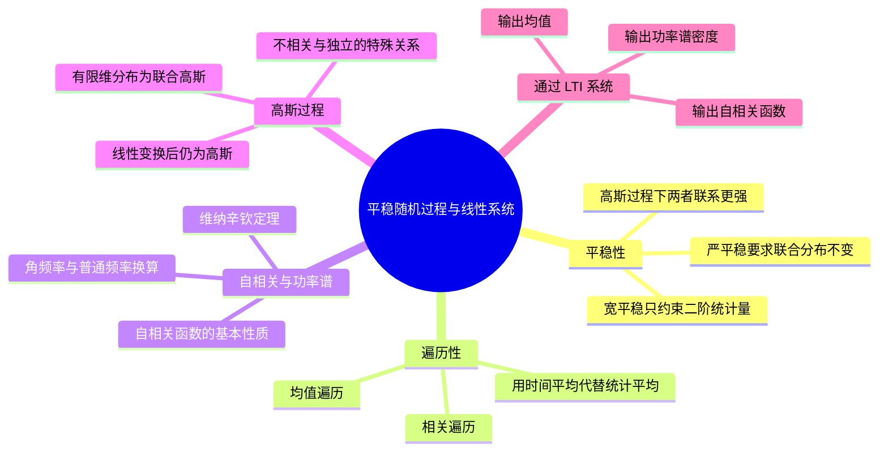

# 第 6 课（学校第四讲）平稳性、高斯随机过程与线性系统

## 本课概要

> 对应学校第四讲。本课把第三讲中临时使用的“平稳”概念正式定义，并回答三个问题：严平稳、宽平稳和遍历性有什么关系；高斯性为什么能把二阶统计量提升为完整分布；随机过程经过线性时不变系统后哪些性质保留。

## 一、平稳性的引入与作用

一般随机过程的均值和相关函数可能依赖绝对时间：

$$
\mu_X(t)=E[X(t)],
$$

$$
R_X(t_1,t_2)=E[X(t_1)X(t_2)].
$$

但许多通信噪声和稳定信号源具有这样的性质：

> 把时间轴整体平移一段时间，统计规律不变。

这种性质可以避免研究绝对时刻，把问题简化为研究时间差。

## 二、严平稳

如果任意有限维概率分布都不随时间平移改变，则称随机过程为严平稳过程，英文为 strict-sense stationary process。

对任意 $n$ 个时刻和任意平移量 $\Delta$：

$$
f_X(x_1,\ldots,x_n;t_1,\ldots,t_n)
=
f_X(x_1,\ldots,x_n;t_1+\Delta,\ldots,t_n+\Delta).
$$

严平稳的“严”体现在：不只均值和相关函数不变，而是任意多个时刻的联合分布都不变。

## 三、宽平稳

若随机过程满足：

$$
E[X^2(t)]<\infty,
$$

$$
E[X(t)]=\mu_X=\text{常数},
$$

$$
R_X(t_1,t_2)=R_X(t_2-t_1),
$$

则称其为宽平稳过程，英文为 wide-sense stationary process。

令：

$$
\tau=t_2-t_1,
$$

则：

$$
R_X(t_1,t_2)=R_X(\tau).
$$

宽平稳只约束一阶和二阶统计量，所以：

$$
\text{严平稳}\Longrightarrow\text{宽平稳},
$$

但反向不成立。

![[SVG图/平稳性关系.svg]]

## 四、遍历性

集合平均是：

$$
E[X(t)].
$$

时间平均是：

$$
\overline{x}
=
\lim_{T\rightarrow\infty}
\frac{1}{2T}
\int_{-T}^{T}x(t)\,\mathrm dt.
$$

时间自相关函数是：

$$
\overline{x(t)x(t+\tau)}
=
\lim_{T\rightarrow\infty}
\frac{1}{2T}
\int_{-T}^{T}x(t)x(t+\tau)\,\mathrm dt.
$$

若时间平均等于集合平均，并且时间自相关等于集合自相关，则过程具有遍历性。

遍历性回答的是：

> 一条长时间记录能否代表整个随机过程的统计规律？

课程中的关系是：

$$
\text{遍历过程}\Longrightarrow\text{严平稳}\Longrightarrow\text{宽平稳}.
$$

但严平稳不保证遍历，宽平稳也不保证严平稳。

| 命题 | 判断 | 解释 |
|---|---|---|
| 任一遍历过程都是宽平稳 | 真 | 遍历性通常建立在平稳性之上 |
| 严平稳一定遍历 | 假 | 一条样本不一定包含总体全部信息 |
| 所有宽平稳都严平稳 | 假 | 宽平稳只看一、二阶矩 |

## 五、自相关函数的性质

设实宽平稳随机过程为 $X(t)$：

$$
R_X(\tau)=E[X(t)X(t+\tau)].
$$

| 性质 | 表达式 | 意义 |
|---|---|---|
| 偶函数 | $R_X(-\tau)=R_X(\tau)$ | 时间差反向不改变相关 |
| 零时差 | $R_X(0)=E[X^2(t)]$ | 总平均功率 |
| 上界 | $|R_X(\tau)|\leq R_X(0)$ | 相关强度不能超过零时差功率 |
| 直流功率 | $\mu_X^2$ | 平均值对应的功率 |
| 交流功率 | $\sigma_X^2=R_X(0)-\mu_X^2$ | 围绕均值的波动功率 |

还应注意：

$$
R_X(0)=\mu_X^2+\sigma_X^2.
$$

在长时间间隔后趋于不相关时，才有：

$$
R_X(\infty)=\mu_X^2.
$$

### 课堂练习二

已知：

$$
R_X(\tau)=16+9e^{-2|\tau|}.
$$

平均功率：

$$
R_X(0)=16+9=25.
$$

直流功率：

$$
R_X(\infty)=16.
$$

交流功率：

$$
\sigma_X^2=25-16=9.
$$

## 六、功率谱密度与维纳－辛钦定理

对于宽平稳过程，功率谱密度与自相关函数互为傅里叶变换：

$$
P_X(f)
=
\int_{-\infty}^{+\infty}
R_X(\tau)e^{-j2\pi f\tau}\,\mathrm d\tau,
$$

$$
R_X(\tau)
=
\int_{-\infty}^{+\infty}
P_X(f)e^{j2\pi f\tau}\,\mathrm df.
$$

这就是维纳－辛钦定理，英文为 Wiener-Khinchin theorem。

总平均功率为：

$$
R_X(0)
=
\int_{-\infty}^{+\infty}P_X(f)\,\mathrm df.
$$

### 角频率与普通频率的换算

$$
\omega=2\pi f,
\qquad
f=\frac{\omega}{2\pi}.
$$

使用角频率时：

$$
P_X(\omega)
=
\int_{-\infty}^{+\infty}
R_X(\tau)e^{-j\omega\tau}\,\mathrm d\tau,
$$

$$
R_X(\tau)
=
\frac{1}{2\pi}
\int_{-\infty}^{+\infty}
P_X(\omega)e^{j\omega\tau}\,\mathrm d\omega.
$$

频率轴的刻度是：

$$
\omega=2\pi f.
$$

但不能机械地把功率谱数值都乘以 $2\pi$；$2\pi$ 还出现在傅里叶反变换的积分测度中。

### 随机相位余弦

若：

$$
X(t)=A\cos(\omega_ct+\Theta),
$$

其中 $\Theta$ 均匀分布，则：

$$
R_X(\tau)=\frac{A^2}{2}\cos(\omega_c\tau),
$$

普通频率下：

$$
P_X(f)
=
\frac{A^2}{4}
[\delta(f-f_c)+\delta(f+f_c)].
$$

角频率下：

$$
P_X(\omega)
=
\frac{\pi A^2}{2}
[\delta(\omega-\omega_c)+\delta(\omega+\omega_c)].
$$

## 七、高斯随机过程

高斯随机过程的定义是：任意有限个时刻的随机向量都服从联合高斯分布。

对任意 $n$ 个时刻：

$$
\mathbf X=
[X(t_1),\ldots,X(t_n)]^{\mathrm T}
\sim
N(\boldsymbol\mu,\boldsymbol\Sigma),
$$

其中 $\boldsymbol\mu$ 是均值向量，$\boldsymbol\Sigma$ 是协方差矩阵。

联合高斯密度为：

$$
f_{\mathbf X}(\mathbf x)
=
\frac{1}{(2\pi)^{n/2}|\boldsymbol\Sigma|^{1/2}}
\exp\left[
-\frac12
(\mathbf x-\boldsymbol\mu)^{\mathrm T}
\boldsymbol\Sigma^{-1}
(\mathbf x-\boldsymbol\mu)
\right].
$$

### 高斯过程由宽平稳推出严平稳的条件

宽平稳保证：

$$
\mu_X(t)=\mu_X,
$$

以及：

$$
C_X(t_i,t_j)=C_X(t_i-t_j).
$$

当所有时刻平移 $\Delta$ 时，均值向量不变，协方差矩阵也不变。由于联合高斯分布完全由均值向量和协方差矩阵决定，所有有限维分布都不随时间平移改变。

因此：

$$
\boxed{
\text{高斯随机过程}+\text{宽平稳}
\Longrightarrow
\text{严平稳}
}
$$

![[SVG图/高斯与LTI系统.svg]]

## 八、不相关与统计独立

不相关只表示：

$$
\operatorname{Cov}(X,Y)=0,
$$

等价于：

$$
E[XY]=E[X]E[Y].
$$

独立则要求联合密度分解：

$$
f_{XY}(x,y)=f_X(x)f_Y(y).
$$

对于一般过程：

$$
\text{不相关}\not\Rightarrow\text{独立}.
$$

例如：

$$
U\sim U(-1,1),
\qquad
V=U^2.
$$

由于 $U$ 关于零对称：

$$
E[UV]=E[U^3]=0,
$$

所以 $U,V$ 不相关。但 $V=U^2$，二者显然不独立。这说明相关系数只检验线性关系，不能排除平方等非线性关系。

对于联合高斯随机变量，协方差矩阵中的交叉项决定联合密度是否分解。若：

$$
\operatorname{Cov}(X,Y)=0,
$$

则联合密度可以写成边缘密度乘积，因此：

$$
\boxed{
\text{联合高斯}+\text{不相关}
\Longrightarrow
\text{独立}
}
$$

准确的说法是“联合高斯”，而不只是两个变量分别服从高斯分布。

## 九、随机过程经过线性时不变系统

设线性时不变系统的冲激响应为 $h(t)$，频率响应为 $H(f)$。输入 $X(t)$ 经过系统后：

$$
Y(t)=h(t)*X(t).
$$

若 $X(t)$ 是宽平稳过程，则：

$$
\mu_Y=\mu_X H(0),
$$

$$
R_Y(\tau)
=
\iint
h(u)h(v)R_X(\tau+u-v)\,\mathrm du\,\mathrm dv.
$$

频域关系更简洁：

$$
P_Y(f)=P_X(f)|H(f)|^2.
$$

其中 $|H(f)|^2$ 是功率增益。

因此：

1. 宽平稳输入经过 LTI 系统，输出仍宽平稳；
2. 高斯输入经过 LTI 系统，输出仍高斯；
3. 高斯性由线性变换保持，因为输出的任意有限维向量仍是输入高斯向量的线性变换。

## 十、最终思考题：延时求和系统（课堂练习五）

已知：

$$
Y(t)=X(t)+X(t-T).
$$

### 1. 方框图

该系统相当于一条直达支路和一条延迟 $T$ 的支路相加，因此：

$$
h(t)=\delta(t)+\delta(t-T).
$$

### 2. 输出均值

若输入均值为 $a$，则：

$$
E[Y(t)]=2a.
$$

### 3. 输出自相关函数

$$
\begin{aligned}
R_Y(\tau)
&=E[Y(t)Y(t+\tau)]\\
&=2R_X(\tau)+R_X(\tau-T)+R_X(\tau+T).
\end{aligned}
$$

### 4. 输出功率谱密度

频率响应为：

$$
H(f)=1+e^{-j2\pi fT}.
$$

因此：

$$
|H(f)|^2
=
2+2\cos(2\pi fT)
=
4\cos^2(\pi fT).
$$

输出功率谱为：

$$
\boxed{
P_Y(f)=P_X(f)\,4\cos^2(\pi fT)
}
$$

若使用角频率：

$$
P_Y(\omega)
=
P_X(\omega)\,4\cos^2\left(\frac{\omega T}{2}\right).
$$

这道题展示了随机过程通过线性系统的标准解题链：

$$
\text{时域关系}
\rightarrow
\text{自相关}
\rightarrow
\text{系统函数}
\rightarrow
\text{输出功率谱}.
$$

## 十一、判断题答案

| 命题 | 答案 | 原因 |
|---|---|---|
| 一般过程严平稳推出宽平稳 | 真 | 严平稳约束更强 |
| 两个不相关随机变量一定独立 | 假 | 非线性依赖仍可能存在 |
| 联合高斯变量不相关等价独立 | 真 | 联合高斯分布由一、二阶矩决定 |
| 所有宽平稳过程都严平稳 | 假 | 宽平稳只约束一、二阶统计量 |

## 十二、复习路线

1. 先分清集合平均和时间平均；
2. 再记住严平稳、宽平稳、遍历性的包含关系；
3. 用自相关函数的零时差和直流、交流分解检查功率；
4. 用维纳－辛钦关系连接时域与频域；
5. 高斯过程的关键是“有限维联合分布由均值向量和协方差矩阵决定”；
6. 线性系统题目优先写时域关系，再转化为功率谱乘法。

PPT 中的 BPSK 误码率和误差函数部分属于拓展内容，本笔记不展开。

## 课件与练习来源

- [[PPT/第四讲/第四讲 chapter 2 Random processes(平稳+高斯+LTI).pptx]]
- [[PPT/第四讲/课堂练习-第四讲.docx]]
