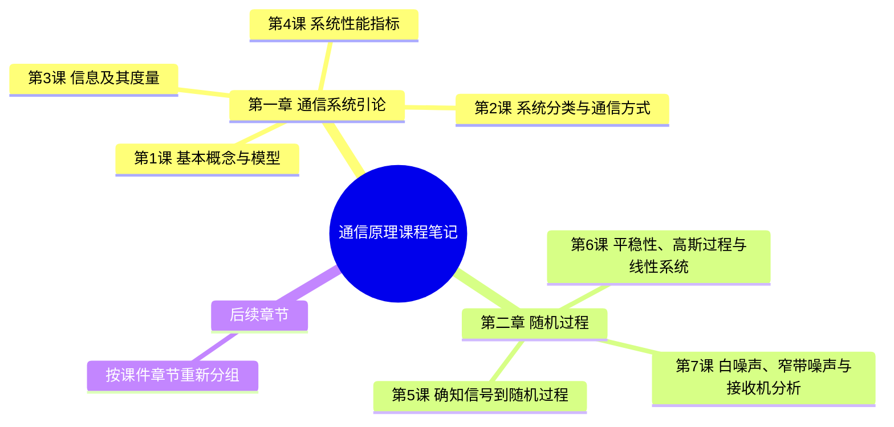

# 通信原理（3学分）学习笔记

这门课的笔记不按课件页码堆积，而按课件章节和知识依赖关系整理。这样既能对应学校的授课进度，也能在复习时沿着“第一章通信系统引论 -> 第二章随机过程”的路线连续阅读。

## 当前学习进度

| 章节 | 课次 | 主题 | 核心问题 | 笔记 |
|---|---|---|---|---|
| 第一章 | 第 1 课 | 通信系统的基本模型 | 消息、信息和信号如何进入通信系统 | [[第1章 01 第1课 通信系统的基本概念与模型]] |
| 第一章 | 第 2 课 | 通信系统的分类 | 一个系统可以从哪些角度分类 | [[第1章 02 第2课 通信系统的分类与通信方式]] |
| 第一章 | 第 3 课 | 信息及其度量 | 如何量化不确定性、消息的信息量和信源平均信息量 | [[第1章 03 第3课 信息及其度量]] |
| 第一章 | 第 4 课 | 通信系统性能指标 | 如何评价传得快不快和恢复得准不准 | [[第1章 04 第4课 通信系统的性能指标]] |
| 第二章 | 第 5 课 | 从确知信号到随机过程 | 随机过程、样本函数、统计量、功率谱密度和典型例题 | [[第2章 05 第5课 从确知信号到随机过程]] |
| 第二章 | 第 6 课 | 平稳性、高斯随机过程与线性系统 | 严平稳、宽平稳、遍历性、自相关性质、PSD、高斯性和 LTI 系统 | [[第2章 06 第6课 平稳性、高斯随机过程与线性系统]] |
| 第二章 | 第 7 课 | 白噪声、窄带噪声与接收机分析 | 高斯噪声的频谱、功率、自相关及 DSB 解调框架 | [[第2章 07 第7课 白噪声、窄带噪声与接收机分析]] |

课件第一章对应学校第一讲和第二讲，即本笔记第 1 至第 4 课；课件第二章对应学校第三讲、第四讲和第五讲，即本笔记第 5 至第 7 课。把课堂材料按章节和知识链拆开，可以看清第一章从通信系统引论过渡到第二章随机过程的关系。

## 章节结构

## 阅读路线

复习时建议按以下顺序：

1. 先读[[第1章 01 第1课 通信系统的基本概念与模型]]，弄清通信系统究竟在传输什么。
2. 再读[[第1章 02 第2课 通信系统的分类与通信方式]]，学会判断分类依据。
3. 接着读[[第1章 03 第3课 信息及其度量]]，区分具体消息的总信息量和信源的熵。
4. 读[[第1章 04 第4课 通信系统的性能指标]]，把码元速率、信息速率、带宽和错误概率放在一起比较。
5. 再读[[第2章 05 第5课 从确知信号到随机过程]]，完成从确定波形到随机过程和功率谱描述的过渡。
6. 读[[第2章 06 第6课 平稳性、高斯随机过程与线性系统]]，掌握平稳性、遍历性、高斯性和 LTI 系统的性质。
7. 最后读[[第2章 07 第7课 白噪声、窄带噪声与接收机分析]]，把随机过程的统计描述放回通信接收机的噪声与解调问题。

## 图解索引

- [[SVG图/通信系统总体模型.svg]]：消息、信息、信号与系统模块的关系。
- [[SVG图/数字通信系统模型.svg]]：信源编码、加密、信道编码、调制及其逆过程。
- [[SVG图/通信系统分类.svg]]：常见分类维度。
- [[SVG图/信息度量计算路径.svg]]：概率、信息量、总信息量、熵和信息速率的计算链。
- [[SVG图/通信系统性能指标.svg]]：有效性与可靠性指标。
- [[SVG图/奈奎斯特无码间串扰与2B关系.svg]]：码元间隔、sinc 脉冲与带宽的直观关系。
- [[SVG图/随机过程双视角.svg]]：样本函数、随机变量和随机过程总体的关系。
- [[SVG图/功率谱与自相关链路.svg]]：自相关函数、傅里叶变换、PSD 与平均功率的关系。
- [[SVG图/平稳性关系.svg]]：遍历过程、严平稳和宽平稳的包含关系。
- [[SVG图/高斯与LTI系统.svg]]：高斯过程、宽平稳和线性时不变系统的性质保持关系。

## 资料归档

- `PPT/`：教师课件、阅读材料、课堂学习单和例题。
- `作业留档/`：已经完成的课程作业。
- `SVG图/`：笔记使用的矢量图。
- `附件/第2章/`：第二章课堂图示的本地副本，供笔记稳定引用。

## 新课堂记录约定

新的一节课先给出关键词、讲课脉络和疑问即可。整理时先根据已有笔记还原课堂内容，解答疑问；只有明确要求“形成笔记”时，再按照当前文件名规则新建或更新 `第 N 课` Markdown 文件，并同步修改本页和 `AGENTS.md` 中的学习进度。

Obsidian 文件中的行内公式使用 `$...$`，独立公式使用 `$$...$$`。

