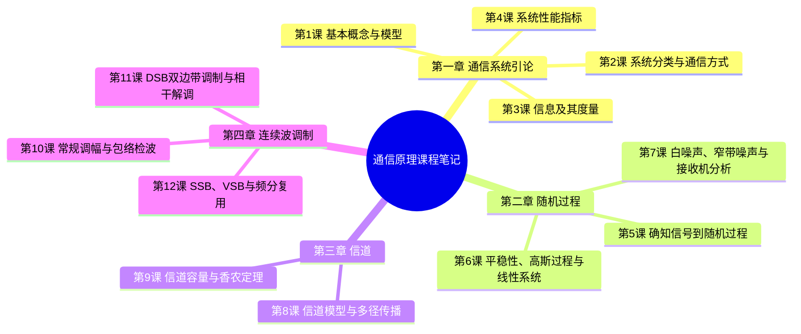

# 通信原理（3学分）学习笔记

这门课的笔记不按课件页码堆积，而按课件章节和知识依赖关系整理。复习时沿着“第一章通信系统引论 -> 第二章随机过程 -> 第三章信道 -> 第四章连续波调制”的路线连续阅读。

## 当前学习进度

| 章节 | 课次 | 主题 | 核心问题 | 笔记 |
|---|---|---|---|---|
| 第一章 | 第 1 课 | 通信系统的基本模型 | 消息、信息和信号如何进入通信系统 | [[第1章 01 第1课 通信系统的基本概念与模型]] |
| 第一章 | 第 2 课 | 通信系统的分类 | 一个系统可以从哪些角度分类 | [[第1章 02 第2课 通信系统的分类与通信方式]] |
| 第一章 | 第 3 课 | 信息及其度量 | 如何量化不确定性、消息的信息量和信源平均信息量 | [[第1章 03 第3课 信息及其度量]] |
| 第一章 | 第 4 课 | 通信系统性能指标 | 如何评价传得快不快和恢复得准不准 | [[第1章 04 第4课 通信系统的性能指标]] |
| 第二章 | 第 5 课 | 从确知信号到随机过程 | 随机过程、样本函数、统计量、功率谱密度和典型例题 | [[第2章 05 第5课 从确知信号到随机过程]] |
| 第二章 | 第 6 课 | 平稳性、高斯随机过程与线性系统 | 严平稳、宽平稳、遍历性、自相关性质、PSD、高斯性和 LTI 系统 | [[第2章 06 第6课 平稳性、高斯随机过程与线性系统]] |
| 第二章 | 第 7 课 | 白噪声、窄带噪声与接收机分析 | 高斯噪声的频谱、功率、自相关及 DSB 解调框架 | [[第2章 07 第7课 白噪声、窄带噪声与接收机分析]] |
| 第三章 | 第 8 课 | 信道模型与多径传播 | 两层信道模型、恒参与随参、两径频率选择性衰落 | [[第3章 08 第8课 信道模型与多径传播]] |
| 第三章 | 第 9 课 | 信道容量与香农定理 | 离散互信息、连续 AWGN 容量、链路例题与多天线扩展 | [[第3章 09 第9课 信道容量与香农定理]] |
| 第四章 | 第 10 课 | 常规调幅与包络检波 | AM 模型、时频域、调幅深度、效率、抗噪声性能与综合例题 | [[第4章 10 第10课 常规调幅与包络检波]] |
| 第四章 | 第 11 课 | DSB双边带调制与相干解调 | 抑制载波、时频域、同步恢复、功率效率、抗噪声性能与 I/Q 支路 | [[第4章 11 第11课 DSB双边带调制与相干解调]] |
| 第四章 | 第 12 课 | SSB、VSB与频分复用 | 单边带的滤波法与相移法、功率与抗噪声、基群超群、VSB无失真条件 | [[第4章 12 第12课 SSB VSB与频分复用]] |

课件第一章对应学校第一讲和第二讲，即本笔记第 1 至第 4 课；课件第二章对应学校第三讲、第四讲和第五讲，即本笔记第 5 至第 7 课；课件第三章对应学校第六讲和第七讲，第 8 课研究信道模型与多径传播，第 9 课研究信道容量。课件第四章从学校第八讲开始，第 10 课研究常规调幅与包络检波，第 11 课研究 DSB 双边带调制与相干解调，第 12 课研究 SSB、VSB 与频分复用；本课程期中范围到第十讲结束，FM 及之后内容属于期末范围。

## 章节结构

第二讲至第六讲的 Word 练习已整理为[[练习解析/第二讲至第六讲 练习解析索引|英汉对照练习解析]]：先英文原题，再中文对照、词汇、解析和笔记出处，包含原题图与课堂填表。发现的知识缺项已补入第 3 至第 8 课，对应概要与出处已同步更新。

## 阅读路线

复习时建议按以下顺序：

1. 先读[[第1章 01 第1课 通信系统的基本概念与模型]]，弄清通信系统究竟在传输什么。
2. 再读[[第1章 02 第2课 通信系统的分类与通信方式]]，学会判断分类依据。
3. 接着读[[第1章 03 第3课 信息及其度量]]，区分具体消息的总信息量和信源的熵。
4. 读[[第1章 04 第4课 通信系统的性能指标]]，把码元速率、信息速率、带宽和错误概率放在一起比较。
5. 再读[[第2章 05 第5课 从确知信号到随机过程]]，完成从确定波形到随机过程和功率谱描述的过渡。
6. 读[[第2章 06 第6课 平稳性、高斯随机过程与线性系统]]，掌握平稳性、遍历性、高斯性和 LTI 系统的性质。
7. 读[[第2章 07 第7课 白噪声、窄带噪声与接收机分析]]，把随机过程的统计描述放回通信接收机的噪声与解调问题。
8. 接着读[[第3章 08 第8课 信道模型与多径传播]]，从传播路径走向波形失真、符号判决和多径衰落。
9. 读[[第3章 09 第9课 信道容量与香农定理]]，从符号转移走向连续信道容量，并用光纤、卫星和电话信道例题理解带宽与信噪比的作用。
10. 读[[第4章 10 第10课 常规调幅与包络检波]]，沿同一条语音信号理解 AM 的生成、边带、包络恢复、功率效率和噪声影响。
11. 接着读[[第4章 11 第11课 DSB双边带调制与相干解调]]，比较去掉载波后的波形、同步恢复、噪声功率与 I/Q 两支路。
12. 最后读[[第4章 12 第12课 SSB VSB与频分复用]]，掌握单边带的两种实现、FDM 基群与超群、以及 VSB 滤波器无失真条件。

## 图解索引

- [[SVG图/通信系统总体模型.svg]]：消息、信息、信号与系统模块的关系。
- [[SVG图/数字通信系统模型.svg]]：信源编码、加密、信道编码、调制及其逆过程。
- [[SVG图/通信系统分类.svg]]：常见分类维度。
- [[SVG图/信息度量计算路径.svg]]：概率、信息量、总信息量、熵和信息速率的计算链。
- [[SVG图/通信系统性能指标.svg]]：有效性与可靠性指标。
- [[SVG图/奈奎斯特无码间串扰与2B关系.svg]]：码元间隔、sinc 脉冲与带宽的直观关系。
- [[SVG图/随机过程双视角.svg]]：样本函数、随机变量和随机过程总体的关系。
- [[SVG图/功率谱与自相关链路.svg]]：自相关函数、傅里叶变换、PSD 与平均功率的关系。
- [[SVG图/平稳性关系.svg]]：遍历过程、严平稳和宽平稳的包含关系。
- [[SVG图/高斯与LTI系统.svg]]：高斯过程、宽平稳和线性时不变系统的性质保持关系。
- [[附件/第3章/17-两层信道模型边界.png]]：调制信道和编码信道在同一系统中的边界。
- [[附件/第3章/37-多径波形频谱对照.png]]：时变多径前后的波形、包络和频谱。
- [[附件/第3章/41-两径频率响应.png]]：固定两径信道随频率出现的增强与抵消。
- [[附件/第3章/第七讲-离散信道符号转移.png]]：从发送符号到接收判决的转移与互信息。
- [[附件/第3章/第七讲-两层信道模型.png]]：离散与连续容量对应的观察边界。
- [[附件/第3章/第七讲-容量随带宽变化.png]]：固定信号功率与噪声谱密度时的容量曲线。
- [[附件/第3章/第七讲-单模与多模光纤.png]]：两类光纤的传播路径对照。
- [[附件/第3章/第七讲-MIMO传输示意.png]]：多发多收的空间路径。
- [[附件/第3章/第七讲-第三章思维导图.png]]：第六、七讲构成的第三章知识结构。
- [[附件/第4章/09-AM系统模型.png]]：AM 的发送、信道与包络检波链路。
- [[附件/第4章/15-双音时域频域对照.png]]：消息、载波、AM 波和检波输出的频谱对照。
- [[附件/第4章/18-调幅系数三种状态.png]]：欠调幅、满调幅与过调制的包络。
- [[附件/第4章/24-AM各节点信号功率.png]]：调制与检波前后四个节点的信号功率填表。
- [[附件/第4章/25-带通与输出噪声频谱.png]]：带通噪声与检波后基带噪声。
- [[附件/第4章/31-包络检波门限效应.png]]：小信噪比时的输出信噪比急剧下降。
- [[附件/第4章/35-实际AM收发链路.png]]：实际发射机与接收机各级作用。
- [[附件/第4章/39-AM综合例题.png]]：带宽、输入输出信噪比与制度增益题目。
- [[附件/第4章/第九讲-AM与DSB频谱对照.png]]：固定载波谱线消失而两边带保留。
- [[附件/第4章/第九讲-DSB双音时域.png]]：消息变号时的高频翻转与半幅恢复波形。
- [[附件/第4章/第九讲-DSB双音频域.png]]：双音消息、载波、DSB 波及解调后的谱线。
- [[附件/第4章/第九讲-DSB时频域对照.png]]：两次相乘与低通输出的时频域关系。
- [[附件/第4章/第九讲-DSB噪声频谱.png]]：两块带通噪声谱与输出基带噪声谱。
- [[附件/第4章/第九讲-DSB综合例题.png]]：第九讲输入输出信噪比与噪声谱绘制题。
- [[附件/第4章/第九讲-Costas环.png]]：同相正交两路与载波同步反馈。
- [[附件/第4章/第九讲-IQ调制.png]]、[[附件/第4章/第九讲-IQ解调.png]]：I/Q 两支路的发送与接收框图。
- [[附件/第4章/第十讲-AM-DSB-SSB频谱对照.jpg]]：AM、DSB 与 SSB 的载波和边带对照。
- [[附件/第4章/第十讲-SSB滤波法系统框图.jpg]]：SSB 滤波法发送接收链路与上下边带选择。
- [[附件/第4章/第十讲-SSB相移法框图与公式.jpg]]：SSB 相移法的 I/Q 支路与上下边带合成。
- [[附件/第4章/第十讲-SSB抗噪声功率框图.jpg]]：SSB 相干解调功率节点填表。
- [[附件/第4章/第十讲-SSB双音时域图.jpg]]、[[附件/第4章/第十讲-SSB双音频谱图.jpg]]：SSB 双音时域与频域对照。
- [[附件/第4章/第十讲-SSB综合例题.jpg]]：SSB 抗噪声综合例题。
- [[附件/第4章/第十讲-DSB与SSB抗噪声比较.jpg]]：相同发送功率下 DSB 与 SSB 的输出信噪比比较。
- [[附件/第4章/第十讲-FDM多路复用框图.jpg]]：多路话音搬移、合并和分离。
- [[附件/第4章/第十讲-FDM基群超群框图.jpg]]、[[附件/第4章/第十讲-FDM基群超群题目.jpg]]：FDM 基群、超群与计算题。
- [[附件/第4章/第十讲-VSB滤波框图.jpg]]、[[附件/第4章/第十讲-VSB无失真条件.jpg]]：VSB 滤波器过渡带和无失真恢复条件。

## 资料归档

- `PPT/`：教师课件、阅读材料、课堂学习单和例题。
- `作业留档/`：已经完成的课程作业。
- `SVG图/`：笔记使用的矢量图。
- `附件/第2章/`：第二章课堂图示的本地副本，供笔记稳定引用。
- `附件/第3章/`：第三章第六、七讲图示的本地副本，供笔记稳定引用。
- `附件/第4章/`：第四章 AM、DSB、SSB、VSB 与 FDM 课件图示的本地副本。
- `练习解析/`：第二讲至第六讲按章节编排的英汉对照题解及覆盖索引。
- `附件/练习解析/`：练习题图的裁剪与整理副本。

## 新课堂记录约定

新的一节课先给出关键词、讲课脉络和疑问即可。整理时先根据已有笔记还原课堂内容，解答疑问；只有明确要求“形成笔记”时，再按照当前文件名规则新建或更新 `第 N 课` Markdown 文件，并同步修改本页和 `AGENTS.md` 中的学习进度。

Obsidian 文件中的行内公式使用 `$...$`，独立公式使用 `$$...$$`。

