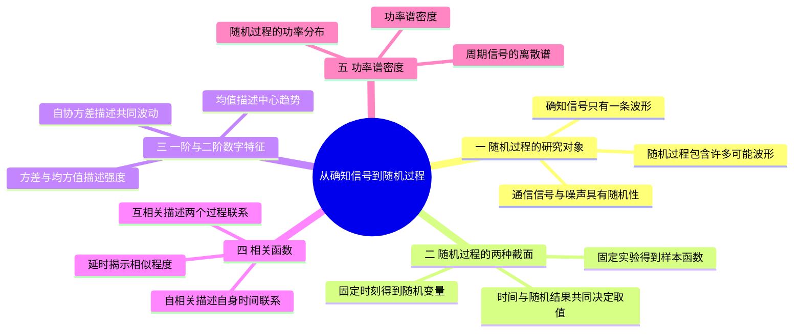

# 第2章 · 第5课（学校第三讲）从确知信号到随机过程

## 本课概要

> 对应学校第三讲。本课不展开平稳过程的完整理论，重点解决一个过渡问题：通信中为什么不能只研究一条完全确定的波形，以及如何用公式描述随机信号的功率和相关性。

## 一、从通信任务看研究对象

通信系统中不仅有信道噪声，携带信息的有效信号也具有不确定性。比如发送语音、随机二进制序列或传感器数据时，发送端在具体消息发出以前不能预测全部波形，接收端更不能提前知道具体实现。

因此，研究对象从一条确定的时间函数，转向“许多可能波形及其统计规律”。这一步不是为了把确定信号变得复杂，而是因为实际通信面对的是：

$$
\text{单次波形不可完全预测，但整体统计规律可以研究}.
$$

![[SVG图/随机过程双视角.svg]]

## 二、确知信号与随机过程的区别

| 比较维度    | 确知信号          | 随机信号（随机过程）          |
| ------- | ------------- | ------------------- |
| 核心性质    | 完全确定的时间函数     | 样本函数集合；固定时刻是随机变量    |
| 给定时刻的取值 | 唯一、可精确预测      | 不能提前精确预测            |
| 波形数量    | 只有一条确定波形      | 有许多可能样本波形，观测只得到其中一条 |
| 描述方法    | 直接写出 $s(t)$   | 均值、方差、概率分布、相关函数等统计量 |
| 功率问题    | 对唯一波形积分或取时间平均 | 平稳随机过程通常用功率谱密度描述    |

随机过程可以写成：

$$
X(t,\xi),
$$

其中 $t$ 是时间，$\xi$ 表示随机实验结果。

固定一次实验结果 $\xi_i$，得到样本函数：

$$
x_i(t)=X(t,\xi_i).
$$

固定一个时刻 $t=t_0$，得到随机变量：

$$
X(t_0)=X(t_0,\xi).
$$

所以：

$$
\text{固定样本、观察时间}\Longrightarrow\text{样本函数},
$$

$$
\text{固定时间、比较样本}\Longrightarrow\text{随机变量}.
$$

一个样本函数只是随机过程的一次实现，不能代表所有可能波形。

## 三、随机过程的数字特征

完整描述随机过程需要任意多个时刻的联合概率密度：

$$
f_X(x_1,\ldots,x_n;t_1,\ldots,t_n).
$$

这种描述很严格，但通信工程通常只关心平均位置、波动大小、两个时刻之间的联系和功率分布。因此先使用均值、方差、相关函数等数字特征。

### 1. 均值

在固定时刻 $t$，随机过程的均值为：

$$
\mu_X(t)=E[X(t)]
=\int_{-\infty}^{+\infty}x f_X(x;t)\,\mathrm dx.
$$

它表示所有可能样本在该时刻的集合平均，不是某一个样本的瞬时值。

### 2. 方差与均方值

方差描述围绕均值的波动：

$$
\sigma_X^2(t)
=E\{[X(t)-\mu_X(t)]^2\}.
$$

均方值描述幅度平方后的平均功率：

$$
E[X^2(t)]=E\{[X(t)]^2\}.
$$

两者关系为：

$$
E[X^2(t)]=\sigma_X^2(t)+\mu_X^2(t).
$$

注意：

$$
E[X^2(t)]\neq [E(X(t))]^2
$$

通常不相等。均值的平方只是平均位置的平方，不是平均功率。

### 3. 自相关函数

同一随机过程两个时刻的自相关函数为：

$$
R_X(t_1,t_2)=E[X(t_1)X(t_2)].
$$

它描述两个时刻的统计乘积联系。若 $t_1=t_2=t$，则：

$$
R_X(t,t)=E[X^2(t)].
$$

### 4. 自协方差函数

去掉均值后，得到自协方差：

$$
C_X(t_1,t_2)
=
E\{[X(t_1)-\mu_X(t_1)][X(t_2)-\mu_X(t_2)]\}.
$$

它与自相关函数的关系是：

$$
C_X(t_1,t_2)
=
R_X(t_1,t_2)-\mu_X(t_1)\mu_X(t_2).
$$

当 $t_1=t_2=t$ 时：

$$
C_X(t,t)=\sigma_X^2(t).
$$

### 5. 互相关函数

若有两个随机过程 $X(t)$ 和 $Y(t)$，它们的互相关函数为：

$$
R_{XY}(t,u)=E[X(t)Y(u)].
$$

它比较的是两个不同过程，而不是同一过程的两个时刻。互协方差函数为：

$$
C_{XY}(t,u)
=
E\{[X(t)-\mu_X(t)][Y(u)-\mu_Y(u)]\}.
$$

二者关系是：

$$
C_{XY}(t,u)=R_{XY}(t,u)-\mu_X(t)\mu_Y(u).
$$

对于实随机过程，有：

$$
R_{XY}(t,u)=R_{YX}(u,t),
$$

但通常不能随意交换 $X,Y$ 而保持时间参数不变。互相关函数可以用来估计两个信号之间的延迟、同步关系或统计相似程度。

## 四、本章常用公式表

### 1. 常用傅里叶变换

以下采用角频率 $\omega$ 的傅里叶变换约定。

| 时域信号                    | 频域结果                                                    |
| ----------------------- | ------------------------------------------------------- |
| $\delta(t)$             | $1$                                                     |
| $1$（直流）                 | $2\pi\delta(\omega)$                                    |
| $e^{j\omega_0t}$        | $2\pi\delta(\omega-\omega_0)$                           |
| $\operatorname{sgn}(t)$ | $\dfrac{2}{j\omega}$                                    |
| $\cos(\omega_0t)$       | $\pi[\delta(\omega-\omega_0)+\delta(\omega+\omega_0)]$  |
| $\sin(\omega_0t)$       | $j\pi[\delta(\omega+\omega_0)-\delta(\omega-\omega_0)]$ |
| $e^{-at}$，$a>0$         | $\dfrac{2a}{a^2+\omega^2}$                              |

若使用普通频率 $f$，则：

$$
\omega=2\pi f.
$$

### 2. 常用三角公式

#### 积化和差

$$
\cos\alpha\cos\beta
=
\frac12[\cos(\alpha-\beta)+\cos(\alpha+\beta)]
$$

$$
\sin\alpha\sin\beta
=
\frac12[\cos(\alpha-\beta)-\cos(\alpha+\beta)]
$$

$$
\sin\alpha\cos\beta
=
\frac12[\sin(\alpha+\beta)+\sin(\alpha-\beta)]
$$

#### 二倍角公式

$$
\sin 2\alpha=2\sin\alpha\cos\alpha
$$

$$
\cos 2\alpha=\cos^2\alpha-\sin^2\alpha
$$

#### 降幂公式

$$
\cos^2\alpha=\frac12(1+\cos 2\alpha)
$$

$$
\sin^2\alpha=\frac12(1-\cos 2\alpha)
$$

#### 基本平方恒等式

$$
\sin^2\alpha+\cos^2\alpha=1.
$$

## 五、确知信号的功率谱密度

对于确知功率信号 $s(t)$，先截断得到：

$$
s_T(t)=
\begin{cases}
s(t),&-\dfrac T2<t<\dfrac T2,\\
0,&\text{其他}.
\end{cases}
$$

截断后的 $s_T(t)$ 是能量信号。根据帕塞瓦尔定理：

$$
E_T=\int_{-T/2}^{T/2}s_T^2(t)\,\mathrm dt
=
\int_{-\infty}^{+\infty}|S_T(f)|^2\,\mathrm df.
$$

功率谱密度定义为：

$$
P_s(f)
=
\lim_{T\rightarrow\infty}
\frac{|S_T(f)|^2}{T}.
$$

总平均功率为：

$$
P=\int_{-\infty}^{+\infty}P_s(f)\,\mathrm df.
$$

这说明通信系统中研究功率谱，关心的是信号检测和信噪比所依赖的平均功率，而不是某一个瞬时幅度。

![[SVG图/功率谱与自相关链路.svg]]

## 六、周期确知信号例题

设：

$$
s(t)=A\cos(\omega_0t+\theta),
$$

其中 $\theta$ 固定，$T_0=\dfrac{2\pi}{\omega_0}$ 为周期。

周期功率信号的时间平均自相关函数为：

$$
R_s(\tau)
=
\frac{1}{T_0}
\int_{-T_0/2}^{T_0/2}
s(t)s(t+\tau)\,\mathrm dt.
$$

代入：

$$
\begin{aligned}
R_s(\tau)
&=
\frac{A^2}{T_0}
\int_{-T_0/2}^{T_0/2}
\cos(\omega_0t+\theta)
\cos[\omega_0(t+\tau)+\theta]\,\mathrm dt.
\end{aligned}
$$

使用积化和差：

$$
\cos\alpha\cos\beta
=
\frac12[\cos(\alpha-\beta)+\cos(\alpha+\beta)].
$$

得到一个与 $t$ 无关的项和一个完整周期积分为零的项，因此：

$$
R_s(\tau)=\frac{A^2}{2}\cos(\omega_0\tau).
$$

平均功率为：

$$
P=R_s(0)=\frac{A^2}{2}.
$$

由傅里叶变换：

$$
\cos(\omega_0\tau)
\longleftrightarrow
\pi[\delta(\omega-\omega_0)+\delta(\omega+\omega_0)],
$$

所以：

$$
P_s(\omega)
=
\frac{\pi A^2}{2}
[\delta(\omega-\omega_0)+\delta(\omega+\omega_0)].
$$

## 七、随机过程例题与解析

### 例题一：离散随机相位余弦

设：

$$
\xi(t)=2\cos(2\pi t+\theta),
$$

其中：

$$
P(\theta=0)=\frac12,
\qquad
P\left(\theta=\frac{\pi}{2}\right)=\frac12.
$$

求 $E[\xi(1)]$ 和 $R_\xi(0,1)$。

因为：

$$
\xi(1)=2\cos(2\pi+\theta)=2\cos\theta.
$$

所以：

$$
\begin{aligned}
E[\xi(1)]
&=2\cos0\cdot\frac12
+2\cos\frac{\pi}{2}\cdot\frac12\\
&=1.
\end{aligned}
$$

又有：

$$
\xi(0)=2\cos\theta,
\qquad
\xi(1)=2\cos\theta.
$$

因此：

$$
\begin{aligned}
R_\xi(0,1)
&=E[\xi(0)\xi(1)]\\
&=E[4\cos^2\theta]\\
&=4\cos^20\cdot\frac12
+4\cos^2\frac{\pi}{2}\cdot\frac12\\
&=2.
\end{aligned}
$$

由此得到最终结果：

$$
\boxed{E[\xi(1)]=1,\qquad R_\xi(0,1)=2}.
$$

### 例题二：独立高斯变量构成的正弦过程

设 $X_1,X_2$ 相互独立，均满足：

$$
E[X_1]=E[X_2]=0,
\qquad
D(X_1)=D(X_2)=\sigma^2.
$$

定义：

$$
X(t)=X_1\cos(\omega_0t)+X_2\sin(\omega_0t).
$$

均值为：

$$
\mu_X(t)=0.
$$

自相关函数为：

$$
\begin{aligned}
R_X(t_1,t_2)
&=E[X(t_1)X(t_2)]\\
&=\sigma^2[
\cos(\omega_0t_1)\cos(\omega_0t_2)
+\sin(\omega_0t_1)\sin(\omega_0t_2)
]\\
&=\sigma^2\cos[\omega_0(t_1-t_2)].
\end{aligned}
$$

这里独立性使交叉项期望为零，三角公式把结果合并为时间差的余弦。求均值和自相关函数时，实际上没有用到高斯分布的全部性质。

### 例题三：随机脉冲序列的余弦调制

设 $s(t)$ 的功率谱为 $P_s(f)$，调制信号为：

$$
e(t)=s(t)\cos(\omega_0t).
$$

先求自相关函数：

$$
R_e(\tau)
=
E[e(t)e(t+\tau)].
$$

使用积化和差，并采用随机载波相位或长时间平均后倍频项为零，可得：

$$
R_e(\tau)
=
\frac12R_s(\tau)\cos(\omega_0\tau).
$$

根据维纳－辛钦定理：

$$
R_s(\tau)\longleftrightarrow P_s(f).
$$

因此：

$$
\boxed{
P_e(f)
=
\frac14[
P_s(f-f_0)+P_s(f+f_0)
]
}
$$

其中：

$$
f_0=\frac{\omega_0}{2\pi}.
$$

调制把基带功率谱搬到正、负载频，两个副本各保留四分之一功率。

## 八、本课最容易混淆的地方

1. 随机过程不是单条噪声波形，而是所有可能波形及其统计规律。
2. 集合平均比较不同样本，时间平均比较同一条样本的不同时刻。
3. 均方值不等于均值平方。
4. 自相关函数是统计期望，不是对时间积分；周期确知信号才使用时间平均自相关。
5. 三角公式的主要作用，是把乘积化成和差，使周期积分或频率搬移变得可见。
6. 第 5 课只把“平稳”作为例题条件使用；严平稳、宽平稳和遍历性的完整讨论放在第 6 课。

## 课件与练习来源

- [[PPT/第三讲/从确知信号到随机信号预备知识 2026版 最新英文版.pptx]]
- [[PPT/第三讲/第三讲 chapter 2 Random process - part I 修改版.pdf]]
- [[PPT/第三讲/（需打印）第三讲 课堂材料.docx]]
- [[PPT/第三讲/(需打印）第三讲 课堂练习 学生版.docx]]
