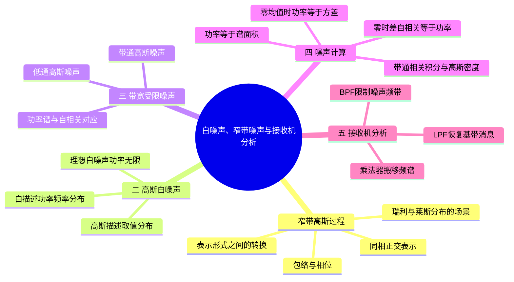
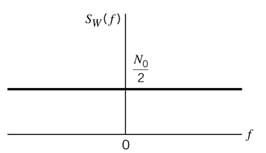
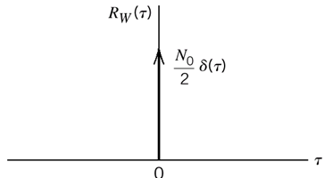
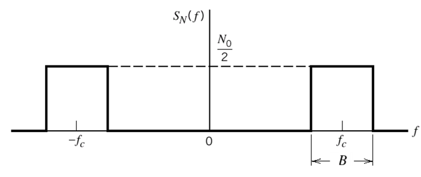
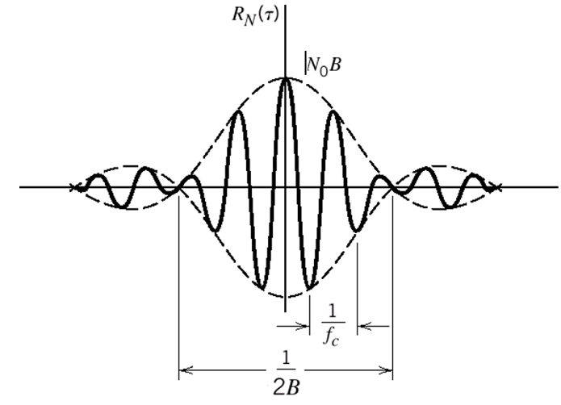
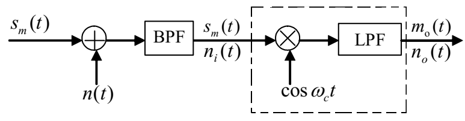
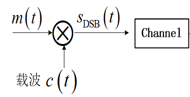

# 第2章 · 第7课（学校第五讲）白噪声、窄带噪声与接收机分析

## 本课概要

第二章前两课已经建立了随机过程的统计描述，本课把这些描述放回通信系统中最常见的噪声模型。主线只有一条：先区分噪声的概率分布和频率分布，再看滤波器如何改变噪声，最后把带通噪声放进 DSB 接收机分析。

## 一、窄带高斯过程的包络与相位

当随机过程的功率主要集中在载频 $f_c$ 附近，并且带宽 $B$ 远小于载频时，称为窄带过程。课件中的条件可概括为：

$$
B\ll f_c,
\qquad
f_c\gg 0.
$$

窄带噪声通常用同相分量和正交分量表示。两个低频随机分量分别乘上正弦、余弦载波后，合成为载频附近的带通信号。观察这个带通信号时，常把它改写成“随时间变化的包络”和“随时间变化的相位”。

### 同相正交与包络相位的转换

同一载频附近的振荡，可以拆成余弦方向与正弦方向的两个低频系数，也可以合并成一个幅度和一个相位。本笔记选用负号正交约定：

$$
x(t)=x_I(t)\cos\omega_ct-x_Q(t)\sin\omega_ct
=a(t)\cos[\omega_ct+\phi(t)].
$$

$x_I$ 为同相分量，$x_Q$ 为正交分量；“正交”指余弦与正弦载波相差四分之一周期，不等于宣称两个随机系数统计独立。展开右式比较系数，有

$$
x_I=a\cos\phi,\qquad x_Q=a\sin\phi,\qquad
a=\sqrt{x_I^2+x_Q^2},\qquad \phi=\operatorname{atan2}(x_Q,x_I).
$$

函数 $\operatorname{atan2}$ 用两个系数的符号判断正确象限，包络为零时相位可任意选定。例如 $x_I=3,x_Q=4$，得到 $a=5$，$\phi\approx0.9273\ \mathrm{rad}$，代回仍是原波形。若教材选用正号正交约定，对应包络相位形式中的相位符号也要调整，不能混用。

### 瑞利与莱斯包络的统计条件

能这样表示波形，并不自动决定包络的分布。若两个正交分量联合高斯、相互独立、零均值且等方差 $\sigma^2$，平面散布围绕原点；到原点的距离就是包络，其密度为瑞利分布：

$$
f_a(r)=\frac r{\sigma^2}\exp\left(-\frac{r^2}{2\sigma^2}\right),\qquad r\ge0.
$$

叠加幅度为 $A$ 的确定正弦分量后，散布中心偏离原点，包络成为莱斯分布：

$$
f_a(r)=\frac r{\sigma^2}\exp\left[-\frac{r^2+A^2}{2\sigma^2}\right]
I_0\left(\frac{Ar}{\sigma^2}\right),\qquad r\ge0.
$$

$I_0$ 为零阶第一类修正贝塞尔函数，本讲不要求计算它；只需用 $I_0(0)=1$ 核对 $A=0$ 时第二式回到第一式。因此“莱斯是瑞利的推广”，具体就是允许确定分量从零变为非零。

| 接收成分 | 包络的常用分布 | 相位的直观特征 |
|---|---|---|
| 没有确定正弦分量，正交分量符合独立、零均值、等方差联合高斯模型 | 瑞利分布 | 相位均匀 |
| 窄带高斯噪声上叠加确定正弦分量 | 莱斯分布 | 相位集中在确定信号相位附近 |
| 确定分量远强于噪声 | 莱斯分布趋近于确定幅度附近的窄分布 | 相位波动变小 |

因此，瑞利和莱斯描述的是**窄带信号的包络统计规律**，不能与“白噪声的功率谱是平的”混为一谈。

第五讲五项判断依次为真、假、真、假、真。“只有反射波”还隐含大量随机散射形成上述高斯模型，不是单靠“反射”二字就必然瑞利。按课程分类，没有确定直射分量时称为瑞利，而非有非零直射成分的莱斯；数学上瑞利又属于莱斯分布的零确定分量特例，要区分分类口径与分布族的包含关系。

## 二、高斯与白描述的是不同性质

前面说“噪声服从高斯分布”，是在描述固定时刻噪声取值的概率规律；现在说“白噪声”，是在描述噪声功率如何分布在频率轴上。

| 名称 | 观察对象 | 典型图形或结论 |
|---|---|---|
| 高斯 | 固定时刻的随机取值 | 一维概率密度呈钟形 |
| 白 | 功率谱密度随频率的分布 | 双边谱为水平直线 |
| 低通、带通 | 通过滤波器后保留的频带 | 矩形谱位于基带或载频附近 |

### 理想高斯白噪声

双边功率谱密度为：

$$
S_W(f)=\frac{N_0}{2},
\qquad -\infty<f<+\infty.
$$

由于频率范围无限宽，理论总功率为：

$$
P_W=\int_{-\infty}^{+\infty}S_W(f)\,\mathrm df=\infty.
$$

所以理想白噪声是分析模型。实际接收机总要用滤波器限制噪声带宽，真正计算的是有限频带内的噪声功率。

功率谱密度与自相关函数互为傅里叶变换，常数谱对应零时差冲激：

$$
R_W(\tau)=\frac{N_0}{2}\delta(\tau).
$$

这表示在理想模型下，非零时间差处的取值不相关。图中的冲激箭头不是普通函数的有限高度，箭头旁的系数表示冲激面积。

理想全频白噪声是广义随机过程，不能把冲激零点的“高度”当作有限方差，也不能给它任意指定有限方差的一维密度。实际有限带宽滤波后，才回到有限功率、可直接使用一维高斯密度的模型。

## 三、带宽受限后的低通与带通噪声

白噪声通过滤波器后，谱形由“无限宽的水平线”变成有限宽的区域。滤波器改变功率谱和自相关函数，但线性滤波不会破坏高斯性：高斯输入经过线性系统后仍是高斯过程。

### 低通高斯噪声

先从上到下比较白、低通、带通三行，再在同一行从谱形看向相关曲线：无限宽常数谱对应冲激，低通矩形对应抽样函数，正负载频附近的两块矩形则对应抽样函数包络内的余弦振荡。下文用谱面积和零时差相关值核对每一行功率。

理想低通滤波器保留 $-f_H$ 到 $f_H$ 的频率：

$$
S_N(f)=
\begin{cases}
\dfrac{N_0}{2},&|f|\leq f_H,\\[4pt]
0,&|f|>f_H.
\end{cases}
$$

功率是矩形谱面积：

$$
P_N=\frac{N_0}{2}\times 2f_H=N_0f_H.
$$

对应的自相关函数为：

$$
R_N(\tau)
=N_0f_H\frac{\sin(2\pi f_H\tau)}{2\pi f_H\tau}.
$$

国内教材常见两种记号：

$$
\operatorname{Sa}(x)=\frac{\sin x}{x},
\qquad
\operatorname{sinc}(x)=\frac{\sin(\pi x)}{\pi x}.
$$

因此同一个结果也可写成：

$$
R_N(\tau)=N_0f_H\operatorname{Sa}(2\pi f_H\tau)
=N_0f_H\operatorname{sinc}(2f_H\tau).
$$

带宽变窄时，频谱矩形变窄，而自相关主峰变宽。高频成分被滤掉后，输出波形变化变慢，邻近时刻的取值更容易相关。

### 带通高斯噪声

带通滤波器只保留载频 $f_c$ 附近的频带，因此出现正、负载频两块对称矩形谱：

正频率一侧矩形的宽度记为 $B$，双边谱总共有两块，所以：

$$
P_N
=2\times\frac{N_0}{2}\times B
=N_0B.
$$

相应的自相关函数为：

$$
R_N(\tau)
=N_0B\operatorname{sinc}(B\tau)\cos(2\pi f_c\tau).
$$

其中，$\operatorname{sinc}(B\tau)$ 是由带宽决定的包络，$\cos(2\pi f_c\tau)$ 是由中心频率决定的快速振荡。取零时差可检查结果：

$$
R_N(0)=N_0B=P_N.
$$

三种噪声的区别应统一放在同一张表中看：

| 噪声类型 | 频谱范围 | 功率 | 自相关形状 | 主要用途 |
|---|---|---|---|---|
| 理想白噪声 | 全部频率 | 理论上无穷大 | 冲激 | 建立噪声分析模型 |
| 低通高斯噪声 | $[-f_H,f_H]$ | $N_0f_H$ | 抽样函数 | 分析基带噪声 |
| 带通高斯噪声 | $\pm f_c$ 附近各宽 $B$ | $N_0B$ | 抽样函数乘载频余弦 | 分析带通信号接收机 |

## 四、功率、方差、自相关与一维高斯密度

设输出噪声为 $Y(t)$，均值为 $\mu_Y$，方差为 $\sigma_Y^2$。一般有：

$$
E[Y^2(t)]=\sigma_Y^2+\mu_Y^2.
$$

自相关函数在零时差处为：

$$
R_Y(0)=E[Y(t)Y(t)]=E[Y^2(t)].
$$

因此，只有在零均值条件 $\mu_Y=0$ 下，才有：

$$
\boxed{
P_Y=E[Y^2(t)]=\sigma_Y^2=R_Y(0)
}.
$$

对于带通矩形谱，进一步得到：

$$
\boxed{
P_Y=\sigma_Y^2=R_Y(0)=N_0B
}.
$$

高斯性决定固定时刻的概率密度形式。一般一维高斯密度为：

$$
f_Y(y)=
\frac{1}{\sqrt{2\pi\sigma_Y^2}}
\exp\left[-\frac{(y-\mu_Y)^2}{2\sigma_Y^2}\right].
$$

若噪声零均值且方差为 $N_0B$，则：

$$
f_Y(y)=
\frac{1}{\sqrt{2\pi N_0B}}
\exp\left(-\frac{y^2}{2N_0B}\right).
$$

解题时要把依据分开：谱面积给出功率，零均值把功率变成方差，高斯性决定密度仍采用高斯形式。

### 理想带通滤波练习的完整计算

原题输入为零均值高斯白噪声，双边谱密度 $n_0/2$，经过中心频率 $f_c$ 的理想带通滤波器，要求输出相关与一维密度。先看题图：正、负频率各有一块通带，每块宽 $B$，不是两块相加才为 $B$。

按单位通带增益、$f_c>B/2$，输出谱在两块通带中保持 $n_0/2$，面积为 $n_0B$。逆傅里叶变换给出

$$
\begin{aligned}
R_Y(\tau)
&=\frac{n_0}{2}\left[
\int_{f_c-B/2}^{f_c+B/2}e^{j2\pi f\tau}\,\mathrm df+
\int_{-f_c-B/2}^{-f_c+B/2}e^{j2\pi f\tau}\,\mathrm df\right]\\
&=\frac{n_0}{2}\frac{\sin(\pi B\tau)}{\pi\tau}
\left(e^{j2\pi f_c\tau}+e^{-j2\pi f_c\tau}\right)\\
&=n_0B\operatorname{sinc}(B\tau)\cos(2\pi f_c\tau).
\end{aligned}
$$

两块矩形各贡献一个复指数，成对相加成为余弦。取零时差的极限得到 $R_Y(0)=n_0B$，与谱面积相同。线性滤波保持高斯性和零均值，所以方差为 $n_0B$，一维密度是

$$
f_Y(y)=\frac1{\sqrt{2\pi n_0B}}\exp\left(-\frac{y^2}{2n_0B}\right).
$$

若通带增益另给为 $K$，输出谱、相关、功率与方差全部乘 $|K|^2$；原图未标数值增益，按理想单位增益作答时应写明条件。

## 五、噪声在接收机各级的变化

前面的噪声模型要回到接收机框图中才真正有用。课件中的框图可按“加噪声、带通限制、混频搬移、低通取出”四步读取：

接收端输入为：

$$
r(t)=s_m(t)+n(t).
$$

经过 BPF 后：

$$
r_i(t)=s_m(t)+n_i(t).
$$

BPF 的主要作用是限制噪声带宽。若正频率一侧通带宽度为 $B$，带通噪声功率就是：

$$
P_{n_i}=N_0B.
$$

BPF 仍然没有恢复消息，因为信号还位于载频附近。接下来需要乘法器把频谱搬回基带。

## 六、DSB 相干解调的数学主线

发送端把消息 $m(t)$ 与载波 $c(t)=\cos\omega_ct$ 相乘：

因此：

$$
s_{\mathrm{DSB}}(t)=m(t)\cos\omega_ct.
$$

接收端使用同频同相本地载波再次相乘：

$$
s_{\mathrm{DSB}}(t)\cos\omega_ct
=m(t)\cos^2\omega_ct.
$$

利用降幂公式：

$$
\cos^2\omega_ct
=\frac12[1+\cos(2\omega_ct)],
$$

得到：

$$
s_{\mathrm{DSB}}(t)\cos\omega_ct
=\frac12m(t)+\frac12m(t)\cos(2\omega_ct).
$$

第一项是基带消息，第二项位于 $2f_c$ 附近。LPF 滤掉高频项后：

$$
m_1(t)=\frac12m(t).
$$

再补偿增益 $2$，就得到：

$$
\hat m(t)=m(t).
$$

所以图中问号处应填：

$$
\boxed{\text{乘法器（相干解调器）+ LPF}}
$$

若乘法器直接使用 $2\cos\omega_ct$，则 LPF 后可以直接得到 $m(t)$。这里的相干条件是本地载波与发送载波同频同相；BPF 负责选出信号频带并限制噪声，乘法器负责频谱搬移，LPF 负责取出基带。

## 七、本课解题入口与易错点

### 噪声功率题

1. 先看功率谱的高度。
2. 再看正、负频率各有几块以及每块宽度。
3. 用谱面积求功率。
4. 若均值为零，直接写 $\sigma^2=P=R(0)$。
5. 若题目要求概率密度，把计算出的方差代入高斯密度。

### 解调框图题

1. BPF 只选频带，不能恢复 $m(t)$。
2. 乘法器与本地载波相乘，产生基带项和 $2f_c$ 附近的高频项。
3. LPF 保留基带项，滤除高频项。
4. 最后检查是否需要增益 $2$ 补偿。

最容易混淆的是：高斯描述幅度取值的概率分布，白噪声描述功率谱的频率分布；自相关函数的零时差等于均方值，但只有零均值时才等于方差。

## 课件与练习来源

配套英文原题、中文翻译、题图和解析：[[练习解析/第2章 第五讲 英汉对照练习解析]]；完整目录：[[练习解析/第二讲至第六讲 练习解析索引]]。

- [[PPT/第五讲/第五讲 chapter 2 Random processes part III学生版 修改.pptx]]
- [[PPT/第五讲/(需打印）第五讲 课堂练习及词汇 - 学生版.docx]]
