# 第3章 · 第8课（学校第六讲）信道模型与多径传播

## 本课概要

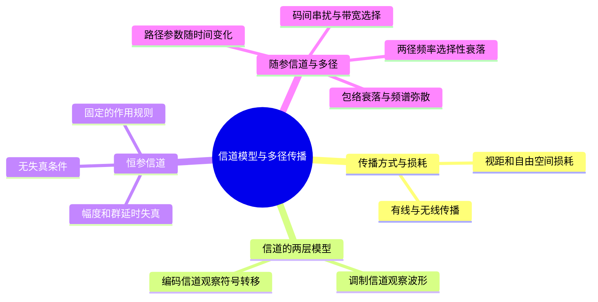

前两章已经分别研究了发送的信号和接收端的噪声。本章把两者之间的传播过程单独拿出来：同一段发送波形进入电缆或空间后，到达接收机时可能变弱、来晚、变形；接收机最后还要据此判定发送了什么。学习信道时始终抓住这条因果链，才能分清传播方式、波形模型、符号模型和各种衰落究竟在回答哪一个问题。

## 一、信道的传播方式与基本损耗

信道首先是信号实际经过的媒介。按媒介分类，有线信道让信号沿实体结构传播，无线信道让电磁波在空间传播。按**作用规律是否随时间明显变化**分类，则有恒参信道与随参信道。这两种分类依据不同：不能把“有线”和“恒参”当成同义词，也不能把“无线”和“随参”当成同义词。

### 有线和无线的具体路径

有线信道中的对称电缆（常见的双绞线）、同轴电缆主要传电信号，光纤传光信号。先看下图右侧的结构：双绞线由成对导线构成；同轴电缆有内导体和外部屏蔽；光纤通过纤芯引导光传播。结构不同，适用距离、带宽和抵抗外界干扰的能力也不同。

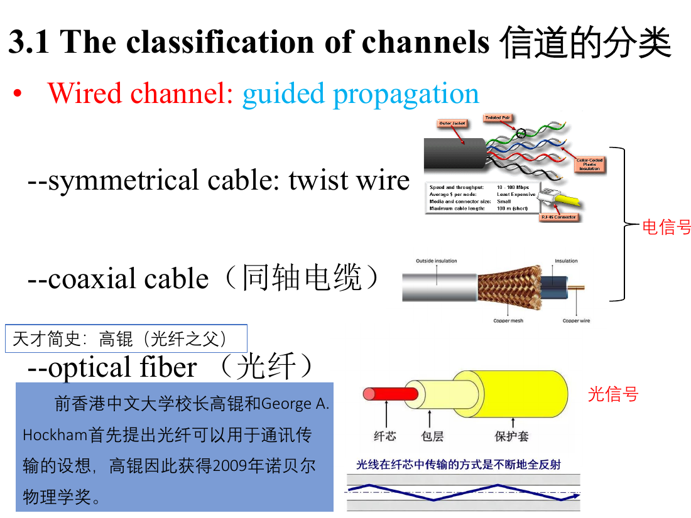

无线传播又可按主要路径分为地波、天波和视距传播。地波沿地表传播，常与中、长波通信联系；天波经电离层返回地面，使短波越过地平线；视距传播依赖两端之间近似无遮挡的路径，常见于微波中继和无线网桥。下图从上到下对应这三种路径，底部弧线尤其显示了地球曲率对视距的限制。

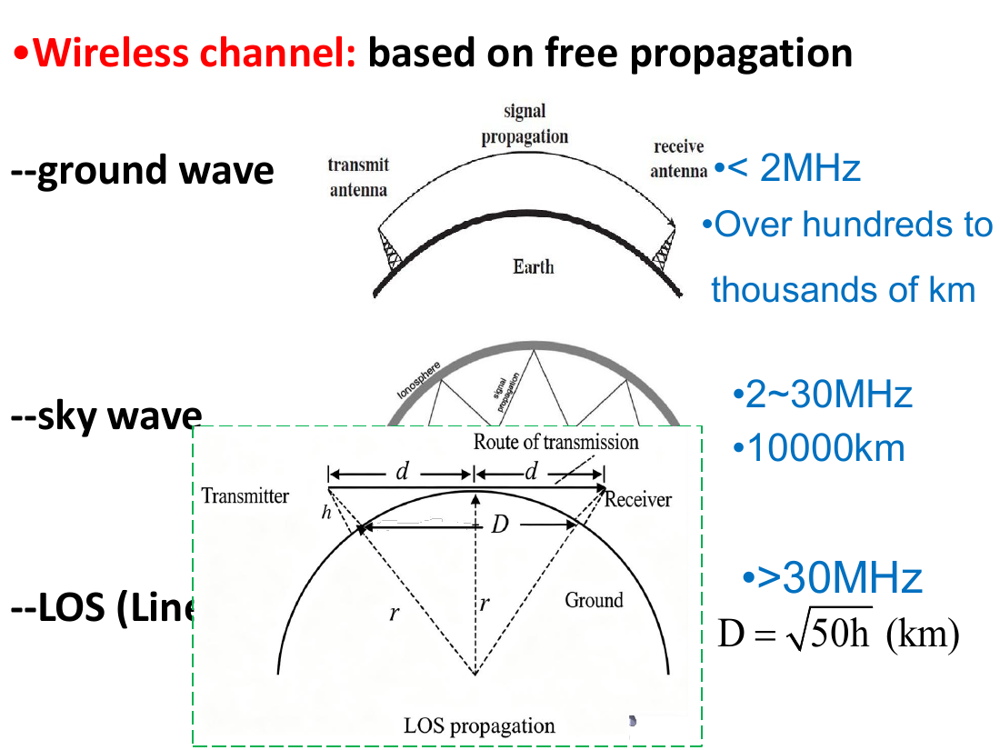

六种媒介和路径放在一起，可以用用途来辨认，而不是死记英文。课件的匹配题原图如下；对照左右两栏，完整答案为双绞线—B、同轴电缆—C、光纤—A、地波—E、天波—F、视距—D。

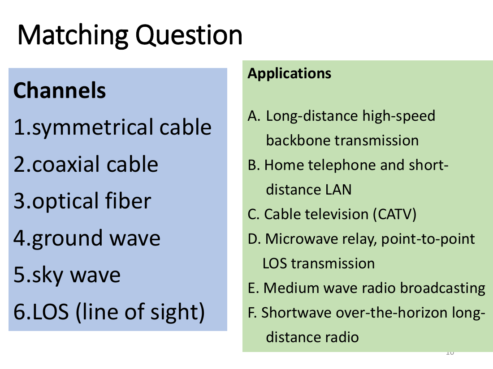

| 路径或媒介 | 典型用途 | 主要辨认依据 |
|---|---|---|
| 双绞线 | 电话线、短距离局域网 | 成对导线，成本低，易受串扰 |
| 同轴电缆 | 早期有线电视、监控 | 外部屏蔽，抗干扰强于普通双绞线 |
| 光纤 | 长距离高速骨干传输 | 光信号、带宽大、抗电磁干扰 |
| 地波 | 中波广播 | 沿地表传播 |
| 天波 | 短波超视距通信 | 借电离层返回地面 |
| 视距传播 | 微波点对点中继 | 两端之间需近似无遮挡 |

### 视距与自由空间传播例题

视距传播中的天线越高，直线路径能够越过地球曲面到达的地方越远。看下图时，从每端天线分别画到地平线：若两端高度同为 $h$，两段地平线距离合起来才是最大视距 $D$。

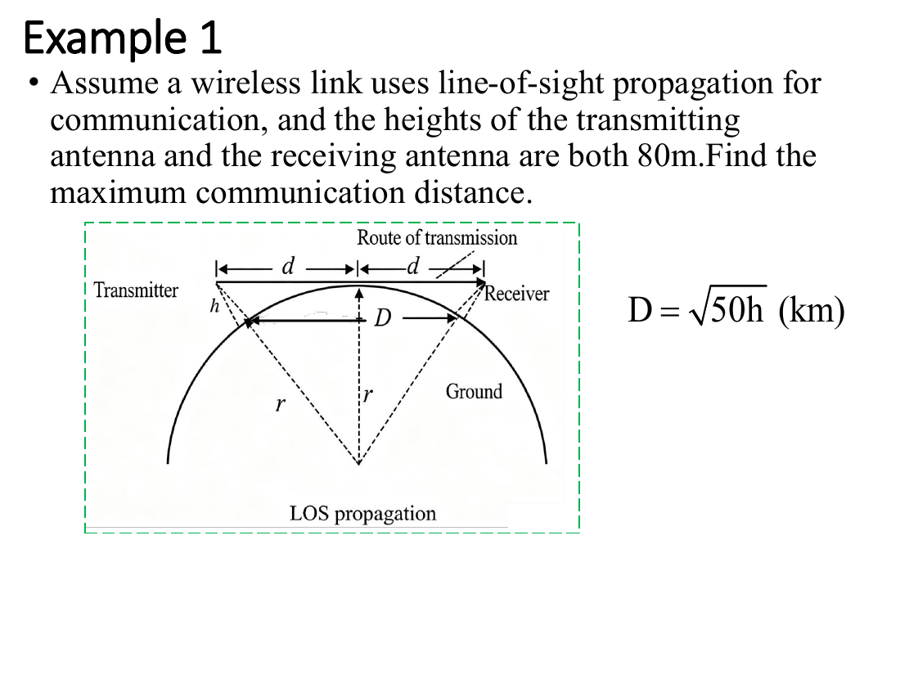

设地球半径为 $R$，一侧天线到几何地平线的距离为 $d$。直角三角形给出 $d^2=(R+h)^2-R^2=2Rh+h^2$。由于 $h\ll R$，取 $d\approx\sqrt{2Rh}$；两端等高时 $D\approx 2d$。以 $R\approx6370\,\mathrm{km}$、$h$ 用米、$D$ 用千米表示，得到常用近似

$$
D\approx\sqrt{50h}\ \mathrm{km}.
$$

题中两端均高 $80\,\mathrm m$，所以 $D\approx\sqrt{4000}\approx63\,\mathrm{km}$。它给出地球曲率下的几何视距估计，不代替对实际地形、遮挡和无线传播条件的检查。

距离不仅限制能否看见，还会使接收功率变小。另一道题给定发射功率 $P_T=10\,\mathrm W$、发射和接收天线增益 $G_T=100$、$G_R=10$、距离 $d=50\,\mathrm{km}$、频率 $f=800\,\mathrm{MHz}$，要求接收功率和传播损耗。题中采用理想自由空间的 Friis 模型，原题列式见下图。

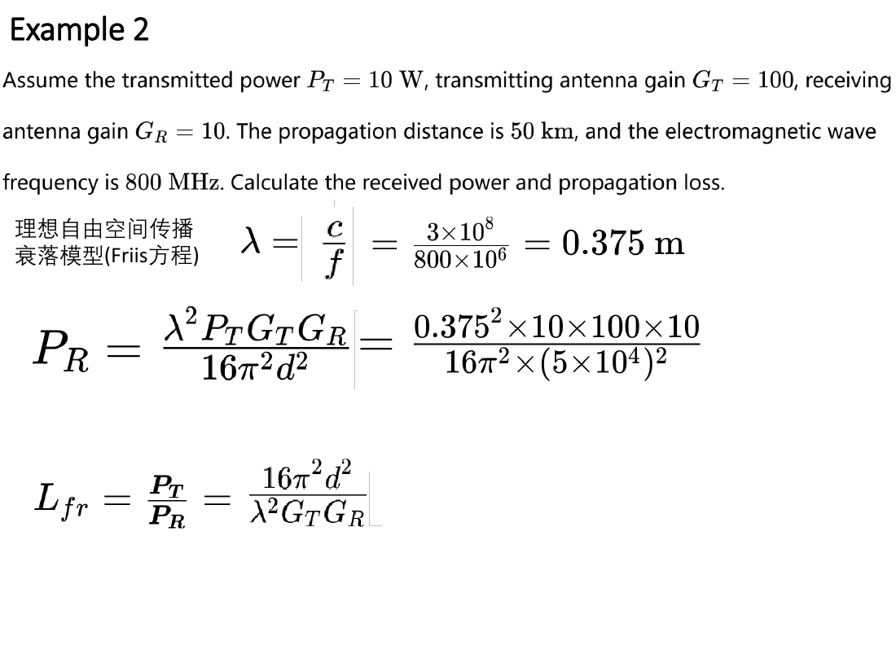

先由电磁波传播速度 $c\approx3\times10^8\,\mathrm{m/s}$ 得波长 $\lambda=c/f=0.375\,\mathrm m$。Friis 关系把发射功率乘以两端天线增益，再乘以距离造成的功率比例：

$$
P_R=P_TG_TG_R\left(\frac{\lambda}{4\pi d}\right)^2
\approx3.56\times10^{-9}\,\mathrm W.
$$

这里 $P_R$ 是接收功率，$\lambda$ 是波长。所谓传播**损耗倍数**定义为 $L_{\mathrm{fr}}=P_T/P_R\approx2.81\times10^9$，换为分贝约 $94.5\,\mathrm{dB}$。它回答“发射功率是接收功率的多少倍”；日常所说“减少了多少功率”则是 $P_T-P_R$，相对减少比例是 $(P_T-P_R)/P_T$，不能把三者混为同一个量。这个损耗比已经把题给的天线增益算进去了，也不能把未被接收天线截获的全部能量解释为空气吸收。

理想自由空间之外，大气中的氧气、水汽和降雨还会产生额外衰减。下图左侧显示某些频率附近衰减峰值，右侧显示降雨率增大时衰减升高。它说明 Friis 例题是一层基本模型，而实际链路还受传播环境影响。

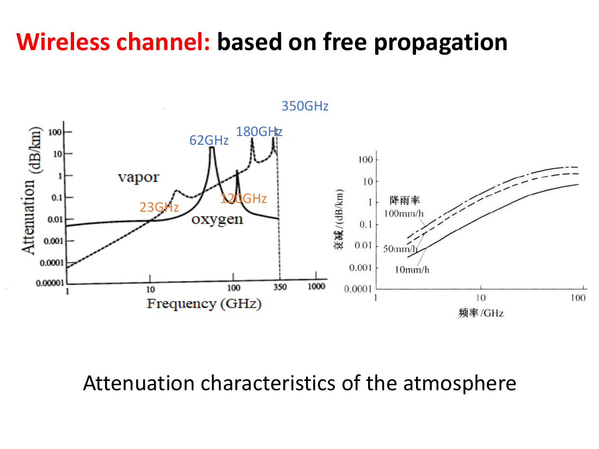

这些分类和计算先回答了信号**走哪条路、到达时有多强**。但接收机还关心另一件事：传输中波形怎样变化，最后发出的符号会不会判错。对此需要给同一段传输建立两层模型。

## 二、同一段传输的两层信道模型

想象发送一个二进制符号 $1$。信道编码器交出的是离散符号，调制器把它变成电压或电磁波；物理传播改变波形，解调器读取波形后给出一个符号判决。若传播后的波形过弱、变形或被噪声扰动，发送的 $1$ 最终可能被判为 $0$。

下图先看中央红色虚线框，再看包住它的蓝色虚线框。红框只跨越调制器输出与解调器输入，蓝框还包含调制器和解调器。**这是对同一次传输选取不同输入、输出，而不是另有两条并行的物理通道。**

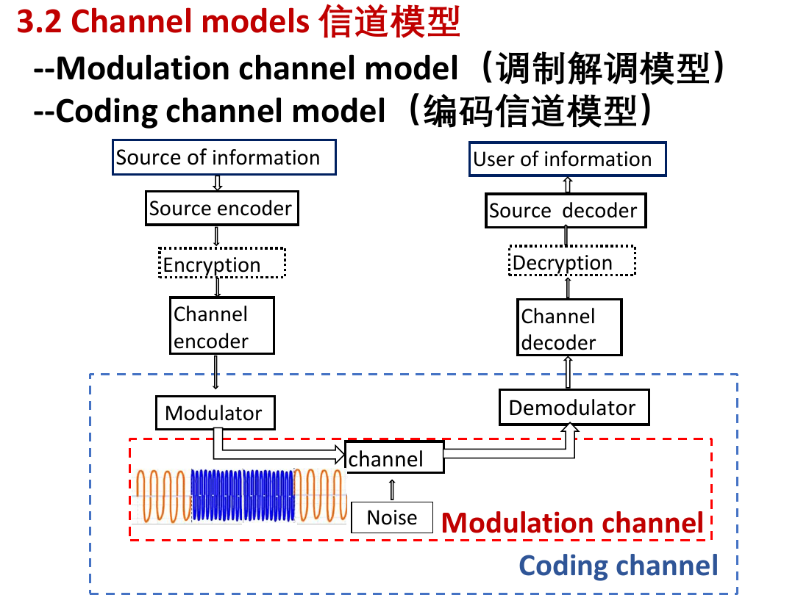

| 模型 | 输入到输出 | 观察对象 | 主要问题 |
|---|---|---|---|
| 调制信道 | 调制器输出波形 $\to$ 解调器输入波形 | 连续的实际信号 | 衰减、延迟、失真和噪声如何改变波形 |
| 编码信道 | 信道编码器输出符号 $\to$ 信道译码器输入符号 | 离散的判决结果 | 发送某符号后被判成各符号的概率 |

### 调制信道保留波形变化

把调制器输出记为 $e_i(t)$，解调器输入记为 $e_o(t)$。传播过程对输入波形的作用可抽象为 $\mathcal F[\,e_i(t)\,]$，再加上噪声电压 $n(t)$：

$$
e_o(t)=\mathcal F[\,e_i(t)\,]+n(t).
$$

读下图时，沿箭头先看信道怎样处理输入，再看噪声从加法节点混入。$\mathcal F$ 可以包含幅度变化、延时、滤波和多径，不能在一般情况下直接简化成“输入只乘一个系数”。

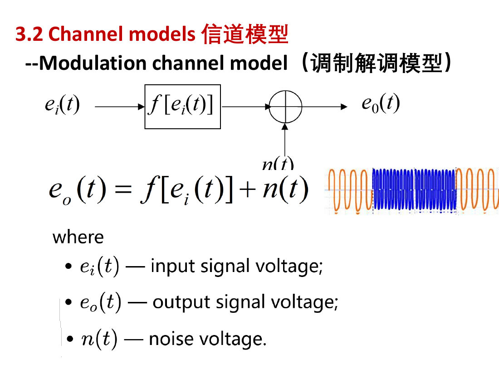

如果研究的信号足够窄、延迟扩展在该频带内可忽略，有时才把作用简化为一个随时间变化的系数，例如 $e_o(t)\approx k(t)e_i(t)+n(t)$。恒参、随参首先是对**调制信道的传播作用**进行分类：在观察时间内作用规律近似固定，称恒参；作用规律明显变化，称随参。固定不等于无失真，时变也不自动说明每个码元都会出错。

### 编码信道只保留符号转移结果

编码信道暂时不追问波形在哪一步变坏，只统计发出 $x$ 后判成 $y$ 的条件概率 $P(Y=y\mid X=x)$。二元模型中有四条可能的转移箭头：$0\to0$、$0\to1$、$1\to0$、$1\to1$。下图左侧是发送，右侧是判决；两条交叉箭头代表错误。

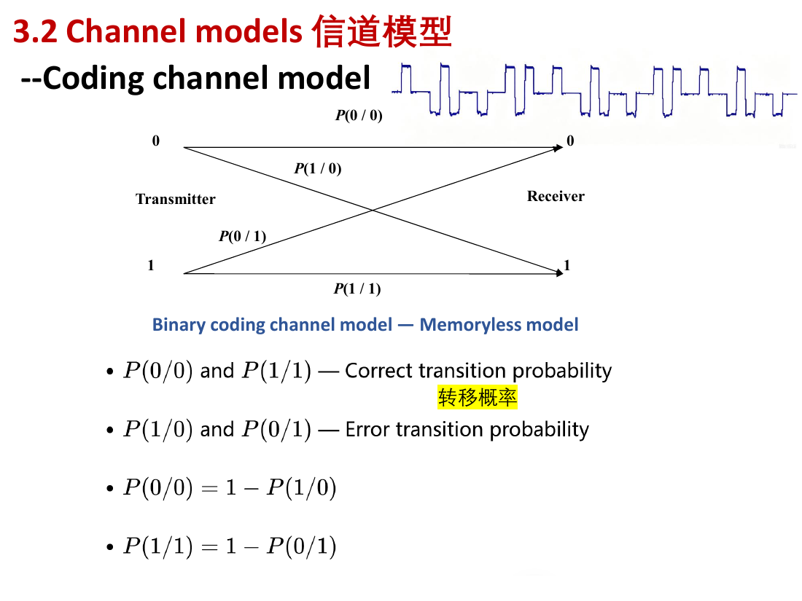

把**行标为发送值、列标为接收判决值**，一个二元信道可写成

$$
\begin{array}{c|cc}
&Y=0&Y=1\\\hline
X=0&P(0\mid0)&P(1\mid0)\\
X=1&P(0\mid1)&P(1\mid1)
\end{array}.
$$

固定发送 $0$，它最终只能判为 $0$ 或 $1$，所以第一行和为 $1$；固定发送 $1$ 时第二行也和为 $1$。这个逐行检查比背四个概率关系更可靠。若每次符号转移不依赖之前的发送和判决，才进一步称为无记忆模型。

例题给定二元对称无记忆信道：$P(X=0)=P(X=1)=0.5$，两种交叉错误概率同为 $0.005$。据每行和为 $1$，正确概率均为 $0.995$；平均误比特率要把“发 $0$ 出错”和“发 $1$ 出错”两种情况按发送概率加权：

$$
P_e=P(X=0)P(1\mid0)+P(X=1)P(0\mid1)
=0.5(0.005)+0.5(0.005)=0.005.
$$

若可发送四个符号，原理不变，只是从每个发送符号分别有四条可能去向。下图中从左侧任一符号出发，通往右侧四个符号的转移概率之和仍为 $1$；一般记为 $P(y_k\mid x_j)$，其中 $x_j$ 是发送符号，$y_k$ 是判决符号。

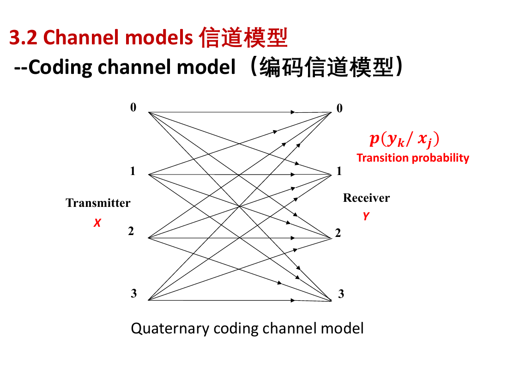

同一物理信道的噪声和失真会影响解调判决，因而影响编码信道的转移概率；调制与判决方式也会影响这些概率。课堂判断题的三句由此可逐项辨明：调制信道位于调制器输出与解调器输入之间，**对**；编码信道主要分析模拟波形的幅频失真，**错**，那是调制信道观察的问题；编码信道的性能受前面的噪声和失真影响，**对**。课件随后列出的不同业务误码率只是应用目标示例，具体可接受值仍由业务要求决定。

既然波形变化最终会影响符号判决，下一步先看最容易分析的传播情形：**信道每次以近似同一套规则处理波形**。这才引出恒参信道。

## 三、恒参信道中的无失真与失真

向同一信道隔一会儿发送两次相同的测试波形。若两次的衰减、延迟和频率响应都近似相同，就可在这段观察时间内把信道的作用参数视为固定，称作恒参信道。有线电话线、同轴电缆、光纤以及稳定的视距微波链路常可在适当时间尺度上这样建模。**恒参只说规则随时间不变，没有说这套规则一定保持波形形状。**

先看最理想的固定规则：所有频率分量按同一比例 $K$ 缩小，又都晚到 $t_d$。发送波形 $s(t)$ 和输出波形 $s_o(t)$ 满足

$$
s_o(t)=K s(t-t_d).
$$

$K$ 是共同幅度比例，$t_d$ 是共同延迟；整段波形只变小、后移，没有改变形状，所以称无失真传输。对角频率 $\omega$，延迟 $t_d$ 对应的相位因子是 $e^{-j\omega t_d}$，于是频率响应为 $H(\omega)=K e^{-j\omega t_d}$。下图左、中、右依次画出恒定幅度、线性相位滞后量、恒定群延时，应并排看它们怎样共同保证原形。

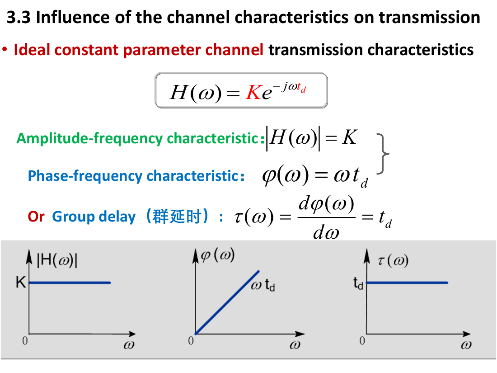

本笔记统一把 $\theta(\omega)=\arg H(\omega)$ 称为**实际相角**。因此理想模型有 $\theta(\omega)=-\omega t_d$，群延时定义为 $\tau_g(\omega)=-\mathrm d\theta/\mathrm d\omega=t_d$。图中写成正的 $\omega t_d$，相当于记录**相位滞后量**；若用实际相角，求群延时必须带负号。这只是符号约定，物理要求仍是各频率得到相同延时。

同一个条件也可用最小例子核对：若发送 $s(t)=\cos(\omega_1t)+\cos(\omega_2t)$，而信道把两项分别变为 $\cos(\omega_1t)+0.2\cos(\omega_2t)$，两部分的相对强弱已变，不可能靠整体放大恢复原形。这种对不同频率不等量的削弱是**幅度失真**。若相位不再对应相同的时间延迟，不同频率也不能一起到达，是**群延时失真**。判断这两个条件，只需看信号**实际占用的频带**，无须要求信道在所有可能频率上都理想。

实际电话信道的图形正好显示这些偏离：左下插入损耗随频率变，中下相位曲线偏离理想直线，右下示意线性补偿使响应更接近理想。失真可能压低有用信号相对噪声的质量，也可能拖长数字脉冲，增加码间串扰；补偿网络则用于改善信号频带内的不均匀响应。

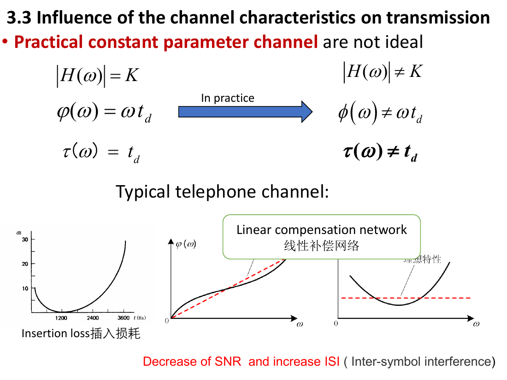

电路例题给出串联电感 $L$、并联电阻 $R$ 的信道，输出取电阻两端，要求分析失真。沿下图从左向右读：输入先经过电感，随后由电阻分压；这不是只看电路外形就能判断的题，要计算不同频率的输出比例。

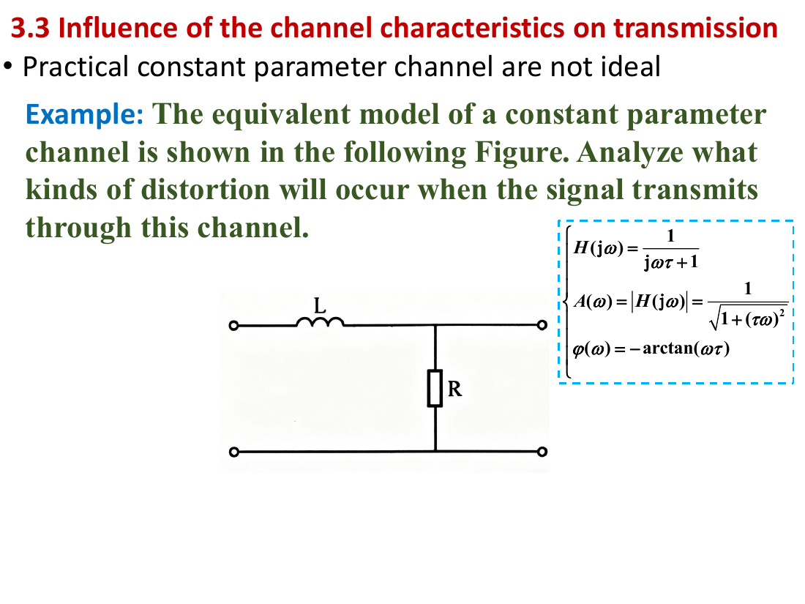

电感的复阻抗为 $j\omega L$，电阻为 $R$。输出取电阻两端，故分压关系为

$$
H(\omega)=\frac{R}{R+j\omega L}
=\frac{1}{1+j\omega L/R}.
$$

频率升高时，电感阻碍增大，电阻分到的电压变少。令 $a=L/R$，则

$$
|H(\omega)|=\frac{1}{\sqrt{1+(a\omega)^2}},
\qquad
\theta(\omega)=-\arctan(a\omega),
\qquad
\tau_g(\omega)=\frac{a}{1+(a\omega)^2}.
$$

$a$ 的量纲是时间。幅度随频率变化，所以对含有一段频带的输入存在幅度失真；群延时也随频率变化，所以还存在群延时失真。电路元件和这些响应都不随观察时刻改变，因此它**仍是恒参信道**。若仅输入一条正弦波，结果只是该频率的幅度与相位改变；要看到合成波形失真，输入须包含多个受不同处理的频率成分。

## 四、随参信道中的多径、包络和频谱

再把发送波形放进移动或变化的传播环境。即便发送端一直送同一正弦波，接收幅度也可能一会儿强、一会儿弱。原因不是发送端自己改变了信号，而是反射物或接收机运动时，各条传播路径的强弱和长度会变。这种**传播作用随观察时间变化**的信道称为随参信道。短波电离层、移动无线和对流层散射信道常须这样描述；某一无线链路若在足够短的时间内近似不变，也可暂按恒参处理。

下图左侧只有一个发送波，右侧却有多条散射路径汇入接收机。每条路径有自己的衰减和延迟，接收机测到的是这些副本的相加；波峰对齐时增强，波峰遇波谷时削弱。

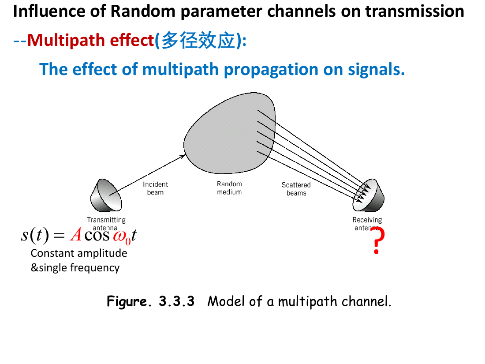

设发送的单频波为 $s(t)=A\cos(\omega_ct)$，其中 $A$ 和载波角频率 $\omega_c=2\pi f_c$ 均固定。第 $i$ 条路径的幅度比例为 $a_i(t)$、延迟为 $\tau_i(t)$，则接收机得到的多径和可写为

$$
r(t)=A\sum_{i=1}^{n}a_i(t)
\cos\!\left[\omega_c\bigl(t-\tau_i(t)\bigr)\right].
$$

每一项都是原来单频波的一份副本，只是强弱和到达相位不同。把这些同频的余弦合并，仍可写成一个快速振荡的载波，外面配一个随时间改变的幅度，里面配一个随时间改变的相位：

$$
r(t)=V(t)\cos[\omega_ct+\phi(t)].
$$

$V(t)$ 是接收包络，$\phi(t)$ 是接收相位。“缓慢变化”是在与载波的一次快速振荡比较：路径参数一般不必每个载波周期就大变；它不意味着包络相对一个码元也必然变化缓慢。这里沿用上节窄带过程的包络、相位表示，但多径信号不因为能这样表示就必然服从噪声章节的瑞利或莱斯分布；那还需要相应的统计假设。

下图上排对照发送和接收波形：发送振荡幅度恒定，接收振荡的外轮廓起伏。下排对照频谱：发送的正频率示意图是一条线，时变多径可能使接收功率分布到载频附近的一段频率。真实余弦的双边频谱还有负频率一侧，图中只画了正频率示意。

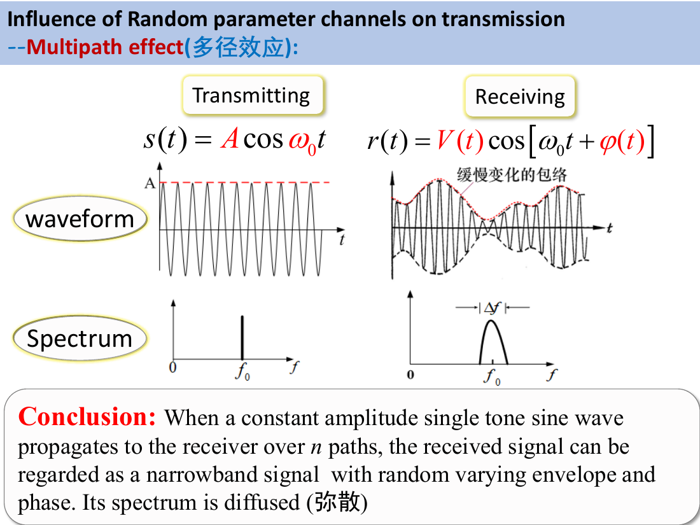

频谱弥散的关键是**随时间变化**，不能只凭“有多条路径”就断言单频线被扩展。若所有路径的幅度和延迟始终固定，多路单频波相加后仍是同频波，只改变合成幅度和相位。若路径相对运动，不同到达波可带有略不同的多普勒频移；严格只有两路时先出现两条相近频率线，多条具有不同频移的路径才可能形成图中的一片扩展。该扩展常用多普勒扩展量描述。

用两条等幅路径看包络为何起伏。设一路为 $a\cos(2\pi f_ct)$，另一路频率偏移 $\Delta f$，相加并用余弦和差公式得

$$
\begin{aligned}
r(t)
&=a\cos(2\pi f_ct)+a\cos[2\pi(f_c+\Delta f)t]\\
&=2a\cos(\pi\Delta f t)
\cos[2\pi(f_c+\Delta f/2)t].
\end{aligned}
$$

后一个因子快速振荡，前一个因子控制接收强弱；当两路相位相反时，包络接近零。这个例子中的频率差是为了把**时变路径导致包络起伏**算出来，后面固定两径的例子则研究**延迟差导致频率选择性**，两者不可混为同一机制。

### 快衰落与慢衰落的时间尺度

衰落的“快、慢”不由包络图看起来起伏大不大决定，而由信道明显变化的时间 $T_c$ 与一个码元的持续时间 $T_B=1/R_B$ 相比较；$R_B$ 是码元速率。若 $T_c\gg T_B$，一个码元内信道近似固定，深衰落可能连续影响许多码元，常表现为成串错误。若 $T_c\lesssim T_B$，一个码元尚未传完信道就已明显变化，接收机难以把该码元看作经过单一的固定幅度和相位，信道跟踪也更困难。

例如信道约每 $10\,\mathrm{ms}$ 明显变化一次：$T_B=0.1\,\mathrm{ms}$ 时，约一百个码元经历近似同一状态，是相对这些码元的慢衰落；$T_B=20\,\mathrm{ms}$ 时，一个码元内部就可能出现明显变化，是快衰落。改变码元速率并不会直接改变物理信道变化的快慢，只会改变比较结果。

课件在包络图旁写“衰落周期约等于码元周期”，只能理解成一种**快衰落的比较情形**，不是多径效应的普遍规律。随机衰落通常也没有严格周期，用“信道变化时间”来比较更妥当。

## 五、两径信道的频率选择性与码间串扰

前面固定一个频率，观察接收幅度随时间怎样变。现在让环境暂时静止，改变发送频率：**相同的两条路径，会不会对不同频率产生不同影响？**即使路径不动，答案也可能是会。因此频率选择性衰落与快、慢衰落是两个不同维度，不能把它们都归结为“信道变快了”。

从下图先看第一份 $f(t)$ 经共同延迟 $\tau_0$ 到达，再看第二份额外晚到 $\tau$。两路幅度比例暂取相同的 $A$，接收波形为

$$
y(t)=A f(t-\tau_0)+A f(t-\tau_0-\tau).
$$

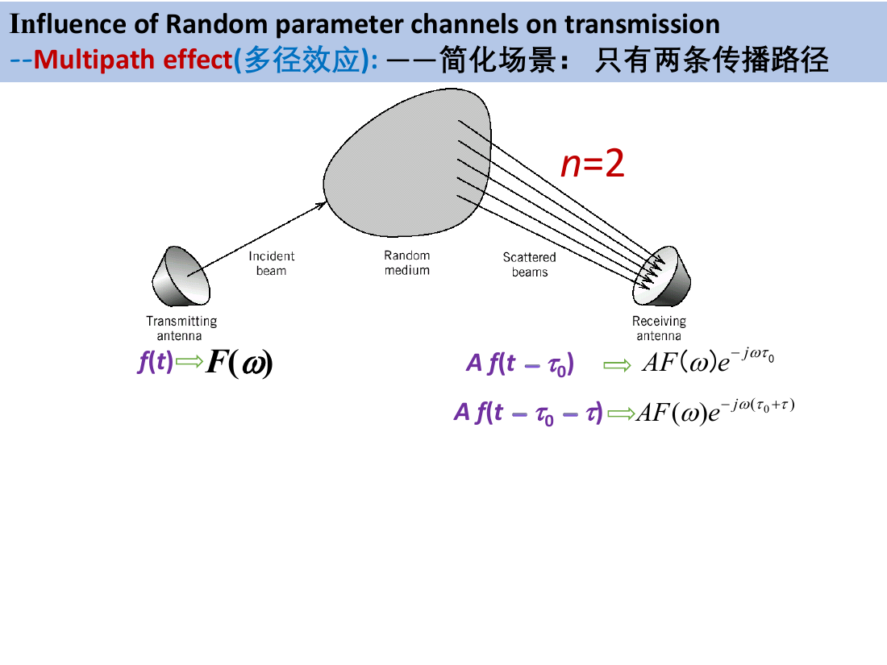

这里 $f(t)$ 表示任意发送波形，$\tau_0$ 是两路共同的传播时间，$\tau$ 是两路的**到达时间差**，不是信道的衰落周期。对频率为 $\nu$ 的一条余弦输入，两路的相位差为 $2\pi\nu\tau$：当 $\nu=1/\tau$ 时相差一整圈、两路增强；当 $\nu=1/(2\tau)$ 时相差半圈、两路等强而相消。

也可直接从波形相加推到幅度。取单位幅度输入 $f(t)=\cos(2\pi\nu t)$，则

$$
\begin{aligned}
y(t)
&=A\cos[2\pi\nu(t-\tau_0)]
 +A\cos[2\pi\nu(t-\tau_0-\tau)]\\
&=2A\cos(\pi\nu\tau)
\cos[2\pi\nu(t-\tau_0)-\pi\nu\tau].
\end{aligned}
$$

第二行用到余弦和差公式。最后一个余弦仍是频率 $\nu$ 的波；前面的系数决定两路合成有多强。由于幅度记为非负值，所以取绝对值，得到 $|H(\nu)|=2A|\cos(\pi\nu\tau)|$。这说明“频率选择”来自**同一时间差对不同频率造成不同相位差**，不是凭空写出的曲线。

对任意输入，再用傅里叶变换的延时性质核对。若输入频谱为 $F(\omega)$，时间延迟 $u$ 对应频域因子 $e^{-j\omega u}$，故

$$
Y(\omega)
=AF(\omega)e^{-j\omega\tau_0}
\bigl(1+e^{-j\omega\tau}\bigr),
\qquad
H(\omega)=\frac{Y(\omega)}{F(\omega)}
=Ae^{-j\omega\tau_0}\bigl(1+e^{-j\omega\tau}\bigr).
$$

若用角频率 $\omega$，幅频响应写作 $|H(\omega)|=2A|\cos(\omega\tau/2)|$。下图曲线的峰值对应同相增强，凹口对应反相抵消；共同延迟因子的模始终为 $1$，不决定凹口位置。图中的文字标注不如这条因果关系准确，读图时以横轴频率和曲线峰、谷为准。

若信号仅占用信道响应近似平坦的一小段频带，各频率受到的作用近似一样，波形较容易保持原形。若信号占用频带内既有峰又有凹口，部分频率强、部分频率弱，合成波形失真，这称为**频率选择性衰落**。用 $B_s$ 表示信号带宽，$B_c$ 表示在选定“响应相近”标准下的相干带宽，常以 $B_s\gtrsim B_c$ 提醒需要考虑选择性影响。$B_c$ 的精确数值取决于判定“相近”的标准，不是从一个路径时差自动得到的唯一常数。

适当减小 $B_s$，并把这段频带放在非深凹口处，可以减少频率选择性失真；若整段窄带恰好落在深凹口，波形虽可能近似整体缩小，接收仍会很困难。缩窄带宽通常还限制可用码元速率，也不能消除时变信道导致的快衰落。设计目标不是无限缩窄，而是在传输速率与信道可用频带之间取得合适选择。

同一两径模型在时间轴上也有清楚的后果：第二路是第一路的迟到副本。若依次发送 $1,0$，用长度为 $T_B=2\,\mu\mathrm{s}$ 的矩形脉冲表示 $1$、无脉冲表示 $0$，而第二路额外晚到 $\tau=T_B$，那么接收第二个码元时段的直接路径是 $0$，迟到路径却带来了上一个 $1$。前一枚码元的能量进入后一枚码元的判决时段，就形成**码间串扰**。是否实际误判，还取决于脉冲形状、抽样时刻、两路幅度和接收机处理。

| 观察方向 | 两径延迟差带来的现象 | 用来比较的量 |
|---|---|---|
| 时间轴 | 前一个码元的迟到副本进入后续码元 | 路径时差 $\tau$ 与码元时长 $T_B$ |
| 频率轴 | 各频率相位差不同，出现峰和凹口 | 信号带宽 $B_s$ 与信道变化尺度 $B_c$ |
| 随时间观察 | 路径本身变化，合成包络与相位波动 | 信道变化时间 $T_c$ 与码元时长 $T_B$ |

注意表中两个与 $T_B$ 比较的量：$\tau$ 是**两份信号到达的时间差**，$T_c$ 是**信道自身明显变化的时间**。它们分别对应码间串扰和快、慢衰落，不能互相替代。

### 两径深衰落与相干带宽例题

已知两条路径等强，$H(\omega)=Ae^{-j\omega\tau_0}(1+e^{-j\omega\tau})$，相对时延 $\tau=2\,\mu\mathrm{s}$。题目要求：一、找完全抵消的频率；二、估计该两径信道的相干带宽。原题见下图，第一问求曲线凹口的位置，第二问求曲线沿频率轴变化的尺度；不能把两问混成一个数。

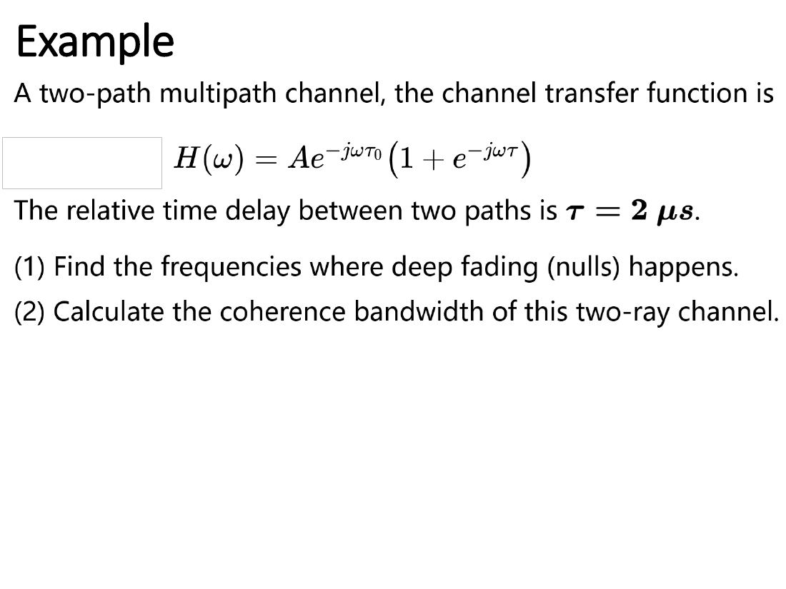

完全抵消时括号中的第二路必须等于第一路的相反数，即 $e^{-j\omega\tau}=-1$。因此 $\omega\tau=(2k+1)\pi$；用 $\omega=2\pi\nu$ 换算，得到

$$
\nu_k=\frac{2k+1}{2\tau}
=(2k+1)\times250\,\mathrm{kHz},
\qquad k\in\mathbb Z.
$$

正频率零点依次在 $250\,\mathrm{kHz}$、$750\,\mathrm{kHz}$、$1.25\,\mathrm{MHz}$ 等处；相邻零点的距离为 $1/\tau=500\,\mathrm{kHz}$。这个距离对应频率再增加这么多时，两路相位差多转一整圈，峰谷图案重复。

若本题按课程常用的**数量级估算**，取信道沿频率轴的特征尺度 $B_c\sim1/\tau$，可报 $B_c\sim500\,\mathrm{kHz}$。但是从峰值走到第一个零点仅有 $1/(2\tau)=250\,\mathrm{kHz}$；“相干”若要求更小的幅相变化，允许的频带还会更窄。题目没有给相关性或平坦程度的判据，所以 $500\,\mathrm{kHz}$ 是一种粗估约定，**不是由已知条件唯一确定的精确相干带宽**。做题应同时写出采用的约定和曲线上的实际零点，避免把相邻零点间隔误说成“整段都平坦”。

## 六、关键区别与本课收束

| 所问的问题 | 应看的对象 | 对应概念 | 本课的最小判据 |
|---|---|---|---|
| 信号沿什么传播 | 电缆、光纤或空间路径 | 有线、无线；地波、天波、视距 | 看传播媒介与路径 |
| 信号怎样被改变 | 调制器输出与解调器输入的波形 | 调制信道 | 看衰减、延迟、失真与噪声 |
| 符号最后判成什么 | 编码器输出与译码器输入的符号 | 编码信道 | 看转移概率 |
| 传播规则是否随时间变 | 同一信道在不同时刻的响应 | 恒参、随参 | 看参数随观察时间是否明显变化 |
| 单个码元内信道是否变 | 信道变化时间与码元时长 | 快衰落、慢衰落 | 比较 $T_c$ 与 $T_B$ |
| 不同频率是否同样衰减 | 信号占用频带内的响应 | 平坦、频率选择性衰落 | 比较 $B_s$ 与 $B_c$，并检查凹口位置 |

这样回看整讲：传播方式说明信号能沿哪些路径到达；调制信道保留途中发生的波形变化，编码信道只记录最后的符号判决；恒参信道让我们先研究固定规则何时无失真；随参信道把路径随时间变化、包络起伏和频谱弥散带进来；固定两径又说明，即使不随时间变化，路径到达时间差也能使不同频率受不同影响，并使前一枚码元干扰后一枚。目录中列出的连续信道容量在这份第六讲材料中尚未展开，属于后续内容。

## 课件与练习来源

- [[PPT/第六讲/第六讲 Chapter3 channel -学生版.pptx]]
- [[PPT/第六讲/(需打印）第六讲 课堂练习 学生版 .docx]]
