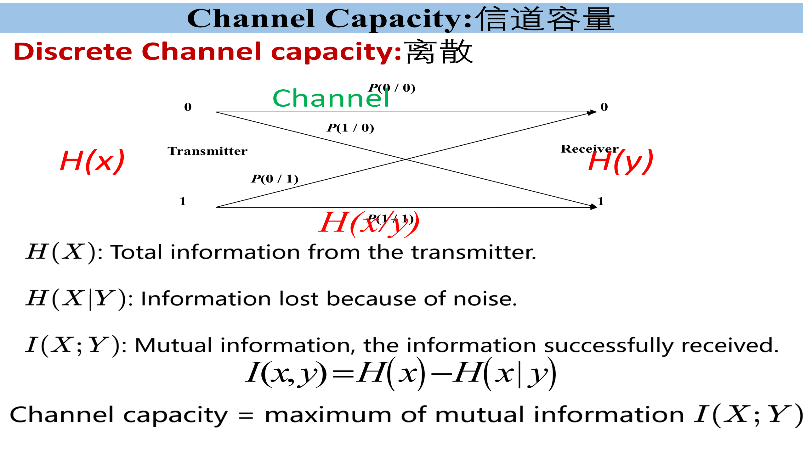
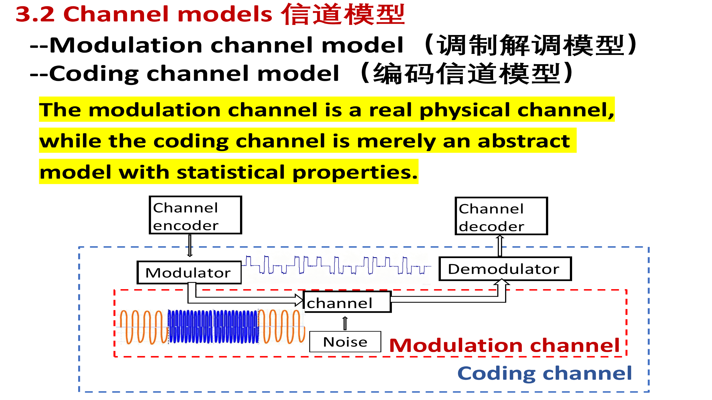
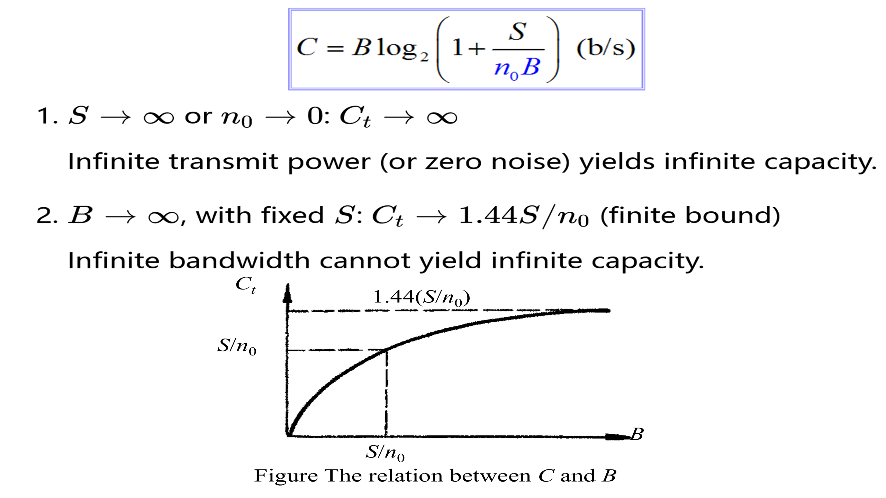
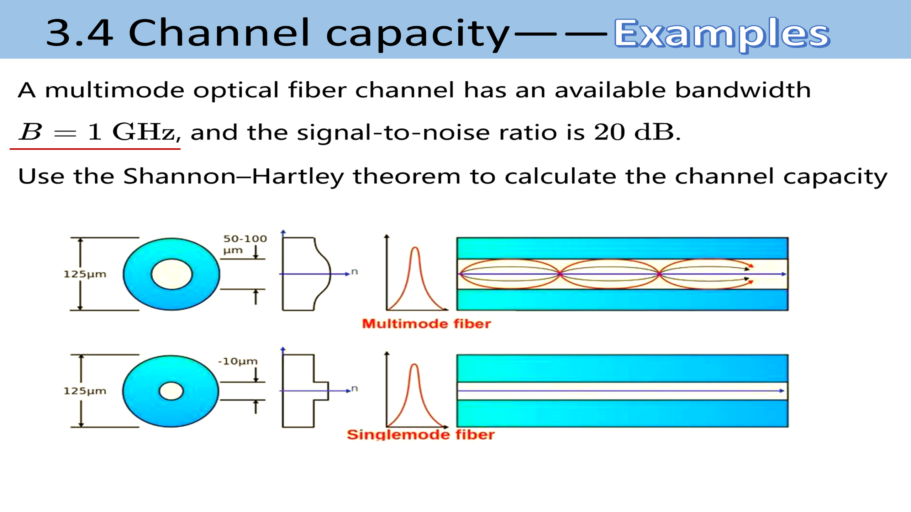
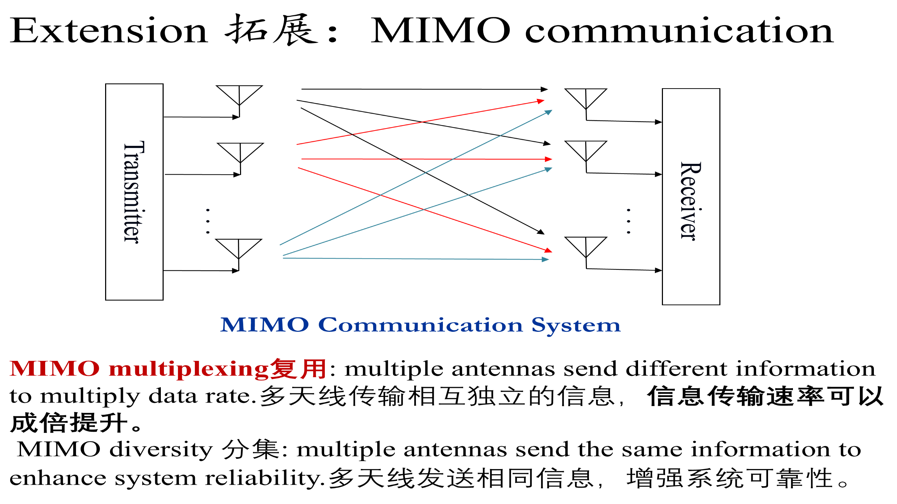
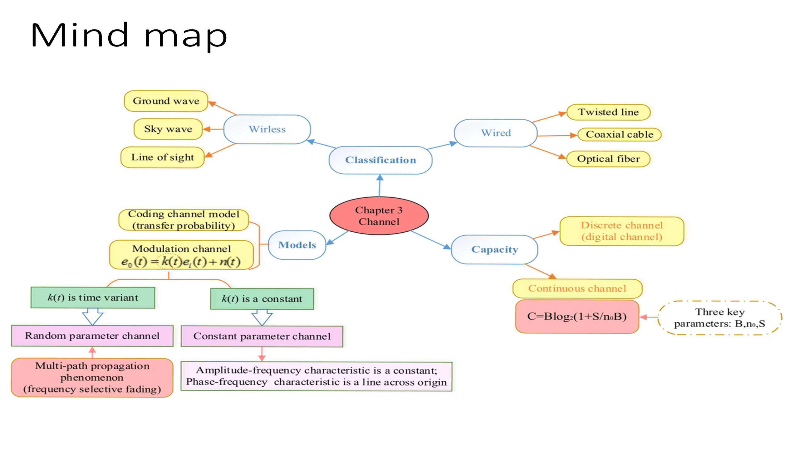

# 第3章 · 第9课（学校第七讲）信道容量与香农定理

## 本课概要

~~~mermaid
mindmap
  root((信道容量))
    信息传输极限
      信息速率与容量
      可靠传输的边界
    离散信道容量
      符号转移概率
      条件熵与互信息
      输入分布的优化
    连续高斯信道容量
      带宽和信噪比
      白噪声谱密度
      功率与带宽的交换
    链路容量计算
      光纤带宽比较
      卫星降雨衰减
      电话信道反求信噪比
    传输方案扩展
      调制与信道编码
      多天线复用与分集
~~~

上一课沿着一段发送波形，研究它经过信道后怎样衰减、失真、叠加噪声，最后可能被判错。本课仍看这段传输，但问题变了：给定这样的信道，发送端可以选择调制、输入分布和纠错编码时，**每秒最多能可靠地传递多少信息**？这就把第3课的信息量、第4课的速率与可靠性，以及第7课的高斯白噪声接到了一起。

## 一、从传输速率到信道容量

在同一条链路上，发送设备可以尝试以不同速率传输。实际信息速率 $R_b$ 是当前方案每秒发送的平均信息量；信道容量 $C$ 则是在给定信道条件下，允许充分优化发送和编码方式时的可靠传输速率上限。速率提高到超过这个上限后，不能再靠延长编码块把差错概率压到任意小。因此容量同时牵住了第4课分开的两件事：传得快与传得准。

课件开头把双绞线、同轴电缆、光纤、地波、短波、卫星视距链路和 Wi-Fi 放在一张带宽与速率表中。它想让我们注意：可用频带不同，实际速率也不同；但**带宽本身不是容量的全部**，噪声和接收信号强度也会限制可用速率。表中的数据是不同媒介和制式的示意值，不宜当作某种媒介恒定不变的参数。

| 课件列举的媒介或链路 | 示意可用带宽 | 示意速率 |
|---|---:|---:|
| 双绞线 | 约 $100$ 或 $250\,\mathrm{MHz}$ | 约 $1\,\mathrm{Gbit/s}$ |
| 同轴电缆 | 约 $1\,\mathrm{GHz}$ | 约 $10\,\mathrm{Gbit/s}$ |
| 光纤 | 太赫兹量级 | 约 $100\,\mathrm{Gbit/s}$ |
| 地波 | 千赫兹至兆赫兹量级 | 兆比特每秒量级 |
| 短波 | 兆赫兹量级 | 数十千比特每秒 |
| 卫星视距链路 | 约数百兆赫兹至吉赫兹量级 | 约 $100\,\mathrm{Mbit/s}$ |
| Wi-Fi | 约 $20$ 至 $160\,\mathrm{MHz}$ | 课件列举的高速制式可达吉比特每秒量级 |

容量的“可靠”采用信息论意义：对速率低于容量的传输，可以用足够长的合适编码，使错误概率任意小。这并不是说每次未经编码的码元判决都绝对不会出错。下面先从上一课的离散符号模型入手，再转回实际传输波形。

## 二、离散信道的互信息与容量

上一课的编码信道模型只保留发送符号 $X$ 和接收判决 $Y$。例如发送 $0$，接收机可能判成 $0$，也可能判成 $1$；四条箭头各有转移概率。看图时从左侧某个发送符号出发，沿箭头走到右侧的两种判决结果。每个发送符号对应的转移概率之和为 $1$。

发送前，$H(X)$ 衡量一个发送符号平均有多难预测。接收了 $Y$ 之后，若仍不能确定发送的 $X$，剩余的不确定性记为 $H(X\mid Y)$。接收结果平均帮我们消除的那一部分不确定性，就是互信息：

$$
I(X;Y)=H(X)-H(X\mid Y).
$$

$I(X;Y)$ 的单位为 $\mathrm{bit/次信道使用}$。如果接收结果总能唯一确定发送符号，则 $H(X\mid Y)=0$，互信息等于发送符号的熵；若接收结果与发送内容毫无关系，则 $H(X\mid Y)=H(X)$，互信息为零。**接收机判对的次数多**也不必然表示传递了很多信息：如果发送端始终只发同一个符号，接收机虽然容易猜中，却没有收到新的选择结果。

同一个物理信道的转移概率固定，发送端仍能改变各符号出现的比例。不同输入分布 $P_X$ 可能得到不同的 $I(X;Y)$。所以每次使用离散信道的容量为

$$
C_{\mathrm D}=\max_{P_X}I(X;Y).
$$

若信道每秒独立使用 $R_B$ 次，且模型满足相应的无记忆条件，才把每次使用的容量换成每秒的容量 $R_BC_{\mathrm D}$。这里优化的是**输入分布**，不是把某一组给定数据的互信息直接称为全局容量。

### 离散信道课堂例题

**课件原题**

> A channel has symbol rate $R_B=1000\,\mathrm{symbol/s}$. Test two different input distributions on this same channel: Distribution 1: $H(X)=1\,\mathrm{bit/symbol}$, $H(X\mid Y)=0.0454\,\mathrm{bit/symbol}$. Distribution 2: $H(X)=0.65\,\mathrm{bit/symbol}$, $H(X\mid Y)=0.12\,\mathrm{bit/symbol}$. Calculate mutual information $I(X;Y)$ for both distributions. Find the channel capacity $C$ and maximum bit rate.

**中文翻译**

某信道每秒传输 $1000$ 个符号。在同一信道上测试两种输入分布。第一种的发送熵为 $1\,\mathrm{bit/symbol}$，接收后剩余条件熵为 $0.0454\,\mathrm{bit/symbol}$；第二种分别为 $0.65$ 和 $0.12\,\mathrm{bit/symbol}$。分别求互信息，并比较两种输入的最大信息速率及题目所称的容量。

每组都按“发送前不确定性减去接收后剩余不确定性”计算：

$$
\begin{aligned}
I_1(X;Y)&=1-0.0454=0.9546\,\mathrm{bit/symbol},\\
I_2(X;Y)&=0.65-0.12=0.53\,\mathrm{bit/symbol}.
\end{aligned}
$$

两种已测试分布分别对应 $954.6\,\mathrm{bit/s}$ 和 $530\,\mathrm{bit/s}$；因此第一种在这两者中较好。题目没有给出完整转移概率，也没有证明第一种是所有可能输入分布中的最优者，所以能确定的是**已测试两种分布中的最大值** $0.9546\,\mathrm{bit/symbol}$，相应速率 $954.6\,\mathrm{bit/s}$；真正的 $C_{\mathrm D}$ 还需要在全部允许输入分布上取最大值。

## 三、连续 AWGN 信道的香农公式

刚才只看“发了什么符号、判成什么符号”，传播波形的细节已经被压缩进转移概率。但建立一条新的链路时，设计者往往先知道的是可用带宽、接收信号功率和噪声强度。为从这些物理量直接判断可靠速率，需要回到调制器输出与解调器输入之间的**调制信道**。图中先看红框内传输的连续波形和噪声，再看包住调制、解调的蓝框怎样把同一次传输概括为符号判决。

在这一节的理想模型中，接收波形是发送波形加上高斯白噪声；噪声在信号频带内按频率均匀分布，且与发送信号独立。高斯描述固定时刻噪声取值的概率规律，白描述其功率的频率分布，二者回答不同问题。对带宽为 $B$ 的连续加性高斯白噪声信道，香农-哈特利公式为

$$
C=B\log_2\left(1+\frac{S}{N}\right).
$$

其中 $B$ 是信道可用带宽，单位 $\mathrm{Hz}$；$S$ 是与噪声在同一接收位置、同一频带比较的有用信号平均功率；$N$ 是带内噪声功率，二者单位相同；$S/N$ 是**线性功率比**；容量 $C$ 的单位为 $\mathrm{bit/s}$。题目若给分贝信噪比，先用

$$
\mathrm{SNR}_{\mathrm{dB}}=10\log_{10}\frac{S}{N},
\qquad
\frac{S}{N}=10^{\mathrm{SNR}_{\mathrm{dB}}/10}
$$

换算。这里用 $10$ 是因为比较的是功率；在阻抗相同的条件下，电压等幅度量的功率正比于幅度平方，因此幅度比写成分贝时系数才是 $20$。

上一章用双边白噪声功率谱密度 $n_0/2$。若正、负频带各保留一块宽度为 $B$ 的通带，两块谱面积之和为 $N=2(n_0/2)B=n_0B$。等价地，把 $n_0$ 看作单边功率谱密度，可将容量写为

$$
C=B\log_2\left(1+\frac{S}{n_0B}\right).
$$

这个写法把带宽、信号功率和噪声谱密度放在同一式中。前面的 $B$ 表示频带越宽，可供信号变化的频率资源越多；分母中的 $n_0B$ 表示频带变宽时也收进更多白噪声。这就是下一步分析“扩带”收益的关键。

离散模型和连续模型并不是两条并行的物理通道。前者在解调判决后观察符号与转移概率，后者在判决前观察波形及带宽、功率、噪声；香农公式是在连续 AWGN 模型下得到的容量，不是把任意衰落或多径信道直接代进去就能精确描述。

## 四、功率、噪声与带宽的作用

固定 $B$ 和 $n_0$ 时，增大接收信号功率 $S$ 会提高容量；降低噪声谱密度 $n_0$ 也会提高容量。公式给出的数学极限是 $S\to\infty$ 或 $n_0\to0$ 时 $C\to\infty$。它们帮助我们辨认变量方向，实际设备仍有有限功率和非零噪声。

带宽的作用更值得慢看。保持 $S$ 和 $n_0$ 不变，把频带从窄逐渐开宽：开始时容量明显上升；后来每增加一段频带，也同时增加一段噪声，收益越来越小。下图从横轴 $B$ 向右读，曲线始终上升，却逐渐接近上方虚线。

当 $B$ 很大时，$S/(n_0B)$ 很小。利用 $\ln(1+x)\approx x$，得到

$$
\begin{aligned}
\lim_{B\to\infty}B\log_2\left(1+\frac{S}{n_0B}\right)
&=\frac{S}{n_0\ln2}\\
&\approx1.44\frac{S}{n_0}.
\end{aligned}
$$

所以**固定信号功率与噪声谱密度时**，无限扩带也只会趋近有限容量。图中 $B=S/n_0$ 是一个容易核对的点：此时 $S/(n_0B)=1$，故 $C=B\log_2 2=S/n_0$。

另一种问题是目标速率固定，反求带宽改变后允许多低的信噪比。由香农公式反解

$$
\frac{S}{N}=2^{C/B}-1.
$$

课件给定目标容量 $C=12\,\mathrm{kbit/s}$。若 $B=3\,\mathrm{kHz}$，每赫兹要承载 $4\,\mathrm{bit/s}$，所需线性信噪比为 $2^4-1=15$；若 $B=4\,\mathrm{kHz}$，每赫兹只需承载 $3\,\mathrm{bit/s}$，所需信噪比降为 $2^3-1=7$。这就是“带宽和信噪比可以互换”的具体意思。这里两种方案各自满足同一个目标容量，比较的是**所需信噪比**；前面的扩带极限则固定了 $S$ 和 $n_0$，条件不同。

## 五、3.4 节的三道链路例题

这组三题沿同一个计算入口推进：先辨认带宽和信噪比，分贝先换线性比，再代入容量公式。前两题比较不同光纤链路；第三题把降雨前后放到同一卫星链路上。

### 单模光纤与多模光纤的容量

**课件原题一**

> A single-mode optical fiber channel has an available bandwidth $B=20\,\mathrm{GHz}$, and the signal-to-noise ratio is $20\,\mathrm{dB}$. Use the Shannon-Hartley theorem to calculate the channel capacity (maximum transmission rate).

**中文翻译**：某单模光纤信道可用带宽为 $20\,\mathrm{GHz}$，信噪比为 $20\,\mathrm{dB}$。用香农-哈特利公式求信道容量。

**课件原题二**

> A multimode optical fiber channel has an available bandwidth $B=1\,\mathrm{GHz}$, and the signal-to-noise ratio is $20\,\mathrm{dB}$. Use the Shannon-Hartley theorem to calculate the channel capacity.

**中文翻译**：某多模光纤信道可用带宽为 $1\,\mathrm{GHz}$，信噪比同为 $20\,\mathrm{dB}$。求其容量，并与前一链路比较。

先看图的右侧：上方多模光纤画出了多条传播路径，下方单模光纤只画出一种主要传播模式。图说明两种光纤的传播方式不同；本题的数值计算直接以各自**给定的可用带宽**为准。

两题的信噪比均为 $20\,\mathrm{dB}$，换成线性功率比是 $10^{20/10}=100$。因此两条信道的每赫兹理论容量相同，都是 $\log_2(101)\approx6.658\,\mathrm{bit/(s\cdot Hz)}$，总容量分别为

$$
\begin{aligned}
C_{\mathrm{single}}&=20\times10^9\log_2(101)
\approx133.16\,\mathrm{Gbit/s},\\
C_{\mathrm{multi}}&=1\times10^9\log_2(101)
\approx6.66\,\mathrm{Gbit/s}.
\end{aligned}
$$

**按题设**，相同带内信噪比下，容量之比等于带宽之比，即 $20:1$。这与上一节的固定 $S,n_0$ 扩带实验不同：那时带宽增加会使噪声功率一起增加；这里题目直接规定两条信道的带内信噪比相同。课件给出的 $\log_2 100\approx6.64$ 可以作估算，按原式应计算 $\log_2(1+100)=\log_2 101$。

### 同步卫星链路的降雨衰减

**课件原题**

> A geosynchronous satellite communication link has a carrier frequency of $14\,\mathrm{GHz}$, the system bandwidth is $36\,\mathrm{MHz}$ between the transmitter and the receiver, and a signal-to-noise ratio (SNR) of $30\,\mathrm{dB}$ at the receiver.
>
> 1. Calculate the channel capacity. The SNR in dB must first be converted to a linear value.
> 2. If the satellite communication link is affected by space rain attenuation, resulting in the receiver SNR dropping to $10\,\mathrm{dB}$ while the bandwidth remains unchanged, how will the channel capacity change? Calculate it.
> 3. What intuitive impact does this change have on the service bearing capacity of satellite communication (e.g., high-definition video transmission, large data backhaul)?

**中文翻译**

一条同步卫星链路的载频为 $14\,\mathrm{GHz}$，带宽为 $36\,\mathrm{MHz}$，正常时接收端信噪比为 $30\,\mathrm{dB}$。（1）求正常容量；（2）降雨衰减使接收信噪比降到 $10\,\mathrm{dB}$，带宽不变，求新容量及变化；（3）说明这对高清视频和大数据回传等业务的影响。

两次计算使用**同一带宽**。降雨使接收信号相对噪声变弱，题目已经把这种变化体现在接收信噪比中。载频 $14\,\mathrm{GHz}$ 说明无线信号工作的频段；在已给定接收信噪比后，不必再把载频直接代入容量公式。

第一问，$30\,\mathrm{dB}$ 对应线性功率比 $10^{30/10}=1000$，所以

$$
C_1=36\times10^6\log_2(1001)
\approx358.82\,\mathrm{Mbit/s}.
$$

第二问，雨后 $10\,\mathrm{dB}$ 对应线性功率比 $10^{10/10}=10$，所以

$$
C_2=36\times10^6\log_2(11)
\approx124.54\,\mathrm{Mbit/s}.
$$

容量减少 $358.82-124.54\approx234.28\,\mathrm{Mbit/s}$，降幅约 $65.3\%$。信噪比的线性功率比变为原来的百分之一，容量没有按同样比例降低，因为容量与信噪比之间是对数关系。

第三问要把数值放回业务。例如一组业务原来共需 $200\,\mathrm{Mbit/s}$：正常时低于 $C_1$，雨后高于 $C_2$，原速率便无法同时保持任意低的差错概率。链路需要减少并发视频路数、降低视频码率或减少数据回传吞吐量；也可采用更稳健的调制和编码来改善可靠性，但这些调整通常伴随有用速率下降。

~~~mermaid
flowchart LR
  A[降雨衰减] --> B[接收信噪比下降]
  B --> C[信道容量下降]
  C --> D[业务速率或并发量下调]
~~~

## 六、调制、编码与容量的关系

前三题算的是信道的上限。现在固定一条信道，改用不同的调制方式，看看实际发送方案能占用这个上限的多少。正交幅度调制 QAM 用不同的幅度与相位组合表示不同码元：$16\mathrm{QAM}$ 有 $16$ 种状态，每码元携带 $4$ 比特；$64\mathrm{QAM}$ 有 $64$ 种状态，每码元携带 $6$ 比特。

### QAM 扩展题

**课件原题**

> For an AWGN channel with ideal baseband Nyquist transmission, the bandwidth $B=2\,\mathrm{MHz}$. The system adopts $16\mathrm{QAM}$ modulation without channel coding.
>
> 1. Find the spectral efficiency of this modulation scheme (unit: $\mathrm{bit/(s\cdot Hz)}$).
> 2. Calculate the information bit rate $R_b$ of the system.
> 3. Given the linear signal-to-noise ratio $\mathrm{SNR}=100$, calculate the Shannon channel capacity of this channel.
> 4. If we switch to higher-order modulation (for example, $64\mathrm{QAM}$), recalculate the information bit rate $R_b$ and compare it with the Shannon capacity obtained in part 3.

**中文翻译**

某 AWGN 信道带宽为 $2\,\mathrm{MHz}$，采用理想奈奎斯特传输，起初使用**无信道编码**的 $16\mathrm{QAM}$。（1）求频带利用率；（2）求信息比特率；（3）在线性信噪比为 $100$ 时求信道容量；（4）改用 $64\mathrm{QAM}$ 后重新计算比特率，并与第三问比较。

这里先统一课件的带宽口径。课件解答按理想 QAM 的占用带宽取码元速率 $R_B=B=2\,\mathrm{MBd}$；第4课公式 $R_B=2B$ 使用的则是**实基带单边带宽**。题干写“baseband Nyquist”，但后面的数值答案采用前一种口径；若不先说明 $B$ 的含义，会把两套公式误用到同一个宽度上。

第一问用“每秒码元数乘每码元比特数，再除以带宽”：

$$
\eta_{16}=\frac{R_B\log_2 16}{B}
=4\,\mathrm{bit/(s\cdot Hz)}.
$$

第二问因未加信道编码，每码元的 $4$ 比特均为待传信息，故 $R_{b,16}=2\times10^6\times4=8\,\mathrm{Mbit/s}$。第三问的 $\mathrm{SNR}=100$ 已是线性功率比，不再做分贝换算：

$$
C=2\times10^6\log_2(101)
\approx13.32\,\mathrm{Mbit/s}.
$$

第四问只换调制阶数。$64\mathrm{QAM}$ 每码元 $6$ 比特，码元速率不变，得到 $\eta_{64}=6\,\mathrm{bit/(s\cdot Hz)}$，$R_{b,64}=2\times10^6\times6=12\,\mathrm{Mbit/s}$。两套发送方案和同一条信道的容量可并排看：

| 发送方案 | 每码元信息量 | 未编码比特率 | 同一信道的容量 |
|---|---:|---:|---:|
| $16\mathrm{QAM}$ | $4\,\mathrm{bit}$ | $8\,\mathrm{Mbit/s}$ | 约 $13.32\,\mathrm{Mbit/s}$ |
| $64\mathrm{QAM}$ | $6\,\mathrm{bit}$ | $12\,\mathrm{Mbit/s}$ | 约 $13.32\,\mathrm{Mbit/s}$ |

$64\mathrm{QAM}$ 使名义速率更接近容量，但在相同平均功率下，更多状态挤在同一信号范围内，接收机更容易把相邻状态判混。$R_b<C$ 只是理论边界比较，不会自动保证这套**未编码**方案的误码率合格。信道编码加入纠错冗余以改善可靠性；若编码率为 $r<1$，同样的码元速率和调制阶数下，有用信息速率变为 $rR_B\log_2M$。因此调制阶数、编码率与实际误码率须一起看。课件写的 $13.28\,\mathrm{Mbit/s}$ 是用 $\log_2 100\approx6.64$ 的粗略估算，按原式计算约为 $13.32\,\mathrm{Mbit/s}$。

## 七、多天线传输的复用与分集

刚才提高调制阶数，是让**每个码元**代表更多比特。多输入多输出系统（MIMO）则增加发送和接收天线，尝试在同一时频资源中分开多路数据。读图时从左边发送天线走到右边接收天线：一根发送天线的信号可经不同路径到达多根接收天线，交叉箭头表示传播联系，并不表示每根箭头天然是一条独立数据通路。

先把图缩成两发两收，并暂时不算噪声：左侧两根天线同一时刻发送 $a=1$、$b=2$。若只有一根接收天线，读数 $a+b=3$ 无法分辨原来是哪两个数。若第二根因传播路径不同读到 $a+2b=5$，就能用两次读数之差求 $b=2$，再得 $a=1$。这就是空间复用：发送**不同数据**，接收端借不同混合结果把它们分开。若两根接收天线看到的只是同一个混合结果的重复，便没有多出可分离的数据流。

如果多根天线发送或接收**同一份信息的多个副本**，一路衰落时另一路可能仍清楚，这叫分集，主要改善可靠性。两者观察的是同一组天线的两种使用方式：

| 使用方式 | 各路内容 | 主要目的 |
|---|---|---|
| 空间复用 | 不同数据 | 在同一时频资源中提高速率 |
| 分集 | 同一信息的副本 | 减少某一路衰落造成的错误 |

路径强弱与相位可写入信道矩阵 $\mathbf H$。矩阵第 $j$ 列记录发送天线 $j$ 到各接收天线的作用，第 $i$ 行记录接收天线 $i$ 听到各发送天线的混合。例如刚才的关系为

$$
\begin{bmatrix}y_1\\y_2\end{bmatrix}
=\underbrace{\begin{bmatrix}1&1\\1&2\end{bmatrix}}_{\mathbf H}
\begin{bmatrix}a\\b\end{bmatrix}
+\begin{bmatrix}n_1\\n_2\end{bmatrix}.
$$

这里 $n_1,n_2$ 是两根接收天线的噪声。实际系数通常为复数，包含幅度与相位。课件进一步给出平坦 MIMO AWGN 信道、发送功率在 $N_t$ 根天线间均分时的容量写法：

$$
C=B\log_2\det\left(
\mathbf I_{N_r}+\frac{\rho}{N_t}\mathbf H\mathbf H^H
\right).
$$

$N_t,N_r$ 是发送、接收天线数；$\rho$ 是按该模型归一化的总信噪比；$\mathbf I_{N_r}$ 是接收端维数的单位矩阵；$\mathbf H^H$ 是共轭转置；$\det$ 是行列式。式中除以 $N_t$ 表示总发送功率分给多根天线，而 $\mathbf H\mathbf H^H$ 让路径的强弱和相互区别进入计算。初学时抓住其作用即可：**仅数天线根数，不能得出一般信道的精确容量**。

### 理想两路的数值例子

**课件原文**

> Numerical Example. For $B=2\,\mathrm{MHz}$, $\mathrm{SNR}=100$: $C_{\mathrm{SISO}}\approx13.28\,\mathrm{Mbps}$, $C_{\mathrm{MIMO}}\approx26.56\,\mathrm{Mbps}$.

**中文翻译**：带宽为 $2\,\mathrm{MHz}$、信噪比数值为 $100$。课件比较单发单收与理想两发两收系统的容量，给出约 $13.28$ 和 $26.56\,\mathrm{Mbit/s}$。

课件近似式把两条可分离、效果相近的空间通路各按有效信噪比 $100$ 估算，因此

$$
\begin{aligned}
C_{\mathrm{SISO}}&=B\log_2(101)\approx13.32\,\mathrm{Mbit/s},\\
C_{2\times2}&\approx2B\log_2(101)\approx26.63\,\mathrm{Mbit/s}.
\end{aligned}
$$

课件数字稍低，仍是使用 $\log_2 100\approx6.64$ 的估算。这个“两倍”来自**两条有效空间通路**；若总功率分配后各路信噪比下降，或传播路径过于相似，就不能直接把单天线容量乘以天线数。一般情形应回到 $\mathbf H$ 和前一公式。

### 上下行天线配置填表

**课件原题**

> Approximate MIMO Capacity Formula (High SNR & Rich Scattering): $C\approx\min(N_t,N_r)\,B\log_2(1+\mathrm{SNR})$.
>
> | Link | Antenna Config | $\min(N_t,N_r)$ | Channel Capacity |
> |---|---|---|---|
> | Downlink | $4\times2$ MIMO (BS 4Tx, UE 2Rx) |  |  |
> | Uplink | $1\times4$ (UE 1Tx, BS 4Rx) |  |  |

**中文翻译**：在课件给定的高信噪比、传播路径足够丰富的近似条件下，填写基站到用户的下行链路、用户到基站的上行链路各可形成几路空间数据流，以及相应容量表达式。BS 是基站，UE 是用户设备，Tx、Rx 分别指发送、接收天线。

下行四发两收，接收端至多分开两路；上行一发四收，发送端只有一路不同数据可送出。按题给近似式填写：

| 方向 | 可区分数据流数 | 按题给近似式填写的容量 |
|---|---:|---|
| 下行 $4\times2$ | $\min(4,2)=2$ | $C_{\mathrm{down}}\approx2B\log_2(1+\mathrm{SNR})$ |
| 上行 $1\times4$ | $\min(1,4)=1$ | $C_{\mathrm{up}}\approx B\log_2(1+\mathrm{SNR})$ |

这里的“下行约两倍”以两方向的 $B$ 和每路有效信噪比相同为比较前提。上行多出的接收天线虽然不新增第二路发送数据，仍可用于分集接收，改善可靠性。

## 八、电话信道作业：由容量反求信噪比

**课件原题**

> A voice-grade channel of the telephone network has a bandwidth of $3.4\,\mathrm{kHz}$.  
> (a) Calculate the information capacity of the telephone channel for a signal-to-noise ratio of $30\,\mathrm{dB}$.  
> (b) Calculate the minimum SNR required to support information transmission through the telephone channel at the rate of $9600\,\mathrm{bps}$.

**中文翻译**

某电话网话音信道的带宽为 $3.4\,\mathrm{kHz}$。（a）信噪比为 $30\,\mathrm{dB}$ 时，求信道容量。（b）要以 $9600\,\mathrm{bit/s}$ 传输，求理论上最低需要的信噪比。

两问固定同一带宽，计算方向相反。（a）把 $30\,\mathrm{dB}$ 换成线性功率比 $1000$，然后求容量：

$$
C=3400\log_2(1001)
\approx33889\,\mathrm{bit/s}
\approx33.89\,\mathrm{kbit/s}.
$$

（b）把目标速率放在容量边界，先求线性功率比，再换分贝：

$$
\begin{aligned}
\mathrm{SNR}_{\min}
&=2^{9600/3400}-1\approx6.08,\\
\mathrm{SNR}_{\min,\mathrm{dB}}
&=10\log_{10}(6.08)\approx7.84\,\mathrm{dB}.
\end{aligned}
$$

第一问的 $30\,\mathrm{dB}$ 允许约 $33.89\,\mathrm{kbit/s}$ 的理论容量；第二问只为 $9600\,\mathrm{bit/s}$ 找容量边界，因此所需最低信噪比低得多。工程实现通常留出高于边界的余量，以承担有限码长、设备误差和实际传播变化。

## 九、第三章信道知识的归纳

课件的章末思维导图把第六讲与第七讲接在一起。先看上方“分类”：信号沿有线媒介或无线传播路径前进；再看左下“模型”：对同一次传输，调制信道追踪波形变化，编码信道记录符号转移；最后看右下“容量”：从符号统计或 AWGN 物理参数，求可靠信息速率的上限。

读图左下角有两处需要放回准确层级。**恒参**只说传播规律在观察期间近似固定；幅频响应平坦、各频率获得相同延时，是恒参信道进一步满足**无失真传输**的条件。**多径**也不只属于随参信道：固定的两径仍可能使某些频率抵消；路径参数再随时间变化，才又出现时变衰落。这样读，第六讲的传播模型与第七讲的容量分析才真正连成一章。

| 第三章观察角度 | 看同一传输的什么 | 典型问题 |
|---|---|---|
 传播媒介与路径 | 信号怎样到达接收机 | 有线、无线、视距和多径 |
 调制信道 | 波形在传播中怎样变化 | 衰减、失真、噪声与衰落 |
 编码信道 | 发送符号最终判成什么 | 转移概率和错误 |
 信道容量 | 在给定条件下最多能可靠传多快 | 离散互信息与连续 AWGN 容量 |

课件最后还安排了第三章作业清单、思维导图与精练摘要；复习时可沿表中四个观察角度回到第8课的具体传播图和本课的容量例题。

## 课件与练习来源

- [[PPT/第七讲/第七讲 Chapter 3 part II   Channel capacity 学生版.pptx]]
- [[PPT/第七讲/(需打印）第七讲 课堂练习 学生版 新增一题 .docx]]
- 前置内容：[[第3章 08 第8课 信道模型与多径传播]]、[[第2章 07 第7课 白噪声、窄带噪声与接收机分析]]、[[第1章 04 第4课 通信系统的性能指标]]
