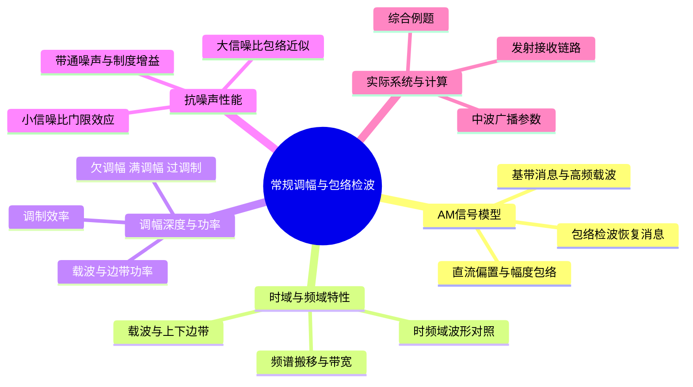

# 第4章 · 第10课（学校第八讲）常规调幅与包络检波

## 本课概要

前三章分别说明了信号、噪声和信道，本章开始研究发送端怎样制作适合信道传输的波形，以及接收端怎样恢复消息。仍以一段声音为对象：话筒输出低频电信号，发送端让它控制高频波的幅度，接收端沿高频波的外轮廓取回声音。这就是常规调幅（amplitude modulation，AM）的主线。

## 一、基带消息进入 AM 收发系统

### 低频声音与高频载波

话筒输出的电压随说话内容改变，记作 $m(t)$。它尚未移到载频附近，所以称为基带消息信号。课件以主要频率约为 $200\,\mathrm{Hz}$ 至 $3.4\,\mathrm{kHz}$ 的语音作例子。若把如此低频的电信号直接用于通常的无线电天线，会遇到波长和天线尺寸等问题。例如 $1\,\mathrm{kHz}$ 电磁波在自由空间中的波长为

$$
\lambda=\frac{c}{f}=\frac{3\times10^8}{10^3}=300\,\mathrm{km},
$$

其中 $c$ 为传播速度，$f$ 为频率。让消息控制高频载波，便能把信号放到更合适的频段；不同载频还便于电台分频使用和接收机选台，并可避开部分低频干扰。下图三组图从上到下分别对应天线尺寸、频分复用和低频干扰；频分复用图应沿左侧各路基带信号看向右侧彼此分开的频带。

![[附件/第4章/04-调制目的.png]]

选一条快速振荡的单位幅度余弦作为载波：$c(t)=\cos(\omega_ct)$，其中 $\omega_c=2\pi f_c$，$f_c$ 为载频。只发送固定载波无法表达不同声音，因此让其幅度随 $m(t)$ 改变。课件先给消息加上固定直流偏置 $A_0$，再与载波相乘：

$$
\boxed{s_{\mathrm{AM}}(t)=[A_0+m(t)]\cos(\omega_ct).}
$$

$A_0+m(t)$ 是乘到高频余弦前面的慢变化系数；$s_{\mathrm{AM}}(t)$ 是发送的已调高频信号。先沿下图左侧从加法器走到乘法器，再沿信道、带通滤波器走到包络检波器。发送时改变的是高频振荡的幅度，信道传输的仍是高频波，不是单独的声音电压。

![[附件/第4章/09-AM系统模型.png]]

例如取 $A_0=1\,\mathrm V$、$m(t)=0.5\cos(2\pi\times1000t)\,\mathrm V$、$f_c=100\,\mathrm{kHz}$。消息每秒变化一千次，载波每秒振荡十万次。在消息分别取 $0.5$、$0$、$-0.5\,\mathrm V$ 时，高频振荡的局部幅度分别为 $1.5$、$1$、$0.5\,\mathrm V$。消息的正负变化变成围绕 $A_0$ 的幅度增减。沿振荡上边缘连出的慢变化外轮廓，称为**包络**。

展开 AM 式得到

$$
s_{\mathrm{AM}}(t)=A_0\cos(\omega_ct)+m(t)\cos(\omega_ct).
$$

第一项是不随消息改变的载波；第二项随消息变化。固定 $A_0$ 和载频时，第二项与消息成正比，所以 AM 属于线性调制。这里的分类依据是**发送端怎样让消息改变载波**。

### 包络检波恢复消息

带通滤波器（BPF）先选出载频附近的目标信号并限制带外噪声；通过它的波形仍在高频附近。包络检波器才从细密振荡中取出慢变化的幅度。课件的电路由二极管、电阻和电容组成：正峰值使电容充电，两次峰值之间电容缓慢放电，输出因而沿着包络变化。读图时先看左侧红色虚线上包络，再看右侧电路的输出标成 $A_0+m(t)$。

![[附件/第4章/10-包络检波电路.png]]

理想包络检波得到的非负幅度是

$$
E(t)=|A_0+m(t)|.
$$

若 $A_0+m(t)$ 始终非负，便有 $E(t)=A_0+m(t)$。随后隔直去掉固定的 $A_0$，并按需要调整增益，就能恢复 $\widetilde m(t)=m(t)$。包络检波不需要一条与发送载波同频同相的本地载波，因此属于**非相干解调**。它与“线性调制”观察的位置不同：前者说接收端是否需要载波相位参考，后者说发送端怎样生成已调波。二极管检波器本身又是非线性器件，这三种说法不能混为一种分类。

课件的波形匹配题给出四种信号：原始基带消息 $m(t)$、等幅载波 $\cos(\omega_ct)$、AM 已调信号 $s_{\mathrm{AM}}(t)$、实际检波恢复信号 $\widetilde m(t)$；候选图（a）为带细小纹波及起始暂态的慢变化波形，（b）为等幅快速振荡，（c）为平滑的慢变化波形，（d）为幅度随时间变化的快速振荡，要求逐一匹配并说明理由。

![[附件/第4章/13-波形匹配题.png]]

先辨认是否包含高频振荡：（b）与（d）都有，其中（b）等幅，是载波；（d）的上下外轮廓起伏，是 AM 波。再比较两条慢变化波：（c）平滑，是原始消息；（a）带有检波纹波与暂态，是实际恢复输出。因此依次为 $m(t)\leftrightarrow(c)$、载波 $\leftrightarrow(b)$、$s_{\mathrm{AM}}(t)\leftrightarrow(d)$、$\widetilde m(t)\leftrightarrow(a)$。下方完整坐标图还显示：（d）的上包络与（c）形状对应，但有直流抬升；（a）尚未达到理想恢复的无失真状态。

![[附件/第4章/14-AM波形对照.png]]

## 二、AM 的时域与频域特性

时间波形让我们看见“振荡幅度如何起伏”，却不易直接读出信号占据哪段频率。为判断台站通带、上下边带和带宽，需要把同一条信号拆成频率分量。

### 傅里叶变换约定与余弦谱线

本课频谱横轴采用普通频率 $f$，单位为 $\mathrm{Hz}$。以下 $j$ 为虚数单位。这套傅里叶变换与逆变换为

$$
X_f(f)=\int_{-\infty}^{\infty}x(t)e^{-j2\pi ft}\,\mathrm dt,
\qquad
x(t)=\int_{-\infty}^{\infty}X_f(f)e^{j2\pi ft}\,\mathrm df.
$$

若横轴改用角频率 $\omega=2\pi f$，同一对公式写成

$$
X_\omega(\omega)=\int_{-\infty}^{\infty}x(t)e^{-j\omega t}\,\mathrm dt,
\qquad
x(t)=\frac1{2\pi}\int_{-\infty}^{\infty}X_\omega(\omega)e^{j\omega t}\,\mathrm d\omega.
$$

两种写法的正变换指数都带负号，逆变换指数都带正号；角频率逆变换前多出的 $1/(2\pi)$，与变量换算 $\mathrm d\omega=2\pi\,\mathrm df$ 相配合。对应地，单位余弦的谱线系数分别为

$$
\cos(\omega_0t)
\longleftrightarrow
\pi[\delta(\omega-\omega_0)+\delta(\omega+\omega_0)],
$$

$$
\cos(2\pi f_0t)
\longleftrightarrow
\frac12[\delta(f-f_0)+\delta(f+f_0)].
$$

这两式描述同一条余弦。把第一式放入含 $1/(2\pi)$ 的逆变换，每个冲激提供一个系数为 $1/2$ 的复指数，二者相加仍回到原余弦。箭头旁的 $\pi$ 或 $1/2$ 是冲激**权重**，不是可直接当作普通曲线高度的数。

### 单音消息产生载波与一对边频

仍用 $A_0=1\,\mathrm V$、$m(t)=0.5\cos(2\pi\times1000t)\,\mathrm V$，这次把载频取为 $20\,\mathrm{kHz}$。先展开 AM 波，再对消息与载波的乘积使用积化和差：

$$
\cos\alpha\cos\beta
=\frac12[\cos(\alpha-\beta)+\cos(\alpha+\beta)].
$$

于是

$$
\begin{aligned}
s_{\mathrm{AM}}(t)
={}&\cos(2\pi\times20000t)\\
&+0.25\cos(2\pi\times19000t)
+0.25\cos(2\pi\times21000t).
\end{aligned}
$$

原来的 $1\,\mathrm{kHz}$ 消息分量，进入已调波后出现在距 $20\,\mathrm{kHz}$ 载频各 $1\,\mathrm{kHz}$ 的位置。$19\,\mathrm{kHz}$ 是下边频，$21\,\mathrm{kHz}$ 是上边频；中央 $20\,\mathrm{kHz}$ 来自直流偏置乘载波。如果消息包含许多低频分量，每个分量都在载频两侧生成对应边频，合起来便形成**下边带**和**上边带**。边带相对载频的位置是分类依据。

对一般消息，设 $M(f)$ 为 $m(t)$ 的傅里叶变换。由于 $\cos(2\pi f_ct)=(e^{j2\pi f_ct}+e^{-j2\pi f_ct})/2$，乘载波会把 $M(f)$ 分别向正、负载频搬移一份，每份系数为 $1/2$。加上载波谱线，得到

$$
\boxed{\begin{aligned}
S_{\mathrm{AM}}(f)
={}&\frac{A_0}{2}[\delta(f-f_c)+\delta(f+f_c)]\\
&+\frac12[M(f-f_c)+M(f+f_c)].
\end{aligned}}
$$

第一行是固定载波；第二行是随消息改变的频谱副本。正载频附近既有下边带又有上边带；负载频附近是实信号相应的对称频谱，不能把正、负两个副本简单称为上下边带。

### 双音消息的波形、谱线与占用带宽

课件把消息增加为两个频率：

$$
m(t)=0.5\cos(2\pi\times1000t)+0.3\cos(2\pi\times2000t),
\qquad A_0=1\,\mathrm V,\quad f_c=20\,\mathrm{kHz}.
$$

下图四格从左上向右下读：基带消息先有 $1$、$2\,\mathrm{kHz}$ 两对谱线，载波在 $\pm20\,\mathrm{kHz}$，已调波在载频两侧出现新谱线，检波后的主要分量回到基带。右下格还画出实际检波的残余纹波、暂态和幅度偏差，不能由它推出理想且未过调制的 AM 必然失真。

![[附件/第4章/15-双音时域频域对照.png]]

逐个把消息分量乘载波，得到正频率一侧的时域余弦分量：

| 频率 | $18\,\mathrm{kHz}$ | $19\,\mathrm{kHz}$ | $20\,\mathrm{kHz}$ | $21\,\mathrm{kHz}$ | $22\,\mathrm{kHz}$ |
|---|---:|---:|---:|---:|---:|
| 身份 | 下边带 | 下边带 | 载波 | 上边带 | 上边带 |
| 余弦幅度 | $0.15$ | $0.25$ | $1$ | $0.25$ | $0.15$ |
| 双边 FT 正频谱冲激权重 | $0.075$ | $0.125$ | $0.5$ | $0.125$ | $0.075$ |

例如幅度 $0.5$ 的消息余弦先通过积化和差，在载频两侧生成幅度各 $0.25$ 的余弦；每条余弦再用双边频谱表示时，正频率处的冲激权重才是 $0.125$。两个“除以二”分别发生在调制和傅里叶表示两步。下图放大了这些正频率谱线，负频率一侧与之共轭对称。

![[附件/第4章/双音AM谱线放大图.png]]

最高消息频率是 $f_H=2\,\mathrm{kHz}$，所以正频带从 $f_c-f_H=18\,\mathrm{kHz}$ 到 $f_c+f_H=22\,\mathrm{kHz}$，占用带宽为 $4\,\mathrm{kHz}$。一般地，在载频高于消息最高频率、频带彼此分开的条件下，

$$
\boxed{B_{\mathrm{AM}}=(f_c+f_H)-(f_c-f_H)=2f_H.}
$$

改变载频只平移整段频谱；提高消息最高频率才会使它向两侧撑宽。负频率的对称部分不意味着通信占用带宽还需再乘一次二。

| 信号 | 时域观察 | 频域观察 |
|---|---|---|
| 基带消息 $m(t)$ | 缓慢变化的原始波形 | $M(f)$ 集中在零频附近 |
| AM 已调波 $s_{\mathrm{AM}}(t)$ | 高频振荡的外轮廓跟着消息变化 | 载波冲激与载频两侧的边带，宽度 $2f_H$ |
| 理想恢复波 $\widetilde m(t)$ | 隔直并调整增益后与 $m(t)$ 同形 | $\widetilde M(f)=M(f)$ |

## 三、调幅深度、包络失真与功率分配

频谱说明消息搬到了哪里，却还不能判断包络检波能否按原形恢复消息。回到 $A_0+m(t)$：消息幅度增大时，波的外轮廓起伏更深；若这项越过零点，检波器取绝对值就会把负的一段折回。

### 调幅系数与三种包络状态

先设单音消息 $m(t)=A_m\cos(2\pi f_mt)$。$A_m$ 是消息余弦幅度，$A_0$ 是基准偏置。把两者作比，定义调幅系数

$$
\boxed{m_a=\frac{A_m}{A_0}},\qquad
s_{\mathrm{AM}}(t)=A_0[1+m_a\cos(2\pi f_mt)]\cos(2\pi f_ct).
$$

固定 $A_0$ 时，$m_a$ 越大，载波幅度随消息起伏越深。课件三列并列图应先看上排曲线是否触及零线，再看下排高频波的外轮廓：左列始终高于零，是欠调幅；中列恰好碰零，是满调幅；右列越过零线，是过调制。

![[附件/第4章/18-调幅系数三种状态.png]]

固定 $A_0=1\,\mathrm V$，取三个可核对的幅度：

| 消息幅度 $A_m$ | 调幅系数 $m_a$ | $A_0+m(t)$ 的范围 | 包络检波结果 |
|---:|---:|---:|---|
| $0.5\,\mathrm V$ | $0.5$ | $0.5$ 至 $1.5\,\mathrm V$ | 可按原形恢复 |
| $1\,\mathrm V$ | $1$ | $0$ 至 $2\,\mathrm V$ | 理想满调幅，低谷触零 |
| $1.5\,\mathrm V$ | $1.5$ | $-0.5$ 至 $2.5\,\mathrm V$ | 负值折回，产生包络失真 |

最后一行在消息负峰处有 $m(t)=-1.5\,\mathrm V$，原本系数 $A_0+m(t)=-0.5\,\mathrm V$；检波器却只能给出 $|-0.5|=0.5\,\mathrm V$。去掉 $1\,\mathrm V$ 偏置后得到 $-0.5\,\mathrm V$，与原消息的 $-1.5\,\mathrm V$ 不同。负系数相当于高频载波反相，包络只取幅度，丢掉了这一符号信息。对单音，$m_a\leq1$ 正好等价于 $A_0+m(t)\geq0$。

课件对一般消息也写 $m_a=\max_t|m(t)|/A_0$。若消息正负峰值不对称，最直接的包络条件仍是 $A_0+\min_t m(t)\geq0$；用 $m_a\leq1$ 可以保证这一条件。过调制是发送波自身的包络问题，即使无信道噪声也会发生。

在无过调制的单音图上，还能直接由上包络的最高、最低读数求调幅系数。两读数分别为 $E_{\max}=A_0+A_m$、$E_{\min}=A_0-A_m$；前者减后者消去偏置，前者加后者消去消息幅度，于是

$$
\boxed{m_a=\frac{E_{\max}-E_{\min}}{E_{\max}+E_{\min}}.}
$$

例如上包络从 $0.5\,\mathrm V$ 变到 $1.5\,\mathrm V$，便得到 $m_a=(1.5-0.5)/(1.5+0.5)=0.5$。读数须从零线量到**上包络**；发生折返后，这个由未过调制波形推得的公式不再适用。

### 载波、两个边带与调制效率

接收端能沿包络恢复消息，代价是发送端必须保留载波。为量化功率去向，先沿用单音消息。幅度为 $a$ 的余弦电压加在电阻 $R$ 上，周期平均功率为 $a^2/(2R)$，因为余弦平方的周期平均是 $1/2$。以下取单位电阻的统一归一化，功率记为 $a^2/2$；实际取同一 $R$ 时，各功率同除以 $R$，比例不变。

单音 AM 经积化和差后，包含一条幅度 $A_0$ 的载波余弦和两条幅度各为 $A_m/2$ 的边频余弦。不同频率分量的交叉乘积长期平均为零，因此功率逐项相加：

$$
P_c=\frac{A_0^2}{2},\qquad
P_{\mathrm{USB}}=P_{\mathrm{LSB}}=\frac{A_m^2}{8},\qquad
P_{\mathrm{SB}}=\frac{A_m^2}{4}.
$$

$P_c$ 为载波功率，$P_{\mathrm{SB}}$ 为**两个边带合计**的功率。固定载频和 $A_0$ 时，消息变化体现在边带中，因而把边带占总发送功率的比例定义为调制效率：

$$
\boxed{
\eta=\frac{P_{\mathrm{SB}}}{P_c+P_{\mathrm{SB}}}
=\frac{m_a^2}{2+m_a^2}.
}
$$

功率取幅度平方，解释了式中为何出现 $m_a^2$。继续取 $A_0=1\,\mathrm V$、$A_m=0.5\,\mathrm V$：载波功率 $0.5\,\mathrm W$，每个边频 $0.03125\,\mathrm W$，两边合计 $0.0625\,\mathrm W$，总功率 $0.5625\,\mathrm W$，效率为 $1/9\approx11.1\%$。增加消息幅度时，载波功率不变，边带功率按幅度平方上升：

| 单音调幅系数 | 载波功率 | 两边带总功率 | 调制效率 |
|---:|---:|---:|---:|
| $0.5$ | $P_c$ | $0.125P_c$ | $11.1\%$ |
| $0.8$ | $P_c$ | $0.32P_c$ | $24.2\%$ |
| $1$ | $P_c$ | $0.5P_c$ | $33.3\%$ |

单音包络检波要求 $m_a\leq1$，所以可取的最高调幅深度为满调幅 $m_a=1$，此时 $\eta_{\max}=1/3$。对应功率比例 $P_c:P_{\mathrm{USB}}:P_{\mathrm{LSB}}=4:1:1$：载波占总功率的 $2/3$，两个边带合计占 $1/3$。这是**单音、无过调制**的上限，不是任意语音波形只要峰值相同就有相同效率。

对零均值一般消息，记单位电阻下的基带消息平均功率为 $P_m=\overline{m^2(t)}$。乘单位幅度的高频余弦后，功率计算中出现 $\cos^2(2\pi f_ct)$；当基带与载频充分分离时，其快速振荡项在长期平均中消失，留下 $1/2$，所以

$$
\boxed{P_{\mathrm{SB}}=\frac{P_m}{2}},\qquad
\boxed{\eta=\frac{P_m}{A_0^2+P_m}}.
$$

这里 $P_m$ 是**乘载波之前**的消息平均功率，$P_{\mathrm{SB}}$ 是**乘载波之后**两个边带的总功率。以幅度 $A_m$ 的单音核对：基带功率 $P_m=A_m^2/2$，上、下边频各为 $A_m^2/8$，合计 $A_m^2/4=P_m/2$。这就是二倍关系的来源；若载波幅度不是单位值，比例还要随其幅度平方改变。

课件双音消息 $m(t)=0.5\cos(2\pi\times1000t)+0.3\cos(2\pi\times2000t)$、$A_0=1$ 时，两项基带功率相加为 $P_m=(0.5^2+0.3^2)/2=0.17$；边带合计 $0.085$，载波 $0.5$，效率 $0.085/(0.5+0.085)\approx14.53\%$。它的最大绝对峰值为 $0.8$，但不能把单音 $m_a=0.8$ 的效率 $24.2\%$ 套上去，因为峰值不决定平均功率。

## 四、带通噪声与 AM 包络检波的制度增益

现在让信道加入噪声。要比较解调前后信噪比，先固定观察位置：输入端取**接收带通滤波器之后、包络检波器之前**；输出端取**检波并隔直后的基带**。模拟系统恢复的是连续波形，第 4 课因此用输出信噪比而不是误码率评价恢复质量。

### 检波前的信号与带内噪声

设信道白噪声的双边功率谱密度为 $n_0/2$，每个正、负载频通带的宽度均为 $B_{\mathrm{AM}}=2f_H$。下图左侧要看两块矩形噪声谱：正、负频率各有一块，不能漏算其中一块；右侧是大信噪比近似下检波后回到基带的同相噪声谱。

![[附件/第4章/25-带通与输出噪声频谱.png]]

课件还要求沿系统填写四个节点的**信号**功率。图中 $a$ 是加偏置后、尚未乘载波的基带；$b$ 是已调波；$c$ 是通过理想单位增益带通滤波器后的有用信号；$d$ 是理想检波、隔直后的消息。先看图中 $a\to b$，就能认出乘单位幅度载波带来的平均功率系数 $1/2$；再看 $c\to d$，恢复的对象已经从整条高频 AM 波换回消息。

![[附件/第4章/24-AM各节点信号功率.png]]

| 节点 | 有用信号 | 平均功率 | 依据 |
|---|---|---:|---|
| $a$ | $A_0+m(t)$ | $A_0^2+P_m$ | 消息零均值，交叉项的平均为零 |
| $b$ | $[A_0+m(t)]\cos(\omega_ct)$ | $(A_0^2+P_m)/2$ | 高频余弦的平方平均贡献 $1/2$ |
| $c$ | 通过接收带通后的 AM 有用信号 | $(A_0^2+P_m)/2$ | 理想滤波器完整保留信号频带 |
| $d$ | 隔直后的 $m(t)$ | $P_m$ | 包络检波恢复基带消息 |

表中暂不把信道噪声计入有用信号功率；噪声另按功率谱计算。带通噪声功率是两块频谱面积：

$$
\boxed{N_i=2\times\frac{n_0}{2}\times B_{\mathrm{AM}}=n_0B_{\mathrm{AM}}.}
$$

此处 $N_i$ 是检波输入噪声功率。若零均值消息的基带平均功率为 $P_m$，输入 AM 信号同时包含载波和两个边带，故 $S_i=A_0^2/2+P_m/2$。输入信噪比为

$$
\boxed{\left(\frac SN\right)_i=\frac{A_0^2+P_m}{2n_0B_{\mathrm{AM}}}.}
$$

这个位置把整条 AM 波计作输入信号，包括固定载波；它不是仅用边带功率计算的比值。

### 大信噪比时的包络近似

带通后的窄带噪声沿用第 7 课的负号正交约定，可分成同相和正交两部分：

$$
n_i(t)=n_c(t)\cos(\omega_ct)-n_s(t)\sin(\omega_ct).
$$

$n_c(t)$ 与载波余弦同方向，$n_s(t)$ 在正交方向。把 AM 信号与噪声相加，检波器看见的合成包络为

$$
E(t)=\sqrt{[A_0+m(t)+n_c(t)]^2+n_s^2(t)}.
$$

若有用包络在观察时段内明显强于噪声，且未过调制，合成长度的一阶变化主要由同相噪声造成：$E(t)\approx A_0+m(t)+n_c(t)$。隔直后便有 $\widetilde m(t)\approx m(t)+n_c(t)$。在理想带通白噪声模型里，同相分量的输出基带谱高度为 $n_0$、范围为 $[-f_H,f_H]$，谱面积为

$$
\boxed{N_o=n_0(2f_H)=n_0B_{\mathrm{AM}}=N_i.}
$$

所以输出有用信号功率 $S_o=P_m$，输出信噪比为

$$
\boxed{\left(\frac SN\right)_o=\frac{P_m}{n_0B_{\mathrm{AM}}}.}
$$

课件相邻页面一处写 $N_o=N_i$，另一处出现“输出噪声功率为输入的两倍”的标注。按图中两块带通谱、输出基带谱面积及课件最终输出信噪比公式，前一写法与这套归一化一致。包络检波在此近似下没有把噪声功率直接加倍；输入、输出信号功率的口径发生了变化。

### 制度增益与发射功率效率的联系

用输出信噪比除以输入信噪比，定义调制制度增益 $G$。代入上面的两个比值，噪声谱密度与带宽相互约掉：

$$
\boxed{G=\frac{(S/N)_o}{(S/N)_i}
=\frac{2P_m}{A_0^2+P_m}=2\eta.}
$$

$\eta$ 问发射功率中边带占多少；$G$ 问按上述输入输出口径，解调后信噪比相对解调前为多少。两者都由载波与边带的功率分配决定，但不是同一个指标。对单音，$P_m=A_m^2/2$、$m_a=A_m/A_0$，于是

$$
G=\frac{2m_a^2}{2+m_a^2}.
$$

单音满调幅时 $G=2/3$。它表示输出信噪比为按课件口径计算的输入信噪比的 $2/3$，并不表示噪声功率变成输入的 $3/2$ 倍。这里的 $G=2/3$ 与上一节 $\eta=1/3$ 都使用了**单音满调幅**条件。

| 位置或指标 | 有用信号功率 | 噪声功率 | 对应关系 |
|---|---:|---:|---|
| 检波前 | $(A_0^2+P_m)/2$ | $n_0B_{\mathrm{AM}}$ | 载波和边带均计作输入信号 |
| 大信噪比检波后 | $P_m$ | $n_0B_{\mathrm{AM}}$ | 去偏置后恢复消息并保留同相噪声 |
| 制度增益 | — | — | 输出信噪比除以输入信噪比 |

### 小信噪比下的门限效应

上面的输出式依赖 $A_0+m(t)$ 明显强于噪声。若噪声增大，尤其在有用包络的低谷处，合成方向会剧烈改变，$n_s(t)$ 也会显著影响平方根的值。取一个最小例子：某时刻有用包络为 $1$、同相噪声为零；正交噪声为 $0.1$ 时，真实包络 $\sqrt{1+0.1^2}\approx1.005$，近似为 $1$ 尚可；正交噪声为 $2$ 时，真实包络 $\sqrt{1+2^2}\approx2.236$，近似已经失效。固定隔直无法消去这种随机起伏。

下图横轴为检波器输入信噪比，纵轴为输出信噪比。从右向左看，输入信噪比降低到门限附近后，输出质量下降得格外快，这称为**门限效应**。它反映包络检波的非线性与大信噪比近似失效；门限不是所有系统共用的某个固定数字。

![[附件/第4章/31-包络检波门限效应.png]]

过调制和门限效应都会使包络恢复失真，但前者是 $A_0+m(t)$ 自己越过零点，即使无噪声也发生；后者是噪声足以主导合成包络，即使发送波未过调制也可能发生。进入门限区域后，不能继续用大信噪比推得的固定制度增益预测输出质量。

## 五、实际 AM 链路与中波参数

简化数学模型只保留调制、信道、带通滤波和检波。实际系统还要限制音频带宽、放大射频、隔直并驱动扬声器。下图从发射机左端沿箭头走到天线，再沿信道向下转入接收机，从右向左走向扬声器：

![[附件/第4章/35-实际AM收发链路.png]]

话筒把声音变为电压，限带滤波确定最高传送频率；AM 调制产生载频和两边带，射频滤波抑制带外成分，功率放大后由天线发射。接收端先高频放大和带通选频，包络检波得到近似 $A_0+m(t)$，隔直去掉 $A_0$，音频放大后驱动扬声器。与第 7 课 DSB 相干接收框架相比，此处不需要接收端的同频同相本地载波，接收设备因而较简单。课件框图将 C 类功放画在已形成的 AM 波之后；实际设计需保持包络形状，功放结构与调制位置必须配合，不能让任意非线性功放直接压坏已调包络。

课堂材料对 AM 的归纳可沿同一条链路理解：包络检波简单、接收成本较低；载波耗费功率，双边带占用 $2f_H$ 带宽；幅度上的噪声和干扰容易进入恢复声音。中波广播可形成较广覆盖，但具体覆盖还由频率、发射功率及传播环境决定，并非单靠 AM 这一调制名称保证。

课件另给一组中波广播示意参数。图中载频为 $1000\,\mathrm{kHz}$，最高音频频率为 $4.5\,\mathrm{kHz}$，所以通带为 $995.5$ 至 $1004.5\,\mathrm{kHz}$、宽度 $9\,\mathrm{kHz}$；调幅系数为 $0.7$，小于 $1$，可避免按峰值条件判断的过调制。隔直高通截止频率 $50\,\mathrm{Hz}$ 用来去掉检波后低频偏置，音频低通截止频率 $4.5\,\mathrm{kHz}$ 对应最高恢复频率。这里与开头 $0.3$ 至 $3.4\,\mathrm{kHz}$ 的语音示例取值不同，是两组示意参数。

![[附件/第4章/38-中波AM参数.png]]

图中 $19.68\%$ 来自把 $m_a=0.7$ 代入**单音**效率公式 $m_a^2/(2+m_a^2)$。若消息真是一段语音，仅知峰值调幅系数并不能算出它的平均功率及确切效率，须回到 $\eta=P_m/(A_0^2+P_m)$。

## 六、AM 带宽与抗噪声性能综合例题

课件给出一条带 AM 信号的信道：噪声在所需频带内的双边功率谱密度为 $P_n(f)=0.5\times10^{-3}\,\mathrm{W/Hz}$；AM **两个边带总功率**为 $10\,\mathrm{kW}$，载波功率为 $40\,\mathrm{kW}$；消息最高频率为 $f_H=5\,\mathrm{kHz}$，载频为 $f_c=100\,\mathrm{kHz}$；解调器前有理想带通滤波器。题目要求依次求：该带通滤波器的中心频率、解调器输入信噪比、解调器输出信噪比、AM 解调器的制度增益 $G$。下图保留原题；课件在题面把边带功率记为 $P_m$，下一页又记为 $P_s$，这里统一记为 $P_{\mathrm{SB}}$，以免与基带消息功率混淆。

![[附件/第4章/39-AM综合例题.png]]

先求正频率通带。最高消息频率使边带伸至载频两侧各 $5\,\mathrm{kHz}$，所以通带为 $95$ 至 $105\,\mathrm{kHz}$，中心频率是 $100\,\mathrm{kHz}$，整个宽度是 $B_{\mathrm{AM}}=10\,\mathrm{kHz}$。中心频率回答“放在哪里”，带宽回答“开多宽”，二者不能互相代替。

噪声双边谱在正、负载频通带内各留一块，每块宽 $10\,\mathrm{kHz}$，因此

$$
N_i=2(0.5\times10^{-3})(10\times10^3)=10\,\mathrm W.
$$

检波输入信号把载波和边带都计入：$S_i=P_c+P_{\mathrm{SB}}=40+10=50\,\mathrm{kW}$。第二问得到

$$
\boxed{(S/N)_i=\frac{50\,000}{10}=5000.}
$$

线性比值 $5000$ 换成分贝约为 $10\log_{10}(5000)=37.0\,\mathrm{dB}$。按题目采用的大信噪比包络检波模型，由于 $P_{\mathrm{SB}}=P_m/2$，在相同的功率归一化下，输出基带消息等效功率为 $P_m=2P_{\mathrm{SB}}=20\,\mathrm{kW}$；输出同相噪声功率 $N_o=N_i=10\,\mathrm W$。第三问为

$$
\boxed{(S/N)_o=\frac{20\,000}{10}=2000.}
$$

线性比值 $2000$ 换成分贝约为 $10\log_{10}(2000)=33.0\,\mathrm{dB}$。最后，把两个线性信噪比相除：

$$
\boxed{G=\frac{2000}{5000}=0.4.}
$$

也可用发射功率分配交叉检查：$\eta=P_{\mathrm{SB}}/(P_c+P_{\mathrm{SB}})=10/50=0.2$，所以 $G=2\eta=0.4$。四问依次得到中心频率 $100\,\mathrm{kHz}$、输入信噪比 $5000$、输出信噪比 $2000$、制度增益 $0.4$。本题直接给出边带总功率，不需先猜消息是否单音，也不应把 $10\,\mathrm{kW}$ 当成调制前消息的 $P_m$。

## 七、本课关系的统一对照

沿着同一条语音消息读完整讲：低频消息控制高频波的外轮廓；时域上是“快振荡加慢包络”，频域上是固定载波加上、下边带；包络检波的可恢复性取决于系数是否越过零；发送效率取决于边带占总功率多少；有噪声时则须分别比较检波前后的信号与噪声。以下两组条件各有自己的对象：

| 所看对象 | 首先检查 | 结果与用途 |
|---|---|---|
| 发送波包络 | $A_0+m(t)$ 是否始终非负 | 判断包络检波会否因过调制折返失真 |
| 发送波频谱 | $f_c$、消息最高频率 $f_H$ | 确定上下边带位置及 $B_{\mathrm{AM}}=2f_H$ |
| 发射功率 | 载波与两个边带分别多少 | 计算 $\eta$；单音满调幅为 $1/3$ |
| 含噪接收包络 | 有用包络相对噪声是否足够强 | 决定大信噪比近似及 $G=2\eta$ 是否可用 |

这些条件不能互相替代：调幅系数小于 $1$ 能避免发送端过调制，却不能单独保证信道噪声小；输入平均信噪比较高，也应注意包络低谷是否先受到明显干扰。后续的 DSB、SSB、VSB 都属于本章线性调制；它们继续改变载波与边带的保留方式，再比较功率、带宽和接收处理。

## 课件与课堂材料

- [[PPT/第八讲/第八讲 Project 1-AM通信系统-学生版.pptx]]
- [[PPT/第八讲/需打印 第八讲 AM通信系统.docx]]
- 前置知识：[[第2章 07 第7课 白噪声、窄带噪声与接收机分析]]、[[第1章 04 第4课 通信系统的性能指标]]。
- 课程目录：[[README|通信原理学习笔记]]。
