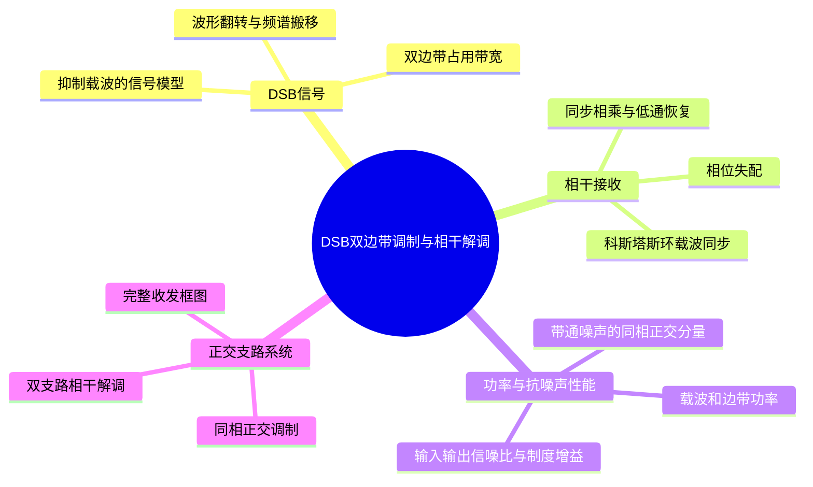
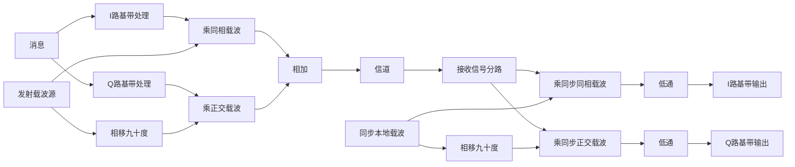

# 第4章 · 第11课（学校第九讲）DSB双边带调制与相干解调

## 本课概要

上一课的常规 AM 让低频消息控制高频波的包络，接收端因此可以用简单的包络检波器恢复声音。不过，AM 还要持续发送一条不随消息变化的载波。我们继续沿用同一条消息 $m(t)$：若把固定载波从发送波中拿掉，剩下什么？接收机又怎样辨认消息的正负变化？本课从这个变化出发，再研究噪声和功率。

## 一、DSB从AM中去掉固定载波

AM 先把直流偏置 $A_0$ 加到消息上，再与载波相乘。展开后，发送波分成一条固定载波和一条随消息变化的双边带波：

$$
s_{\mathrm{AM}}(t)=[A_0+m(t)]\cos(\omega_ct)
=A_0\cos(\omega_ct)+m(t)\cos(\omega_ct),
\qquad \omega_c=2\pi f_c.
$$

$f_c$ 是载频，$\omega_c$ 是相应角频率。去掉第一项，便得到抑制载波双边带信号，简称 DSB 或 DSB-SC：

$$
\boxed{s_{\mathrm{DSB}}(t)=m(t)\cos(\omega_ct).}
$$

“抑制载波”是说发送波不再额外包含 $A_0\cos(\omega_ct)$；发送端仍需要产生余弦载波，才能完成乘法调制。下图先看上排 AM 在载频处的箭头，再看下排 DSB：箭头消失，上、下边带都还在。这个判断以消息没有直流分量为前提；若 $m(t)$ 含直流分量，乘法后也会在载频处形成谱线。

![[附件/第4章/第九讲-AM与DSB频谱对照.png|650]]

同一条消息送进两套发送机时，区别集中在第一个乘法器之前。AM 要先加 $A_0$；DSB 直接乘 $m(t)$。两者的信道都传高频已调波，接收端也都先用带通滤波器选出台站的载频附近频带。

![[附件/第4章/09-AM系统模型.png|650]]

![[附件/第4章/第九讲-DSB系统模型.png|650]]

为了看见去掉偏置的后果，取 $A_0=1$，让消息在两个时刻分别为 $+0.5$ 和 $-0.5$。AM 的高频系数是 $1.5$ 与 $0.5$，包络检波能区分它们。DSB 的系数是 $+0.5$ 与 $-0.5$：两个时刻的外轮廓都为 $0.5$，但后一个时刻的高频振荡反相。包络只保留大小，会把这两个不同的消息值看成一样。因此一般不能用包络检波恢复 DSB；接收端必须保留高频波相对于参考载波的方向。

### 双音消息的时域波形与频谱

课件给出一条双音消息，载频取 $20\,\mathrm{kHz}$：

$$
m(t)=0.5\cos(2\pi\cdot1000t)+0.3\cos(2\pi\cdot2000t)
\quad(\mathrm V),
\qquad f_c=20\,\mathrm{kHz}.
$$

先看下图左上角的消息，再看左下角的 DSB 波。消息穿过零点后，高频波翻转方向；若只沿波形最外侧描轮廓，就会丢掉这个正负号。右下角的同步解调输出与左上角同形，但幅度为一半，原因将在接收机乘法中算出。

![[附件/第4章/第九讲-DSB双音时域.png|650]]

时间波形能看出翻转，频谱则用来判断占用的频率。若 $M(f)$ 是消息 $m(t)$ 的频谱，乘以单位幅度余弦相当于将它向正、负载频各搬移一份：

$$
\boxed{S_{\mathrm{DSB}}(f)
=\frac12\left[M(f-f_c)+M(f+f_c)\right].}
$$

两个 $1/2$ 权重来自 $\cos(2\pi f_ct)=(e^{j2\pi f_ct}+e^{-j2\pi f_ct})/2$；括号里的两项分别是向正、负载频方向的搬移。对双音例子，正频率处的四条边频如下。表中的“余弦幅度”是时域各边频项的系数，“正频冲激权重”又是其一半，不能把这两次除以二混为一次。

| 正频率 | $18\,\mathrm{kHz}$ | $19\,\mathrm{kHz}$ | $20\,\mathrm{kHz}$ | $21\,\mathrm{kHz}$ | $22\,\mathrm{kHz}$ |
|---|---:|---:|---:|---:|---:|
| 来源 | $2\,\mathrm{kHz}$ 下边频 | $1\,\mathrm{kHz}$ 下边频 | 抑制载波 | $1\,\mathrm{kHz}$ 上边频 | $2\,\mathrm{kHz}$ 上边频 |
| 余弦幅度 | $0.15$ | $0.25$ | $0$ | $0.25$ | $0.15$ |
| 正频冲激权重 | $0.075$ | $0.125$ | $0$ | $0.125$ | $0.075$ |

下图按基带、载波、DSB 波、同步解调输出排列。先沿左列看原消息在零频附近的两对谱线，再沿左下看这些谱线到了 $20\,\mathrm{kHz}$ 两侧；载波图在 $20\,\mathrm{kHz}$ 处有峰，DSB 图的同一位置却没有独立载波峰。

![[附件/第4章/第九讲-DSB双音频域.png|650]]

若消息最高频率为 $f_H$ 且载频高于该值，正频率通带从 $f_c-f_H$ 到 $f_c+f_H$，所以

$$
\boxed{B_{\mathrm{DSB}}=(f_c+f_H)-(f_c-f_H)=2f_H.}
$$

本例最高消息频率为 $2\,\mathrm{kHz}$，正频通带从 $18$ 到 $22\,\mathrm{kHz}$，宽度为 $4\,\mathrm{kHz}$。DSB 去掉的是固定载波的功率，仍保留两个边带，因此占用带宽与常规 AM 相同。

## 二、相干解调恢复消息的正负号

带通滤波器（BPF）只把载频附近的目标信号和带内噪声留下来，尚未恢复低频消息。接收机于是产生一条与发送载波同频同相的本地余弦，再与带通输出相乘。先不计噪声，乘法器的结果是

$$
\begin{aligned}
s_{\mathrm{DSB}}(t)\cos(\omega_ct)
&=m(t)\cos^2(\omega_ct)\\
&=\frac12m(t)+\frac12m(t)\cos(2\omega_ct).
\end{aligned}
$$

第一项回到基带，第二项在两倍载频附近。低通滤波器（LPF）去掉第二项，留下 $\widetilde m(t)=m(t)/2$。这个 $1/2$ 是第二次乘单位幅度余弦的结果，并非消息丢失一半；若本地载波改用 $2\cos(\omega_ct)$，理想低通输出就是 $m(t)$。

课件把基带输入、DSB 已调波、接收乘法器输出、低通输出并排放在时频域表中。读下图时沿同一行从时域移到频域，再沿各行向下走：第一次相乘把消息移到载频两侧，第二次相乘产生基带和两倍载频分量，低通只保留基带。

![[附件/第4章/第九讲-DSB时频域对照.png|650]]

用 $s_{\mathrm{mult}}(t)$ 记接收乘法器输出，各节点可归纳为：

| 节点 | 时域信号 | 频域信号 |
|---|---|---|
| 原消息 | $m(t)$ | $M(f)$ |
| DSB 已调波 | $m(t)\cos(\omega_ct)$ | $\frac12[M(f-f_c)+M(f+f_c)]$ |
| 接收乘法器输出 | $\frac12m(t)[1+\cos(2\omega_ct)]$ | $\frac12M(f)+\frac14[M(f-2f_c)+M(f+2f_c)]$ |
| 理想低通输出 | $\frac12m(t)$ | $\frac12M(f)$ |

### 本地载波的相位与同步

接收机若使用 $\cos(\omega_ct+\varphi)$，其中 $\varphi$ 是相对发送载波的固定相位差，低通输出成为

$$
\widetilde m(t)=\frac12m(t)\cos\varphi.
$$

$\varphi=0$ 时只需补足固定增益；$\varphi=\pi/4$ 时幅度再乘 $\sqrt2/2$；$\varphi=\pi/2$ 时输出为零。若两端有频率差，$\varphi$ 随时间变化，消息幅度也会周期性起伏。下图的乘法器下方标着失配的本地载波，应沿它向右看低通输出，再用式中的 $\cos\varphi$ 判断失真。

![[附件/第4章/第九讲-DSB相位失配.png|650]]

DSB 不发送独立的固定载波，却要求接收端建立同步参考。课件列出导频插入、平方环、科斯塔斯环和多次方环等方法；共同目的都是估计并跟踪载波的频率与相位，不属于前面计算 $1/2$ 的额外功率步骤。

科斯塔斯环把同一条接收 DSB 波送进两路：一路与本地余弦相乘，另一路与其正交的本地正弦相乘。若本地载波与发送端有相位差 $\varphi$，两路低通输出分别随 $\cos\varphi$ 和 $\sin\varphi$ 改变。相位对准附近，消息集中在同相路，正交路趋近于零。鉴相器结合两路输出形成相位误差信号，反馈给压控振荡器（VCO）；VCO 调整本地载波后，新的两路输出又进入鉴相器，构成持续跟踪的闭环。

![[附件/第4章/第九讲-Costas环.png|650]]

这里的两路叫**同相和正交**，载波相差 $\pi/2$；“反相”是相差 $\pi$，不是正交。因为被抑制的载波本身没有单独发来，环路建立的是可用于相干解调的参考。对双边带抑制载波信号，相差 $\pi$ 的锁定还会使恢复消息整体反号；这就是载波恢复的极性歧义。

## 三、功率效率与抗噪声性能

下面统一用单位电阻的功率归一化，并设消息零均值、基带平均功率为 $P_m=\overline{m^2(t)}$。单位幅度余弦的平方长期平均为 $1/2$；基带频谱与载频分离时，消息与载波相乘后，DSB 已调波的功率为 $P_m/2$。AM 在相同边带之外还保留载波功率 $A_0^2/2$。

| 发射功率去向 | 常规 AM | DSB |
|---|---:|---:|
| 独立载波 | $A_0^2/2$ | $0$ |
| 两个边带合计 | $P_m/2$ | $P_m/2$ |
| 发射总功率 | $(A_0^2+P_m)/2$ | $P_m/2$ |
| 边带占总功率的比例 | $\eta_{\mathrm{AM}}=P_m/(A_0^2+P_m)$ | $\eta_{\mathrm{DSB}}=1$ |

调制效率 $\eta$ 只问“发射功率有多少落在随消息变化的边带中”。DSB 的 $\eta=1$ 表示零均值消息的已调信号没有独立载波功率，并不涉及信道噪声。对单音 $m(t)=A_m\cos(2\pi f_mt)$，有 $P_m=A_m^2/2$，调幅系数 $m_a=A_m/A_0$，所以 $\eta_{\mathrm{AM}}=m_a^2/(2+m_a^2)$。单音满调幅 $m_a=1$ 时，AM 的效率为 $1/3$；相同消息的 DSB 没有那条固定载波。

### 解调前后各节点的信号功率

课件用 $a,b,c,d$ 标出调制前、调制后、接收带通后和低通后的四个节点。先沿上方链路认出每个位置，再看下面表格中的功率：乘载波使 $a\to b$ 的功率减半；理想单位增益带通完整保留有用信号；接收端输出 $m(t)/2$ 的幅度，故 $d$ 点功率是原消息功率 $P_m$ 的四分之一、$c$ 点功率的一半。

![[附件/第4章/第九讲-DSB信号功率节点.png|650]]

| 节点 | 有用信号 | 平均功率 |
|---|---|---:|
| $a$ | $m(t)$ | $P_m$ |
| $b$ | $m(t)\cos(\omega_ct)$ | $P_m/2$ |
| $c$ | 带通后保留的 DSB 信号 | $P_m/2$ |
| $d$ | $m(t)/2$ | $P_m/4$ |

### 带通噪声进入相干解调器

沿用第二章的双边白噪声谱密度 $n_0/2$。设正、负载频处各有一块宽 $B_{\mathrm{DSB}}=2f_H$ 的理想接收通带，每块噪声谱高度均为 $n_0/2$。检波输入噪声功率等于两块面积之和：

$$
\boxed{N_i=2\cdot\frac{n_0}{2}\cdot B_{\mathrm{DSB}}
=n_0B_{\mathrm{DSB}}.}
$$

下图左侧先数正、负载频两块矩形；右侧的矩形是解调后落回基带的噪声谱，横向从 $-f_H$ 到 $f_H$。谱图的面积就是相应位置的噪声功率。

![[附件/第4章/第九讲-DSB噪声频谱.png|650]]

为了看清低通滤波器到底保留哪部分，把接收带通噪声写成同相和正交两路：

$$
n_i(t)=n_c(t)\cos(\omega_ct)-n_s(t)\sin(\omega_ct).
$$

$n_c(t)$ 与本地余弦同方向，$n_s(t)$ 与它正交；两者都是低频随机系数。再乘本地余弦时，使用平方与积化和差公式得到

$$
\begin{aligned}
n_i(t)\cos(\omega_ct)
&=n_c(t)\cos^2(\omega_ct)
-n_s(t)\sin(\omega_ct)\cos(\omega_ct)\\
&=\underbrace{\frac12n_c(t)}_{\text{基带}}
+\underbrace{\frac12n_c(t)\cos(2\omega_ct)
-\frac12n_s(t)\sin(2\omega_ct)}_{\text{两倍载频附近}}.
\end{aligned}
$$

低通滤波器留下 $n_o(t)=n_c(t)/2$，把第二项和整条正交支路的高频项滤去。正交噪声不是在接收端凭空消失，而是经过相乘后没有留下基带分量。

这里容易把“同相系数的功率”与“同相带通分量的功率”混淆。在理想窄带白噪声模型中，$\overline{n_c^2}=\overline{n_s^2}=N_i$；但 $n_c(t)\cos(\omega_ct)$ 和 $n_s(t)\sin(\omega_ct)$ 各自只贡献 $N_i/2$ 的带通功率，两部分相加才是 $N_i$。例如两个低频系数的功率各为 $4\,\mathrm W$，乘上各自高频载波后的功率各为 $2\,\mathrm W$，输入噪声共 $4\,\mathrm W$；输出 $n_c/2$ 的功率则为 $(1/2)^2\cdot4=1\,\mathrm W$。因此

$$
\boxed{N_o=\frac14\overline{n_c^2}
=\frac14N_i=\frac14n_0B_{\mathrm{DSB}}.}
$$

输出基带噪声的双边谱密度在 $[-f_H,f_H]$ 内为 $n_0/4$，外侧为零。矩形宽度 $2f_H=B_{\mathrm{DSB}}$，故谱面积是 $n_0B_{\mathrm{DSB}}/4$，与时域功率一致。

### 制度增益与AM包络检波的对照

制度增益 $G$ 比较解调器输出与输入的**信噪比**，不是边带占总发射功率的比例。DSB 输入有用信号功率是 $P_m/2$、噪声功率是 $n_0B$；输出信号是 $m/2$，噪声是 $n_c/2$。于是

$$
\left(\frac SN\right)_i^{\mathrm{DSB}}
=\frac{P_m/2}{n_0B},\qquad
\left(\frac SN\right)_o^{\mathrm{DSB}}
=\frac{P_m/4}{n_0B/4}
=\frac{P_m}{n_0B},\qquad
\boxed{G_{\mathrm{DSB}}=2}.
$$

其中 $B=B_{\mathrm{DSB}}=2f_H$。相干解调后信号功率变为输入的一半，噪声功率却变为输入的四分之一，所以输出信噪比为输入的两倍。输出端若把电压再放大两倍，信号与噪声功率都会同乘四，信噪比和 $G$ 不变。

AM 包络检波经过的是另一种操作。带通波中有用的慢变化系数为 $A(t)=A_0+m(t)$，含噪包络的准确表达式为

$$
E(t)=\sqrt{[A(t)+n_c(t)]^2+n_s^2(t)}.
$$

当 $A(t)$ 保持正值并明显强于噪声时，同相噪声沿原波的方向直接改变长度；正交噪声垂直于原波，对长度只产生较小的高阶变化。因此 $E(t)\approx A_0+m(t)+n_c(t)$，隔直后是 $m(t)+n_c(t)$。**AM 的正交分量不是被滤波器彻底消掉，而是在这个强信号近似下一阶影响很小。**一旦噪声能明显改变合成包络，近似便失效，出现包络检波的门限效应；同步的 DSB 乘法解调没有这个包络非线性门限。

在相同的双边噪声谱和带宽下，AM 大信噪比包络模型有 $N_o^{\mathrm{AM}}=N_i=n_0B$、$S_o^{\mathrm{AM}}=P_m$。把发射的固定载波也计入解调器输入信号功率，可得统一对照：

| 比较对象 | AM包络检波 | DSB相干解调 |
|---|---:|---:|
| 输入信号功率 | $(A_0^2+P_m)/2$ | $P_m/2$ |
| 输入噪声功率 | $n_0B$ | $n_0B$ |
| 输出信号功率 | $P_m$ | $P_m/4$ |
| 输出噪声功率 | $n_0B$ | $n_0B/4$ |
| 制度增益 | $G_{\mathrm{AM}}=2P_m/(A_0^2+P_m)=2\eta_{\mathrm{AM}}$ | $G_{\mathrm{DSB}}=2$ |

AM 的输入信号把固定载波算在内，输出隔直后却只保留消息；这解释了为什么其 $G$ 随载波所占功率增大而降低。单音满调幅时 $G_{\mathrm{AM}}=2/3$，而 DSB 为 $2$。两个 $G$ 不能直接当成“相同消息下谁的输出信噪比高多少倍”：固定同一条 $m(t)$、同一接收带宽和带内噪声，按表算出的两种理想输出信噪比都是 $P_m/(n_0B)$；DSB 的发射机此时少发送了固定载波功率。

课件总结表的优缺点也可沿同一条链路填写：DSB 不消耗独立载波功率，理想同步解调无包络检波门限；它仍占用 $2f_H$ 的双边带宽，接收端须恢复同步载波，因而不能像无过调制 AM 那样用简单包络检波器接收。

## 四、DSB带宽与抗噪声综合例题

课件给出一条 DSB 信道：噪声的**双边**功率谱密度为 $0.5\times10^{-3}\,\mathrm{W/Hz}$；发送的 DSB 已调波功率为 $10\,\mathrm{kW}$；消息带宽为 $5\,\mathrm{kHz}$，载频为 $100\,\mathrm{kHz}$；解调器之前设理想带通滤波器。题目依次要求：求带通滤波器的中心频率、解调器输入信噪比、解调器输出信噪比并画出输出噪声功率谱、解调制度增益 $G$。第三问按课件要求从输出信号和噪声分别计算，而不先代入 $G=2$。

![[附件/第4章/第九讲-DSB综合例题.png|650]]

消息最高频率为 $f_H=5\,\mathrm{kHz}$，所以正频率通带从 $f_c-f_H=95\,\mathrm{kHz}$ 到 $f_c+f_H=105\,\mathrm{kHz}$。第一问的**中心频率**为 $100\,\mathrm{kHz}$；通带**宽度**为 $B=10\,\mathrm{kHz}$。中心频率说滤波器放在哪里，宽度说它开多宽。

题给双边谱高度是 $n_0/2=0.5\times10^{-3}\,\mathrm{W/Hz}$，因此 $n_0=10^{-3}\,\mathrm{W/Hz}$。正、负频率各有一块宽 $10\,\mathrm{kHz}$ 的噪声通带，输入噪声功率为

$$
N_i=2(0.5\times10^{-3})(10\times10^3)=10\,\mathrm W.
$$

输入有用功率是题给的 DSB 已调波功率 $S_i=10\,\mathrm{kW}$，第二问得到

$$
\boxed{\left(\frac SN\right)_i=\frac{10\,000}{10}=1000.}
$$

第三问沿接收链计算。$S_i=P_m/2=10\,\mathrm{kW}$，故基带消息功率 $P_m=20\,\mathrm{kW}$；单位幅度本地载波解调后的输出消息功率是 $S_o=P_m/4=5\,\mathrm{kW}$。输出噪声功率 $N_o=N_i/4=2.5\,\mathrm W$，从而

$$
\boxed{\left(\frac SN\right)_o=\frac{5000}{2.5}=2000.}
$$

输出噪声谱应画成以零频为中心的矩形：区间 $[-5,5],\mathrm{kHz}$ 内的高度为 $n_0/4=0.25\times10^{-3}\,\mathrm{W/Hz}$，区间外为零。矩形面积为 $10\times10^3\cdot0.25\times10^{-3}=2.5\,\mathrm W$，可反查第三问。最后用已经算出的两个信噪比得到

$$
\boxed{G=\frac{2000}{1000}=2.}
$$

## 五、I/Q支路的调制与相干解调

前面的 DSB 只让一条消息乘余弦。接收机分析噪声时，我们已经见过余弦方向与正弦方向可以分开观察；同样的想法也能用于**主动制作信号**：让两个低频系数分别控制这两个相差四分之一周期的载波方向，再把它们合成同一条高频波。课件先让原消息经过两个基带处理支路 $H_I$、$H_Q$，得到 $s_I(t)$、$s_Q(t)$，然后形成

$$
\boxed{s(t)=s_I(t)\cos(\omega_ct)+s_Q(t)\sin(\omega_ct).}
$$

$s_I$ 是同相（I）基带分量，$s_Q$ 是正交（Q）基带分量；发射端载波经 $\pi/2$ 相移形成另一个方向。看下图时沿左侧分叉分别经过两个基带处理模块和乘法器，再到右侧求和点。普通 DSB 是 $s_I=m$、$s_Q=0$ 的特例。

![[附件/第4章/第九讲-IQ调制.png|650]]

这里的正交信号公式采用“加正弦项”的约定；上面带通噪声分解采用“减正弦项”的约定。只是 $Q$ 方向符号的选择不同，使用时应让发射与接收两端的约定一致。I/Q 架构还使较复杂的滤波和相位处理可以先在低频基带完成，再经两路乘法器搬到射频；这是课件强调的实际价值。

接收端把同一条高频波分给两路。上路与 $2\cos(\omega_ct)$ 相乘，下路与 $2\sin(\omega_ct)$ 相乘，各自再低通。乘数中的 $2$ 用来抵消余弦或正弦平方平均带来的 $1/2$；两条本地载波仍须与发送端同频同相。

![[附件/第4章/第九讲-IQ解调.png|650]]

把发送式代入两条接收支路，并把乘积拆为低频和两倍载频两类：

$$
\begin{aligned}
2s(t)\cos(\omega_ct)
&=s_I(t)[1+\cos(2\omega_ct)]+s_Q(t)\sin(2\omega_ct),\\
2s(t)\sin(\omega_ct)
&=s_I(t)\sin(2\omega_ct)+s_Q(t)[1-\cos(2\omega_ct)].
\end{aligned}
$$

上路只有 $s_I(t)$ 留在低频，下路只有 $s_Q(t)$ 留在低频；每路低通滤波器都把另外的两倍载频项滤掉，因此 $\widetilde s_I=s_I$、$\widetilde s_Q=s_Q$。取一个最小核对：若某一短时间内 $s_I=2$、$s_Q=1$，两路理想低通输出分别为 $2$ 和 $1$。两项虽然叠加在同一条高频波上，却按正交载波方向分开了。

课堂学习单要求画“含调制器与相干解调器的 I/Q 收发框图”。把课件的发送图与接收图接起来，完整路径如下；先看发射端两路**分别相乘后相加**，再看接收端**先分路、分别相乘后低通**。接收端的同步本地载波必须对应发射端的两条方向，否则两路会混入彼此的分量。

### 可跳读拓展：FM立体声中的DSB子信道

课件还用 FM 立体声展示 DSB 作为系统内部子调制模块的用法。左右声道 $L(t)$、$R(t)$ 先变成和信号 $S(t)=L(t)+R(t)$ 与差信号 $D(t)=L(t)-R(t)$：只要 $S$ 就能播放单声道，同时取得 $S,D$ 就能恢复左右两路。比如某一时刻 $L=3,R=1$，则 $S=4,D=2$；接收端按 $L=(S+D)/2$、$R=(S-D)/2$ 得回 $3$ 和 $1$。

频段图中应先看 $0$ 至 $15\,\mathrm{kHz}$ 的和信号，再看 $23$ 至 $53\,\mathrm{kHz}$ 的差声道 DSB 波：它以 $38\,\mathrm{kHz}$ 为子载频，两边各伸展 $15\,\mathrm{kHz}$。$19\,\mathrm{kHz}$ 导频供接收端恢复同步的 $38\,\mathrm{kHz}$ 参考；$57\,\mathrm{kHz}$ 的 RDS 为可选数据。图的矩形高度仅示意频段位置，不代表信号幅度。

![[附件/第4章/第九讲-FM立体声频段.png|650]]

下图发送端把和信号、DSB 差信号和导频相加，形成复合基带 MPX，再送进外层 FM 调制器；接收端先完成 FM 解调取得 MPX，再分别滤出和信号、差声道 DSB 波和导频。差声道经相干解调恢复 $D$，最后用 $S,D$ 还原 $L,R$。这里的 DSB 是 MPX 内部的一层调制，外层无线电广播仍是 FM。

![[附件/第4章/第九讲-FM立体声收发.png|650]]

## 本课关系的统一对照

| 观察位置 | AM | DSB | 解题时首先看什么 |
|---|---|---|---|
| 发送端 | 先加偏置再乘载波 | 消息直接乘载波 | 是否额外发送固定载波 |
| 时域波形 | 无过调制时包络记录消息 | 消息变负时高频波翻转 | 包络是否保留消息正负号 |
| 频域 | 载波谱线与两个边带 | 零均值消息时只有两个边带 | 载频处有无独立谱线 |
| 占用带宽 | $2f_H$ | $2f_H$ | 最高消息频率 |
| 接收端 | 包络检波、隔直 | 同步相乘、低通 | 是否需要本地相干载波 |
| 发射效率 | $P_m/(A_0^2+P_m)$ | $1$ | 边带功率占发射总功率多少 |
| 理想制度增益 | 大信噪比时 $2P_m/(A_0^2+P_m)$ | 同步时 $2$ | 输入输出各自的信号和噪声功率 |

读本课时可沿同一条消息连续检查：发送端是否保留固定载波，接收端怎样恢复负值，两个边带各搬到哪里，带通噪声经解调又留下哪一部分。这样公式中的每个 $1/2$ 都能回到具体乘法或功率平方上。

## 课件与前置笔记

- [[PPT/第九讲/第九讲 Project 2—DSB通信系统 学生版.pptx]]
- [[PPT/第九讲/(需打印) 第九讲 DSB系统 .docx]]
- [[第4章 10 第10课 常规调幅与包络检波]]：AM 模型、包络检波、边带功率与制度增益。
- [[第2章 07 第7课 白噪声、窄带噪声与接收机分析]]：双边白噪声谱、带通噪声与同相正交表示。
- [[README|通信原理学习笔记]]
