# 第4章 · 第12课（学校第十讲）SSB、VSB 与频分复用

## 本课概要

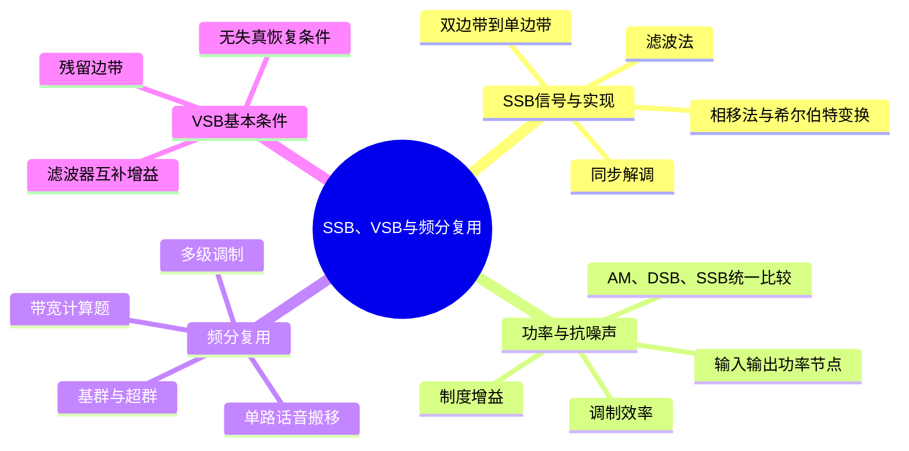

本课承接常规 AM 和 DSB。AM 保留载波与两个边带，DSB 去掉固定载波但仍保留两个边带；SSB 继续只保留一个边带，以减少带宽和发射功率。随后，SSB 被用于多路话音的频分复用；VSB 则在 SSB 的基础上保留一小段残余边带，用较容易实现的滤波器完成近似单边带传输。

## 一、SSB 从 DSB 中只保留一个边带

DSB 信号为

$$
s_{\mathrm{DSB}}(t)=m(t)\cos(\omega_ct),
$$

其中 $m(t)$ 是基带消息，$\omega_c$ 是载波角频率。若消息中有一个角频率为 $\omega_m$ 的余弦分量，积化和差公式给出

$$
\cos(\omega_mt)\cos(\omega_ct)
=\frac12\cos[(\omega_c+\omega_m)t]
+\frac12\cos[(\omega_c-\omega_m)t].
$$

因此，每个消息频率都会在载频两侧产生一对边频。保留 $\omega_c+\omega_m$ 一侧称为上边带（USB），保留 $\omega_c-\omega_m$ 一侧称为下边带（LSB）。若消息最高频率为 $f_H$，则

$$
B_{\mathrm{DSB}}=2f_H,
\qquad
B_{\mathrm{SSB}}=f_H.
$$

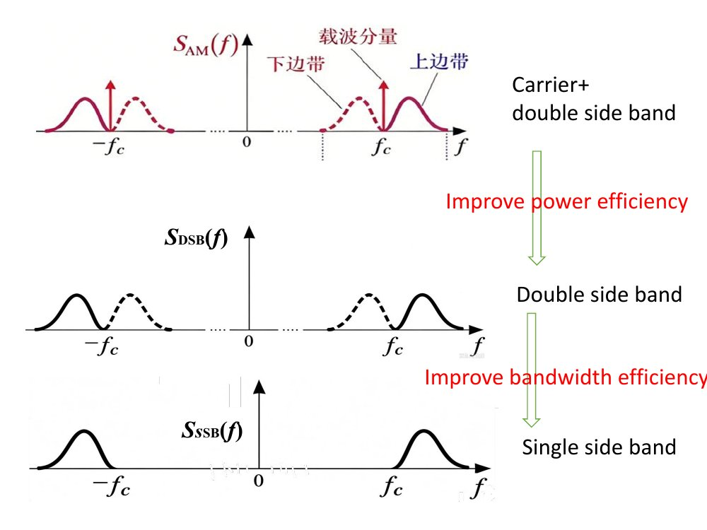

图中应先看正载频附近：AM 有载波谱线和上下边带，DSB 去掉载波谱线，SSB 再去掉其中一侧边带。负频率部分是实信号的对称频谱，不能把它误认为额外占用了一倍通信带宽。

SSB 不再发送独立载波，所以接收端不能只看高频波的包络，而要用同频同相本地载波相干解调。下面的两种发送方法得到相同的单边带信号，但解决滤波问题的方式不同。

## 二、SSB 的滤波法与相移法

### 1. 滤波法

发送端先用

$$
s_{\mathrm{DSB}}(t)=m(t)\cos(\omega_ct)
$$

生成 DSB，再用带通滤波器 $H(\omega)$ 选出上边带或下边带。接收端经过信道和带通滤波后，用同步载波相乘，再用低通滤波器恢复基带。

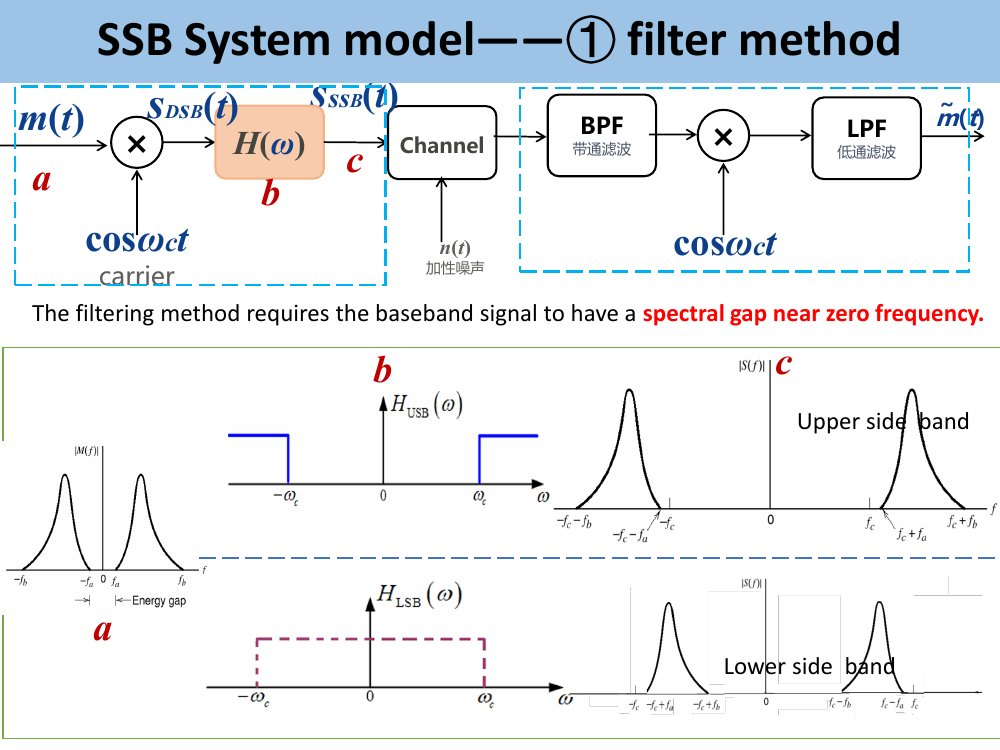

滤波法的难点在载频附近。如果基带频谱一直延伸到零频，上、下边带会在载频附近紧挨着，实际滤波器需要非常陡的过渡带。课件图中标出的基带零频附近频谱空隙，正是滤波法能够分离两边带的条件。

### 2. 相移法

相移法不依靠载频附近的陡峭滤波器，而是用两条正交支路让一个边带相加、另一个边带抵消。希尔伯特变换器 $H_h(\omega)$ 对消息产生九十度相移，课件采用的频域写法为

$$
H_h(\omega)=
\begin{cases}
-j,&\omega>0,\\
+j,&\omega<0,
\end{cases}
\qquad |H_h(\omega)|=1.
$$

记 $\hat m(t)$ 为 $m(t)$ 的希尔伯特变换。两路分别乘余弦载波和正弦载波，再在合成点取适当符号，可得

$$
\begin{aligned}
s_{\mathrm{USB}}(t)
&=\frac12m(t)\cos(\omega_ct)
-\frac12\hat m(t)\sin(\omega_ct),\\
s_{\mathrm{LSB}}(t)
&=\frac12m(t)\cos(\omega_ct)
+\frac12\hat m(t)\sin(\omega_ct).
\end{aligned}
$$

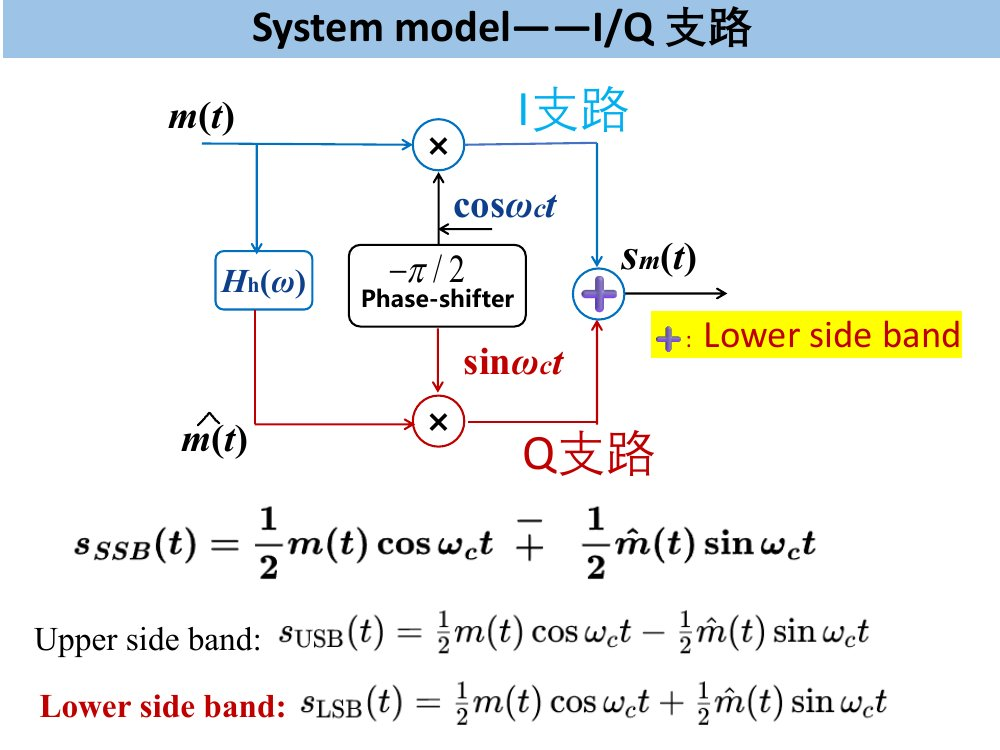

以单音 $m(t)=\cos(\omega_mt)$ 为例，上方 I 支路产生上、下边频各一份；Q 支路经移相后产生一份符号相反的上、下边频。合成点取减号时，上边带相加、下边带抵消；取加号时，留下下边带。对于多音消息，希尔伯特变换对每个频率分量分别提供所需的九十度相移，因此不需要某一个固定延时同时适配所有频率。

### 3. 同步解调与双音核对

课件的双音消息为

$$
m(t)=0.5\cos(2\pi\cdot1\,\mathrm{kHz}\,t)
+0.3\cos(2\pi\cdot2\,\mathrm{kHz}\,t),
\qquad f_c=20\,\mathrm{kHz}.
$$

若发送上边带，正频率一侧只留下 $21\,\mathrm{kHz}$ 和 $22\,\mathrm{kHz}$ 两条边频，时域 SSB 波的外包络不再严格等于 $|m(t)|$。接收端乘同步余弦并低通后，两个边频分别回到 $1\,\mathrm{kHz}$ 和 $2\,\mathrm{kHz}$，输出波形与消息同形，只差固定增益。

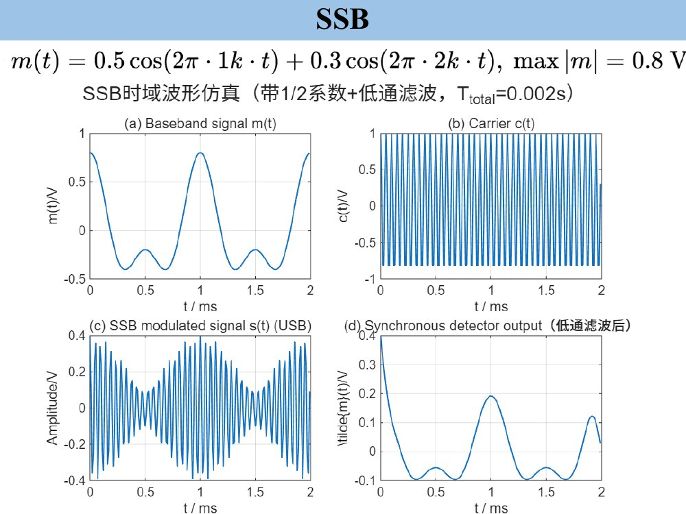

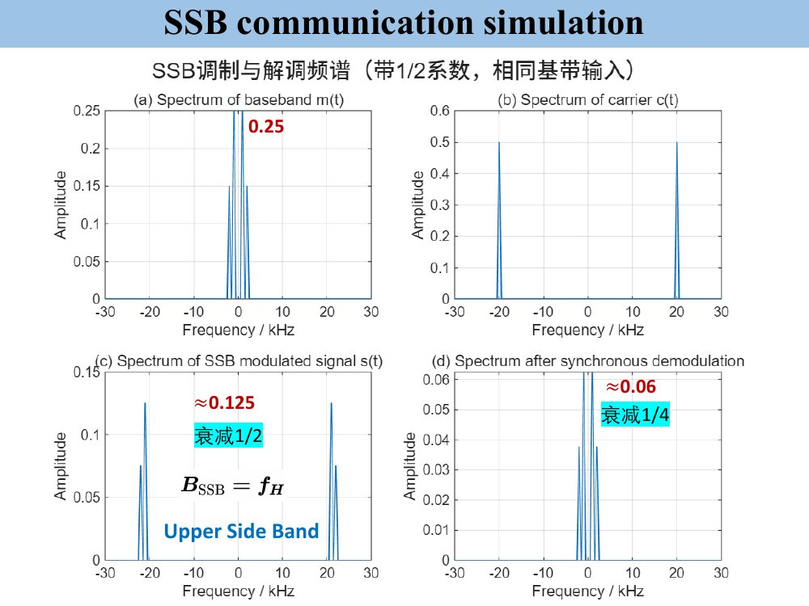

本课采用课件的 $1/2$ 系数约定。由

$$
s_{\mathrm{USB}}(t)=
\frac12m(t)\cos(\omega_ct)-\frac12\hat m(t)\sin(\omega_ct)
$$

乘以单位幅度本地载波并低通，第一项留下 $m(t)/4$，第二项只产生两倍载频附近分量。因此

$$
\tilde m(t)=\frac14m(t).
$$

这里的 $1/4$ 来自两次乘法各产生一次 $1/2$。接收机若增加固定增益，可以把恢复波形的幅度补回；固定增益不改变信噪比。

## 三、框图中的功率、效率与制度增益

这三项指标观察的位置不同：

- **调制效率 $\eta$** 看发送总功率中有多少用于承载消息的边带。
- **输入信噪比** 看接收带通滤波器之后、解调器之前的有用信号与带内噪声。
- **制度增益 $G$** 比较解调器输出和输入的信噪比。

### 1. 三种系统的功率表

设白噪声双边功率谱密度为 $n_0/2$。AM、DSB 的正频率接收带宽分别为 $2f_H$，SSB 为 $f_H$。表中同步解调器均采用单位幅度本地余弦，AM 采用大信噪比包络检波近似。

| 方式 | $P_{s,i}$ | $P_{n,i}$ | $(S/N)_i$ | $P_{s,o}$ | $P_{n,o}$ | $(S/N)_o$ | $G$ | $\eta$ |
|---|---:|---:|---:|---:|---:|---:|---:|---:|
| AM 包络检波 | $\dfrac{A_0^2+P_m}{2}$ | $2n_0f_H$ | $\dfrac{A_0^2+P_m}{4n_0f_H}$ | $P_m$ | $2n_0f_H$ | $\dfrac{P_m}{2n_0f_H}$ | $\dfrac{2P_m}{A_0^2+P_m}$ | $\dfrac{P_m}{A_0^2+P_m}$ |
| DSB 相干解调 | $\dfrac{P_m}{2}$ | $2n_0f_H$ | $\dfrac{P_m}{4n_0f_H}$ | $\dfrac{P_m}{4}$ | $\dfrac{n_0f_H}{2}$ | $\dfrac{P_m}{2n_0f_H}$ | $2$ | $1$ |
| SSB 相干解调 | $\dfrac{P_m}{4}$ | $n_0f_H$ | $\dfrac{P_m}{4n_0f_H}$ | $\dfrac{P_m}{16}$ | $\dfrac{n_0f_H}{4}$ | $\dfrac{P_m}{4n_0f_H}$ | $1$ | $1$ |

表中各项的来源如下。

对于 AM，发送信号为 $[A_0+m(t)]\cos(\omega_ct)$，输入有用功率为 $(A_0^2+P_m)/2$。包络检波、隔直后的消息为 $m(t)$，所以输出有用功率为 $P_m$。在大信噪比近似下，同相噪声直接进入输出，噪声功率不变。

对于 DSB，发送信号为 $m(t)\cos(\omega_ct)$，功率为 $P_m/2$。同步相乘并低通得到 $m(t)/2$，所以输出信号功率为 $P_m/4$；噪声留下同相分量的一半，功率变为输入的四分之一。

对于 SSB，发送信号只保留 DSB 的一个边带，功率为 $P_m/4$。同步相乘并低通得到 $m(t)/4$，所以输出信号功率为 $P_m/16$。SSB 接收带通正、负频率各只通过宽 $f_H$ 的一段，输入噪声为 $n_0f_H$。同步乘余弦后，每个基带频率只从一个通过的边带搬回，因此输出双边噪声谱高为 $n_0/8$，范围为 $[-f_H,f_H]$；谱面积为 $n_0f_H/4$，即输入噪声的四分之一。由此，信号和噪声功率都缩为输入的四分之一，$G_{\mathrm{SSB}}=1$。

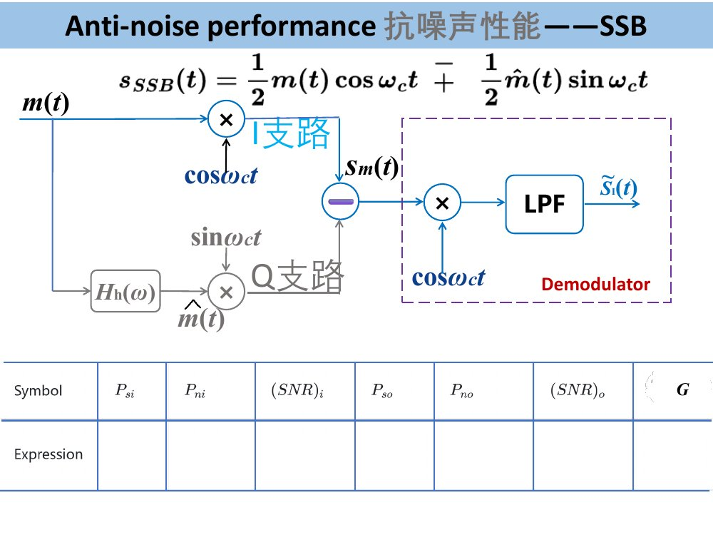

### 2. 调制效率与制度增益的区别

AM 的调制效率为

$$
\eta_{\mathrm{AM}}
=\frac{P_{\mathrm{SB}}}{P_c+P_{\mathrm{SB}}}
=\frac{P_m}{A_0^2+P_m},
$$

其中 $P_c=A_0^2/2$ 是独立载波功率，$P_{\mathrm{SB}}=P_m/2$ 是两个边带的总功率。DSB 去掉固定载波，SSB 又只保留一个边带，但保留下来的边带仍然全部用于传递消息，因此

$$
\eta_{\mathrm{DSB}}=\eta_{\mathrm{SSB}}=1.
$$

制度增益则由

$$
G=\frac{(S/N)_o}{(S/N)_i}
$$

定义。它不是发射功率利用率。对于 AM，在本表的输入输出口径和大信噪比条件下有 $G_{\mathrm{AM}}=2\eta_{\mathrm{AM}}$；这个关系不能直接套到 DSB 和 SSB。

### 3. 同消息功率与同发送功率的比较

若固定同一条消息 $P_m$，SSB 发送功率是 DSB 的一半，不能只比较两个 $G$ 就下结论。课件的 DSB 与 SSB 对照固定的是**相同发送功率 $S_i$、相同噪声谱密度和相同消息带宽**：

- DSB 带宽为 $2f_H$，输入噪声为 $2n_0f_H$，但 $G_{\mathrm{DSB}}=2$。
- SSB 带宽为 $f_H$，输入噪声为 $n_0f_H$，但 $G_{\mathrm{SSB}}=1$。

两者乘起来的输出信噪比相同：

$$
(S/N)_{o,\mathrm{DSB}}
=2\cdot\frac{S_i}{2n_0f_H}
=\frac{S_i}{n_0f_H},
$$

$$
(S/N)_{o,\mathrm{SSB}}
=1\cdot\frac{S_i}{n_0f_H}
=\frac{S_i}{n_0f_H}.
$$

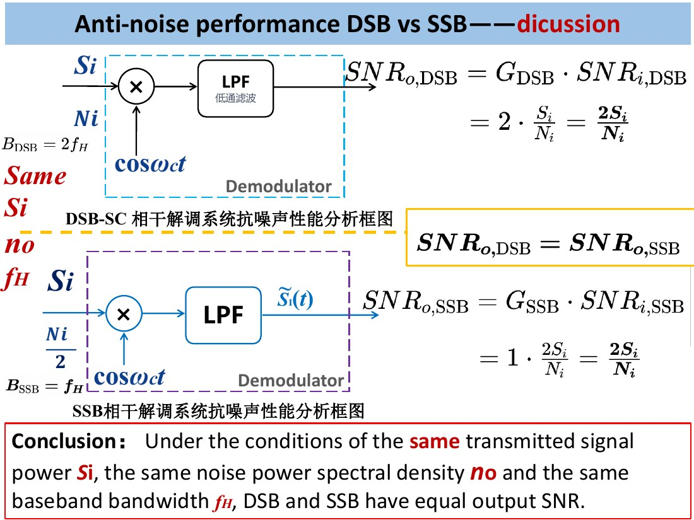

## 四、SSB 综合例题

题目给定：信道噪声双边功率谱密度为 $0.5\times10^{-3}\,\mathrm{W/Hz}$；发送 USB 信号功率为 $10\,\mathrm{kW}$；消息带宽为 $5\,\mathrm{kHz}$；载频为 $100\,\mathrm{kHz}$；解调器前有理想带通滤波器。求：

1. 理想带通滤波器的中心频率；
2. 解调器输入信噪比；
3. 解调器输出信噪比和输出噪声功率谱；
4. SSB 解调器的制度增益。

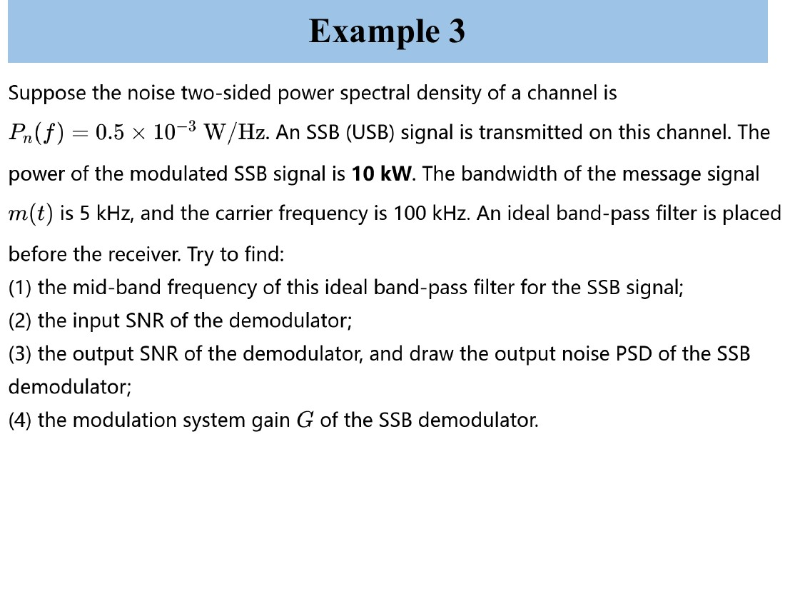

这是 USB，所以正频率通带为 $100$ 至 $105\,\mathrm{kHz}$，中心频率为

$$
f_{\mathrm{mid}}=\frac{100+105}{2}=102.5\,\mathrm{kHz}.
$$

两块正、负频率噪声通带各宽 $5\,\mathrm{kHz}$，所以

$$
N_i=2\times0.5\times10^{-3}\times5\times10^3=5\,\mathrm W.
$$

输入信噪比为

$$
(S/N)_i=\frac{10\,000}{5}=2000.
$$

按课件单位余弦解调的归一化，输出信号功率为输入的四分之一，输出噪声功率也为输入的四分之一：

$$
P_{so}=2500\,\mathrm W,
\qquad
P_{no}=1.25\,\mathrm W.
$$

于是

$$
(S/N)_o=\frac{2500}{1.25}=2000,
\qquad
G=\frac{2000}{2000}=1.
$$

输出噪声双边谱在 $-5$ 至 $5\,\mathrm{kHz}$ 内为

$$
\frac{n_0}{8}=0.125\times10^{-3}\,\mathrm{W/Hz},
$$

区间外为零。矩形面积为 $10\times10^3\times0.125\times10^{-3}=1.25\,\mathrm W$，与功率计算一致。

## 五、FDM：多路话音在频率上分开

单路话音都占据相同的基带频段。若直接相加，频谱会重叠，接收端无法分辨来源。频分复用的做法是：每路先用调制器搬到不同的非重叠频带，再相加；接收端按频带滤出各路，再分别解调。

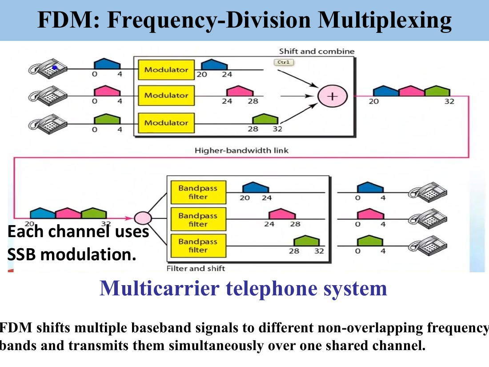

课件的电话系统中，每路话音带宽为 $4\,\mathrm{kHz}$，每路使用 SSB。图中三路分别占据 $20$ 至 $24$、$24$ 至 $28$、$28$ 至 $32\,\mathrm{kHz}$。SSB 使每路仍只占 $4\,\mathrm{kHz}$；若改用 DSB，每路要占 $8\,\mathrm{kHz}$，需要更宽的总频带。

### 基群与超群题

题目给定：每路话音占 $4\,\mathrm{kHz}$；一个基群含 $12$ 路，频率范围为 $60$ 至 $108\,\mathrm{kHz}$；$5$ 个基群组成一个超群，超群范围为 $312$ 至 $552\,\mathrm{kHz}$。

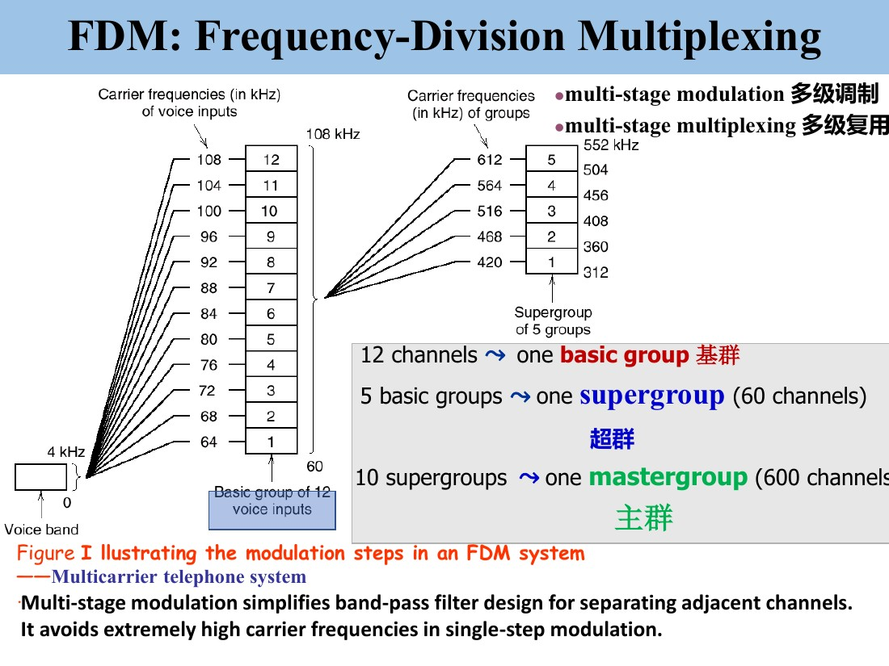

**第一问：基群带宽。**

$$
B_{\mathrm{basic}}=108-60=12\times4=48\,\mathrm{kHz}.
$$

**第二问：每路调制类型及原因。** 每路采用 SSB。每路话音带宽为 $4\,\mathrm{kHz}$，SSB 搬移后仍占 $4\,\mathrm{kHz}$，正好可以让 $12$ 路连续排列在 $48\,\mathrm{kHz}$ 的基群中；DSB 会使每路带宽变成 $8\,\mathrm{kHz}$。

**第三问：超群带宽。**

$$
B_{\mathrm{super}}=552-312=5\times48=240\,\mathrm{kHz}.
$$

超群含 $5\times12=60$ 路话音。

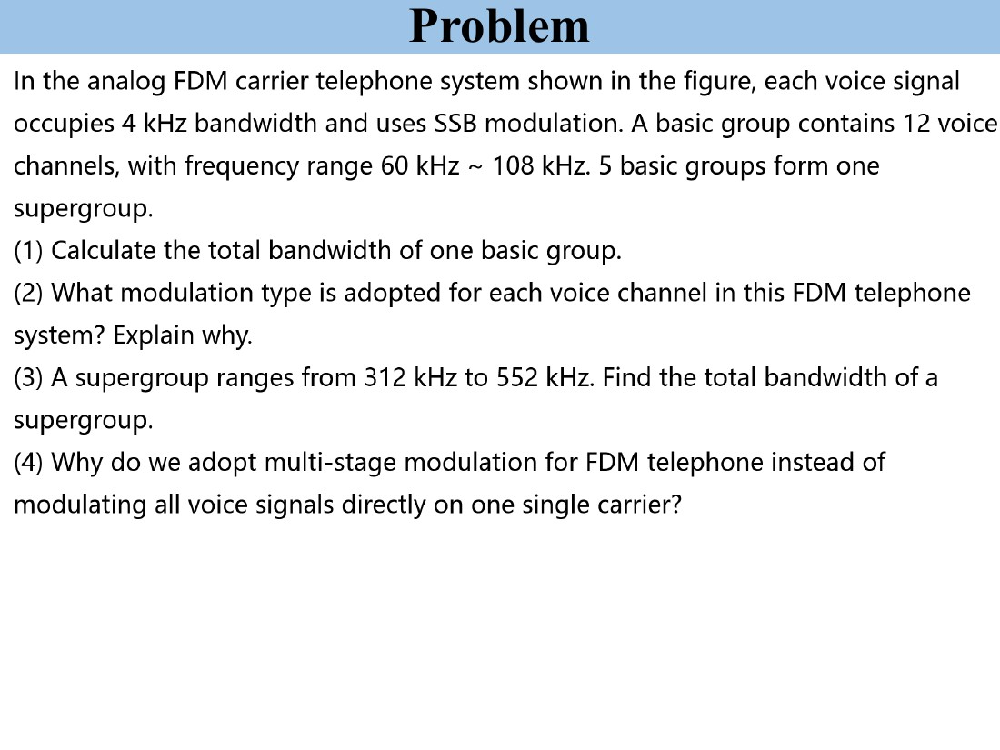

**第四问：多级调制的原因。** 先把固定数量的单路话音组成基群，再把基群整体搬移组成超群，可以重复使用分组、滤波和频率规划结构。若所有话音直接调制到同一个很高载频，载频间隔、带通滤波器设计和接收端分路都会更加困难。多级调制的核心是降低单级频率规划和滤波实现的复杂度，不改变“各路占用互不重叠频带”的基本原则。

## 六、VSB 的基本模型与无失真条件

VSB 的问题来自 SSB 的滤波器：SSB 需要在载频附近把一侧边带突然切掉，实际滤波器难以做到。VSB 保留一个主要边带，并在另一侧靠近载频处保留一小段残留边带，因此带宽略大于 SSB，但滤波器过渡带可以更平缓。

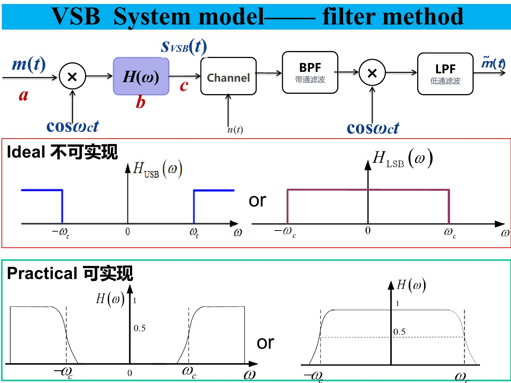

### 1. 从一个消息频率看两个滤波器增益

设消息中有角频率为 $\Omega$ 的分量。DSB 调制后，它出现在

$$
\omega_c+\Omega,
\qquad
\omega_c-\Omega.
$$

VSB 滤波器对这两个位置的增益可能不同。设它们的通过量分别为 $H(\omega_c+\Omega)$ 和 $H(\omega_c-\Omega)$。接收端同步相乘时，两条边频都会搬回同一个 $\Omega$，所以恢复分量的幅度与两者之和成正比。

例如一条音调的两条边频通过量为 $0.8$ 和 $0.2$，总通过量为 $1$；另一条音调的通过量为 $0.6$ 和 $0.4$，总通过量仍为 $1$。这样不同消息频率都获得相同总增益，波形不发生频率选择性失真。

### 2. 课件函数表达式的推导

第一次乘载波后的 DSB 频谱为

$$
S_{\mathrm{DSB}}(\omega)
=\frac12\left[M(\omega-\omega_c)+M(\omega+\omega_c)\right].
$$

VSB 滤波器输出为

$$
S_{\mathrm{VSB}}(\omega)=H(\omega)S_{\mathrm{DSB}}(\omega).
$$

接收端再乘 $\cos(\omega_ct)$，频谱平移为

$$
Y(\omega)=\frac12\left[S_{\mathrm{VSB}}(\omega-\omega_c)+S_{\mathrm{VSB}}(\omega+\omega_c)\right].
$$

低通滤波器去掉位于 $\pm2\omega_c$ 附近的项，只保留基带消息频率 $|\omega|\leq\omega_H$。将两条搬回基带的分量展开，得到

$$
\widetilde M(\omega)
=\frac14\left[H(\omega+\omega_c)+H(\omega-\omega_c)\right]M(\omega).
$$

若希望输出只是原消息乘一个与频率无关的固定增益，即

$$
\widetilde M(\omega)=\frac C4M(\omega),
$$

则必须满足

$$
\boxed{H(\omega+\omega_c)+H(\omega-\omega_c)=C,
\qquad |\omega|\leq\omega_H.}
$$

这就是课件要求掌握的 VSB 滤波器条件。它不是要求两个边带各自相同，也不是要求滤波器在所有频率都等于某个常数，而是要求**对每一个消息频率，载频两侧对应位置的增益之和相同**。课件图中一侧斜坡上升、另一侧对应斜坡下降，正是这个互补关系。

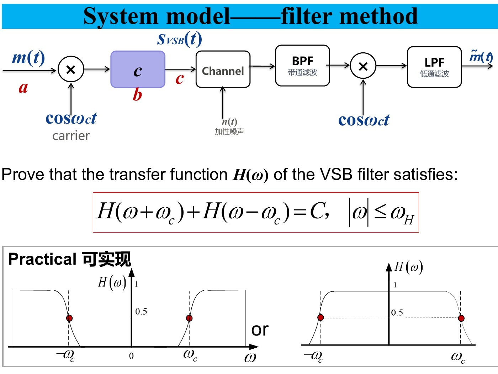

当图示取 $C=1$ 且滤波器关于频率对称时，载频处两侧位置重合，所以 $2H(\omega_c)=1$，即载频处增益为 $0.5$。但考试判断条件时，重点仍是整个 $|\omega|\leq\omega_H$ 范围内的增益和恒定。

## 七、本课与期中范围的统一对照

| 方式 | 发送端改变 | 接收端主要操作 | 载波是否独立发送 | 带宽 | 调制效率 | 解调特点 |
|---|---|---|---|---:|---:|---|
| AM | $[A_0+m(t)]\cos(\omega_ct)$ | 包络检波、隔直 | 是 | $2f_H$ | $\dfrac{P_m}{A_0^2+P_m}$ | 电路简单，但有过调制和门限效应 |
| DSB-SC | $m(t)\cos(\omega_ct)$ | 同步相乘、低通 | 否 | $2f_H$ | $1$ | 需要载波同步 |
| SSB | DSB 后滤波或相移抵消一侧 | 同步相乘、低通 | 否 | $f_H$ | $1$ | 带宽和功率利用率高 |
| VSB | DSB 后保留主边带和残留边带 | 同步相乘、低通 | 视具体系统而定 | 略大于 $f_H$、小于 $2f_H$ | 由滤波器和系统约定确定 | 关键是两侧增益之和恒定 |

FDM 不与 AM、DSB、SSB、VSB 处于同一分类层级。前四者是调制方式，FDM 是把多路信号安排到互不重叠频带的复用方法；课件中的电话系统使用 SSB 作为每一路的调制方式，再用 FDM 把多路组合成基群和超群。

到这里，本课程期中范围在第四章第十讲结束。FM 及角度调制属于后续期末范围，不并入本课。

## 课件与图示来源

- [[PPT/第十讲/第十讲 SSB communication system学生版.pptx]]
- [[第4章 10 第10课 常规调幅与包络检波]]：AM 模型、包络检波、效率与制度增益。
- [[第4章 11 第11课 DSB双边带调制与相干解调]]：DSB 相干解调、噪声分析与 I/Q 支路。
- [[README|通信原理学习笔记]]
