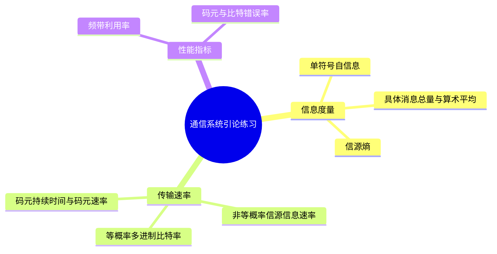

# 第1章 第二讲 英汉对照练习解析

## 内容概要

来源：[[PPT/第二讲/第二讲例题.docx]]、[[PPT/第二讲/第二讲课堂学习单.docx]]。例题共 5 题，按原文件的两个知识单元编排，保留各单元原编号。学习单的两张公式表另列在本篇末尾，供核对英文术语。数学排版已规范化，英文题干的已知条件与设问保留。

学校第二讲对应笔记第 3、4 课，不能把“第二讲”误当成“第 2 课”。返回[[练习解析/第二讲至第六讲 练习解析索引]]。

## 一 信息及其度量

### 1.3 Example 1 二元等概率信源的自信息

**English original**

Example 1: there is a binary discrete source, if $p(0)=p(1)=1/2$, then

$$
I(0)=\underline{\qquad};\qquad I(1)=\underline{\qquad}.
$$

**中文对照**

有一个二元离散信源，若 $p(0)=p(1)=1/2$，求符号 $0$、$1$ 各自的信息量。

**词语辨认**：binary（二元的）；discrete source（离散信源）；amount of information（信息量）。

**解析与方法**

两个结果同样可能，收到一个结果就消除一次二选一的不确定性。自信息把发生前的概率换算成信息量，概率越小，结果越意外。用二为底时单位为比特：

$$
I(x)=-\log_2p(x),\qquad I(0)=I(1)=-\log_2\frac12=1\ \mathrm{bit}.
$$

这里算的是某个符号发生时带来的信息量，不是每秒的信息量。

**笔记对应**：[[第1章 03 第3课 信息及其度量#概率与自信息的对应关系]]，已覆盖。

### 1.3 Example 2 一条消息的总信息量

**English original**

Example 2: A source has three symbols A, B, C with probabilities:

$$
p(A)=1/2,\qquad p(B)=1/4,\qquad p(C)=1/4.
$$

A 10-symbol message: A A B C A B A C A A. Find the total information of this message.

**中文对照**

信源有三个符号 A、B、C，其概率分别为 $1/2,1/4,1/4$。一条含 10 个符号的消息是 A A B C A B A C A A，求这条消息的总信息量。

**词语辨认**：symbol（符号）；probability（概率）；10-symbol message（含十个符号的消息）；total information（总信息量）。

**解析与方法**

先把每种符号的概率换成信息量，再按这条消息中实际出现的次数累加。数得 A 出现 6 次，B、C 各出现 2 次；每个 A 带来 1 bit，每个 B、C 带来 2 bit，因此

$$
I_{\mathrm{total}}=6\times1+2\times2+2\times2=14\ \mathrm{bit}.
$$

课程在这里采用无记忆信源的逐符号相加模型；若符号存在依赖，完整序列的信息量应由序列联合概率决定。也不能把符号实际出现次数换成理论概率：本条消息的算术平均为 $14/10=1.4\ \mathrm{bit/symbol}$，而信源熵为 $1.5\ \mathrm{bit/symbol}$，两者不必相等。

**笔记对应**：[[第1章 03 第3课 信息及其度量#一条消息的总信息量]]已含同题；原笔记未单列消息算术平均和熵的对照，原覆盖不合格，已补入[[第1章 03 第3课 信息及其度量#具体消息的算术平均与信源熵]]。

### 1.3 Example 3 四符号非等概率信源的熵

**English original**

Example 3: A discrete source has four possible symbols $x_1,x_2,x_3,x_4$ with probabilities:

$$
p(x_1)=1/4,\quad p(x_2)=1/8,\quad p(x_3)=1/8,\quad p(x_4)=1/2.
$$

Find the entropy of this source (in bits per symbol).

**中文对照**

离散信源有四个可能符号，概率依次为 $1/4,1/8,1/8,1/2$。求信源熵，单位为比特每符号。

**词语辨认**：possible（可能的）；entropy（熵）；bits per symbol（每符号的比特数）。

**解析与方法**

这次没有给某条具体消息，要求的是信源长期平均。四个符号的自信息分别为 2、3、3、1 bit，用各自概率加权：

$$
H(X)=\frac14\times2+\frac18\times3+\frac18\times3+\frac12\times1
=1.75\ \mathrm{bit/symbol}.
$$

只有四符号等概率时才达到 $log_2 4=2\ \mathrm{bit/symbol}$；“四个符号”本身不足以使用该结果。

**笔记对应**：[[第1章 03 第3课 信息及其度量#从一条消息走向信源的平均信息量]]，已含同题。

## 二 通信系统性能指标

### 1.4 Example 1 八进制系统的两种速率

**English original**

Example 1: In a digital communication system, the symbol duration is $T=0.2\ \mathrm{ms}$. The system adopts octal transmission (each symbol carries 3 bits of information).

1. Calculate the symbol rate $R_B$ (Baud).
2. Calculate the information bit rate $R_b$ (bit/s).

**中文对照**

数字通信系统的码元持续时间为 $0.2\ \mathrm{ms}$，采用八进制传输，每个码元携带 3 bit 信息。求：（1）码元速率，单位为波特；（2）信息比特率，单位为比特每秒。

**词语辨认**：duration（持续时间）；adopt（采用）；octal（八进制的）；carry（携带）；symbol rate（码元速率）；bit rate（比特率）。

**解析与方法**

码元速率数的是每秒发多少个码元，先把毫秒换成秒。比特率则把每个码元携带的比特数也算进去：

$$
T=0.2\times10^{-3}\ \mathrm s,\qquad
R_B=\frac1T=5000\ \mathrm{Bd},
$$

$$
R_b=R_B\log_2 8=5000\times3=15000\ \mathrm{bit/s}.
$$

两种速率的数值不同，原因是一个八进制码元能表示三位二进制数据。

**笔记对应**：[[第1章 04 第4课 通信系统的性能指标#例一：码元速率与信息速率]]，已含同题。

### 出门测 非等概率信源的平均信息速率

**English original**

Suppose that an information source is composed of 4 different symbols, with the probabilities of $1/4$, $1/8$, $1/8$ and $1/2$. If the source sends out 2400 independent symbols per second, try to find the average information rate of the information source.

**中文对照**

信源由四种不同符号组成，概率依次为 $1/4,1/8,1/8,1/2$。信源每秒发出 2400 个相互独立的符号，求平均信息速率。原文件标注为“2024 期末”。

**词语辨认**：be composed of（由……组成）；independent（相互独立的）；per second（每秒）；average information rate（平均信息速率）。

**解析与方法**

先求每个符号平均携带多少信息，再乘每秒符号数。前面的四符号熵题已经给出 $H(X)=1.75\ \mathrm{bit/symbol}$，所以

$$
R_{\mathrm{info}}=2400\times1.75=4200\ \mathrm{bit/s}.
$$

若机械套用 $2400\log_2 4=4800$，算到的是每符号固定用两位编码时的数据位速率，不是该非等概率信源的平均信息速率。题中的独立性使逐符号熵可以直接表示每符号信息率。

**笔记对应**：[[第1章 03 第3课 信息及其度量#典型练习]]、[[第1章 04 第4课 通信系统的性能指标#例三：由概率计算平均信息速率]]，均已覆盖。

## 三 课堂学习单的公式与英文术语

### Table 1 信息量四种口径

学习单此处是已有公式表，并非另加数值题。原表主要英文栏目如下，中文与数学含义列在其后。

| English original | 中文对照 | 公式与观察对象 |
|---|---|---|
| Amount of information | 单符号信息量 | $I(x_i)=-\log_2p(x_i)$，某个结果出现时的信息量 |
| Total information | 具体消息总信息量 | $I_{\mathrm{total}}=\sum_i n_iI(x_i)$，$n_i$ 为实际次数 |
| Average information (arithmetic mean) | 具体消息的算术平均信息量 | $\bar I=I_{\mathrm{total}}/N$，$N$ 为消息符号总数 |
| Entropy | 信源熵 | $H(X)=\sum_i p(x_i)I(x_i)$，按理论概率平均 |

用本篇 Example 2 检查：总量为 14 bit，消息算术平均为 1.4 bit/symbol，信源熵为 1.5 bit/symbol。原表写“消息长度趋于无穷时，算术平均趋于熵”，需要独立同分布等保证经验频率收敛的条件，不能推广到任意长序列。

**笔记对应**：[[第1章 03 第3课 信息及其度量#具体消息的算术平均与信源熵]]，已补齐条件和对照。

### Table 2 六项数字通信性能指标

| English original | 中文对照 | 正确公式 |
|---|---|---|
| Symbol rate | 码元速率 | $R_s=1/T_s$，单位 $\mathrm{Bd}$ |
| Bit rate | 比特率 | 等概率多进制时 $R_b=R_s\log_2M$ |
| Symbol spectral efficiency | 码元频带利用率 | $\eta_s=R_s/B$ |
| Bit spectral efficiency | 比特频带利用率 | $\eta_b=R_b/B$ |
| Symbol error rate | 误符号率 | $P_s=N_{\mathrm{symbol,error}}/N_{\mathrm{symbol,total}}$ |
| Bit error rate | 误比特率 | $P_b=N_{\mathrm{bit,error}}/N_{\mathrm{bit,total}}$ |

原表的两个错误率把“总数”和“错误数”的分子分母写反，以上已纠正。原表还把多进制情况写成严格的 $P_b<P_s$，也不够准确：每个码元映射成 $k=\log_2M$ 位时，一个错码元可能错一位到 $k$ 位，因此

$$
\frac{P_s}{k}\le P_b\le P_s.
$$

上界可以取等号；高信噪比、格雷映射并以相邻符号错误为主时，才常用 $P_b\approx P_s/k$。不要把近似关系用于所有映射。

**笔记对应**：[[第1章 04 第4课 通信系统的性能指标#数字通信系统的码元速率与信息速率]]、[[第1章 04 第4课 通信系统的性能指标#数字通信系统的错误概率指标]]。原笔记公式方向正确，现已补上上述一般界限与原表勘误。
