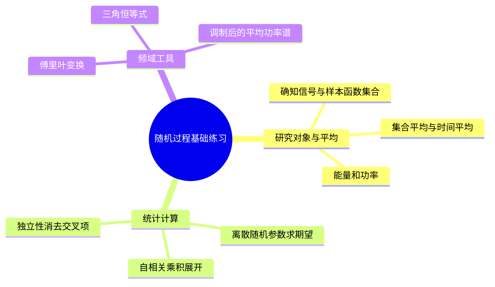
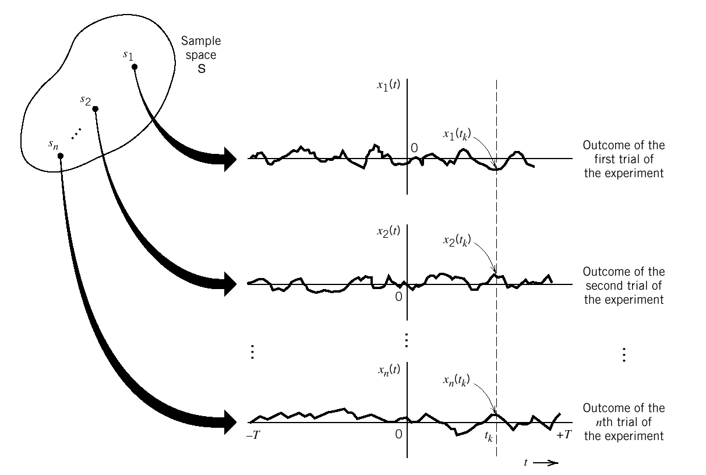

# 第2章 第三讲 英汉对照练习解析

## 内容概要

来源：[[PPT/第三讲/(需打印）第三讲 课堂练习 学生版.docx]]的 3 道例题，以及[[PPT/第三讲/（需打印）第三讲 课堂材料.docx]]的对照表、两张公式填空表和随机相位余弦的集合与时间平均表。对应笔记第 5 课；平稳性和遍历性的完整条件还需接第 6 课。返回[[练习解析/第二讲至第六讲 练习解析索引]]。

## 一 随机过程的统计计算

### Example 1 离散随机相位余弦

**English original**

Let the stochastic process $\xi(t)$ be expressed as $\xi(t)=2\cos(2\pi t+\theta)$, where $\theta$ is a discrete random variable. $P(\theta=0)=1/2$, $P(\theta=\pi/2)=1/2$.

Compute: (1) The mean value $E_\xi(\xi(1))$. (2) The auto-correlation function $R_\xi(0,1)$.

Formula reminder for discrete random variable expectation:

$$
E[X(t)]=\sum_{i=1}^K x_iP(x_i).
$$

**中文对照**

随机过程 $\xi(t)=2\cos(2\pi t+\theta)$，其中离散随机变量 $\theta$ 以相同概率取 $0$ 或 $\pi/2$。求：（1）时刻 $t=1$ 的均值；（2）时刻 $0$、$1$ 之间的自相关函数值。提示：离散变量的期望等于各可能值乘对应概率后求和。

**词语辨认**：stochastic process（随机过程）；be expressed as（表示为）；mean value（均值）；auto-correlation function（自相关函数）；expectation（期望）。

**解析与方法**

同一次实验中相位一旦选定，就一直用于整条波形，不能到另一个时刻重新独立抽取相位。代入两个时刻，有 $\xi(0)=\xi(1)=2\cos\theta$。

| 相位 | 概率 | $\xi(1)$ | $\xi(0)\xi(1)$ |
|---|---|---|---|
| $0$ | $1/2$ | $2$ | $4$ |
| $\pi/2$ | $1/2$ | $0$ | $0$ |

对最后两列分别取概率平均：

$$
E[\xi(1)]=\frac12\times2+\frac12\times0=1,
\qquad R_\xi(0,1)=\frac12\times4+\frac12\times0=2.
$$

不能把相关值写成两个均值相乘，因为两个时刻共用同一个随机相位，并不独立。这个过程的均值为 $\cos(2\pi t)-\sin(2\pi t)$，随时间改变，因此也不能未经检查就把两时刻自相关改写成平稳形式。

**笔记对应**：[[第2章 05 第5课 从确知信号到随机过程#例题一：离散随机相位余弦]]，已含同题。

### Example 2 独立高斯系数构成的正弦过程

**English original**

Let $X_1$ and $X_2$ be statistically independent Gaussian distributed random variables, each with zero mean and variance $\sigma^2$. Define the Gaussian process

$$
X(t)=X_1\cos(\omega_0t)+X_2\sin(\omega_0t).
$$

Find the mean value $\mu_X(t)$ and auto-correlation function $R_X(t_1,t_2)$.

Given Conditions: $E[X_1]=E[X_2]=0$; $D(X_1)=D(X_2)=\sigma^2$; $X_1$ and $X_2$ are independent, so $E[X_1X_2]=E[X_1]E[X_2]=0$; $E[X_1^2]=E[X_2^2]=\sigma^2$.

**中文对照**

随机变量 $X_1,X_2$ 相互统计独立，均服从零均值、方差为 $\sigma^2$ 的高斯分布。定义上式随机过程，求其均值和两时刻自相关函数。原题提示：独立使交叉乘积期望为零；零均值使均方值等于方差。

**词语辨认**：statistically independent（统计独立）；Gaussian distributed（服从高斯分布）；variance（方差）；each（各自）；define（定义）。

**解析与方法**

先看清随机性在哪里：每次实验抽取一对 $X_1,X_2$，这对数值在整条样本波形中保持不变；$\cos(\omega_0t)$ 和 $\sin(\omega_0t)$ 则是由时刻 $t$ 确定的系数。求均值时，期望可以分配到和式的两项，确定系数可以移到期望号外：

$$
\begin{aligned}
\mu_X(t)
&=E[X(t)]\\
&=E[X_1\cos(\omega_0t)+X_2\sin(\omega_0t)]\\
&=\cos(\omega_0t)E[X_1]+\sin(\omega_0t)E[X_2]\\
&=\cos(\omega_0t)\cdot0+\sin(\omega_0t)\cdot0=0.
\end{aligned}
$$

自相关比较**同一次实验**在 $t_1$、$t_2$ 的两个取值。先分别写出它们，再相乘；两个时刻共用同一对 $X_1,X_2$，所以乘积里会出现平方项和交叉项。为让四项都能看见，暂记 $c_1=\cos(\omega_0t_1)$、$s_1=\sin(\omega_0t_1)$，$c_2=\cos(\omega_0t_2)$、$s_2=\sin(\omega_0t_2)$。这些都是确定数，不是随机变量。于是

$$
\begin{aligned}
R_X(t_1,t_2)
&=E[X(t_1)X(t_2)]\\
&=E[(X_1c_1+X_2s_1)(X_1c_2+X_2s_2)]\\
&=E[X_1^2c_1c_2+X_1X_2c_1s_2+X_2X_1s_1c_2+X_2^2s_1s_2]\\
&=E[X_1^2]c_1c_2+E[X_1X_2]c_1s_2
  +E[X_2X_1]s_1c_2+E[X_2^2]s_1s_2.
\end{aligned}
$$

现在分别处理这四个期望。**独立性只用于两个不同随机变量的乘积**：$E[X_1X_2]=E[X_1]E[X_2]=0$，而 $E[X_2X_1]$ 是同一个乘积，也等于零。对平方项不能写成 $E[X_i]^2$，要从方差定义 $D(X_i)=E[X_i^2]-E[X_i]^2$ 得出：因 $E[X_i]=0$，所以 $E[X_1^2]=E[X_2^2]=\sigma^2$。四项逐一代回，得到

$$
\begin{aligned}
R_X(t_1,t_2)
&=\sigma^2c_1c_2+0\cdot c_1s_2+0\cdot s_1c_2+\sigma^2s_1s_2\\
&=\sigma^2[\cos(\omega_0t_1)\cos(\omega_0t_2)
 +\sin(\omega_0t_1)\sin(\omega_0t_2)].
\end{aligned}
$$

括号内是余弦差角公式 $\cos(\alpha-\beta)=\cos\alpha\cos\beta+\sin\alpha\sin\beta$，取 $\alpha=\omega_0t_1$、$\beta=\omega_0t_2$，最终得到

$$
\boxed{\mu_X(t)=0,\qquad R_X(t_1,t_2)=\sigma^2\cos[\omega_0(t_1-t_2)]}.
$$

取 $t_1=t_2$ 检查，得到 $R_X(t,t)=\sigma^2$，正是任意时刻的均方值。均值恒为零、自相关只依赖时间差且二阶矩有限，所以过程宽平稳。题设的高斯性没有参与上述均值和自相关的计算；它进一步说明任意时刻的联合分布也由这些一、二阶统计量确定，因此本过程还严平稳。

**笔记对应**：[[第2章 05 第5课 从确知信号到随机过程#例题二：独立高斯变量构成的正弦过程]]及[[第2章 06 第6课 平稳性、高斯随机过程与线性系统#高斯过程由宽平稳推出严平稳的条件]]，已覆盖。

### Example 3 随机脉冲序列的余弦调制

**English original**

Let $s(t)$ be a stationary random pulse sequence with power spectral density $P_s(f)$. Find the power spectral density $P_e(f)$ of the modulated signal $e(t)=s(t)\cos\omega_0t$.

**中文对照**

平稳随机脉冲序列 $s(t)$ 的功率谱密度为 $P_s(f)$，求调制后信号 $e(t)=s(t)\cos\omega_0t$ 的功率谱密度。

**词语辨认**：stationary（平稳的）；pulse sequence（脉冲序列）；power spectral density，PSD（功率谱密度）；modulated signal（已调信号）。

**解析与方法**

余弦调制把基带谱搬到正、负载频附近，但功率系数必须从相关函数推出。记 $f_0=\omega_0/(2\pi)$，把两个输出样值相乘并对随机输入取平均：

$$
\begin{aligned}
R_e(t,t+\tau)
&=R_s(\tau)\cos(\omega_0t)\cos[\omega_0(t+\tau)]\\
&=\frac12R_s(\tau)\{\cos(\omega_0\tau)+\cos(2\omega_0t+\omega_0\tau)\}.
\end{aligned}
$$

这里仍有绝对时间 $t$，所以固定相位载波调制后的过程一般不宽平稳。原题通常要求的是对载波周期作时间平均后的功率谱：倍频项时间平均为零，留下

$$
\bar R_e(\tau)=\frac12R_s(\tau)\cos(2\pi f_0\tau).
$$

再用 $\cos(2\pi f_0\tau)=[e^{j2\pi f_0\tau}+e^{-j2\pi f_0\tau}]/2$，每个指数把谱移到一个载频，总系数为 $1/2\times1/2$：

$$
\boxed{\bar P_e(f)=\frac14[P_s(f-f_0)+P_s(f+f_0)]}.
$$

若改用与输入独立的均匀随机载波相位，也能得到同一结果，并可在通常的宽平稳意义下使用。两个谱副本各乘四分之一，总功率为输入的一半，正好对应余弦平方的时间平均为二分之一。

**笔记对应**：[[第2章 05 第5课 从确知信号到随机过程#例题三：随机脉冲序列的余弦调制]]原有答案但未完整展示固定相位下的非平稳项，原覆盖不充分，已补齐推导和平均谱的适用条件。

## 二 课堂材料中的概念对照与填表

### Table 1 Deterministic Signals vs Random Processes

**English original**：Table 1 Deterministic Signals vs Random Processes. 原文件的具体比较项用中文给出，并附确定波形、随机波形与多条样本路径图，没有额外英文设问。

**中文对照**：表 1 确知信号与随机过程。沿同一个时间点比较：确定波形给出唯一值；随机过程则要在所有可能实验结果中比较不同值。下图保留原材料的样本路径关系，先看左侧不同实验结果，再看各自生成的整条曲线。

| 比较内容 | 确知信号 | 随机过程 |
|---|---|---|
| 核心本质与描述方法 | 一条给定时间函数 $s(t)$ | 波形及其概率规律，用 $X(t,\xi)$ 表示 |
| 固定时刻的取值 | 唯一确定 | 一般为随机变量 |
| 波形数量 | 一条 | 可有多条样本路径；不一定必须有无穷多条 |
| 能量和功率 | 对该波形积分或作时间平均 | 平稳有限二阶矩模型常用均方值和 PSD 描述平均功率 |
| 可预测性 | 给定模型可算出瞬时值 | 一般不能预知下一次实现，但可描述统计规律 |

原表“有无穷多条样本波形”不是定义必要条件。Example 1 只有两个随机相位，也就是两条可能波形，仍是随机过程。原表“平稳随机过程是功率信号”按课程常见的有限、非零平均功率模型理解，不应套到无限方差或零过程等情况。

**笔记对应**：[[第2章 05 第5课 从确知信号到随机过程#二、确知信号与随机过程的区别]]原有对照；[[第2章 05 第5课 从确知信号到随机过程#能量信号与功率信号的判定]]原来缺少判据，已补齐。

### Table 2 Fourier Transforms of Typical Signals

**English original**：Fourier Transforms of Typical Signals. Columns: time-domain $f(t)$; frequency-domain $F(\omega)$. Fill the frequency-domain results for $\delta(t)$, $1$, $e^{j\omega_0t}$, $\operatorname{sgn}(t)$, $\cos(\omega_0t)$, $\sin(\omega_0t)$ and $e^{-a|t|}$.

原表英文只有标题；上面的 Columns 和 Fill 句是为完整读题补写的英文说明，并非原文新增设问。原表每一行频域栏均为空。

**中文对照**：典型信号的傅里叶变换表。按角频率约定填出以上七个时域信号的频域结果，其中 $a>0$。

采用 $F(\omega)=\int_{-\infty}^{\infty}f(t)e^{-j\omega t}\,\mathrm dt$：

| 时域原题 | 频域填空答案 |
|---|---|
| $\delta(t)$ | $1$ |
| $1$ | $2\pi\delta(\omega)$ |
| $e^{j\omega_0t}$ | $2\pi\delta(\omega-\omega_0)$ |
| $\operatorname{sgn}(t)$ | $2/(j\omega)$，按主值分布理解 |
| $\cos(\omega_0t)$ | $\pi[\delta(\omega-\omega_0)+\delta(\omega+\omega_0)]$ |
| $\sin(\omega_0t)$ | $j\pi[\delta(\omega+\omega_0)-\delta(\omega-\omega_0)]$ |
| $e^{-a\lvert t\rvert}$ | $2a/(a^2+\omega^2)$ |

**解析与方法**：冲激变换为常数，直流变换为零频冲激；复指数只有一个频率，正弦、余弦则先用欧拉公式拆成两个复指数。最后一行应在零点拆成两段积分，分别得到 $1/(a+j\omega)$ 和 $1/(a-j\omega)$，相加得到表中结果。负时间一侧也必须衰减，所以不能漏掉绝对值。

**笔记对应**：[[第2章 05 第5课 从确知信号到随机过程#1. 常用傅里叶变换]]。原笔记将最后一行误写为 $e^{-at}$，与答案不符，属笔记不合格项，现已改为 $e^{-a|t|}$ 并补充推导。

### Table 3 常用三角函数公式填空

**English original**：Type; Formula.

| Type 原栏目 | Formula 原题空格 |
|---|---|
| Product-to-sum | $\cos\alpha\cos\beta=\underline{\qquad}$ |
| Product-to-sum | $\sin\alpha\sin\beta=\underline{\qquad}$ |
| Double-angle formulas | $\sin2\alpha=\underline{\qquad}$ |
| Power-reduction identities | $\cos^2\alpha=\underline{\qquad}$ |
| Power-reduction identities | $\sin^2\alpha=\underline{\qquad}$ |
| Basic Pythagorean identity | $\sin^2\alpha+\cos^2\alpha=\underline{\qquad}$ |

**中文对照**：依次补全两条积化和差、一条二倍角、两条降幂和一条基本平方恒等式。

$$
\begin{aligned}
\cos\alpha\cos\beta&=\frac12[\cos(\alpha-\beta)+\cos(\alpha+\beta)],\\
\sin\alpha\sin\beta&=\frac12[\cos(\alpha-\beta)-\cos(\alpha+\beta)],\\
\sin2\alpha&=2\sin\alpha\cos\alpha,\\
\cos^2\alpha&=\frac12(1+\cos2\alpha),\\
\sin^2\alpha&=\frac12(1-\cos2\alpha),\\
\sin^2\alpha+\cos^2\alpha&=1.
\end{aligned}
$$

**解析与方法**：积化和差把“两个样值相乘”改写成和频、差频项，便于判断哪些项周期平均为零。降幂把平方改写为直流与倍频项，直接用于计算余弦平均功率。检查符号时可令 $\alpha=\beta=0$：第一行应得 1，第二行应得 0。

**笔记对应**：[[第2章 05 第5课 从确知信号到随机过程#2. 常用三角公式]]，六项均已覆盖。

### Ensemble vs Time Average of Random-Phase Cosine

**English original**

Ensemble vs Time Average of Random-Phase Cosine.

$$
X(t)=A\cos(\omega_ct+\Theta),\qquad \Theta\sim U[-\pi,\pi].
$$

Columns: Ensemble (Statistical) Properties; Time-Averaged Properties (Single Sample Path). Quantity: Mean; Autocorrelation function; Power spectral density. The sample path is $x(t)=A\cos(\omega_ct+\theta)$, where $\theta$ is one fixed realization. Fill the two columns.（最后一句为补写的读表说明。）

**中文对照**

随机相位余弦的集合平均与时间平均。相位在 $[-\pi,\pi]$ 均匀分布，单次实现的相位固定。分别补出过程总体与单条样本的均值、自相关函数和功率谱密度。按原表通常假设 $A$ 为确定常数、$\omega_c\ne0$。

**词语辨认**：ensemble（总体、集合）；single sample path（单条样本路径）；realization（一次实现）；time-averaged（经时间平均的）。

| 物理量 | 集合统计结果 | 单条样本的时间平均结果 |
|---|---|---|
| Mean | $E[X(t)]=0$ | $\overline x=0$ |
| Autocorrelation function | $R_X(\tau)=A^2\cos(\omega_c\tau)/2$ | $\overline{x(t)x(t+\tau)}=A^2\cos(\omega_c\tau)/2$ |
| Power spectral density，普通频率 | $P_X(f)=A^2[\delta(f-f_c)+\delta(f+f_c)]/4$ | 同左 |

**解析与方法**

集合平均沿相位积分：均匀相位让余弦在一整圈中正负抵消；相关函数的积化和差中，含两倍随机相位的项也平均为零。时间平均则固定相位，让时间走过许多周期，抵消的是随时间振荡的项。两条不同的平均途径给出相同均值与相关函数，说明它具有均值、相关遍历性。不能仅凭这些二阶结果就声称任意过程的全部统计量都遍历。

**笔记对应**：[[第2章 05 第5课 从确知信号到随机过程#随机相位余弦的集合平均与时间平均对照]]。原笔记分别给过周期信号与随机相位结果，但遗漏原材料要求的并列填表及条件，已补齐。
