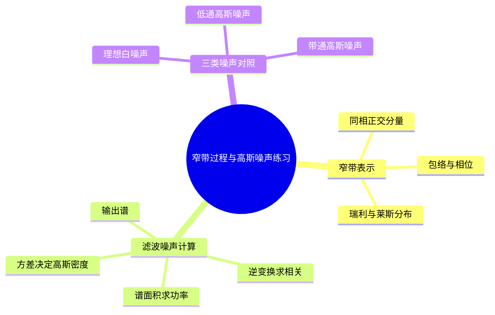
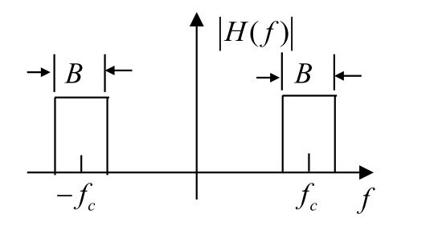
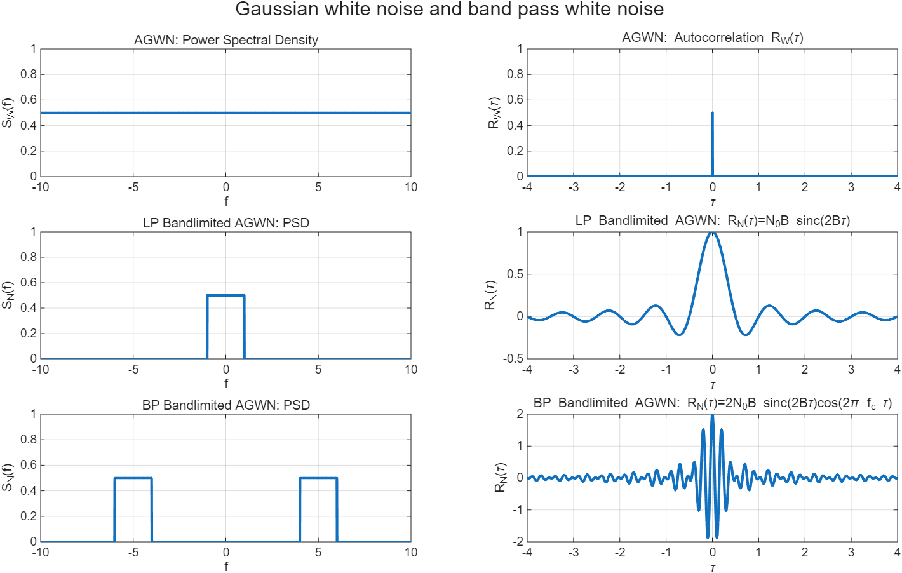

# 第2章 第五讲 英汉对照练习解析

## 内容概要

来源：[[PPT/第五讲/(需打印）第五讲 课堂练习及词汇 - 学生版.docx]]。共 2 组练习，其中判断题有 5 小题，另有一张三类噪声填表和 10 项词汇表。对应笔记第 7 课。返回[[练习解析/第二讲至第六讲 练习解析索引]]。

## 一 窄带过程的表示与包络分布

### 练习一 True or False

**English original**

1. Rician distribution can be regarded as a generalized Rayleigh distribution.
2. When there is no direct wave and only reflected waves, the envelope of received signal follows Rician distribution.
3. A narrowband random process can be expressed by in-phase and quadrature components.
4. Rayleigh distribution occurs when there exists a strong direct wave.
5. Envelope-phase form is one representation of narrowband random process.

**中文对照**

1. 莱斯分布可以看作广义的瑞利分布。
2. 没有直射波、只有反射波时，接收信号包络服从莱斯分布。
3. 窄带随机过程可以用同相分量和正交分量表示。
4. 存在强直射波时，包络服从瑞利分布。
5. 包络—相位形式是窄带随机过程的一种表示形式。

**词语辨认**：be regarded as（被看作）；generalized（推广的、广义的）；direct wave（直射波）；reflected wave（反射波）；envelope（包络）；in-phase（同相的）；quadrature（正交的）；representation（表示方式）。

**解析与方法**

五句分两类：第 3、5 句讨论“同一条窄带波形怎样表示”，其余三句讨论“在特定高斯散射模型下包络服从什么分布”，不能把波形表示与概率假设混为一谈。

先看表示。选定载频 $\omega_c$ 后，写成

$$
x(t)=x_I(t)\cos\omega_ct-x_Q(t)\sin\omega_ct
=a(t)\cos[\omega_ct+\phi(t)].
$$

这里 $x_I,x_Q$ 是随时间缓慢变化的同相与正交分量。两种写法为何相等，可以直接展开右侧：

$$
a\cos(\omega_ct+\phi)
=a\cos\phi\cos\omega_ct-a\sin\phi\sin\omega_ct.
$$

逐项比较余弦、正弦前面的系数，得到 $x_I=a\cos\phi$、$x_Q=a\sin\phi$，反过来便有

$$
a=\sqrt{x_I^2+x_Q^2},\qquad
\phi=\operatorname{atan2}(x_Q,x_I).
$$

因此第 3、5 句均为 **True**。例如 $x_I=3,x_Q=4$ 时，$a=\sqrt{3^2+4^2}=5$，而 $\cos\phi=3/5$、$\sin\phi=4/5$；代回展开式正好得到 $3\cos\omega_ct-4\sin\omega_ct$。若选用加号正交约定，相位的符号需相应改变。

再看分布。若两正交噪声分量相互独立、零均值、等方差且联合高斯，它们在平面上围绕原点散布，到原点的距离服从瑞利分布。叠加确定直射分量后，散布中心移离原点，此时包络服从莱斯分布。

（1）**True**。莱斯分布允许确定分量幅度 $A$ 非零；当 $A=0$ 时退化为瑞利分布。这就是“推广”的具体含义。

（2）按课堂“瑞利衰落与有直射分量的莱斯衰落”的分类，**False**，应为瑞利分布。它隐含许多随机相位散射分量可近似为上述零均值高斯分量，单凭“只有反射波”不自动保证瑞利。数学上瑞利也可看作莱斯分布 $A=0$ 的特例，因此若把 Rician 理解为含该退化情形的整个分布族，原句措辞不够严密；考试按该分类意图作答并注明“Rayleigh, the zero-direct-component case”。

（4）**False**。有强确定直射分量加高斯散射时，应使用莱斯模型，且分布集中在确定幅度附近；只有噪声、没有确定分量时才是瑞利。

**答案顺序**：True、False、True、False、True。

**笔记对应**：[[第2章 07 第7课 白噪声、窄带噪声与接收机分析#一、窄带高斯过程的包络与相位]]。原笔记仅用文字提及表示，未给同相正交与包络相位转换，且瑞利条件不全，原覆盖不合格，已补齐公式、最小实例及莱斯退化关系。

## 二 带通滤波后的噪声统计量

### 练习二 理想带通滤波器输出

**English original**

A zero-mean Gaussian white noise with power spectral density $n_0/2$ is fed into an ideal band pass filter. The filter has a center frequency $f_c$ and bandwidth $B$, as shown in the figure.

1. Find the auto-correlation function of the filter’s output noise.
2. Write down the one-dimensional probability density function of the output noise.

**中文对照**

零均值高斯白噪声的双边功率谱密度为 $n_0/2$，输入理想带通滤波器。滤波器中心频率为 $f_c$，图中正、负频率两侧各有一块通带，每块宽度为 $B$，通常按单位通带增益理解。求：（1）输出噪声的自相关函数；（2）输出噪声的一维概率密度函数。

**词语辨认**：zero-mean（零均值的）；be fed into（输入到）；ideal band pass filter（理想带通滤波器）；center frequency（中心频率）；bandwidth（带宽）；one-dimensional probability density function（一维概率密度函数）。

**解析与方法**

先读图：$B$ 标在正、负通带的各自上方，不是两块通带宽度之和；纵轴是滤波器幅度 $|H(f)|$，并非输入噪声谱。设输入双边谱为 $S_W(f)=n_0/2$。线性滤波器输出谱满足 $S_Y(f)=|H(f)|^2S_W(f)$：通带内按题图的单位增益取 $|H(f)|^2=1$，阻带内取零。因此保留下来的两块谱高度均为 $n_0/2$：

$$
S_Y(f)=
\begin{cases}
n_0/2,&f_c-B/2\le |f|\le f_c+B/2,\\
0,&\text{其他}.
\end{cases}
$$

默认 $f_c>B/2$，两通带不重叠。先由面积求功率，也就是后面密度公式需要的方差：

$$
P_Y=2\times\frac{n_0}{2}\times B=n_0B.
$$

第一问用逆傅里叶变换，将两块带通矩形分别积分。为看清每块为何变成一个复指数乘抽样函数，先对正频通带换元 $f=f_c+u$，其中 $-B/2\le u\le B/2$：

$$
\begin{aligned}
\int_{f_c-B/2}^{f_c+B/2}e^{j2\pi f\tau}\,\mathrm df
&=e^{j2\pi f_c\tau}\int_{-B/2}^{B/2}e^{j2\pi u\tau}\,\mathrm du\\
&=e^{j2\pi f_c\tau}
\left[\frac{e^{j2\pi u\tau}}{j2\pi\tau}\right]_{-B/2}^{B/2}\\
&=e^{j2\pi f_c\tau}\frac{\sin(\pi B\tau)}{\pi\tau}.
\end{aligned}
$$

负频通带以 $-f_c$ 为中心，同样计算，只把前面的指数换成 $e^{-j2\pi f_c\tau}$。两块相加：

$$
\begin{aligned}
R_Y(\tau)
&=\frac{n_0}{2}\left[\int_{f_c-B/2}^{f_c+B/2}e^{j2\pi f\tau}\,\mathrm df
+\int_{-f_c-B/2}^{-f_c+B/2}e^{j2\pi f\tau}\,\mathrm df\right]\\
&=\frac{n_0}{2}\frac{\sin(\pi B\tau)}{\pi\tau}
\left(e^{j2\pi f_c\tau}+e^{-j2\pi f_c\tau}\right)\\
&=n_0B\operatorname{sinc}(B\tau)\cos(2\pi f_c\tau).
\end{aligned}
$$

两指数相加使用 $e^{jv}+e^{-jv}=2\cos v$，而 $\sin(\pi B\tau)/(\pi\tau)=B\operatorname{sinc}(B\tau)$；这里 $\operatorname{sinc}(u)=\sin(\pi u)/(\pi u)$。零时差用 $\operatorname{sinc}(0)=1$ 取极限，$R_Y(0)=n_0B$，与谱面积一致。

第二问要分别使用三个事实：线性滤波保持高斯性；输入零均值使输出仍零均值；零均值使方差等于均方功率。因此 $\sigma_Y^2=n_0B$，一维密度为

$$
\boxed{f_Y(y)=\frac1{\sqrt{2\pi n_0B}}
\exp\!\left(-\frac{y^2}{2n_0B}\right)}.
$$

若滤波器通带增益另给为 $K$，上述谱、相关、功率与方差都需乘 $|K|^2$。原图未标数值增益，按课程理想单位滤波器作答时需说明该默认条件。

**笔记对应**：[[第2章 07 第7课 白噪声、窄带噪声与接收机分析#带通高斯噪声]]和[[第2章 07 第7课 白噪声、窄带噪声与接收机分析#四、功率、方差、自相关与一维高斯密度]]已有结果；现已在[[第2章 07 第7课 白噪声、窄带噪声与接收机分析#理想带通滤波练习的完整计算]]补入原题图、逐项积分及增益条件。

## 三 三类高斯噪声填表

**English original**

Table 1 Gaussian Noise at Different Stages in Communication System.

Rows: AGWN; Low-pass Gaussian noise; Band-pass Gaussian noise. Columns: Gaussian distribution; PSD; $R(\tau)$ curve; $R(\tau)$ mathematical expression; Power $P$. 原表中的 PSD、相关曲线、表达式与功率栏为空；“AGWN”应规范为“AWGN”。

**中文对照**

通信系统不同阶段的高斯噪声。分别补出加性高斯白噪声、低通高斯噪声、带通高斯噪声的功率谱形状、自相关曲线、相关数学表达式与功率。原表第一栏题为 Gaussian distribution，实际填写的是噪声类别，并非另外要求画一维密度。

统一令白噪声双边谱高为 $N_0/2$，低通截止频率为 $f_H$，带通正频率通带宽度为 $B$。这一步统一宽度记号后，才能横向比较。

| 噪声原题类别 | PSD 填空 | 自相关表达式 | 相关曲线读法 | 功率 |
|---|---|---|---|---|
| AWGN | 全频率为 $N_0/2$ | $R_W(\tau)=N_0\delta(\tau)/2$ | 零时差处冲激 | 理想模型发散 |
| Low-pass Gaussian noise | $\lvert f\rvert\le f_H$ 为 $N_0/2$，其他为零 | $N_0f_H\operatorname{sinc}(2f_H\tau)$ | 以零点为中心的抽样函数 | $N_0f_H$ |
| Band-pass Gaussian noise | $\pm f_c$ 附近各宽 $B$，高 $N_0/2$ | $N_0B\operatorname{sinc}(B\tau)\cos(2\pi f_c\tau)$ | 抽样函数包络内有载频余弦振荡 | $N_0B$ |

**解析与方法**：图从上到下读“白—低通—带通”，同一行先看左侧保留的频带，再看右侧的相关曲线。无限宽常数谱对应冲激。低通矩形的相关函数可直接从逆变换算出：

$$
\begin{aligned}
R_{\mathrm{LP}}(\tau)
&=\int_{-f_H}^{f_H}\frac{N_0}{2}e^{j2\pi f\tau}\,\mathrm df\\
&=\frac{N_0}{2}\frac{\sin(2\pi f_H\tau)}{\pi\tau}\\
&=N_0f_H\operatorname{sinc}(2f_H\tau).
\end{aligned}
$$

零时差取极限给出 $R_{\mathrm{LP}}(0)=N_0f_H$，也等于矩形面积 $(N_0/2)(2f_H)$。带通情形把同样宽度为 $B$ 的矩形搬到正负载频附近，推导已在练习二逐步写出；相关函数因此在抽样函数包络内多出载频余弦。功率按两块面积 $2(N_0/2)B=N_0B$ 求出。

理想白噪声是广义随机过程，不能把冲激的“零点高度”当成普通有限方差，也不能给它随意写一个有限方差的一维高斯密度。实际接收机限制带宽后，才得到有限功率噪声。

**笔记对应**：[[第2章 07 第7课 白噪声、窄带噪声与接收机分析#三、带宽受限后的低通与带通噪声]]，已有三类图表、相关式与功率关系；现补齐了读图引导与理想白噪声的说明。

## 四 原文件词汇表

| English original | 中文对照 |
|---|---|
| Narrowband Random Process | 窄带随机过程 |
| In-phase and quadrature component | 同相、正交分量 |
| Envelope-phase form | 包络—相位形式 |
| Rayleigh distribution | 瑞利分布 |
| Rician distribution | 莱斯分布 |
| Multi-path effect | 多径效应 |
| Gaussian white noise | 高斯白噪声 |
| Low-pass Gaussian noise | 低通高斯噪声 |
| Band-pass Gaussian noise | 带通高斯噪声 |
| Sine wave plus narrowband noise | 正弦波加窄带噪声 |
