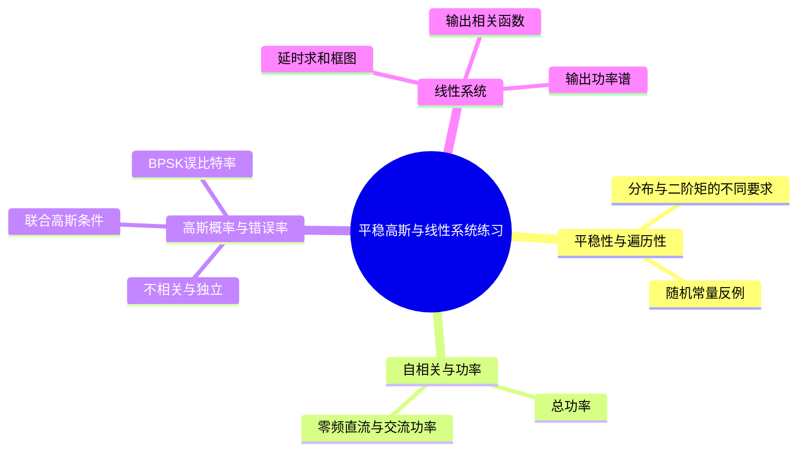
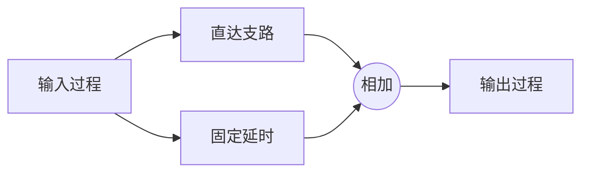

# 第2章 第四讲 英汉对照练习解析

## 内容概要

来源：[[PPT/第四讲/课堂练习-第四讲.docx]]，共 5 组练习，其中两组判断题各有 3 小题。对应笔记第 6 课；错误率含义还承接第 4 课。返回[[练习解析/第二讲至第六讲 练习解析索引]]。

## 一 平稳性与功率分解

### 练习一 Stationary Processes

**English original — True or False**

1. Any ergodic random process must be wide-sense stationary.
2. A strictly stationary random process is always ergodic.
3. All wide-sense stationary processes are strictly stationary.

**中文对照——判断正误**

1. 任何各态历经（遍历）随机过程一定宽平稳。
2. 严平稳随机过程一定遍历。
3. 所有宽平稳过程都是严平稳过程。

**词语辨认**：any（任意一个）；must（必定）；always（总是）；ergodic（遍历的）；strictly stationary（严平稳的）；wide-sense stationary（宽平稳的）。这些全称词意味着找到一个反例就能否定命题。

**解析与方法**

三句都在观察同一个过程，但标准不同：严平稳看整体平移后所有有限维分布是否不变，宽平稳只看均值和二阶相关，遍历性则看一条长记录能否给出总体统计量。

（1）按课程采用的平稳、有限二阶矩的遍历过程范围，**True**。均值时间平均是一个常数；时差为 $\tau$ 的乘积时间平均也只依赖 $\tau$，与总体相应统计量相等，故满足宽平稳条件。不能仅凭“均值遍历”一个性质推断整个过程的各种统计量都遍历；无限二阶矩情形也不能直接称宽平稳。

（2）**False**。取 $X(t)=Z$，其中 $Z=1$、$-1$ 各以二分之一概率发生。每次实验是一条始终不变的水平线，整体平移不改变任何分布，因此严平稳；总体均值为零，但任一条样本的时间平均始终是 $1$ 或 $-1$，不能代表总体均值，所以不均值遍历。

（3）**False**。宽平稳只锁定一、二阶矩，不保证所有分布不变。一个可核对的连续时间反例是

$$
X(t)=A\cos\omega_0t+B\sin\omega_0t,
$$

其中 $A,B$ 独立且各以相同概率取 $1$、$-1$，$\omega_0\ne0$。均值为零，自相关为 $\cos[\omega_0(t_1-t_2)]$，故宽平稳。但 $t=0$ 时只取 $\pm1$；$t=\pi/(4\omega_0)$ 时取 $-\sqrt2,0,\sqrt2$，分布已经改变，故不严平稳。若过程是高斯过程，宽平稳才足以进一步推出严平稳。

**笔记对应**：[[第2章 06 第6课 平稳性、高斯随机过程与线性系统#三、宽平稳]]、[[第2章 06 第6课 平稳性、高斯随机过程与线性系统#四、遍历性]]。原有结论缺少必要条件及反例，已在原节补齐。

### 练习二 自相关函数中的三种功率

**English original**

Suppose $X(t)$ is a wide-sense stationary random process. Its auto correlation function is

$$
R_X(\tau)=16+9e^{-2|\tau|}.
$$

Solve the following questions:

1. Find the average power of $X(t)$.
2. Find the DC power of $X(t)$.
3. Find the AC power of $X(t)$.

**中文对照**

宽平稳过程的自相关函数为 $16+9e^{-2|\tau|}$。求：（1）平均总功率；（2）直流功率；（3）交流功率。

**词语辨认**：average power（平均功率）；DC，direct current（直流）；AC，alternating current（交流）；auto correlation（自相关）。

**解析与方法**

零时差时，相关函数就是样值平方的平均，所以总功率为

$$
P=R_X(0)=16+9=25.
$$

按本课程以零频谱线划分直流、其余频谱划分交流的口径，常数相关项 $16$ 对应 $16\delta(f)$，指数相关项对应非零频连续谱。因此

$$
P_{\mathrm{DC}}=16,\qquad P_{\mathrm{AC}}=25-16=9.
$$

也可以用傅里叶变换核对：

$$
P_X(f)=16\delta(f)+\frac{36}{4+(2\pi f)^2}.
$$

第一项面积为 16，第二项面积为 9。原题未给物理幅度单位，因此结果保留为功率数值；若幅度按单位电阻上的电压归一化，可对应瓦特。

这道题不能仅凭宽平稳就断言 $E[X]=\pm4$。若另有“长时差协方差趋于零”，才可把常数项解释成确定均值平方，从而有 $\mu_X^2=16$、方差为 9。若存在随机但不随时间改变的直流偏置，零频功率仍可为 16，而总体均值可能为零。

**笔记对应**：[[第2章 06 第6课 平稳性、高斯随机过程与线性系统#课堂练习二]]。原答案 25、16、9 已有；原笔记将交流功率无条件写成方差，条件不足，现已补齐零频谱线与确定均值的区别。

## 二 高斯性与错误概率

### 练习三 Gaussian Random Processes

**English original — True or False**

1. For a general random process, strict-sense stationary implies wide-sense stationary.
2. If two random variables are uncorrelated, they must be statistically independent.
3. For Gaussian random variables, uncorrelated means statistically independent.

**中文对照——判断正误**

1. 对一般随机过程，严平稳可以推出宽平稳。
2. 两个随机变量若不相关，就一定统计独立。
3. 对高斯随机变量，不相关意味着统计独立。

**词语辨认**：general（一般的）；imply（蕴含、推出）；uncorrelated（不相关的）；statistically independent（统计独立的）；jointly Gaussian（联合高斯的，第三句需要补充的条件）。

**解析与方法**

（1）课程默认讨论有限二阶矩，按该范围判 **True**：联合分布不变使均值不随时间变，自相关只随时差变。但原句若被当作覆盖所有分布的无条件命题，则不成立。例如随机常量 $X(t)=Z$，$Z$ 服从柯西分布，过程严平稳却没有有限二阶矩，不能称宽平稳。答题写“True, assuming finite second moments”最准确。

（2）**False**。不相关只排除协方差所反映的线性联系，独立则排除一切统计依赖。取 $U\sim U(-1,1)$、$V=U^2$，由对称性 $E[U]=E[U^3]=0$，故 $\operatorname{Cov}(U,V)=0$；但知道 $U$ 就完全知道 $V$，所以不独立。

（3）在本节高斯过程语境下，两个样值是**联合高斯**，故判 **True**。联合高斯分布由均值和协方差决定，协方差为零使联合分布分解成边缘分布乘积。但仅仅“各自都服从高斯分布”还不够：若 $U\sim N(0,1)$，独立随机符号 $S$ 等概率取 $\pm1$，令 $V=SU$，则两者分别为标准高斯且不相关，却有 $|V|=|U|$，并不独立。

**笔记对应**：[[第2章 06 第6课 平稳性、高斯随机过程与线性系统#八、不相关与统计独立]]、[[第2章 06 第6课 平稳性、高斯随机过程与线性系统#十一、典型命题辨析]]。原笔记已说联合高斯，但判断总表遗漏有限二阶矩；现已统一条件并补反例。

### 练习四 BPSK 在高斯白噪声中的误比特率

**English original**

Given formula:

$$
P_e=\frac12\operatorname{erfc}\!\left(\sqrt{\frac{E_b}{N_0}}\right).
$$

For a BPSK system over AWGN channel, the energy per bit $E_b=4\times10^{-6}\ \mathrm J$, single-sided noise power spectral density $N_0=1\times10^{-6}\ \mathrm{W/Hz}$. Given: $\operatorname{erf}(2)=0.995322$.

Calculate the bit error probability $P_e$.

**中文对照**

二进制相移键控系统在加性高斯白噪声信道中传输。每比特能量为 $4\times10^{-6}\ \mathrm J$，单边噪声功率谱密度为 $1\times10^{-6}\ \mathrm{W/Hz}$，已知 $\operatorname{erf}(2)=0.995322$。利用所给公式求误比特概率。

**词语辨认**：BPSK，binary phase-shift keying（二进制相移键控）；AWGN，additive white Gaussian noise（加性高斯白噪声）；energy per bit（每比特能量）；single-sided（单边的）；bit error probability（误比特概率）。

**解析与方法**

接收端需要在两个相反的信号状态之间判决。噪声过大时会把判决量推过门限，高斯分布尾部的面积就给出误判概率。比值 $E_b/N_0$ 越大，两个状态相对噪声越容易区分。

题目给的是误差函数值，公式需要互补误差函数，因此先换用

$$
\operatorname{erfc}(x)=1-\operatorname{erf}(x).
$$

再计算公式自变量：

$$
\frac{E_b}{N_0}=4,\qquad \sqrt{\frac{E_b}{N_0}}=2.
$$

最后

$$
P_e=\frac12[1-0.995322]=0.002339=2.339\times10^{-3}.
$$

这里 $N_0$ 是单边谱密度，常用双边谱写成 $N_0/2$；不能再把已给的 $N_0$ 除以二代入。使用的是线性能量比，若题目改给分贝值，应先换为线性比。所给公式适用于相干 BPSK、等概率比特及 AWGN 模型。

**笔记对应**：[[第2章 06 第6课 平稳性、高斯随机过程与线性系统#高斯噪声下的 BPSK 误比特率]]。原笔记末尾明确写“不展开”，遗漏课堂练习，原覆盖不合格；现已补入知识解释、函数关系、计算及适用条件。

## 三 随机过程通过线性系统

### 练习五 延时求和系统

**English original**

Let $X(t)$ be a stationary stochastic process with mean value $a$ and auto correlation function $R_x(\tau)$. Its output after passing through a linear system is

$$
Y(t)=X(t)+X(t-T).
$$

1. Draw the block diagram of this linear system.
2. Find the auto correlation function and power spectral density of $Y(t)$.

**中文对照**

平稳输入过程 $X(t)$ 的均值为 $a$，自相关为 $R_X(\tau)$，经过线性系统得到 $Y(t)=X(t)+X(t-T)$。求：（1）系统框图；（2）输出自相关函数和功率谱密度。$T$ 为固定延时。

**词语辨认**：passing through（通过）；linear system（线性系统）；output（输出）；block diagram（方框图）；delay（延时）。

**解析与方法**

先把同一输入分成两路：一路直接到相加器，另一路晚到 $T$，最后相加。图中没有两个独立输入，两路来自同一个过程。

对应 $h(t)=\delta(t)+\delta(t-T)$。输出均值虽非单独设问，也可用于检查：$E[Y(t)]=2a$。

输出相关必须展开四项，不能把两路当成不相关信号：

$$
\begin{aligned}
R_Y(\tau)
&=E\{[X(t)+X(t-T)][X(t+\tau)+X(t+\tau-T)]\}\\
&=R_X(\tau)+R_X(\tau-T)+R_X(\tau+T)+R_X(\tau)\\
&=2R_X(\tau)+R_X(\tau-T)+R_X(\tau+T).
\end{aligned}
$$

求谱时，延时变成相位因子，所以

$$
H(f)=1+e^{-j2\pi fT},\qquad
|H(f)|^2=2+2\cos(2\pi fT)=4\cos^2(\pi fT),
$$

$$
\boxed{P_Y(f)=4\cos^2(\pi fT)P_X(f)}.
$$

若原题使用角频率，应相应写为 $P_Y(\omega)=4\cos^2(\omega T/2)P_X(\omega)$。取 $T=0$ 检查，系统变为 $Y=2X$，相关和功率谱都应变成原来的四倍，以上两式满足这一检查。

**笔记对应**：[[第2章 06 第6课 平稳性、高斯随机过程与线性系统#十、最终思考题：延时求和系统（课堂练习五）]]。原笔记有公式但未实际画出所要求的框图，已补齐分支与相加关系。

## 四 原文件词汇表

| English original | 中文对照 |
|---|---|
| Strict-sense stationary random process | 严平稳随机过程 |
| Wide-sense stationary random process | 宽平稳随机过程 |
| Ergodicity | 各态历经性、遍历性 |
| Autocorrelation function | 自相关函数 |
| Power spectral density (PSD) | 功率谱密度 |
| Wiener-Khinchin Relation (Theorem) | 维纳—辛钦关系、定理 |
| Gaussian random process | 高斯随机过程 |
| Statistical average | 统计平均、集合平均 |
| Time average | 时间平均 |
| Statistically independent | 统计独立 |
| Uncorrelated | 不相关 |
| DC power | 直流功率 |
| AC power | 交流功率 |
