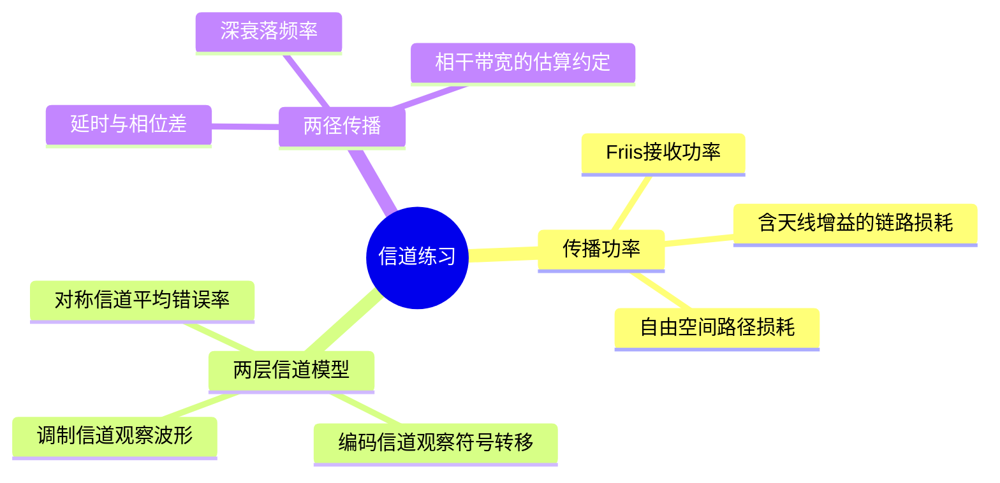
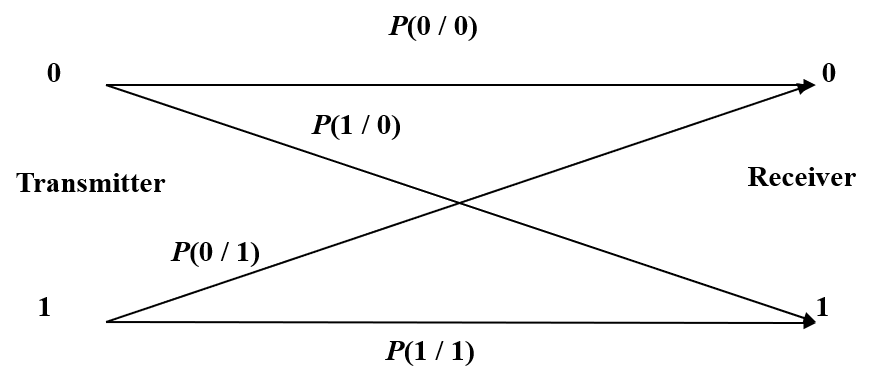
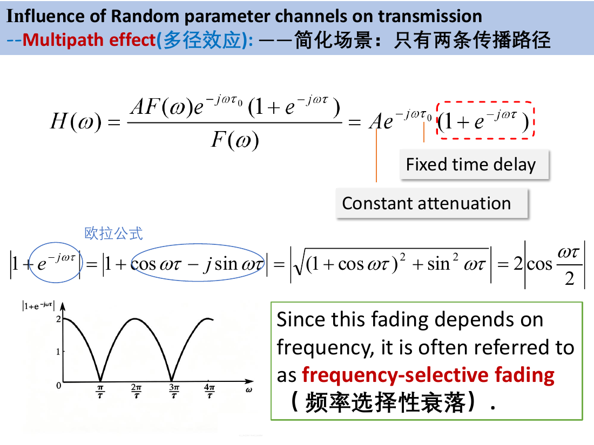

# 第3章 第六讲 英汉对照练习解析

## 内容概要

来源：[[PPT/第六讲/(需打印）第六讲 课堂练习 学生版 .docx]]。保留 Example 1、Example 2、三条判断、一道简答与 Example 3 的原顺序，共 5 组。对应笔记第 8 课，未混入第七讲的信道容量。返回[[练习解析/第二讲至第六讲 练习解析索引]]。

## 一 自由空间传播的接收功率

### Example 1 接收功率与传播损耗

**English original**

Assume the transmitted power $P_T=10\ \mathrm W$, transmitting antenna gain $G_T=100$, receiving antenna gain $G_R=10$. The propagation distance is $50\ \mathrm{km}$, and the electromagnetic wave frequency is $800\ \mathrm{MHz}$. Calculate the received power and propagation loss.

**中文对照**

发射功率为 10 W，发射天线增益为 100，接收天线增益为 10，传播距离为 50 km，电磁波频率为 800 MHz。求接收功率和传播损耗。

**词语辨认**：assume（假设）；transmitted / received power（发射／接收功率）；antenna gain（天线增益）；propagation distance（传播距离）；electromagnetic wave（电磁波）；loss（损耗）。

**解析与方法**

先把距离与频率换成国际单位，并把频率换成波长。这里增益 100、10 是线性倍数，不是分贝。

$$
d=5\times10^4\ \mathrm m,\qquad f=8\times10^8\ \mathrm{Hz},\qquad
\lambda=\frac cf=\frac{3\times10^8}{8\times10^8}=0.375\ \mathrm m.
$$

按理想自由空间、远场、天线匹配且对准的 Friis 模型，传播扩散造成的接收比例为 $(\lambda/(4\pi d))^2$，再计入两端天线增益：

$$
P_R=P_TG_TG_R\left(\frac{\lambda}{4\pi d}\right)^2
=10\times100\times10\left(\frac{0.375}{4\pi\times50000}\right)^2
\approx3.56\times10^{-9}\ \mathrm W.
$$

按课程例题采用的发射端到接收端功率比，传播损耗为

$$
L_{\mathrm{link}}=\frac{P_T}{P_R}\approx2.81\times10^9,\qquad
L_{\mathrm{link,dB}}=10\log_{10}L_{\mathrm{link}}\approx94.48\ \mathrm{dB}.
$$

“Propagation loss”在不同材料中也可能特指**不计天线增益的自由空间路径损耗**：

$$
L_{\mathrm{FS}}=\left(\frac{4\pi d}{\lambda}\right)^2\approx2.81\times10^{12},
\qquad L_{\mathrm{FS,dB}}\approx124.48\ \mathrm{dB}.
$$

两者相差发射和接收天线增益合计的 $10\log_{10}(100\times10)=30\ \mathrm{dB}$。答卷应先写损耗定义：按本课程例题口径报 94.48 dB；若明确问 free-space path loss，则报 124.48 dB。两者都不等于 $P_T-P_R$，也不能把未被接收天线截获的功率全部说成被空气吸收。

**笔记对应**：[[第3章 08 第8课 信道模型与多径传播#视距与自由空间传播例题]]。原笔记已含接收功率与 94.5 dB；现补齐另一常见路径损耗定义、两者换算及英文判读。

## 二 编码信道的符号转移

### Example 2 二元对称无记忆信道

**English original**

A binary symmetric memoryless channel (BSC). Bit 0 and bit 1 are transmitted with equal probability. The error transition probabilities are $P(1|0)=P(0|1)=0.005$. Calculate the average bit error probability $P_e$.

**中文对照**

一个二元对称无记忆信道，发送 0、1 的概率相等。发 0 判 1 与发 1 判 0 的条件概率都为 0.005。求平均误比特概率。原图左侧为发送，右侧为接收；两条交叉箭头代表错误。

**词语辨认**：binary（二元的）；symmetric（对称的）；memoryless（无记忆的）；transition probability（转移概率）；equal probability（相同概率）。

**解析与方法**

本题不追踪电压波形，只关心最终判成哪个比特。符号条件概率 $P(y|x)$ 的竖线右侧是已知发送值，左侧是接收判决值。用“行表示发送、列表示接收”的表格补全图：

$$
\begin{array}{c|cc}
 &Y=0&Y=1\\\hline
X=0&0.995&0.005\\
X=1&0.005&0.995
\end{array}
$$

固定一行，接收结果只有 0 或 1，因此每行相加必须为 1。平均错误率再按两种发送事件的概率加权：

$$
P_e=P(X=0)P(1|0)+P(X=1)P(0|1)
=\frac12(0.005)+\frac12(0.005)=0.005.
$$

不能把两条交叉概率直接相加成 0.01，因为这两项分别以不同发送事件为条件。对称信道两条交叉概率相同，所以即使输入不等概率，平均错误率仍等于该共同交叉概率；无记忆则描述相邻使用之间的依赖，不是错误率相等的原因。

**笔记对应**：[[第3章 08 第8课 信道模型与多径传播#编码信道只保留符号转移结果]]，已含同题、矩阵与行和解释。

### True & False 调制信道与编码信道

**English original**

1. The modulation channel is located between the output of the modulator and the input of the demodulator.
2. The coding channel mainly analyzes waveform distortion and amplitude-frequency distortion of analog signals.
3. The performance of the coding channel depends on the noise and distortion from the modulation channel.

**中文对照**

1. 调制信道位于调制器输出端与解调器输入端之间。
2. 编码信道主要分析模拟信号的波形失真、幅频失真。
3. 编码信道的性能取决于调制信道中的噪声和失真。

**词语辨认**：be located between（位于……之间）；modulator / demodulator（调制器／解调器）；waveform distortion（波形失真）；amplitude-frequency distortion（幅频失真）；depend on（受……影响、取决于）。

**解析与方法**

沿同一次发送来判断：编码器先交出符号，调制器将其变为波形，传播与噪声改变波形，解调判决后又得到符号。因此同一段传输可以从波形层与符号层建立模型。

（1）**True**。边界是调制器输出到解调器输入，输入输出均按波形看待；关注衰减、延迟、失真与噪声。

（2）**False**。幅频失真属于波形层分析；编码信道从编码器输出到译码器输入，用离散符号的条件转移概率描述结果。

（3）**True**。传播中的波形变化会影响后续判决，进而改变符号转移概率。不过它还受调制、解调与判决方式影响，不能理解成“只取决于物理传播”。

**笔记对应**：[[第3章 08 第8课 信道模型与多径传播#二、同一段传输的两层信道模型]]，已有这三项的解释。

### Short answer question 两层模型的区别

**English original**

What is the difference between modulation channel and coding channel?

**中文对照**

调制信道与编码信道有什么区别？

**解析与方法**

回答要围绕同一个通信系统比较模型边界、输入输出及描述方法。

| 比较项 | Modulation channel 调制信道 | Coding channel 编码信道 |
|---|---|---|
| 边界 | 调制器输出到解调器输入 | 编码器输出到译码器输入，包含调制、传播和解调判决 |
| 输入与输出 | 波形 | 离散符号 |
| 研究内容 | 衰减、时延、噪声、幅度及相位失真 | 判决正确与错误的概率 |
| 描述方法 | 冲激响应、频率响应及噪声模型等 | 条件转移概率 $P(y\mid x)$ |

**可用于英文答卷的表达**：The modulation channel extends from the modulator output to the demodulator input and describes changes in signal waveforms. The coding channel extends from the encoder output to the decoder input and describes symbol transitions by conditional probabilities. Noise and distortion in the modulation channel affect the transition probabilities of the coding channel.

**笔记对应**：[[第3章 08 第8课 信道模型与多径传播#二、同一段传输的两层信道模型]]和[[第3章 08 第8课 信道模型与多径传播#六、关键区别与本课收束]]，已覆盖。

## 三 两径传播的频率选择性

### Example 3 深衰落频率与相干带宽

**English original**

A two-path multi-path channel, the channel transfer function is

$$
H(\omega)=Ae^{-j\omega\tau_0}(1+e^{-j\omega\tau}).
$$

The relative time delay between two paths is $\tau=2\ \mu\mathrm s$.

1. Find the frequencies where deep fading (nulls) happens.
2. Calculate the coherence bandwidth of this two-ray channel.

**中文对照**

两径信道的传递函数如上，两路相对时延为 $2\ \mu\mathrm s$。求：（1）发生深衰落、完全相消的频率；（2）两径信道的相干带宽。$A$ 为共同路径幅度系数，$\tau_0$ 为共同延时，$\tau$ 是两路额外到达时间差。

**词语辨认**：two-path / two-ray（两径的）；transfer function（传递函数）；relative time delay（相对时延）；deep fading（深衰落）；null（零点、凹口）；coherence bandwidth（相干带宽）。

**解析与方法**

先将两个同频副本相加的幅度看清：共同延时因子模为一，不改变相消频率；两路相位差才决定增强或抵消。

$$
|H(\omega)|=2|A|\left|\cos\frac{\omega\tau}{2}\right|.
$$

沿图中横轴看峰、谷交替：两路相差整圈时增强，相差半圈时抵消。第一问令括号 $1+e^{-j\omega\tau}=0$，得到

$$
\omega_k=\frac{(2k+1)\pi}{\tau},\qquad
f_k=\frac{\omega_k}{2\pi}=\frac{2k+1}{2\tau},\qquad k\in\mathbb Z.
$$

代入 $\tau=2\times10^{-6}\ \mathrm s$，正频率零点为

$$
f_k=(2k+1)\times250\ \mathrm{kHz},\qquad k=0,1,2,\ldots
$$

即 250 kHz、750 kHz、1.25 MHz 等。相邻零点间距为 $1/\tau=500\ \mathrm{kHz}$。若答角频率，首个正零点应为 $5\times10^5\pi\ \mathrm{rad/s}$，不能将它标成 Hz。

第二问需写清估算口径。按课程笔记沿用的粗估 $B_c\sim1/\tau$，得到

$$
B_c\sim500\ \mathrm{kHz}.
$$

这是频率响应变化的数量级尺度；峰到相邻零点的距离却只有 $1/(2\tau)=250\ \mathrm{kHz}$。若把某种相关性阈值或平坦程度作为相干标准，所得带宽会不同。原题及课件没有指定阈值，因此不能把 500 kHz 说成唯一精确值，更不能说宽达 500 kHz 的每段频带都平坦。考试若指定另一经验式，应按其定义代入并保留第一问的精确零点结果。

**笔记对应**：[[第3章 08 第8课 信道模型与多径传播#两径深衰落与相干带宽例题]]，已完整包含两问、频响图与估算条件。

## 四 原文件词汇表

| English original | 中文对照 |
|---|---|
| attenuation | 衰减 |
| propagation | 传播 |
| symmetrical cable | 对称电缆 |
| coaxial cable | 同轴电缆 |
| optical fiber | 光纤 |
| ground wave | 地波 |
| sky wave | 天波 |
| LOS (line of sight) | 视距传播 |
| constant parameter channel | 恒参信道 |
| random parameter channel | 随参信道 |
| frequency selective fading | 频率选择性衰落 |
