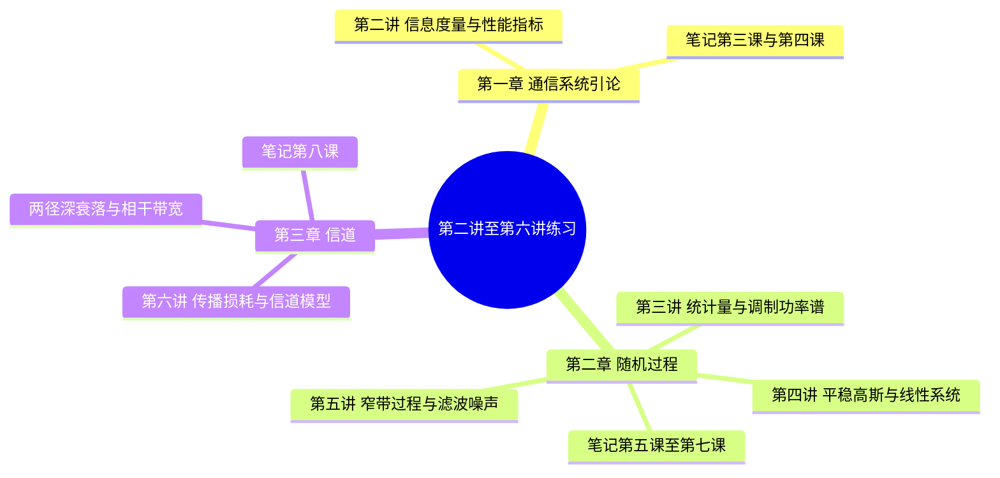

# 第二讲至第六讲 英汉对照练习解析

## 章节与练习结构

这组材料按课件第一、二、三章顺序组织，每章内部保留学校讲次与原题编号。每道题先给英文原题，再给完整中文对照、辨认词汇、计算或概念解析，最后定位到现有笔记的具体小节。图形承担已知条件或模型关系时，题目旁保留本地题图。

学校讲次与笔记课次不相同：学校第二讲对应笔记第 3、4 课，学校第三至第五讲对应笔记第 5 至第 7 课，学校第六讲对应笔记第 8 课。英文句子的数学式已转为可渲染公式；原材料仅有中文或空表时，保留原表性质，并标明为读表补写的英文说明，避免误认成教师原话。

## 分讲阅读入口

| 课件章节 | 学校讲次 | 题解 | 练习范围 | 对应笔记 |
|---|---|---|---|---|
| 第一章 | 第二讲 | [[练习解析/第1章 第二讲 英汉对照练习解析]] | 5 道例题及学习单 2 张公式表 | 第 3、4 课 |
| 第二章 | 第三讲 | [[练习解析/第2章 第三讲 英汉对照练习解析]] | 3 道例题、概念对照、傅里叶与三角填表、集合与时间平均填表 | 第 5 课，联系第 6 课 |
| 第二章 | 第四讲 | [[练习解析/第2章 第四讲 英汉对照练习解析]] | 5 组练习，含 6 条判断、功率题、BPSK 错误率及延时求和系统 | 第 6 课，联系第 4 课 |
| 第二章 | 第五讲 | [[练习解析/第2章 第五讲 英汉对照练习解析]] | 5 条判断、带通滤波计算、三类噪声填表及词汇 | 第 7 课 |
| 第三章 | 第六讲 | [[练习解析/第3章 第六讲 英汉对照练习解析]] | 3 道例题、3 条判断、1 道简答及词汇 | 第 8 课 |

以上按原文件题组口径合计 20 组例题／练习，包含 14 条判断命题；公式表和课堂填表另外完整收入，不混算成教师原编号的额外题目。

## 原文件覆盖清单

| 原文件 | 本次整理内容 |
|---|---|
| [[PPT/第二讲/第二讲例题.docx]] | 信息量 3 题、性能指标 1 题、出门测 1 题 |
| [[PPT/第二讲/第二讲课堂学习单.docx]] | 信息量四种口径、数字通信六项性能指标，纠正错误率分子分母 |
| [[PPT/第三讲/(需打印）第三讲 课堂练习 学生版.docx]] | 三道例题的所有设问、已知条件和提示 |
| [[PPT/第三讲/（需打印）第三讲 课堂材料.docx]] | 确知与随机对照、七行傅里叶填空、六条三角填空、随机相位余弦六格平均与功率谱填表 |
| [[PPT/第四讲/课堂练习-第四讲.docx]] | 五组练习和原词汇表 |
| [[PPT/第五讲/(需打印）第五讲 课堂练习及词汇 - 学生版.docx]] | 两组练习、滤波器题图、三类噪声空表及十项词汇 |
| [[PPT/第六讲/(需打印）第六讲 课堂练习 学生版 .docx]] | 三道例题、判断、简答、二元信道图及十一项词汇 |

## 笔记缺项与已完成的补充

下表记录整理前的缺项；“原覆盖不合格”表示当时笔记未能支持相应原题或存在具体错误。缺失知识已直接补回课程笔记，题解中的出处链接指向补充后的版本。

| 笔记 | 整理前的具体缺项 | 已补充或修正的位置 |
|---|---|---|
| [[第1章 03 第3课 信息及其度量]] | 未单列具体消息的算术平均，容易与熵混淆 | “具体消息的算术平均与信源熵”，补实际频率与理论概率对照、独立模型条件 |
| [[第1章 04 第4课 通信系统的性能指标]] | 未解释学习单错误率倒置和多进制严格不等式的问题 | “数字通信系统的错误概率指标”，补一般界限、格雷近似条件及学习单勘误 |
| [[第2章 05 第5课 从确知信号到随机过程]] | 双边指数误写；能量功率判据与集合／时间平均填表不全；调制谱推导省略非平稳项 | 修正傅里叶表，补判据、并列平均表及时间平均调制谱推导 |
| [[第2章 06 第6课 平稳性、高斯随机过程与线性系统]] | 明确略过 BPSK 原题；延时系统缺实际框图；平稳、联合高斯与直流功率条件不全 | 补“高斯噪声下的 BPSK 误比特率”、分支框图、反例及功率口径 |
| [[第2章 07 第7课 白噪声、窄带噪声与接收机分析]] | 同相正交转换只有名称；瑞利与莱斯条件不全；带通原题缺图和完整积分 | 补转换与数值实例、包络密度与退化关系、原题图、相关积分和高斯密度 |
| [[第3章 08 第8课 信道模型与多径传播]] | 已有全部练习主线，但自由空间损耗与含天线增益损耗的英文口径对照不足 | 在原传播例题后补两种定义、30 dB 差值与 Friis 条件 |

## 易混英文与公式约定

读题先识别计算对象：information of a symbol 是某个符号的自信息，total information of this message 是具体消息总量，entropy 是理论平均，information rate 是每秒平均信息量。stationary、ergodic、Gaussian 分别讨论时间平移、单样本代表总体与联合分布，不能相互替代。

各篇沿用当前笔记的普通频率约定 $P(f)=\int R(\tau)e^{-j2\pi f\tau}\,\mathrm d\tau$。若给角频率，先用 $\omega=2\pi f$ 换轴；求总功率时，以 $\omega$ 积分需带 $1/(2\pi)$。噪声双边谱常写 $N_0/2$，BPSK 题所给单边参数则为 $N_0$。

第六讲相干带宽题没有给相关性阈值，题解明确把 $1/\tau$ 当作粗估约定，精确深衰落零点另算；第五讲滤波器原图没有标增益，计算注明单位通带增益。原题条件不足的地方已说明所采用的课程约定，没有把约定说成唯一精确结论。

返回课程目录：[[README]]。
