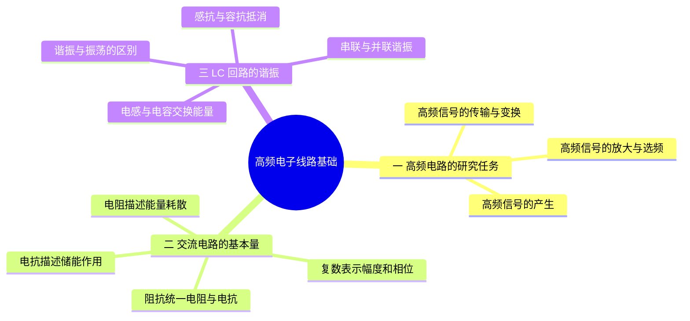

---
tags:
  - 高频电子线路
  - 交流阻抗
  - 谐振基础
aliases:
  - 第1课
  - 高频电子线路理解基础
---
# 第1课 学习高频电子线路前的一些理解基础

## 本课概要

## 1. 高频电子线路的研究对象与任务

一台接收机的天线会同时收到许多不同频率的信号。后级电路既不能把所有频率同样放大，也不能随意把一个低阻负载直接接到高阻放大器上，否则会同时出现两个问题：

1. 目标频率与相邻频率无法分开；
2. 信号源能够提供的电压、电流能力与实际负载不合适，功率不能有效传递。

LC 谐振回路正好提供两类能力：

- 利用电感和电容随频率变化的阻抗实现**选频**；
- 利用电感或电容抽头改变电压、电流比例，实现**阻抗变换与匹配**。

因此，这一章的知识主线是：

$$
\text{交流阻抗}
\longrightarrow
\text{LC 谐振}
\longrightarrow
\text{频率响应与 }Q
\longrightarrow
\text{带宽与选择性}
\longrightarrow
\text{抽头接入与阻抗匹配}
$$

---

## 2. 电抗、阻抗与复数表示

电阻满足 $u=Ri$，电压和电流同时过零、同时达到峰值，因此二者同相。但电感和电容的电压、电流关系中包含变化率：

$$
u_L=L\frac{\mathrm di}{\mathrm dt}
$$

$$
i_C=C\frac{\mathrm du}{\mathrm dt}
$$

对正弦量求导会使相位改变 $90^\circ$，所以：

- 电感电压超前电流 $90^\circ$；
- 电容电流超前电压 $90^\circ$。

为了在一个量中同时记录“幅度比例”和“相位差”，交流电路用复阻抗：

$$
Z=R+jX
$$

其中：

- $R$ 是消耗平均功率的电阻分量；
- $X$ 是带符号的电抗；
- $j$ 表示相位旋转 $90^\circ$。

角频率与普通频率的关系为：

$$
\omega=2\pi f
$$

电感和电容的阻抗分别为：

$$
Z_L=j\omega L
$$

$$
Z_C=\frac{1}{j\omega C}=-j\frac{1}{\omega C}
$$

若把电抗 $X$ 定义为带符号量，则：

$$
X_L=\omega L>0
$$

$$
X_C=-\frac{1}{\omega C}<0
$$

于是二者都能统一写成 $Z=jX$。有些教材把 $X_C=1/(\omega C)$ 仅作为“容抗大小”，此时必须另写 $Z_C=-jX_C$，不要混用两套约定。

---

## 3. LC 谐振的形成机理

电感和电容对频率的反应方向相反：

$$
X_L=\omega L
$$

随频率升高而增大；而容抗大小

$$
|X_C|=\frac{1}{\omega C}
$$

随频率升高而减小。因此一定存在一个频率，使二者大小相等：

$$
\omega_0L=\frac{1}{\omega_0C}
$$

解得理想 LC 回路的固有角频率和固有频率：

$$
\boxed{\omega_0=\frac{1}{\sqrt{LC}}}
$$

$$
\boxed{f_0=\frac{1}{2\pi\sqrt{LC}}}
$$

这里的 $\omega_0$ 是频率，不是电压或电流。给回路输入正弦电压或正弦电流，并使输入频率满足 $\omega=\omega_0$，回路就处于谐振状态。

### 3.1 振荡与谐振不是同一个概念

振荡是电压或电流随时间周期变化的现象。谐振则是外部周期性激励与系统固有节奏相符时出现的特殊响应状态。

- 先给电容充电，再让 LC 自由交换能量，是自由振荡；
- 用频率等于 $\omega_0$ 的外部正弦信号持续驱动，是受迫谐振；
- 振荡器借助放大、正反馈与选频网络，从直流电源中持续产生交流信号。

LC 回路中的能量在两种形式之间交换：

$$
\text{电容的电场能}
\longleftrightarrow
\text{电感的磁场能}
$$

真实回路存在电阻损耗，所以自由振荡会衰减；振荡器必须由有源器件补充每周期损失的能量。

---
