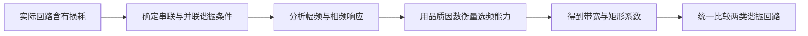

---
tags:
  - 高频电子线路
  - LC谐振
  - 品质因数
  - 通频带
aliases:
  - 第2课
  - 串并联谐振回路
---
# 第2课 并联和串联谐振回路

## 本课概要

第1课已经说明，LC 回路能够利用电感和电容随频率反向变化的电抗形成谐振。现在要进一步回答一个工程问题：真实线圈总有损耗，而且串联谐振与并联谐振对电压、电流和阻抗的呈现并不相同。本课从真实并联回路出发，再把串联、并联两种形式放进同一套频率响应框架中，说明品质因数 $Q$、通频带和选择性为什么彼此关联。
## 1. 真实并联谐振回路：损耗电阻如何进入推导

真实线圈的导线有电阻，因此线圈应写成串联模型：

$$
Z_L=r+j\omega L
$$

其中 $r$ 是线圈串联损耗。它与电容并联后，总导纳为：

$$
Y=\frac{1}{r+j\omega L}+j\omega C
$$

将第一项有理化：

$$
Y=
\frac{r}{r^2+\omega^2L^2}
+j\left(
\omega C-\frac{\omega L}{r^2+\omega^2L^2}
\right)
$$

导纳实部表示损耗，虚部表示尚未抵消的无功作用。谐振要求虚部为零：

$$
\omega_0C=\frac{\omega_0L}{r^2+\omega_0^2L^2}
$$

所以准确的谐振角频率为：

$$
\omega_0=\sqrt{\frac{1}{LC}-\frac{r^2}{L^2}}
$$

高频线圈通常满足 $r\ll\omega_0L$，因此常近似为：

$$
\omega_0\approx\frac{1}{\sqrt{LC}}
$$

谐振时，从端口观察，串联损耗 $r$ 可以等效为并联电阻：

$$
R_{e0}=\frac{r^2+\omega_0^2L^2}{r}=\frac{L}{Cr}
$$

高 $Q$ 时又可近似为：

$$
\boxed{R_{e0}\approx\frac{(\omega_0L)^2}{r}}
$$

![[高频振荡回路与阻抗匹配.assets/02-真实并联谐振回路与等效模型.svg]]

在等效并联模型中：

$$
Y=\frac{1}{R_{e0}}+j\left(\omega C-\frac{1}{\omega L}\right)
$$

谐振时虚部为零，只剩：

$$
Y(\omega_0)=\frac{1}{R_{e0}}
$$

因此：

$$
\boxed{Z(\omega_0)=R_{e0}}
$$

这就是并联谐振时阻抗峰值刚好等于等效并联电阻的原因，并不是额外规定。

### 1.1 为什么并联谐振阻抗最大

令：

$$
B(\omega)=\omega C-\frac{1}{\omega L}
$$

则：

$$
|Z|=\frac{1}{\sqrt{(1/R_e)^2+B^2(\omega)}}
$$

因为 $B^2(\omega)\geq0$，分母在 $B(\omega)=0$ 时最小，所以：

$$
\boxed{|Z|_{\max}=R_e}
$$

从电流角度看，谐振时电感支路与电容支路的无功电流大小相等、相位相反，在端口处互相抵消。电源只需提供损耗电流和负载电流，因此端口总电流最小，$Z=U/I$ 最大。

### 1.2 为什么阻抗最大时输出电压最大

这句话隐含“近似恒流驱动”的前提。晶体管的集电极或漏极常近似为受控电流源，于是：

$$
\dot U_o=\dot I_s Z
$$

当 $|I_s|$ 基本不随频率改变时，$|Z|$ 最大就意味着输出电压最大：

$$
|U_o|_{\max}=|I_s|R_e
$$

若用理想电压源直接跨接回路，电压已被电源固定，谐振时表现为输入电流最小，而不是电压继续升高。

---

## 2. 广义失谐、幅频特性和相频特性

仅知道“是否等于 $\omega_0$”还不够，还需要衡量频率偏离谐振点后，回路响应下降得有多快。为此引入无量纲的**广义失谐量**：

$$
\xi=R_e\left(\omega C-\frac{1}{\omega L}\right)
$$

将总导纳提取 $1/R_e$：

$$
Y=\frac{1}{R_e}(1+j\xi)
$$

因此并联回路阻抗为：

$$
\boxed{Z_p=\frac{R_e}{1+j\xi}}
$$

并联回路品质因数为：

$$
Q=\omega_0CR_e=\frac{R_e}{\omega_0L}
$$

利用 $\omega_0^2LC=1$，广义失谐可改写为：

$$
\xi=Q\left(\frac{\omega}{\omega_0}-\frac{\omega_0}{\omega}\right)
$$

在谐振点附近，令 $\Delta\omega=\omega-\omega_0$，可作窄带近似：

$$
\boxed{\xi\approx2Q\frac{\Delta\omega}{\omega_0}
=2Q\frac{\Delta f}{f_0}}
$$

于是幅值和相位分别为：

$$
|Z_p|=\frac{R_e}{\sqrt{1+\xi^2}}
$$

$$
\varphi_p=-\arctan\xi
$$

当频率变化时：

| 条件 | $\xi$ | $\operatorname{Im}(Z_p)$ | 端口性质 |
|---|---:|---:|---|
| $\omega<\omega_0$ | $<0$ | $>0$ | 感性 |
| $\omega=\omega_0$ | $=0$ | $=0$ | 纯阻性 |
| $\omega>\omega_0$ | $>0$ | $<0$ | 容性 |

“从端口观察”是指从连接 LC 回路的同一对端子测量端口电压与流入总电流，并不是必须从某个独立输出端观察。

### 2.1 $Q$ 高为什么选频更准

$Q$ 的能量定义为：

$$
Q=2\pi\frac{\text{回路储存的能量}}{\text{每周期损失的能量}}
$$

$Q$ 高说明每周期损失较少，回路中原有振荡能保持更多周期。若外部频率略有偏差，每周期积累的一点相位误差会在较长时间内不断累积，使失谐信号无法持续同相补充能量。因而高 $Q$ 回路对频率偏差的响应下降更快。

高 $Q$ 不会主动产生失谐。准确说法是：在同样的 $\Delta f/f_0$ 下，$Q$ 越高，$\xi$ 越大，幅值和相位变化越显著。

### 2.2 相位斜率与振荡频率稳定

谐振附近：

$$
\varphi_p\approx-2Q\frac{\Delta f}{f_0}
$$

所以中心斜率为：

$$
\left.\frac{\mathrm d\varphi_p}{\mathrm df}\right|_{f_0}
=-\frac{2Q}{f_0}
$$

$Q$ 越大，相频曲线在谐振点附近越陡。对自激振荡器而言，频率偏离 $\omega_0$ 后，谐振回路会引入相位偏差，使反馈不再同相，偏离频率的分量不能稳定维持；靠近满足环路幅相条件的频率最终保留下来。

所谓“频率被拉回”，并不是 LC 直接测量频率并施力，而是反馈信号的正交分量逐周期修正总相位。外部理想信号源强制给定频率时，LC 只能改变幅度和相位，不能改变信号源频率。

![[高频振荡回路与阻抗匹配.assets/01-串并联谐振幅相特性.svg]]

课堂 PPT 原图：

![[高频振荡回路与阻抗匹配.assets/PPT-02-并联谐振幅相特性.png]]

---

## 3. 归一化谐振函数、带宽与矩形系数

为了只比较曲线形状而不受峰值阻抗 $R_e$ 影响，将阻抗除以谐振值：

$$
N(f)=\frac{Z(f)}{R_e}
$$

于是并联回路的复数归一化谐振函数为：

$$
\boxed{N(f)=\frac{1}{1+j\xi}}
$$

其幅值为：

$$
|N(f)|=\frac{1}{\sqrt{1+\xi^2}}
$$

在谐振附近：

$$
\boxed{|N(f)|\approx
\frac{1}{\sqrt{1+\left(2Q\dfrac{\Delta f}{f_0}\right)^2}}}
$$

![[高频振荡回路与阻抗匹配.assets/PPT-03-归一化谐振函数.png]]

### 3.1 $3\ \mathrm{dB}$ 带宽为什么等于 $f_0/Q$

半功率点的幅度为峰值的 $1/\sqrt2$：

$$
|N(f)|=\frac{1}{\sqrt2}
$$

代入归一化函数：

$$
\left|2Q\frac{\Delta f}{f_0}\right|=1
$$

左右两个半功率频率分别为 $f_1$、$f_2$，因此：

$$
\boxed{BW_{0.707}=f_2-f_1=\frac{f_0}{Q}}
$$

这表明：

$$
Q\uparrow
\Longrightarrow
BW\downarrow
\Longrightarrow
\text{相邻频率更容易分开}
$$

![[高频振荡回路与阻抗匹配.assets/PPT-04-通频带.png]]

### 3.2 矩形系数为什么与 $Q$、$f_0$ 无关

设在幅度降到峰值的 $\alpha$ 倍时，带宽为 $BW_\alpha$。由归一化函数可得：

$$
BW_\alpha
=\frac{f_0}{Q}\sqrt{\frac{1}{\alpha^2}-1}
$$

常用矩形系数为：

$$
K_{0.1}=\frac{BW_{0.1}}{BW_{0.707}}
$$

代入后，分子分母共同含有的 $f_0/Q$ 抵消：

$$
K_{0.1}=\sqrt{99}\approx9.95
$$

因此单个 LC 回路无论怎样提高 $Q$，只能把曲线整体压窄，不能改变归一化后的基本形状。理想矩形滤波器的矩形系数应接近 $1$；要明显改善矩形系数，需要多级或耦合谐振回路。

![[高频振荡回路与阻抗匹配.assets/PPT-05-矩形系数.png]]

---

## 4. 串联谐振与并联谐振的统一比较

串联 RLC 的阻抗可以直接相加：

$$
Z_s=R+j\left(\omega L-\frac{1}{\omega C}\right)
$$

其中 $R$ 是串联路径中所有有效损耗电阻的总和，可能包括线圈损耗、电容等效串联损耗、信号源内阻和折算后的负载。

定义串联广义失谐量：

$$
\xi_s=
\frac{\omega L-1/(\omega C)}{R}
=Q_s\left(\frac{\omega}{\omega_0}-\frac{\omega_0}{\omega}\right)
$$

其中：

$$
Q_s=\frac{\omega_0L}{R}=\frac{1}{\omega_0CR}
$$

于是：

$$
\boxed{Z_s=R(1+j\xi_s)}
$$

串联回路直接相加阻抗，所以公式中是乘法；并联回路先相加导纳、最后取倒数，所以出现：

$$
Z_p=\frac{R_e}{1+j\xi}
$$

两种回路的谐振条件都是感抗与容抗大小相等，因此理想谐振频率相同：

$$
\omega_0=\frac{1}{\sqrt{LC}}
$$

但端口表现相反：

| 特性 | 串联谐振 | 并联谐振 |
|---|---|---|
| 谐振时阻抗 | 最小，$Z=R$ | 最大，$Z=R_e$ |
| 恒压驱动时 | 电流最大 | 电流最小 |
| 恒流驱动时 | 电压最小 | 电压最大 |
| $\omega<\omega_0$ | 容性 | 感性 |
| $\omega>\omega_0$ | 感性 | 容性 |

课堂 PPT 原图：

![[高频振荡回路与阻抗匹配.assets/PPT-01-串联谐振幅相特性.png]]

![[高频振荡回路与阻抗匹配.assets/PPT-06-串联谐振曲线.png]]

---
