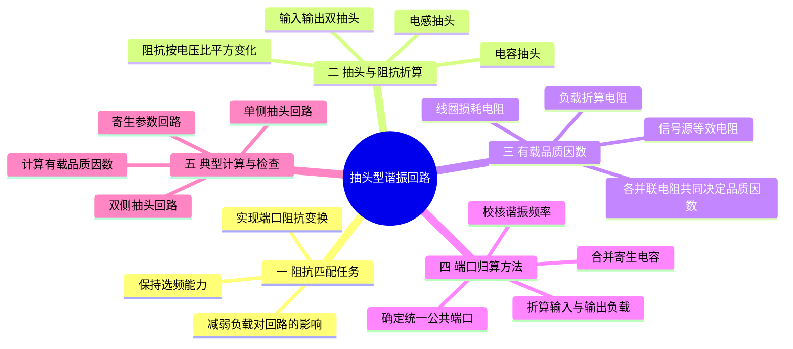

---
tags:
  - 高频电子线路
  - 抽头谐振回路
  - 阻抗匹配
  - 有载品质因数
aliases:
  - 第3课
  - 抽头型谐振回路
---
# 第3课 抽头型谐振回路

## 本课概要

第2课解决了“回路在哪个频率谐振、响应有多尖锐”的问题，但还有一个现实困难：谐振回路往往呈现很高的阻抗，而信号源和负载的阻抗通常较低，直接连接会破坏回路的 $Q$ 和功率传递。本课引入抽头接入与阻抗折算，说明怎样在不改变谐振频率的前提下，把实际电阻变换到适合回路的数值。
## 1. 阻抗匹配的作用

实际信号源不能同时提供任意大的电压和电流。若负载太小，器件容易先达到电流极限；若负载太大，器件容易先达到电压极限。合适的负载能使器件同时合理利用允许的电压摆幅和电流摆幅。

对戴维南信号源 $U_s$、内阻 $R_s$ 和纯电阻负载 $R_L$，负载功率为：

$$
P_L=\frac{U_s^2R_L}{(R_s+R_L)^2}
$$

纯电阻最大功率传输条件为：

$$
R_L=R_s
$$

复阻抗情况下是共轭匹配：

$$
Z_L=Z_s^*
$$

高频功率放大器中的目标通常不是机械地令两个物理电阻相等，而是把实际负载变换成有源器件需要的最佳负载 $R_{\mathrm{opt}}$，使器件能在电压、电流和效率限制内输出预期功率。

理想匹配网络不制造功率：

$$
P_{\mathrm{网络输入}}\approx P_{\mathrm{网络输出}}
$$

但“直接连接”和“加入匹配网络”是两种不同工作状态。匹配网络改变了信号源看到的阻抗，使信号源可以输出更多可用功率；网络再把这份功率变换为负载所需的电压和电流比例。

---

## 2. 抽头接入与阻抗平方变换

定义抽头电压接入系数：

$$
\boxed{p=\frac{U_{\mathrm{tap}}}{U_{\mathrm{tank}}}}
$$

所以：

$$
U_{\mathrm{tap}}=pU_{\mathrm{tank}}
$$

理想抽头网络近似无损，稳定正弦状态下平均有功功率守恒：

$$
U_{\mathrm{tap}}I_{\mathrm{tap}}
\approx
U_{\mathrm{tank}}I_{\mathrm{tank}}
$$

于是：

$$
I_{\mathrm{tank}}=pI_{\mathrm{tap}}
$$

从抽头侧观察：

$$
Z_{\mathrm{tap}}
=\frac{U_{\mathrm{tap}}}{I_{\mathrm{tap}}}
=p^2\frac{U_{\mathrm{tank}}}{I_{\mathrm{tank}}}
$$

所以：

$$
\boxed{Z_{\mathrm{tap}}=p^2Z_{\mathrm{tank}}}
$$

反过来，将抽头处负载折算到完整回路：

$$
\boxed{Z'=\frac{Z_{\mathrm{tap}}}{p^2}}
$$

![[高频振荡回路与阻抗匹配.assets/03-抽头分压与阻抗折算.svg]]

### 2.1 电感抽头

若把各段视为互不耦合的串联电感，抽头覆盖部分为 $L_2$：

$$
p=\frac{L_2}{L_1+L_2}
$$

三个或更多串联电感时：

$$
p=
\frac{\sum L_{\mathrm{抽头覆盖部分}}}
{\sum L_{\mathrm{完整回路}}}
$$

真实单线圈抽头通常强耦合，应优先使用匝数比：

$$
p=\frac{N_{\mathrm{tap}}}{N_{\mathrm{total}}}
$$

不要同时把 $L\propto N^2$ 与“独立串联电感直接相加”的模型混用。

### 2.2 电容抽头

串联电容流过相同电流，但 $Z_C=1/(j\omega C)$，因此电容量越小，分得电压越高。若输出取在 $C_2$ 两端：

$$
p=\frac{Z_{C2}}{Z_{C1}+Z_{C2}}
=\frac{C_1}{C_1+C_2}
$$

有三个或更多串联电容时，不必背展开式，直接按阻抗分压：

$$
p=
\frac{\sum_{k\in\mathrm{抽头部分}}1/C_k}
{\sum_{k\in\mathrm{完整串联支路}}1/C_k}
$$

此式要求这些电容确实处在同一串联支路；拓扑改变时必须重新分析节点。

### 2.3 两侧都有抽头时的公共端口法

选完整 LC 回路两端作为公共参考端口。若输入抽头和输出抽头系数分别为 $p_s$、$p_L$，则：

$$
R_s'=\frac{R_s}{p_s^2}
$$

$$
R_L'=\frac{R_L}{p_L^2}
$$

理想无损、纯电阻匹配时：

$$
\boxed{R_s'=R_L'}
$$

这等价于站在输入端要求：

$$
R_{\mathrm{in}}=R_s
$$

如果 LC 自身存在损耗电阻 $R_{e0}$，输入侧真正面对的是：

$$
R_{\mathrm{rest}}=R_{e0}\parallel R_L'
$$

匹配条件应改为：

$$
p_s^2R_{\mathrm{rest}}=R_s
$$

---

## 3. 有载品质因数：哪些电阻必须计入

判断一个电阻是否影响 $Q$，不能只看它叫“输入电阻”“输出电阻”还是“内阻”。应当：

1. 将独立电压源置零为短路，将独立电流源置零为开路；
2. 观察该电阻是否仍能从 LC 回路吸收能量；
3. 若能，先折算到完整 LC 端口，再与其他损耗电阻并联。

一般并联回路可写为：

$$
\frac{1}{R_e}
=\frac{1}{R_{e0}}
+\frac{1}{R_L'}
+\frac{1}{R_s'}
+\frac{1}{R_i'}
+\cdots
$$

有载品质因数为：

$$
\boxed{Q_L=\frac{R_e}{\omega_0L}=\omega_0CR_e}
$$

有载带宽为：

$$
\boxed{BW_L=\frac{f_0}{Q_L}}
$$

增加负载相当于增加能量泄漏通道，因此：

$$
R_e\downarrow
\Longrightarrow
Q_L\downarrow
\Longrightarrow
BW_L\uparrow
$$

同时，恒流驱动时的谐振峰值电压 $U_{\max}=IR_e$ 也会下降。

---

## 4. 典型例题：用同一套端口折算方法处理

### 4.1 例题 2：电流源驱动电容抽头回路

已知：

$$
L=10\ \mu\mathrm H,\quad
C_1=C_2=2000\ \mathrm{pF},\quad
R_1=500\ \Omega
$$

输入电流为：

$$
i(t)=1\ \mathrm{mA}\cos(10^7t)
$$

并忽略回路固有损耗。

![[高频振荡回路与阻抗匹配.assets/04-例题2-电容抽头电流源激励.svg]]

两个电容串联的等效电容为：

$$
C_\Sigma=\frac{C_1C_2}{C_1+C_2}=1000\ \mathrm{pF}
$$

所以：

$$
\omega_0=\frac{1}{\sqrt{LC_\Sigma}}=10^7\ \mathrm{rad/s}
$$

电容抽头系数为：

$$
p=\frac{C_1}{C_1+C_2}=\frac12
$$

将负载折算到完整回路：

$$
R_1'=\frac{R_1}{p^2}=2000\ \Omega
$$

谐振时完整回路电压振幅为：

$$
U=IR_1'=1\ \mathrm{mA}\times2000\ \Omega=2\ \mathrm V
$$

抽头输出为：

$$
u_1(t)=pu(t)=\cos(10^7t)\ \mathrm V
$$

有载品质因数：

$$
Q_L=\frac{R_1'}{\omega_0L}=\frac{2000}{100}=20
$$

角频率带宽：

$$
\Delta\omega=\frac{\omega_0}{Q_L}=5\times10^5\ \mathrm{rad/s}
$$

若加入电感并联损耗 $R_{pL}$ 和电流源输出电阻 $R_o$，应改为：

$$
R_e=R_1'\parallel R_{pL}\parallel R_o'
$$

再用 $Q_L=R_e/(\omega_0L)$ 计算。

### 4.2 例题 3：输入、输出都有抽头的阻抗匹配

已知：

$$
C_1=5\ \mathrm{pF},\quad C_2=15\ \mathrm{pF}
$$

$$
R_s=75\ \Omega,\quad R_L=300\ \Omega
$$

求输入侧与完整回路侧有效匝数比 $N_1/N_2$。

![[高频振荡回路与阻抗匹配.assets/05-例题3-双抽头阻抗匹配.svg]]

先把输出负载折算到完整回路。输出接入系数为：

$$
p_L=\frac{C_1}{C_1+C_2}=\frac14
$$

所以：

$$
R_L'=\frac{R_L}{p_L^2}
=\frac{300}{(1/4)^2}
=4800\ \Omega
$$

令输入电感抽头系数为：

$$
p_s=\frac{N_1}{N_2}
$$

将 $R_s$ 折算到完整回路并要求匹配：

$$
\frac{R_s}{p_s^2}=R_L'
$$

于是：

$$
p_s=\sqrt{\frac{75}{4800}}=\frac18
$$

因此：

$$
\boxed{\frac{N_1}{N_2}=\frac18}
$$

若图中的 $N_2$ 被定义为“上面新增的一段”而不是“完整回路侧总匝数”，就应先写 $N_{\mathrm{total}}=N_1+N_2$ 再代入。做题时必须检查教材对匝数的定义。

### 4.3 例题 4：未知输入抽头条件下的近似处理

该题给出 $R_s$、$R_L$、$L$、$C_1$、$C_2$ 和空载 $Q_0$，但没有给输入电感抽头系数。

![[高频振荡回路与阻抗匹配.assets/06-例题4-部分接入与带宽模型.svg]]

谐振电容和频率可以直接求出：

$$
C_\Sigma=\frac{C_1C_2}{C_1+C_2}
$$

$$
f_0=\frac{1}{2\pi\sqrt{LC_\Sigma}}
$$

回路固有并联损耗为：

$$
R_{e0}=Q_0\omega_0L
$$

输出负载接入系数和折算电阻为：

$$
p_L=\frac{C_1}{C_1+C_2}
$$

$$
R_L'=\frac{R_L}{p_L^2}
$$

课堂答案采用：

$$
R=R_{e0}\parallel R_L'
$$

所以：

$$
Q_L=\frac{R}{\omega_0L}
$$

$$
BW=\frac{f_0}{Q_L}
$$

这一模型忽略了信号源侧加载，因此不需要未知的输入抽头系数。

若计算完整物理电路，令输入抽头系数为 $p_s$，则应加入：

$$
R_s'=\frac{R_s}{p_s^2}
$$

完整模型为：

$$
R_e=R_{e0}\parallel R_L'\parallel R_s'
$$

因此，在没有给出 $p_s$ 或输入匹配条件时，完整有载带宽不能唯一确定。课堂答案与完整模型的差异来自建模范围不同，并不是抽头比例被代数消除了。

### 4.4 例题 5：寄生电容和两端加载

已知：

$$
L=0.8\ \mu\mathrm H,\quad Q_0=100
$$

$$
C_1=C_2=20\ \mathrm{pF},\quad
C_i=5\ \mathrm{pF},\quad C_0=20\ \mathrm{pF}
$$

$$
R_i=10\ \mathrm{k\Omega},\quad R_0=5\ \mathrm{k\Omega}
$$

![[高频振荡回路与阻抗匹配.assets/07-例题5-寄生参数与双端加载.svg]]

首先按节点关系合并电容。$C_0$ 与 $C_2$ 并联：

$$
C_2'=C_2+C_0=40\ \mathrm{pF}
$$

输出抽头系数因此变为：

$$
p=\frac{C_1}{C_1+C_2'}=\frac13
$$

输出电阻折算到完整回路：

$$
R_0'=\frac{R_0}{p^2}=45\ \mathrm{k\Omega}
$$

完整回路总电容为：

$$
C_\Sigma
=C_i+\frac{C_1C_2'}{C_1+C_2'}
=18.33\ \mathrm{pF}
$$

所以：

$$
\omega_0=\frac{1}{\sqrt{LC_\Sigma}}
\approx2.61\times10^8\ \mathrm{rad/s}
$$

$$
\boxed{f_0\approx41.6\ \mathrm{MHz}}
$$

回路自身并联损耗为：

$$
R_{e0}=Q_0\omega_0L\approx20.9\ \mathrm{k\Omega}
$$

$R_i$ 直接跨在完整 LC 两端，接入系数为 $1$，无需折算。所有损耗合并为：

$$
R_e=R_{e0}\parallel R_i\parallel R_0'
$$

$$
R_e\approx5.88\ \mathrm{k\Omega}
$$

有载品质因数：

$$
\boxed{Q_e=\frac{R_e}{\omega_0L}\approx28.1}
$$

通频带：

$$
\boxed{BW=\frac{f_0}{Q_e}\approx1.48\ \mathrm{MHz}}
$$

这道题之所以必须并联 $R_i$，是因为它直接跨在储能回路两端，会持续消耗回路能量。上一题的课堂解答省略 $R_s$，则是采用了忽略信号源侧加载的简化模型，不能把这种省略理解为普遍规律。

---

## 5. 常见误区与检查方法

### 5.1 把容抗大小当成带符号电抗

若写 $X_C=1/(\omega C)$，它只是大小，此时 $Z_C=-jX_C$；若要统一使用 $Z=jX$，则必须写：

$$
X_C=-\frac{1}{\omega C}
$$

### 5.2 输入电阻计入品质因数的判据

名称不重要。关闭独立源后，只要电阻仍能从 LC 回路吸收能量，就必须计入。直接跨接的电阻直接并联；抽头接入的电阻先折算。

### 5.3 不区分空载 $Q_0$ 与有载 $Q_L$

空载 $Q_0$ 只反映回路自身损耗；有载 $Q_L$ 还包括信号源、负载和前后级输入输出电阻造成的损耗。通常：

$$
Q_L<Q_0
$$

### 5.4 不先合并寄生电容就计算抽头比

与抽头电容连接在相同两个节点上的寄生电容，会同时改变：

1. 总谐振电容；
2. 抽头电压比；
3. 负载折算电阻。

因此必须先按节点合并电容，再求 $p$。

### 5.5 把“并联谐振阻抗最大”理解成任何驱动下电压都最大

恒流驱动时 $U=IZ$，阻抗最大对应电压最大；恒压驱动时电压固定，阻抗最大对应输入电流最小。结论必须连同激励方式一起使用。

---

## 6. 复习时使用的一条总流程

遇到谐振回路题目时，可按下面顺序分析：

1. **认节点**：判断哪些元件真正串联、并联，哪些寄生参数跨在同一对节点上。
2. **求总储能参数**：得到完整回路使用的 $L$ 与 $C_\Sigma$。
3. **求谐振频率**：$\omega_0=1/\sqrt{LC_\Sigma}$。
4. **选择公共参考端口**：通常取完整 LC 回路两端。
5. **求各抽头系数**：$p=U_{\mathrm{tap}}/U_{\mathrm{tank}}$。
6. **折算所有电阻**：抽头负载折算为 $R'=R/p^2$。
7. **由 $Q_0$ 求固有损耗**：$R_{e0}=Q_0\omega_0L$。
8. **关闭独立源检查加载**：决定哪些源内阻、输入电阻和输出电阻必须并入。
9. **合并损耗**：并联回路求 $R_e$，串联回路求总串联 $R$。
10. **求有载参数**：$Q_L=R_e/(\omega_0L)$，$BW=f_0/Q_L$。

最核心的三条公式是：

$$
\boxed{\omega_0=\frac{1}{\sqrt{LC}}}
$$

$$
\boxed{Z'=\frac{Z_{\mathrm{tap}}}{p^2}}
$$

$$
\boxed{Q_L=\frac{R_e}{\omega_0L},\qquad BW=\frac{f_0}{Q_L}}
$$
