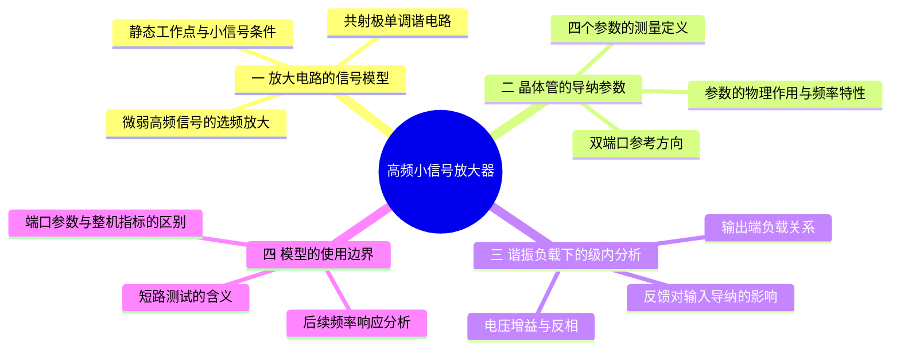

---
tags:
  - 高频电子线路
  - 高频小信号放大器
  - y参数
  - 单调谐放大器
aliases:
  - 第6课
  - 高频小信号放大器
---
# 第6课 高频小信号放大器

## 本课概要

前几课研究的谐振回路能从许多频率中挑出一段，却不能补偿接收链路中的信号衰减。现在把晶体管接到谐振回路前面：晶体管提供能量增益，谐振回路决定哪些频率得到较大的输出。这就是本章的研究对象。除了能放大，还要考察它能通过多宽的频带、能多有效地压低邻近干扰，以及工作是否稳定、引入多少噪声。我们先把一个放大级在**某个工作频率附近**的连接和参数讲清；有了这套模型，后续才能可靠地推这些指标。

本章按国内高频电子线路课程常见的知识依赖顺序展开，前一环节的模型会成为后一环节的计算基础：

本轮先学到单级的双端口模型及其接负载后的基本计算。后面的主题将沿这条路线逐段续写；双调谐与集中选频的具体深度可再与教师课件对照。

## 1. 共射极单调谐放大器的信号通路

设天线前级送来一个很弱的高频电压，目标频率为 $f_0$。若只接一个并联谐振回路，回路能够选频，却无法把输入信号变得更强。共射极晶体管可以让基极的小电压变化控制较大的集电极电流变化；把并联谐振回路接在集电极，电流变化又在回路上形成输出电压。

![[高频振荡回路与阻抗匹配.assets/18-共射极单调谐放大器-交流信号通路.svg]]

图中只画**交流小信号通路**：直流偏置电阻、电源去耦和耦合电容按工作频率下的等效状态省略。实际电路必须先有合适的静态工作点，使晶体管处于放大区；输入变化还要足够小，使参数可视为常量。没有这些条件，下面的线性关系就不能直接用。

上一课见过并联回路在谐振附近阻抗较大：相同的集电极交流电流，在谐振附近形成更大的电压；远离谐振时输出变小。因此，“晶体管放大”和“回路选频”是同一级中配合的两个作用。接下来要把晶体管本身从整张电路图中抽出来，才能分清器件作用与外接回路作用。

## 2. 晶体管的双端口导纳描述

### 2.1 端口量与参考方向

对共射极电路，把发射极作为交流公共端；基极与发射极构成输入端口，集电极与发射极构成输出端口。分别用 $v_1$、$v_2$ 表示两端口**上端对公共端**的相量电压，用 $i_1$、$i_2$ 表示**流入晶体管**的相量电流。相量保留幅值与相位，因此参数一般是复数，也会随频率变化。

![[高频振荡回路与阻抗匹配.assets/19-晶体管双端口-电压电流参考方向.svg]]

一端施加电压时，两端都可能有电流；因此只用一个输入电阻或一个电流放大倍数，无法完整描述高频晶体管。在线性小信号条件下，两个端口电流都可写成两个端口电压的线性组合：

$$
\begin{cases}
i_1=y_{ie}v_1+y_{re}v_2,\\
i_2=y_{fe}v_1+y_{oe}v_2.
\end{cases}
$$

下标 $i$、$o$ 分别指输入、输出，$f$、$r$ 分别指正向、反向，$e$ 指共射极组态。四个 $y$ 的量纲都是西门子（S），因为它们都是“电流相量除以电压相量”的导纳。矩阵写法只是把同一组关系压缩表示：

$$
\begin{bmatrix}i_1\\i_2\end{bmatrix}
=
\begin{bmatrix}y_{ie}&y_{re}\\y_{fe}&y_{oe}\end{bmatrix}
\begin{bmatrix}v_1\\v_2\end{bmatrix}.
$$

### 2.2 四个参数的测量意义

怎样把两个电压的影响分开？令其中一个端口的**交流电压为零**，另一个电压对电流的作用便可单独测出。这里的短路是交流测试条件，不是把实际放大器长期短接。

| 测试条件 | 参数定义 | 它告诉我们的事 |
|---|---|---|
| 输出端交流短路，$v_2=0$ | $y_{ie}=\left.\dfrac{i_1}{v_1}\right|_{v_2=0}$ | 输入电压造成多少输入电流，即短路输出条件下的输入导纳 |
| 输入端交流短路，$v_1=0$ | $y_{re}=\left.\dfrac{i_1}{v_2}\right|_{v_1=0}$ | 输出电压经晶体管内部返回输入端的作用，称反向传输导纳 |
| 输出端交流短路，$v_2=0$ | $y_{fe}=\left.\dfrac{i_2}{v_1}\right|_{v_2=0}$ | 输入电压控制输出电流的作用，称正向传输导纳 |
| 输入端交流短路，$v_1=0$ | $y_{oe}=\left.\dfrac{i_2}{v_2}\right|_{v_1=0}$ | 输出电压自身造成的输出端电流，即短路输入条件下的输出导纳 |

这些定义的关键是**固定住另一端口电压**。例如 $y_{ie}$ 不是晶体管接上任意负载后的输入导纳；接上负载后，输出电压通常不为零，$y_{re}v_2$ 也会贡献输入电流。后面会直接算出两者的差别。

同一组方程可画成等效电路：每个端口都有一个自身导纳支路，另有一个由对侧电压控制的电流源。图里的受控电流源是数学模型，不是电路中另装的器件。

![[高频振荡回路与阻抗匹配.assets/20-共射极y参数-双端口等效电路.svg]]

高频下不仅电流与电压的幅值可能不同，相位也可能不同，所以可以把自身导纳写作 $y_{ie}=g_{ie}+jb_{ie}$、$y_{oe}=g_{oe}+jb_{oe}$。实部 $g$ 对应同相电流，虚部 $b$ 对应相差四分之一周期的电流；正向和反向传输导纳同样一般为复数。具体数值必须对应**指定的偏置、频率和温度**。参数表中的某频点数据不能不加检验地用于很宽的频带。

## 3. 接上谐振负载后的电压与输入导纳

现在把外接选频回路及其损耗、下一级负载在输出端合并为一个负载导纳 $Y_L$。这是“从集电极端口向外看”的导纳；它与晶体管内部的 $y_{oe}$ 是并联关系。上面规定 $i_2$ 流入晶体管，而流入负载的电流为 $Y_Lv_2$，在输出节点列电流守恒得到

![[高频振荡回路与阻抗匹配.assets/21-输出端接入谐振负载-电流方向.svg]]

$$
i_2+Y_Lv_2=0.
$$

把晶体管的输出端方程代入，便有

$$
y_{fe}v_1+(y_{oe}+Y_L)v_2=0,
\qquad
A_v\equiv\frac{v_2}{v_1}=-\frac{y_{fe}}{y_{oe}+Y_L}.
$$

$A_v$ 是从**晶体管输入端电压**到**输出端电压**的级内电压增益；分母是集电极端并联导纳之和。负号来自所选电压、电流方向与节点电流守恒，表示在参数近似为实数且负载处于谐振时，共射极输出通常与输入反相。它不意味着所有频率下相位都严格等于半个周期。若计算从信号源到输出的总增益，还要把源内阻与实际输入导纳造成的分压计入。

再把 $v_2=A_vv_1$ 代回输入方程，可以看出负载会反过来改变晶体管呈现给信号源的输入导纳：

$$
Y_{in}\equiv\frac{i_1}{v_1}
=y_{ie}-\frac{y_{re}y_{fe}}{y_{oe}+Y_L}.
$$

第二项沿着“输入控制输出电流 → 负载上产生输出电压 → 输出电压经反向传输回到输入”的路径形成。它解释了为什么不能把 $y_{ie}$ 永远当作实际输入导纳，也说明谐振负载不仅影响输出，还可能影响输入匹配。若 $y_{re}$ 足够小，且校核精度允许，才可近似 $Y_{in}\approx y_{ie}$。

### 3.1 一个工作频点的计算

设某工作频点测得 $y_{ie}=(2+j1)\,\mathrm{mS}$、$y_{re}=-j0.05\,\mathrm{mS}$、$y_{fe}=(20-j1)\,\mathrm{mS}$、$y_{oe}=(0.2+j0.4)\,\mathrm{mS}$。这里 $j$ 表示相位超前四分之一周期的虚数单位；这些数只是练习同一套端口约定的示例，不是某个器件的通用参数。令外接负载在这个频点为 $Y_L=(0.8-j0.4)\,\mathrm{mS}$。它的虚部恰好抵消 $y_{oe}$ 的虚部，合计导纳为 $1.0\,\mathrm{mS}$。

于是该频点的级内电压增益为

$$
A_v=-\frac{20-j1}{1.0}=-20+j1,
\qquad |A_v|\approx20.02.
$$

因为式中的分子、分母都用毫西门子，量纲相消。输入导纳则为

$$
Y_{in}=(2+j1)-\frac{(-j0.05)(20-j1)}{1.0}
=(2.05+j2.00)\,\mathrm{mS}.
$$

虽然 $|y_{re}|$ 远小于 $|y_{fe}|$，输入导纳的虚部仍由 $1$ 增加到 $2\,\mathrm{mS}$。这不是计算异常，而是输出端电压较大，使小的反向作用也能明显回到输入端。做输入匹配时要看 $Y_{in}$，不能只抄 $y_{ie}$。若上述数据并非同一频率、同一偏置条件，结果也没有物理意义。

## 4. 本轮模型的使用边界与下一步

到这里，我们已经可以在一个指定频点根据晶体管参数和外接负载求级内电压增益、实际输入导纳，也能判断反向传输是否可忽略。但 $Y_L$ 本身随频率变化，晶体管的四个参数也可能随频率变化；只有把这些变化放回谐振回路，才会得到整级的幅频和相频曲线。下一轮从**单调谐放大器的选频响应**开始，再讨论有载品质因数、通频带与增益的牵制。多级级联和稳定性应在单级响应清楚之后处理。

本轮尤其要避免三种混淆：短路测试参数不等于任意接负载后的端口参数；$y_{oe}$ 属于晶体管而 $Y_L$ 属于外电路；级内 $A_v=v_2/v_1$ 不等于从信号源算起的总电压增益。
