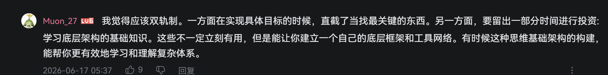

一个视频里说的AI能帮助你学习的几个关键点：

1.先让AI帮你搭学习阶梯，让AI把你要学的东西分为5个学习等级，每一层应该掌握什么，常见错误是什么，这一步不是为了让AI直接教会你所有，而是让你有一张地图，让你明白你现在在哪，下一步该往哪走。很多人学东西学不进去，一学就觉得难，觉得无从入手，想要放弃，就是因为一开始学就已经“跨级“了，应该先把基本的概念串起来，而不是一开始就来做复杂的项目，这样会导致越学越乱，因为他不知道何为基础，何为根本，是盲目的学习
2.学习20%的重点，学习不是一上来就研究所有边边角角的知识，他们固然重要，但那20%的重点才是根本，那20%学完了才能撬动剩余80%的内容。比如你打算花20个小时去学习某个东西，你告诉AI，你打算投入20个小时，让他找出这20%的重点，设计10次学习计划，每次2小时，每次都要有资源，练习，复盘，意在把一个庞大的高不可攀的学习目标拆分为无数个小的学习计划，一天只需2小时，积累和复盘会产生奇效。
（这里我就想到了之前提到的双轨制学习方法，一方面要直截了当地去找和学最关键的那部分内容，另一方面就要投入时间去学底层架构的基础知识，让你建立一个自己的底层框架和工具网络，也就是说，学习不仅有短线，也有长线，所以学习计划里不仅要有重点的学习，也要分另一条主线出来学习更底层的东西）
3.让AI问你问题，一直到你答不上来。每次你学完一个主题，就该让AI来每次只问你一个问题，从简单到困难，并给你的回答打分，并只重新解释你没掌握的知识，注意这里是只问一个问题，因为真正的学习反馈不是一次性一股脑给你几十道题和答案，而在在你学习一个小主题后，通过问答立马找出你的知识缺口，很多时候，你看完了一篇文档，看完了一个视频，你觉得自己学会了，实则只是看懂了，并不意味着你学懂了，因为你只接受了输入，却不能自己输出，这说明你只是看懂了，并没有学会。
4.让AI给你一张速查表，这个速查表也应该随着你的学习进度不断更新，每当你学完一个主题，应该让AI为你总结一个更精简的表单，不要直接把你今天所有的学习内容和细节都写进去，这是因为人脑天生不适合记忆长篇大论，更擅长记忆结构，因此你要把你学到的东西结构化，脑图xmind化，并给每个结构写好他的一句话总结，写出重要的概念，几个真实例子，常见的错误，你曾犯下的错误。这个东西他相当于你每次复习的时候