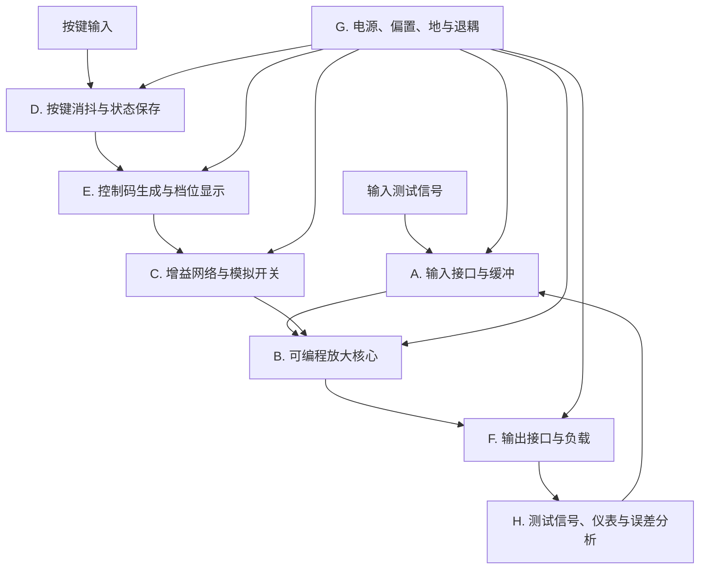
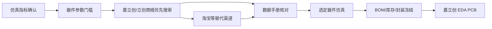

# 项目 A：功能级仿真拆分与选型路径

> **工作顺序：先确认仿真指标，再根据指标数据和网购可得性选择器件，最后使用选定器件进行分块和整机仿真。**
>
> 指标确认前不锁定具体型号；指标确认后立即进入器件筛选。器件必须优先能在嘉立创/立创商城购买，其次能在淘宝等正规渠道购买。无法稳定网购的器件不能进入最终 BOM。
>
> 最后更新：2026-10-11（Asia/Shanghai）。

## 1. 本阶段要解决的问题

项目 A 的工作顺序是：

1. 确认仿真输入、电源、增益、负载、频带、误差和控制指标；
2. 把系统指标换算为各功能部分的器件参数门槛；
3. 根据数据手册和网购可得性筛选器件，优先嘉立创/立创商城，其次淘宝等；
4. 使用选定或最终候选器件建立分块仿真电路；
5. 验证每个功能部分，再完成整机仿真；
6. 根据实际器件参数修正电路、误差和 BOM；
7. 在嘉立创 EDA 中绘制 PCB，并完成采购、焊接和测试。

因此，本阶段必须先形成 `项目A/00-仿真指标确认表.md`。指标冻结后再开始选型，不允许脱离指标只凭常见型号直接确定 BOM。

详细的功能定义仍需保留，以便把指标分配到输入缓冲、放大、增益切换、数字控制、输出和电源等部分。

## 2. 功能级系统描述

项目 A 的目标是：输入测试信号后，通过用户操作改变当前增益状态，并输出相应幅度的信号。

可以抽象为：

$$
v_{\mathrm o}(t)=G(C)\,v_{\mathrm i}(t)+e(t)
$$

其中：

- $v_{\mathrm i}(t)$ 为输入测试信号；
- $v_{\mathrm o}(t)$ 为输出信号；
- $C$ 为当前增益控制码；
- $G(C)$ 为控制码对应的电压增益；
- $e(t)$ 为失调、噪声、失真、纹波等非理想误差。

当前分析稿拟定 16 个增益状态：

$$
G_{\mathrm{set}}=2+\sum_{k=0}^{3}2^k b_k,\qquad b_k\in\{0,1\}
$$

即控制码从 `0000` 到 `1111` 时，标称增益为：

$$
G_{\mathrm{set}}=2,3,4,\ldots,17
$$

但该增益表仍属于 `[分析建议]`，需要教师确认后才能冻结为设计指标。

## 3. 系统功能框图



模拟信号主链路是：

```text
输入接口 -> 缓冲 -> 可编程放大 -> 输出接口 -> 负载/测量
```

数字控制链路是：

```text
按键 -> 消抖 -> 状态保存/计数 -> 控制码 -> 模拟开关状态
```

项目 B 的语音信号、带通滤波、功率放大和扬声器不属于项目 A。

---

# 4. 分块定义

## 4.1 A. 输入接口与缓冲

### 功能

接收信号源输出的测试信号，并为后级提供幅度明确、受负载影响较小的信号。输入缓冲的作用是隔离信号源与增益网络，防止后级输入阻抗或切换动作明显改变输入信号。

### 输入与输出

| 接口 | 内容 | 状态 |
|---|---|---|
| 输入 | 输入幅度 $V_{\mathrm{i,pp}}$、频率 $f_{\mathrm i}$、信号源内阻 $R_{\mathrm s}$ | `[待确认]` |
| 输出 | 缓冲后的测试信号 $v_{\mathrm b}(t)$ | `[仿真结果]` |

### 基本原理

理想电压缓冲器满足：

$$
v_{\mathrm b}(t)\approx v_{\mathrm i}(t)
$$

实际运放会受到输入偏置电流、失调电压、带宽、输出摆幅和电源条件影响。输入缓冲通常采用高输入阻抗、低输出阻抗的电压跟随或同相放大结构。

### 默认补充的模拟知识

- 运算放大器的理想模型与实际限制；
- 虚短、虚断的工程理解；
- 输入阻抗、输出阻抗和负载效应；
- 输入偏置电流与失调电压；
- 单电源、双电源和共模输入范围；
- 信号源内阻对测量的影响。

### 分块仿真任务

1. 对比接入缓冲前后的输入信号变化；
2. 改变信号源内阻，观察缓冲效果；
3. 检查不同频率下的幅值和相位；
4. 检查接近电源电压时是否削顶。

---

## 4.2 B. 可编程放大核心

### 功能

根据当前控制状态，将输入信号放大到目标幅度。它是项目 A 的核心性能模块。

### 输入与输出

| 接口 | 内容 | 状态 |
|---|---|---|
| 输入 | 缓冲信号 $v_{\mathrm b}(t)$、等效反馈参数 | `[分析建议]` |
| 输出 | 放大信号 $v_{\mathrm g}(t)$ | `[仿真结果]` |
| 约束 | 增益、带宽、输出摆幅、失真、噪声 | `[待确认]` |

### 基本原理

先以非反相放大器作为功能基线：

$$
G=1+\frac{R_{\mathrm f}}{R_{\mathrm g}}
$$

其中，$R_{\mathrm f}$ 为反馈电阻，$R_{\mathrm g}$ 为反相输入端到地之间的等效电阻。

完成固定增益验证后，再把 $R_{\mathrm g}$ 替换为可编程网络：

$$
G(C)=1+\frac{R_{\mathrm f}}{R_{\mathrm g}(C)}
$$

必须同时检查：

$$
|v_{\mathrm o}(t)|\leq V_{\mathrm{o,max}}
$$

因为最高增益档不一定能够保持线性输出，$V_{\mathrm{o,max}}$ 由电源、运放输出级和负载共同决定。

### 默认补充的模拟知识

- 负反馈和非反相放大原理；
- 增益带宽积、压摆率和闭环带宽；
- 输出摆幅、削顶和饱和；
- 失调、噪声及其随增益放大；
- 反馈电阻精度与热漂移；
- 运放驱动负载的能力；
- 增益提高后带宽和稳定性下降的问题。

### 分块仿真任务

1. 只仿真一个固定增益档；
2. 验证理论增益和仿真增益；
3. 增大输入幅度，记录首次失真或削顶；
4. 扫描频率，得到幅频响应；
5. 确认反馈节点、相位裕度或异常振荡风险。

---

## 4.3 C. 增益网络与模拟开关

### 功能

按照控制码改变 $R_{\mathrm g}$，从而改变放大器闭环增益。模拟开关只承担信号路径选择和电阻网络切换功能，不应与数字逻辑开关混为一谈。

### 输入与输出

| 接口 | 内容 | 状态 |
|---|---|---|
| 输入 | 四位控制码或等效开关状态 | `[分析建议]` |
| 输出 | 控制码对应的 $R_{\mathrm g}(C)$ | `[仿真结果]` |
| 约束 | 导通电阻、信号范围、切换瞬态、漏电流 | `[待确认]` |

### 基本原理

功能上可写为：

$$
R_{\mathrm g}(C)=F(R_0,R_1,R_2,R_3,C)
$$

其中，$F$ 表示具体串并联拓扑，目前尚未冻结。控制码不同，接入反馈网络的电阻支路不同，因此 $R_{\mathrm g}(C)$ 和 $G(C)$ 随之改变。

实际模拟开关具有导通电阻：

$$
R_{\mathrm{branch}}=R_{\mathrm{ideal}}+R_{\mathrm{on}}
$$

是否可以直接这样相加，以及误差多大，取决于支路与 $R_{\mathrm{on}}$ 的实际连接方式。因此必须先确定拓扑，再建立误差模型。

### 默认补充的模拟知识

- 电阻串联、并联和等效变换；
- 二进制权电阻网络的含义；
- 模拟开关的导通电阻 $R_{\mathrm{on}}$；
- 开关的输入信号范围和漏电流；
- 导通、截止状态与控制电平；
- 切换过程中的毛刺和瞬态；
- 电阻容差、温漂和增益误差。

### 默认补充的数字知识

- 控制码的二进制表示；
- 高低电平与开关状态的逻辑映射；
- 禁止出现不可预测的中间状态；
- 控制信号与模拟信号的隔离和回流路径。

### 分块仿真任务

1. 先用理想开关验证控制码到 $R_{\mathrm g}(C)$ 的映射；
2. 再加入有限 $R_{\mathrm{on}}$，观察增益偏差；
3. 对电阻容差进行参数扫描或最坏情况分析；
4. 检查相邻档位切换时的输出毛刺；
5. 验证最高、最低增益档的线性范围。

---

## 4.4 D. 按键消抖与状态保存

### 功能

把不稳定的机械按键动作转换成一次有效操作。其功能目标可以写成：

> 每次有效按下按键，只改变一次增益状态，不因触点抖动产生多次跳档。

### 输入与输出

| 接口 | 内容 | 状态 |
|---|---|---|
| 输入 | 机械按键电平 | `[功能需求]` |
| 输出 | 一次有效触发或稳定状态 | `[仿真结果]` |
| 约束 | 抖动时间、响应速度、误触发 | `[待确认]` |

### 基本原理

机械触点闭合时会产生多次快速通断，即按键抖动。功能上可通过时间延迟、积分判断或锁存状态消除抖动。该部分可以先建立行为级模型：

```text
不稳定按键信号 -> 判定为一次有效动作 -> 输出单次触发或稳定状态
```

当前不锁定采用电阻电容消抖、触发器消抖还是其他逻辑结构。

### 默认补充的数字知识

- 机械按键抖动；
- 组合逻辑与时序逻辑的区别；
- 触发器的状态保持；
- 真值表和状态转换；
- 有效电平、上升沿、下降沿；
- 复位和上电状态；
- 按键响应时间。

### 默认补充的模拟知识

- $RC$ 充放电时间常数；
- 输入保护和悬空电平；
- 逻辑输入阈值与噪声裕量。

### 分块仿真任务

1. 输入一段带有多次抖动的测试波形；
2. 验证输出只产生一次有效动作；
3. 改变抖动时间，确定有效范围；
4. 快速连续按键时检查状态行为；
5. 检查上电时是否产生误动作。

---

## 4.5 E. 控制码生成与档位显示

### 功能

保存当前增益状态，根据有效按键操作更新控制码，并向模拟开关和显示部分提供稳定信号。

### 输入与输出

| 接口 | 内容 | 状态 |
|---|---|---|
| 输入 | 单次有效按键触发、复位信号 | `[功能需求]` |
| 输出 | 控制码 $C$、档位显示 | `[分析建议]` |
| 约束 | 状态数、计数顺序、上电初值 | `[待确认]` |

### 基本原理

若采用循环递增方式，16 档状态可抽象为：

$$
C_{\mathrm{next}}=(C_{\mathrm{current}}+1)\bmod 16
$$

控制码可用四位二进制表示：

$$
C=b_3b_2b_1b_0
$$

显示部分只需要让用户识别当前状态，具体采用二进制 LED、十六进制数码管或其他方式，均在后续选型时确定。

### 默认补充的数字知识

- 二进制与十六进制；
- 四位计数和模运算；
- 同步、异步复位；
- 时钟或有效触发的概念；
- 触发器级联；
- LED 限流和逻辑输出驱动能力；
- 显示译码的必要性。

### 分块仿真任务

1. 用单次触发验证状态递增；
2. 检查 `0000` 到 `1111` 的完整循环；
3. 验证复位后初态；
4. 检查控制码与增益档位映射；
5. 验证显示信号不会影响模拟控制。

---

## 4.6 F. 输出接口与负载

### 功能

把放大后的信号传送给测量仪器或负载，并明确输出摆幅、驱动能力和失真边界。

### 输入与输出

| 接口 | 内容 | 状态 |
|---|---|---|
| 输入 | 放大后的信号 $v_{\mathrm g}(t)$ | `[仿真结果]` |
| 输出 | $v_{\mathrm o}(t)$ | `[仿真结果]` |
| 约束 | 负载电阻 $R_{\mathrm L}$、输出电流、带宽、保护 | `[待确认]` |

### 基本原理

信号源经放大级后通常需要较低输出阻抗。若负载过重，输出摆幅、带宽和失真都会恶化。可以先采用理想负载测试，再逐步加入真实负载和输出隔离电阻。

### 默认补充的模拟知识

- 输出阻抗和负载效应；
- 最大输出电流；
- 削顶、饱和、交越失真；
- 容性负载稳定性；
- 输出短路保护；
- 示波器和负载对电路的影响。

### 分块仿真任务

1. 对比空载和接入负载后的输出；
2. 改变 $R_{\mathrm L}$，观察幅度和失真；
3. 检查最高增益档的最大不失真输出；
4. 检查容性负载下是否振荡；
5. 记录输出范围和最大安全输入。

---

## 4.7 G. 电源、偏置、地与退耦

### 功能

为模拟、开关和数字部分提供稳定工作条件，并控制噪声通过电源和地相互耦合。

### 基本原理

所有有源器件都需要能量和合适的直流工作点。电源不是附属部分，而会直接影响增益、输出摆幅、噪声和稳定性。退耦电容为芯片的快速电流需求提供本地回路，地规划决定干扰电流的返回路径。

### 默认补充的模拟知识

- 单电源与双电源；
- 虚地、偏置点和共模范围；
- 电源抑制比；
- 去耦和滤波；
- 电源内阻和地弹；
- 模拟地与数字地的回流。

### 默认补充的数字知识

- 逻辑器件电源；
- 上电复位；
- 逻辑电平兼容；
- 数字开关噪声对模拟增益级的耦合。

### 分块仿真任务

1. 先在理想电源下验证功能；
2. 再加入有限电源内阻和纹波；
3. 观察控制码切换时的电源扰动；
4. 检查输出中的电源相关毛刺；
5. 为 PCB 退耦和分区提供依据。

---

## 4.8 H. 测试信号、仪表与误差分析

### 功能

为所有模块提供统一测试条件，并把波形和测量结果转换为可以写入报告的证据。

### 基本测量

实际增益为：

$$
G_{\mathrm{meas}}=\frac{V_{\mathrm{o,pp}}}{V_{\mathrm{i,pp}}}
$$

相对误差为：

$$
\delta=\frac{G_{\mathrm{meas}}-G_{\mathrm{set}}}{G_{\mathrm{set}}}\times 100\%
$$

电压增益用分贝表示时为：

$$
A_v=20\log_{10}|G|
$$

### 默认补充的测量知识

- 峰峰值、有效值和平均值；
- 示波器探头与地线；
- 仪器输入阻抗；
- 频率响应；
- 增益误差和绝对误差；
- 谐波失真和信噪比；
- 仿真截图、数据表和结论之间的对应关系。

### 统一仿真输出

每个模块至少保存：

1. 原理图或功能模型；
2. 输入和输出波形；
3. 工作条件；
4. 关键测量值；
5. 理论值、仿真值和误差；
6. 非理想因素说明；
7. 结论及下一步。

---

# 5. 从指标到仿真的工作阶段

## 阶段 S0：确认仿真指标

输入：教师要求、测试条件和课程实现条件。

输出：

- `项目A/00-仿真指标确认表.md` 中的必填项全部冻结；
- 电源、输入、增益、输出、频带、误差和控制要求明确；
- 尚未确认的内容不再用于器件选型。

## 阶段 S1：换算器件参数门槛

把系统指标分配到各功能部分：

| 功能部分 | 主要指标 | 转换后的器件参数 |
|---|---|---|
| 输入缓冲 | 输入阻抗、频率、幅度 | 偏置电流、输入范围、GBW、输出摆幅 |
| 放大核心 | 最高增益、最高频率、最大输出 | GBW、压摆率、输出摆幅、输出电流、噪声 |
| 增益网络 | 增益表、最大增益误差 | 电阻值、精度、功率、温漂 |
| 模拟开关 | 信号范围、增益误差 | 导通电阻、漏电流、信号范围、逻辑电平 |
| 消抖/状态 | 抖动时间、响应速度 | 电源、输入阈值、延时和状态功能 |
| 控制码 | 档数、循环方式 | 位数、复位、触发、驱动能力 |
| 输出接口 | 负载、最大输出 | 输出电流、输出阻抗、容性负载能力 |
| 电源 | 电压、电流、纹波 | 耐压、功耗、去耦和封装 |

典型换算关系包括：

$$
\mathrm{GBW}_{\min}\geq m_G G_{\max}f_{\max}
$$

$$
\mathrm{SR}_{\min}\geq m_S\,2\pi f_{\max}V_{\mathrm{o,peak}}
$$

$$
I_{\mathrm{o,peak}}=\frac{V_{\mathrm{o,peak}}}{R_{\mathrm L}}
$$

其中，$m_G$、$m_S$ 和 $m_I$ 为需要在选型时明确的裕量系数。

## 阶段 S2：器件筛选和网购可得性检查

每个功能先写参数门槛，再到网上寻找满足条件的器件。

筛选顺序：

1. 嘉立创/立创商城优先；
2. 检查符号、封装和嘉立创 EDA 支持；
3. 检查当前库存、价格、起订量和商品编号；
4. 查阅数据手册，确认关键参数；
5. 嘉立创缺货时检查淘宝等正规渠道；
6. 为关键器件准备替代型号；
7. 记录商品链接、库存和数据依据。

硬门槛：

- 电气指标满足并有裕量；
- 能在网上稳定购买；
- 封装适合课程焊接和调试；
- 嘉立创 EDA 中可绘制；
- 数据手册足以支持仿真；
- 价格和采购数量可接受。

## 阶段 S3：使用选定器件分块仿真

根据 S2 的候选或选定器件建立仿真电路。每个功能部分单独验证：

- 输入缓冲；
- 固定增益放大基线；
- 增益网络和模拟开关；
- 按键消抖与状态保存；
- 控制码生成与显示；
- 输出接口与负载；
- 电源、偏置和退耦；
- 统一测试和误差分析。

仿真模型不足时，应记录所用理想化假设，不能把行为级结果冒充实际器件性能。

## 阶段 S4：整机仿真与容差检查

使用选定器件完成整体连接，验证：

- 全部增益档和控制顺序；
- 最大输出与削顶；
- 频率响应和带宽；
- $R_{\mathrm{on}}$、电阻容差造成的增益误差；
- 按键抖动和档位切换瞬态；
- 电源波动、负载变化和最差条件；
- 器件替代型号的影响。

## 阶段 S5：BOM 冻结与 PCB

只有 S4 通过后才冻结：

- 最终型号和立创商城编号；
- 封装、替代型号和采购渠道；
- 原理图参数和仿真证据；
- 测试点、电源、地和退耦；
- 嘉立创 EDA 原理图与 PCB。

---

# 6. 器件选择与嘉立创实现原则

## 6.1 选择流程



## 6.2 选型记录格式

| 功能块 | 指标门槛 | 候选型号 | 采购平台 | 商品编号/链接 | 库存 | 价格 | 封装 | 数据依据 | 替代型号 | 结论 |
|---|---|---|---|---|---|---:|---|---|---|---|
| 待定 | 待计算 | 待选 | 嘉立创优先 | 待查 | 待查 | 待查 | 待定 | 待补 | 待查 | 待定 |

## 6.3 型号选择时必须检查

- 嘉立创 EDA 是否有符号和封装；
- 嘉立创/立创商城是否有货；
- 淘宝等渠道是否可作为缺货替代；
- 工作电压、摆幅、GBW、压摆率和负载能力是否满足；
- 模拟开关的 $R_{\mathrm{on}}$、信号范围和逻辑电平是否满足；
- 封装是否便于课程焊接和调试；
- 价格、起订量和交期是否可接受；
- 是否有可采购的替代器件；
- 选定后是否需要用实际参数重新仿真。

PPT 中的器件型号只作为搜索起点，不能绕过指标、数据手册和购买可得性检查。

---

# 7. 当前不做的事

本阶段明确不做：

- 仿真指标未确认前，不提前锁定器件型号；
- 不脱离指标和数据手册直接照抄常见电路；
- 不把无法稳定网购的器件写入最终 BOM；
- 不假设某个芯片一定有货或一定适合课程焊接；
- 不把理想化或行为级仿真结果写成实际器件性能；
- 不在选型完成前直接画最终 PCB；
- 不把空的试验目录写成已完成仿真；
- 不混入项目 B 的语音和扬声器内容；
- 不编译 Keil、ESP 或其他嵌入式工程。

---

# 8. 当前最该完成的输出

优先完成以下内容：

1. 冻结 `项目A/00-仿真指标确认表.md`；
2. 将指标换算为器件参数门槛；
3. 优先在嘉立创/立创商城筛选并确认可购买的候选器件；
4. 对嘉立创缺货器件检查淘宝等替代渠道；
5. 记录型号、商品编号、库存、价格、封装和数据手册依据；
6. 使用选定或最终候选器件建立分块仿真电路；
7. 完成全档位整机仿真和容差检查；
8. 冻结 BOM、替代型号和仿真证据后进入嘉立创 EDA PCB。
