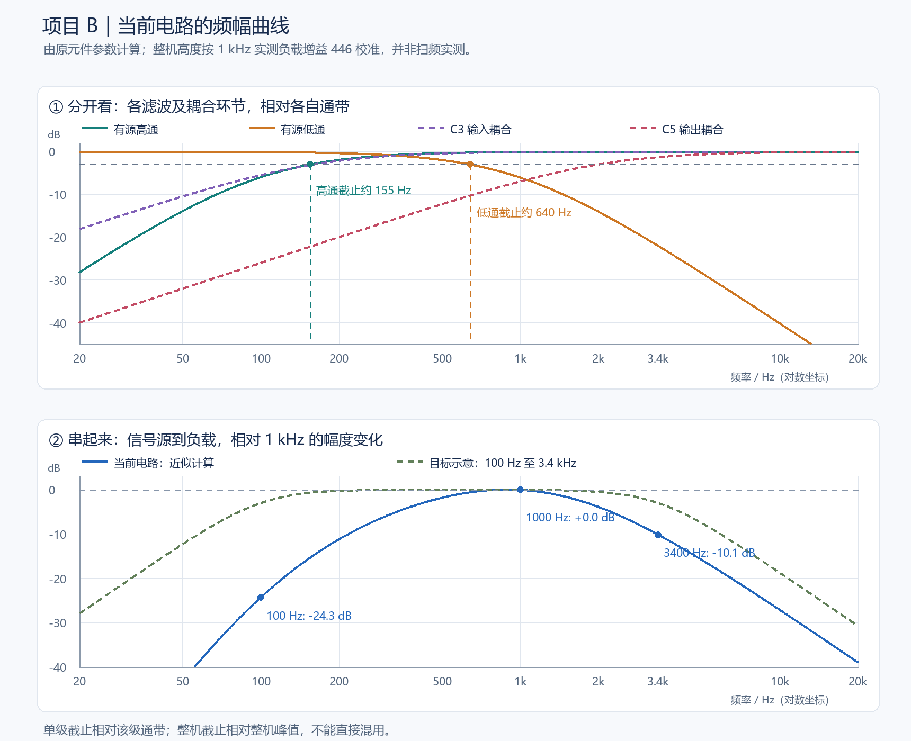

# 项目 B：现在的频幅曲线有什么问题？

现在的输入是 $1\,\mathrm{kHz}$、交流峰值约 $5\,\mathrm{mV}$，可以保留。只是判断滤波效果要看整个频率范围，不能只看这个频率下放大了多少倍。

下面按原元件参数计算，并用你实测的负载增益 $446$ 倍校准整机曲线。**这是计算预测，不是新做的 Multisim 扫频。**暂时把导入功放的增益视为不随频率变化，C3 后的等效电阻按 $10\,\mathrm{k\Omega}$ 近似；曲线用于说明阻容网络的问题。

## 1．先看曲线

上半图把高通、低通、两个耦合环节分开看；下半图把它们串起来，看信号源到负载的结果。绿色虚线只是希望得到的频带形状示意，不代表已经改好了电路。

## 2．我们的高通、低通，截止在哪里？

这里“截止”指 **$-3\,\mathrm{dB}$ 点**，即电压幅度降至参考通带的约 $0.707$。

### 有源高通：约 $155\,\mathrm{Hz}$

R3、R4 都是 $10\,\mathrm{k\Omega}$，C1、C2 都是 $160\,\mathrm{nF}$，运放接成跟随器。它的特征频率是：

$$
f_{0,\mathrm H}=\frac{1}{2\pi RC}\approx99.47\,\mathrm{Hz}
$$

这种等值元件、单位增益二阶接法的幅度响应是：

$$
\lvert H_{\mathrm H}(f)\rvert=\frac{1}{1+(f_{0,\mathrm H}/f)^2}
$$

因此，特征频率不直接等于半功率截止频率：

$$
f_{\mathrm{高通截止}}=f_{0,\mathrm H}\sqrt{1+\sqrt2}\approx154.6\,\mathrm{Hz}
$$

**在 $100\,\mathrm{Hz}$ 时，这一级就已让幅度约减半。下限比希望的偏高。**

### 有源低通：约 $640\,\mathrm{Hz}$

R7、R8 都是 $10\,\mathrm{k\Omega}$，C6、C7 都是 $16\,\mathrm{nF}$：

$$
f_{0,\mathrm L}=\frac{1}{2\pi RC}\approx994.72\,\mathrm{Hz}
$$

$$
\lvert H_{\mathrm L}(f)\rvert=\frac{1}{1+(f/f_{0,\mathrm L})^2}
$$

$$
f_{\mathrm{低通截止}}=f_{0,\mathrm L}\sqrt{\sqrt2-1}\approx640.2\,\mathrm{Hz}
$$

**这一级衰减得太早：在 $1\,\mathrm{kHz}$ 时剩约 $49.7\%$，在 $3.4\,\mathrm{kHz}$ 时只剩约 $7.9\%$。**与你测到低通输出约减半是一致的。

## 3．还有两个额外高通，不能漏掉

| 环节 | 原元件参数 | 单独的近似截止频率 | 主要影响 |
|---|---|---|---|
| 有源高通 | $10\,\mathrm{k\Omega}$、$160\,\mathrm{nF}$，等值二阶接法 | $155\,\mathrm{Hz}$ | 低端衰减偏早 |
| 有源低通 | $10\,\mathrm{k\Omega}$、$16\,\mathrm{nF}$，等值二阶接法 | $640\,\mathrm{Hz}$ | 过早削弱语音高频 |
| 输入耦合 C3 | $0.1\,\mu\mathrm F$，后接约 $10\,\mathrm{k\Omega}$ | $159\,\mathrm{Hz}$ | 又增加低频衰减 |
| 输出耦合 C5 | $10\,\mu\mathrm F$、$8\,\Omega$ 负载 | $1.99\,\mathrm{kHz}$ | 大量低频到不了负载 |

C3 的近似忽略了功放输入加载；C3、C5 的一阶高通公式为：

$$
f_c=\frac{1}{2\pi RC},\qquad
\lvert H_{\mathrm{耦合}}(f)\rvert=\frac{1}{\sqrt{1+(f_c/f)^2}}
$$

**上表是各环节单独的截止频率，并不是整机的上下截止点。**

## 4．整机的频幅变化

把前级、电位器和功放的固定幅度因子合并为 $K$，当前阻容网络给出的近似响应为：

$$
A(f)=K\,
\frac{1}{1+(99.47/f)^2}\,
\frac{1}{1+(f/994.72)^2}\,
\frac{1}{\sqrt{1+(159.15/f)^2}}\,
\frac{1}{\sqrt{1+(1989.44/f)^2}}
$$

其中频率统一用赫兹；用实测 $A(1000)=446$ 确定整体高度。以下是计算值，并非每个频率都已实测。相对变化按下式计算：

$$
\Delta G(f)=20\log_{10}\frac{A(f)}{A(1000)}
$$

| 输入频率 | 负载增益（计算） | 相对参考增益的变化 | 输入峰值不变时的负载峰值（计算） |
|---|---|---|---|
| $50\,\mathrm{Hz}$ | $3.1$ | $-43.18\,\mathrm{dB}$ | $0.015\,\mathrm V$ |
| $100\,\mathrm{Hz}$ | $27.1$ | $-24.32\,\mathrm{dB}$ | $0.136\,\mathrm V$ |
| $155\,\mathrm{Hz}$ | $76.5$ | $-15.31\,\mathrm{dB}$ | $0.383\,\mathrm V$ |
| $300\,\mathrm{Hz}$ | $222.1$ | $-6.06\,\mathrm{dB}$ | $1.111\,\mathrm V$ |
| $500\,\mathrm{Hz}$ | $364.2$ | $-1.76\,\mathrm{dB}$ | $1.821\,\mathrm V$ |
| $640\,\mathrm{Hz}$ | $419.0$ | $-0.54\,\mathrm{dB}$ | $2.095\,\mathrm V$ |
| $1000\,\mathrm{Hz}$ | $446.0$ | $+0.00\,\mathrm{dB}$ | $2.230\,\mathrm V$ |
| $2000\,\mathrm{Hz}$ | $285.5$ | $-3.88\,\mathrm{dB}$ | $1.427\,\mathrm V$ |
| $3400\,\mathrm{Hz}$ | $138.7$ | $-10.15\,\mathrm{dB}$ | $0.693\,\mathrm V$ |
| $10000\,\mathrm{Hz}$ | $19.6$ | $-27.13\,\mathrm{dB}$ | $0.098\,\mathrm V$ |

**现在不是宽而平坦的语音通带，而是中间一段突出，两端明显降低。**

计算曲线最高点约在 $890\,\mathrm{Hz}$，增益约 $450$。相对这个最大值下降 $3\,\mathrm{dB}$ 的整机上下截止约为 $422\,\mathrm{Hz}$ 和 $1799\,\mathrm{Hz}$。它们包含了两级滤波、输入耦合、输出耦合的共同作用，实际值要通过扫频确认。

## 5．希望做到什么程度？

以下是建议的小组设计目标，不是老师额外规定的指标。以 $1\,\mathrm{kHz}$ 的整机负载增益作参考：

| 频率范围或位置 | 建议达到的效果 | 当前电路的计算情况 |
|---|---|---|
| $300\,\mathrm{Hz}$ 至 $2\,\mathrm{kHz}$ | 增益较平坦，相对参考值变化尽量不超过约 $1\,\mathrm{dB}$ | 两端分别低约 $6.1\,\mathrm{dB}$、$3.9\,\mathrm{dB}$，不够平坦 |
| 约 $100\,\mathrm{Hz}$ | 接近下截止点，相对参考增益下降约 $3\,\mathrm{dB}$ | 下降约 $24.3\,\mathrm{dB}$，低频损失过大 |
| 约 $3.4\,\mathrm{kHz}$ | 接近上截止点，相对参考增益下降约 $3\,\mathrm{dB}$ | 下降约 $10.1\,\mathrm{dB}$，高频损失过大 |
| 低于下限、超过上限 | 随着远离通带，衰减逐渐增大 | 虽有衰减，但希望保留的频段也衰减过多 |

如果参考增益取 $500$，则目标上下截止附近的增益约为：

$$
A_{\mathrm{截止}}\approx0.707\times500\approx354
$$

**不能只增加放大倍数：把曲线整体抬高，并不会让它变平，也不会修复两端相对中间衰减过大的问题。**

## 总结

- 输入可以保留，后续用相同幅度扫频，便于比较。
- 有源高通下限略高，有源低通上限明显过低，需要重新配参数。
- C3、C5 应适当增大，使耦合电容少干扰目标频段，尤其是 C5。
- 换正确的 LM386 模型后再调整增益；仅换功放，不会修复原有阻容网络造成的频带问题。

**现在已经验证了“能放大”，但“整个目标语音频带都能正常放大”还没有做到。**
