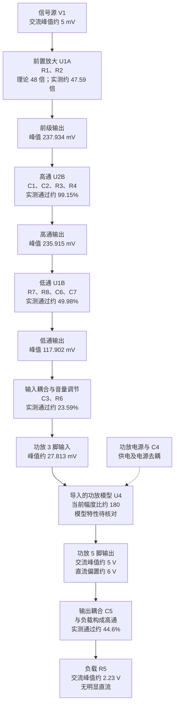

# 项目 B：电路链路与逐级增益仿真分析报告

## 1. 分析目的与测试条件

项目 B 的目标是将微弱语音信号经过前置放大、频段选择、音量调节和功率放大，最终驱动扬声器。本报告分析当前原电路在单一测试频率下的逐级电压增益、输出直流偏置及负载输出。

工程目录内已有“设计1 (1).ms14”。本文依据会话中的截图记录参数和连接，未解析工程内部模型，也未确认截图与工程保存状态完全一致。功放符号标为 LM386N-4；据组员说明，其模型由 AI 生成并导入。因此，必须区分“当前导入模型的表现”和“标准 LM386 的器件特性”。

| 项目 | 本次条件或约定 |
|---|---|
| 仿真软件 | Multisim 14.3，版本依据项目约定 |
| 输入波形 | 正弦波 |
| 输入频率 | $f=1\,\mathrm{kHz}$ |
| 输入交流峰值 | 约 $5\,\mathrm{mV}$ |
| 输入交流峰峰值 | 约 $10\,\mathrm{mV}$ |
| 信号源有效值设置 | 截图为 $3.535\,\mathrm{mV}$，对应峰值约 $5\,\mathrm{mV}$ |
| LM324 电源 | 截图为正负 $12\,\mathrm{V}$ |
| 功放电源 | 截图为单电源 $12\,\mathrm{V}$ |
| 电位器 R6 | 总阻值 $10\,\mathrm{k\Omega}$，滑片位置标注为 $75\%$ |
| 负载 R5 | $8\,\Omega$ 纯电阻，用于模拟扬声器负载 |
| 幅度比较规则 | 比较交流峰值，不把直流偏置计入交流增益 |

对于正弦波：

$$
V_{\mathrm{pp}}=2V_{\mathrm p},\qquad
V_{\mathrm{rms}}=\frac{V_{\mathrm p}}{\sqrt2}
$$

本报告的电压幅度增益定义为：

$$
A=\frac{V_{\mathrm{out,p}}}{V_{\mathrm{in,p}}}
$$

注意：[项目介绍中的项目 B 初选方案](../项目介绍/项目介绍.md)记录的输入为 $5\,\mathrm{mV}$ **峰峰值**，本次测试实际为约 $5\,\mathrm{mV}$ **峰值**，两者幅度条件相差一倍，不能混用。初选频段目标为 $100\,\mathrm{Hz}$ 至 $3.4\,\mathrm{kHz}$，最终指标仍应以课程任务书为准。

## 2. 完整电路链路框图

图中所有增益和通过比例仅对应本次测试频率。滤波与耦合环节的比例会随频率改变。C4 位于供电支路，不串入信号增益链。

框图内数字为测量标签，推导及单位排版见后文公式。

## 3. 测量记录与读数修正

### 3.1 整机测量

| 通道 | 测点 | 交流峰值 | 直流分量与相位观察 |
|---|---|---|---|
| A | 信号源输入 | 约 $5\,\mathrm{mV}$ | 用户报告微小直流，可忽略；作为相位参考 |
| B | 功放 3 脚输入 | 约 $27.813\,\mathrm{mV}$，按截图修正 | 无明显直流；相位相对输入移动 |
| C | 功放 5 脚输出 | 用户报告约 $5\,\mathrm{V}$；截图峰值附近为 $4.968\,\mathrm{V}$ | 用户另行观察到约 $6\,\mathrm{V}$ 直流；相位略有变化 |
| D | 负载电阻两端 | 用户报告约 $2.23\,\mathrm{V}$；截图峰值附近为 $2.245\,\mathrm{V}$ | 无明显直流；相位相对功放输出移动 |

**B 通道读数修正：**用户文字最初写功放输入峰值约 $1.5\,\mathrm{mV}$。第一张示波器截图中，第二个光标位置的 A 通道为 $1.482\,\mathrm{mV}$，B 通道为 $27.813\,\mathrm{mV}$。因此，本报告采用 B 通道峰值附近的约 $27.8\,\mathrm{mV}$，不把 A 通道在该时刻的读数当成功放输入峰值。

若使用 $1.5\,\mathrm{mV}$，将得到约 $3333$ 的功放幅度比，与截图不一致。本文采用的峰值仍是光标选点的近似读数，不是自动测量结果。

两张截图主要展示交流耦合波形；输出直流偏置约 $6\,\mathrm{V}$ 来自用户先前的直流耦合观察，并非交流耦合截图单独证明。用户约数与截图选点值存在精度差别，本文分开标注。

由于各节点存在相位差，应分别读取各波形自己的峰值，或统一测各自峰峰值；不能直接将同一时刻两个光标电压相除作为增益。

### 3.2 前三级补测

补测复用了示波器通道，以下通道位置与整机测试不同。

| 补测通道 | 测点 | 用户报告的交流峰值 | 直流分量 |
|---|---|---|---|
| A | U1A 前置放大输出 | $237.934\,\mathrm{mV}$ | 微小，可忽略 |
| B | U2B 高通输出 | $235.915\,\mathrm{mV}$ | 微小，可忽略 |
| C | U1B 低通输出 | $117.902\,\mathrm{mV}$ | 微小，可忽略 |

这三个补测数值来自用户文字记录，本次未提供相应的独立示波器截图。

## 4. 原电路参数与作用

| 环节 | 元件参数 | 主要作用 |
|---|---|---|
| 前置放大 | R1：$1\,\mathrm{k\Omega}$；R2：$47\,\mathrm{k\Omega}$ | 设定同相放大器负反馈比例 |
| 高通 | R3、R4：各 $10\,\mathrm{k\Omega}$；C1、C2：各 $160\,\mathrm{nF}$ | 与 U2B 构成二阶高通，削弱低频 |
| 低通 | R7、R8：各 $10\,\mathrm{k\Omega}$；C6、C7：各 $16\,\mathrm{nF}$ | 与 U1B 构成二阶低通，削弱高频 |
| 输入耦合 | C3：$0.1\,\mu\mathrm{F}$ | 隔离前级可能的直流偏移，同时影响低频 |
| 音量调节 | R6：$10\,\mathrm{k\Omega}$ 电位器 | 滑片分压，调节送入功放的信号 |
| 供电去耦 | C4：$220\,\mu\mathrm{F}$ | 缓冲功放供电波动 |
| 输出耦合 | C5：$10\,\mu\mathrm{F}$ | 隔离功放输出直流，与负载形成高通 |
| 负载 | R5：$8\,\Omega$ | 模拟扬声器的电阻负载 |

R6 本身不隔直流。C3 隔离前级可能的直流偏移；功放随后在自身输出建立直流工作点，C5 再将这一偏置与负载隔开。

## 5. 逐级计算验证

### 5.1 前置放大级

理论增益：

$$
A_{1,\mathrm{th}}=1+\frac{R_2}{R_1}=1+\frac{47}{1}=48
$$

实测增益：

$$
A_{1,\mathrm m}=\frac{237.934}{5}=47.5868
$$

相对理论偏差约为 $-0.861\%$。理论输出峰值为 $240\,\mathrm{mV}$，与实测 $237.934\,\mathrm{mV}$ 基本一致。小偏差可能包括运放非理想响应和读数误差，尚不能作单一原因归因。

### 5.2 二阶高通级

按截图的等值元件、单位增益 Sallen–Key 接法，忽略运放非理想因素。设 $\tau_{\mathrm H}=RC$、$s=j2\pi f$，由该结构的传递函数分析 [2]：

$$
H_{\mathrm H}(s)=\frac{(s\tau_{\mathrm H})^2}{(s\tau_{\mathrm H})^2+2s\tau_{\mathrm H}+1}
$$

其特征频率及幅度响应为：

$$
f_{0,\mathrm H}=\frac{1}{2\pi\times10\,\mathrm{k\Omega}\times160\,\mathrm{nF}}\approx99.47\,\mathrm{Hz}
$$

$$
\lvert H_{\mathrm H}(f)\rvert=\frac{1}{1+(f_{0,\mathrm H}/f)^2}
$$

在本次频率：

$$
A_{2,\mathrm{th}}=\frac{1}{1+(99.47/1000)^2}\approx0.99020
$$

实测：

$$
A_{2,\mathrm m}=\frac{235.915}{237.934}\approx0.99151
$$

相对理论偏差约 $+0.133\%$。理论通过约 $99.02\%$，实测通过约 $99.15\%$，基本吻合。

### 5.3 二阶低通级

按等值元件、单位增益接法，令 $\tau_{\mathrm L}=RC$ [2]：

$$
H_{\mathrm L}(s)=\frac{1}{(s\tau_{\mathrm L})^2+2s\tau_{\mathrm L}+1}
$$

$$
f_{0,\mathrm L}=\frac{1}{2\pi\times10\,\mathrm{k\Omega}\times16\,\mathrm{nF}}\approx994.72\,\mathrm{Hz}
$$

$$
\lvert H_{\mathrm L}(f)\rvert=\frac{1}{1+(f/f_{0,\mathrm L})^2}
$$

在本次频率：

$$
A_{3,\mathrm{th}}=\frac{1}{1+(1000/994.72)^2}\approx0.49735
$$

实测：

$$
A_{3,\mathrm m}=\frac{117.902}{235.915}\approx0.49976
$$

相对理论偏差约 $+0.485\%$，基本吻合。低通级在本次频率使信号幅度约减半。

### 5.4 输入耦合与音量调节

实测合计比例：

$$
A_{4,\mathrm m}=\frac{27.813}{117.902}\approx0.23590
$$

为估计数量级，先忽略功放输入加载，并假设当前滑片对应上段 $7.5\,\mathrm{k\Omega}$、下段 $2.5\,\mathrm{k\Omega}$。实际分段方向仍需确认，不能仅凭标注的滑片百分比断定。

电位器分压比例为：

$$
A_{\mathrm{R6}}=\frac{2.5}{7.5+2.5}=0.25
$$

C3 与整个电位器构成高通，近似截止频率为：

$$
f_{c,\mathrm{C3}}\approx\frac{1}{2\pi\times10\,\mathrm{k\Omega}\times0.1\,\mu\mathrm{F}}\approx159.15\,\mathrm{Hz}
$$

在测试频率的近似通过比例：

$$
\lvert H_{\mathrm{C3}}(1000)\rvert\approx\frac{1}{\sqrt{1+(159.15/1000)^2}}\approx0.98757
$$

合计：

$$
A_{4,\mathrm{approx}}\approx0.98757\times0.25=0.24689
$$

实测 $0.23590$ 比这个高输入阻抗近似值低约 $4.45\%$。近似忽略了功放输入对电位器的加载，不能将全部差异等同于读数误差。

作条件性验证：若功放输入电阻取标准 LM386 手册的典型值 $50\,\mathrm{k\Omega}$ [1]，电位器下段会被并联加载：

$$
R'_{\mathrm d}=2.5\,\mathrm{k\Omega}\parallel50\,\mathrm{k\Omega}\approx2.381\,\mathrm{k\Omega}
$$

令 $R_{\mathrm u}=7.5\,\mathrm{k\Omega}$，则加载后近似比例为：

$$
A_{4,\mathrm{loaded}}\approx
\frac{R'_{\mathrm d}}{R_{\mathrm u}+R'_{\mathrm d}}
\frac{1}{\sqrt{1+\left[\frac{1}{2\pi fC_3(R_{\mathrm u}+R'_{\mathrm d})}\right]^2}}
\approx0.23790
$$

这一条件性估计与实测相差约 $-0.84\%$。导入模型的实际输入阻抗未检查，因此不能据此宣称模型内部确有该电阻，或将此一致性当作模型已经验证。

### 5.5 功放模型

采用用户整理的输出约数：

$$
A_{5,\mathrm m}=\frac{5\,\mathrm V}{27.813\,\mathrm{mV}}\approx179.77
$$

采用截图输出峰值附近的读数：

$$
A_{5,\mathrm{cursor}}\approx\frac{4.968\,\mathrm V}{27.813\,\mathrm{mV}}\approx178.62
$$

因此，当前记录宜写为“本次条件下交流幅度比约 $179$ 至 $180$”，不再沿用旧读数估算的 $186$。

标准 LM386 在 1、8 脚悬空时典型电压增益为 $20$，跨接合适的增益设置电容后可提高至约 $200$，输出静态工作点约为半电源电压 [1]。截图中 1、8 脚悬空，当前模型表现与默认增益不符，需检查模型定义、引脚映射及工作状态。

本次输出幅度较大，尚未进行减小输入后的比例测试、失真测量和模型校验。因此，此幅度比不能直接作为已验证的线性小信号增益，也不能说成真实 LM386 的默认特性。

### 5.6 输出耦合与负载

忽略电容寄生参数，负载视为纯电阻。比较 C5 前的功放交流电压与 R5 两端电压，分压关系为：

$$
H_6(j\omega)=\frac{R_5}{R_5+1/(j\omega C_5)}
$$

$$
X_{C5}=\frac{1}{2\pi fC_5}
=\frac{1}{2\pi\times1000\times10\times10^{-6}}
\approx15.915\,\Omega
$$

理论幅度比：

$$
A_{6,\mathrm{th}}=\frac{8}{\sqrt{8^2+15.915^2}}\approx0.44911
$$

实测幅度比：

$$
A_{6,\mathrm m}=\frac{2.23}{5}=0.446
$$

相对理论偏差约 $-0.693\%$。按输出峰值约 $5\,\mathrm V$ 预测：

$$
V_{\mathrm{L,p,th}}\approx5\times0.44911=2.2456\,\mathrm V
$$

与用户报告的约 $2.23\,\mathrm V$ 基本一致。截图负载峰值附近读数约 $2.245\,\mathrm V$ 也处于同一量级，但不能混用两套近似数据来声称更高精度。

## 6. 理论与实测对照总表

偏差定义为：

$$
\varepsilon=\left(\frac{A_{\mathrm m}}{A_{\mathrm{th}}}-1\right)\times100\%
$$

| 环节 | 理论或条件性参考 | 实测幅度比 | 核对结果 |
|---|---|---|---|
| 前置放大 | $48$ | $47.5868$ | 偏差 $-0.861\%$ |
| 高通 | $0.99020$ | $0.99151$ | 偏差 $+0.133\%$ |
| 低通 | $0.49735$ | $0.49976$ | 偏差 $+0.485\%$ |
| C3 与电位器，忽略加载 | 约 $0.24689$ | $0.23590$ | 低约 $4.45\%$，近似遗漏输入加载 |
| C3 与电位器，条件性加载估计 | 假设输入电阻为 $50\,\mathrm{k\Omega}$ 时约 $0.23790$ | $0.23590$ | 低约 $0.84\%$，实际模型阻抗待查 |
| 功放模型 | 标准 LM386 默认接法典型值为 $20$ | 约 $179$ 至 $180$ | 与标准默认特性不符，模型待查 |
| 输出耦合 | $0.44911$ | $0.446$ | 偏差 $-0.693\%$ |

部分电压为用户约数或手动选点读数，表内小数便于复核计算，不代表测量精度或元件实际公差。

## 7. 整机增益与负载功率

### 7.1 输入到功放输出脚

$$
A_{\mathrm{i\to5}}\approx\frac{5\,\mathrm V}{5\,\mathrm{mV}}=1000
$$

这里不包含输出耦合衰减，也不包含直流偏置。

### 7.2 输入到负载两端

$$
A_{\mathrm{i\to L}}\approx\frac{2.23\,\mathrm V}{5\,\mathrm{mV}}=446
$$

各级实测比例连乘也得到相同结果：

$$
47.5868\times0.99151\times0.49976\times0.23590\times179.77\times0.446\approx446
$$

这是同一组节点测量的链路一致性核对，不是独立理论验证。不能用 $48\times20$ 解释当前整机增益，因为必须计入滤波、音量衰减及导入模型的实际表现。

### 7.3 负载电压、功率与电流

对峰值约 $2.23\,\mathrm V$ 的正弦波：

$$
V_{\mathrm{L,rms}}=\frac{2.23}{\sqrt2}\approx1.577\,\mathrm V
$$

$$
P_{\mathrm L}=\frac{V_{\mathrm{L,rms}}^2}{R_5}=\frac{2.23^2}{2\times8}\approx0.311\,\mathrm W
$$

$$
I_{\mathrm{L,p}}=\frac{2.23}{8}\approx0.279\,\mathrm A
$$

这些是正弦波、纯电阻假设下的仿真负载功率与峰值电流，不等同于实物扬声器声功率、响度或功放额定不失真输出功率。

## 8. 截止频率、直流及相位解释

### 8.1 当前各环节的截止频率

对原图两级等值元件、单位增益滤波器，$f_0=1/(2\pi RC)$ 为特征频率，不直接等于半功率截止频率。由第 5 节幅度响应可得：

$$
f_{\mathrm{H},-3\mathrm{dB}}=f_{0,\mathrm H}\sqrt{\sqrt2+1}\approx154.6\,\mathrm{Hz}
$$

$$
f_{\mathrm{L},-3\mathrm{dB}}=f_{0,\mathrm L}\sqrt{\sqrt2-1}\approx640.2\,\mathrm{Hz}
$$

| 独立环节 | 半功率截止频率 | 所用参考 |
|---|---|---|
| 有源高通 | 约 $155\,\mathrm{Hz}$ | 该级的高频通带 |
| 有源低通 | 约 $640\,\mathrm{Hz}$ | 该级的低频通带 |
| C3 与电位器 | 约 $159\,\mathrm{Hz}$ | 忽略功放输入加载的估计 |
| C5 与负载 | 约 $1.99\,\mathrm{kHz}$ | 该耦合环节的高频通过幅度 |

这些是单独环节的截止频率，不能直接当作整机的上下截止点。整机频带应根据复合响应或扫频确定，并明确通带参考值。

当前低通明显削弱较高频率的语音，输出电容又明显削弱低频。单频测量与计算吻合，只能证明这一频率下的行为可以解释，不能证明原先目标语音频带合格。本文记录原参数，前面讨论过的改值方案不视为已经实施。

### 8.2 两次隔直流

前级双电源运放理想输出中心接近零，但可能存在少量直流偏移；C3 将其与功放输入隔开。功放随后在自身输出建立约半电源的工作点，C5 将这一输出直流偏置与负载隔开 [1]。

$$
v_5(t)\approx6\,\mathrm V+5\,\mathrm V\sin(2\pi ft+\varphi_5)
$$

输出电容之后，负载稳态波形近似为：

$$
v_{\mathrm L}(t)\approx2.23\,\mathrm V\sin(2\pi ft+\varphi_{\mathrm L})
$$

示波器交流耦合去除的是显示中的直流分量，不代表被测节点实际没有直流电压。

### 8.3 相位移动

电容使分压比包含相位，因此滤波与耦合电路不仅改变幅度，也改变相位。横向移动本身不等于异常，各通道必须分别读取峰值。

对理想 C5 与纯电阻负载，负载电压相对电容前的交流电压超前：

$$
\varphi_6=\arctan\left(\frac{1}{2\pi fR_5C_5}\right)\approx63.3^\circ
$$

第二张截图的负载峰值附近时间约为 $312.500\,\mu\mathrm s$，功放输出峰值附近时间约为 $477.196\,\mu\mathrm s$。若两光标对应同一周期内各自的峰值，则相差约 $164.696\,\mu\mathrm s$，在本次频率对应约 $59.3^\circ$，方向与理论相符。手动选点较粗，不作为精确相位验证。

## 9. 结论与待核对事项

1. 前级实测约 $47.59$ 倍，与设计的 $48$ 倍吻合。
2. 高通与低通实测分别约 $0.9915$ 和 $0.4998$，与原图参数的理论响应吻合。
3. C3 与电位器合计通过约 $23.59\%$。分压及输入加载可以解释其数量级，实际模型输入阻抗仍需检查。
4. 功放模型当前幅度比约 $179$ 至 $180$，与标准 LM386 默认增益不符，模型尚未校验。
5. 输出耦合实测通过约 $44.6\%$，与理论约 $44.9\%$ 一致；负载正弦功率估计约 $0.311\,\mathrm W$。
6. 输入到功放 5 脚增益约 $1000$，到负载增益约 $446$。单频结果不能代替目标频带、失真和最大不失真输出功率的验证。

后续建议：减小输入检查功放比例是否保持，核对导入模型的默认增益、引脚映射和输入阻抗，再进行整机扫频及削顶、失真测试。这些步骤尚未执行。

## 参考资料

1. Texas Instruments，LM386 数据手册，文档标识 SNAS545。用于核对标准器件的默认增益、典型输入电阻、输出偏置及典型接法。
2. Texas Instruments，Analysis of the Sallen-Key Architecture，文档标识 SLOA024B。用于核对二阶高通、低通结构的传递函数。
3. 工程内[项目介绍](../项目介绍/项目介绍.md)的项目 B 章节，用于回顾初选目标，不作为本次测量的独立证据。

---

状态：本报告仅整理原电路的仿真数据与计算。未修改元件参数，未重新运行仿真，未完成模型验证或实物测试。

