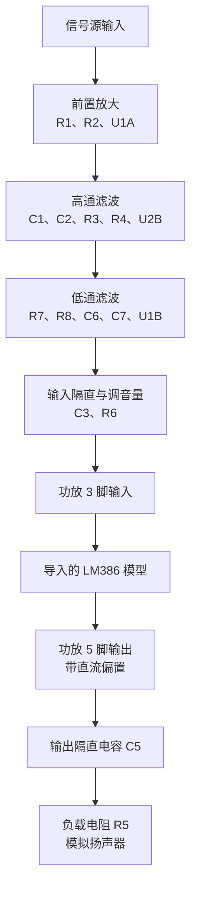

# 项目 B：每一级到底放大了多少

**前三个运放级和输出电容，实测都与计算基本吻合；功放模型测出的幅度比约为 $180$，仍与标准 LM386 默认的 $20$ 倍不同。**
d
## 整个链路

## 1．各级测量结果

以下都比较**交流峰值**，不把直流偏置算入增益；输入频率为 $1\,\mathrm{kHz}$。

| 环节 | 输入峰值 | 输出峰值 | 实测电压增益 |
|---|---|---|---|
| 前置放大 | $5\,\mathrm{mV}$ | $237.934\,\mathrm{mV}$ | $47.587$ |
| 高通滤波 | $237.934\,\mathrm{mV}$ | $235.915\,\mathrm{mV}$ | $0.9915$ |
| 低通滤波 | $235.915\,\mathrm{mV}$ | $117.902\,\mathrm{mV}$ | $0.4998$ |
| C3 与电位器 | $117.902\,\mathrm{mV}$ | 约 $27.813\,\mathrm{mV}$ | 约 $0.2359$ |
| 功放模型 | 约 $27.813\,\mathrm{mV}$ | 约 $5\,\mathrm{V}$ | 约 $179.8$ |
| C5 与负载 | 约 $5\,\mathrm{V}$ | $2.23\,\mathrm{V}$ | $0.446$ |

前三级有微小直流，可忽略；功放输入没有明显直流；功放 5 脚有约 $6\,\mathrm{V}$ 直流偏置；负载两端没有明显直流。这些是你提供的仿真观察，不是我重新运行的结果。

## 2．前置放大：符合设计的放大倍数

按 R1、R2 计算：

$$
A_1=1+\frac{47\,\mathrm{k\Omega}}{1\,\mathrm{k\Omega}}=48
$$

实测：

$$
A_{1,\mathrm{实测}}=\frac{237.934}{5}=47.5868
$$

**相对理论值低约 $0.86\%$，这一项吻合。**

## 3．高通：在这个频率基本不衰减

按图中的等值元件、单位增益接法，理想幅度响应为：

$$
\lvert H_{\mathrm H}(f)\rvert=\frac{1}{1+(f_{0,\mathrm H}/f)^2}
$$

其中：

$$
f_{0,\mathrm H}=\frac{1}{2\pi RC}
=\frac{1}{2\pi\times10\,\mathrm{k\Omega}\times160\,\mathrm{nF}}
\approx99.47\,\mathrm{Hz}
$$

代入测试频率：

$$
\lvert H_{\mathrm H}(1000)\rvert
=\frac{1}{1+(99.47/1000)^2}
\approx0.9902
$$

实测：

$$
\frac{235.915}{237.934}\approx0.9915
$$

**理论通过约 $99.02\%$，实测通过约 $99.15\%$，吻合。**

## 4．低通：在这个频率幅度约剩一半

同样按原图等值元件和跟随器接法：

$$
f_{0,\mathrm L}=\frac{1}{2\pi\times10\,\mathrm{k\Omega}\times16\,\mathrm{nF}}
\approx994.72\,\mathrm{Hz}
$$

$$
\lvert H_{\mathrm L}(f)\rvert=\frac{1}{1+(f/f_{0,\mathrm L})^2}
$$

代入测试频率：

$$
\lvert H_{\mathrm L}(1000)\rvert
=\frac{1}{1+(1000/994.72)^2}
\approx0.4974
$$

实测：

$$
\frac{117.902}{235.915}\approx0.4998
$$

**理论剩约 $49.74\%$，实测剩约 $49.98\%$，吻合。这直接验证了“低通在这里削弱了一半”。**

## 5．C3 与电位器：通过约四分之一

由测量直接得到：

$$
A_{\mathrm{C3+R6}}=\frac{27.813}{117.902}\approx0.2359
$$

为什么接近四分之一？如果当前滑片位置对应上段 $7.5\,\mathrm{k\Omega}$、下段 $2.5\,\mathrm{k\Omega}$，忽略功放输入负载，电位器比例就是：

$$
A_{\mathrm{R6}}=\frac{2.5}{7.5+2.5}=0.25
$$

C3 与整个电位器构成的高通，其近似截止频率是：

$$
f_c\approx\frac{1}{2\pi\times10\,\mathrm{k\Omega}\times0.1\,\mu\mathrm{F}}
\approx159\,\mathrm{Hz}
$$

在测试频率的近似通过比例：

$$
A_{\mathrm{C3}}\approx\frac{1}{\sqrt{1+(159/1000)^2}}\approx0.9876
$$

合计：

$$
A_{\mathrm{C3+R6,近似}}\approx0.9876\times0.25\approx0.2469
$$

**实测是 $0.2359$，与四分之一附近的衰减相符。**精确值还受功放模型输入阻抗、电位器实际分段影响；不能仅凭标注的滑片百分比就认定精确衰减。

C3 负责隔直流，R6 负责分压调音量。两者会一起影响功放输入幅度。

## 6．功放模型：当前测得约一百八十倍

按你提供的约数：

$$
A_{\mathrm{功放}}\approx\frac{5\,\mathrm{V}}{27.813\,\mathrm{mV}}\approx179.8
$$

若用第二张截图中输出峰值附近的 $4.968\,\mathrm{V}$：

$$
A_{\mathrm{功放}}\approx\frac{4.968}{0.027813}\approx178.6
$$

**所以这次记录为“当前条件下，功放模型交流幅度比约 $179$ 至 $180$”。前面用旧读数得到的 $186$ 不再沿用。**

标准 LM386 在 1、8 脚悬空时典型增益约为 $20$，与这里测出的数不一致。模型还需要检查；也应减小输入，看看这个比例是否保持，才能进一步判断它的线性增益。

你看到的输出约 $6\,\mathrm{V}$ 直流偏置，不参与上述交流增益计算。C5 将它隔开，所以负载电压又围绕零变化。

## 7．输出电容：实测与计算吻合

按 C5 为 $10\,\mu\mathrm{F}$、负载为 $8\,\Omega$：

$$
X_{C5}=\frac{1}{2\pi fC_5}\approx15.92\,\Omega
$$

电容与负载共同分配交流电压，负载上的理论幅度比例是：

$$
A_{\mathrm{输出耦合}}
=\frac{8}{\sqrt{8^2+15.92^2}}
\approx0.4491
$$

因此理论负载峰值：

$$
V_{\mathrm{负载,峰值}}\approx5\times0.4491\approx2.246\,\mathrm{V}
$$

**你测到 $2.23\,\mathrm{V}$，差约 $0.7\%$，吻合。**这也解决了先前负载读成约 $0.792\,\mathrm{V}$ 时的矛盾。

各级出现相位移动也是滤波、耦合电路的正常表现。比较幅度时，要分别找各波形自己的峰值，不能直接拿同一时刻的两个电压相除。

## 最后把整条链路对起来

输入到功放 5 脚：

$$
A_{\mathrm{输入到5脚}}\approx\frac{5\,\mathrm{V}}{5\,\mathrm{mV}}=1000
$$

输入到负载两端：

$$
A_{\mathrm{输入到负载}}\approx\frac{2.23\,\mathrm{V}}{5\,\mathrm{mV}}=446
$$

把各级实测倍数乘起来也一样：

$$
47.5868\times0.9915\times0.4998\times0.2359\times179.8
\approx1000
$$

$$
1000\times0.446=446
$$

这里连乘是对同一组数据的核对，不是另一次独立验证。

**结论：前级放大、滤波、电位器衰减和输出电容衰减基本对上了。现在最明确的待查项，是导入的功放模型为什么在默认接法下表现出约 $180$ 倍的幅度比。单个频率的结果吻合，也不代表整个语音频带已经符合要求。**
